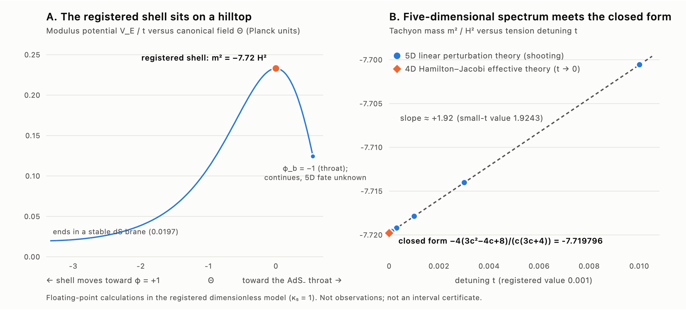
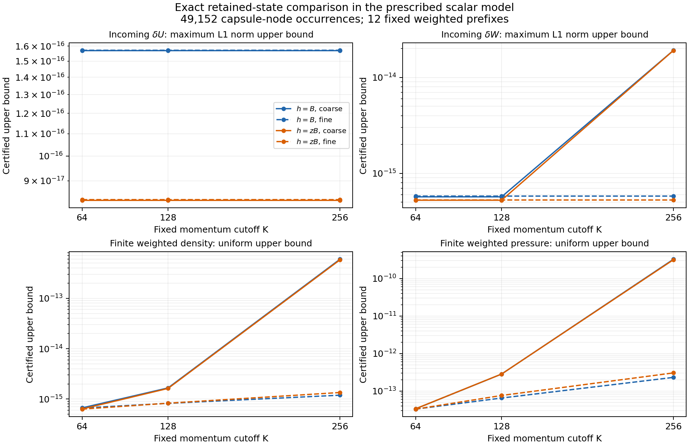
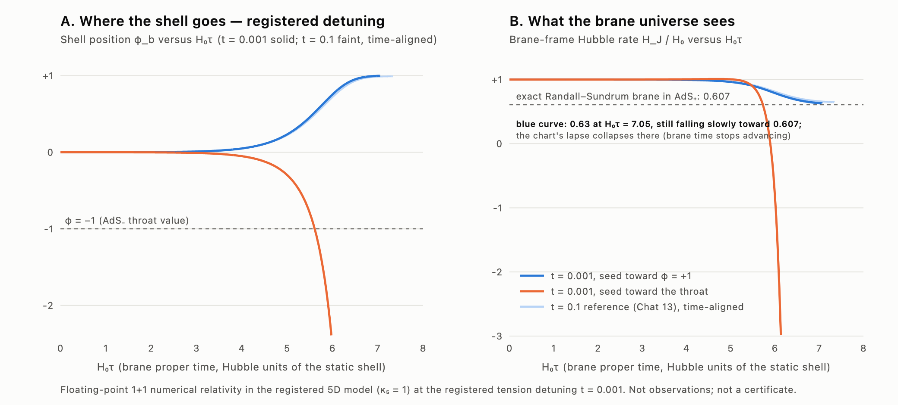

# HDBLAST — Could a higher-dimensional "blast" have sparked our Big Bang?

<!-- numerical-response-inputs-20261016 -->
**15 October 2026 (Pacific): certified numerical inputs for the selected formal second-order response.** Actual first-master/gauge approximation errors are bounded continuously through scaled order three; the exact selected 23-amplitude operator and sharp pointwise constant sqrt(321/19) are verified. Whole-cell initial-profile evaluation tightens the same global response norm upper bound to **1.03e33**, about 990 times below the former rounded bound. These are conservative formal-coefficient bounds, not evaluated waveform amplitudes. The full quadratic metric-source adapter and continuously certified numerical response remain unfinished. No exact nonlinear family, invariant force or higher-dimensional Big Bang origin is established. No new Zenodo version or journal submission accompanies this checkpoint. [Technical working note (PDF)](https://github.com/maldonado-research/HDblast/blob/main/research/HDBLAST_NUMERICAL_RESPONSE_INPUTS_20261016/manuscript/NUMERICAL_INPUTS_NOTE.pdf) · [Derivations, source and replay](https://github.com/maldonado-research/HDblast/tree/main/research/HDBLAST_NUMERICAL_RESPONSE_INPUTS_20261016) · [Verification evidence](https://github.com/maldonado-research/HDblast/tree/main/hdblast/continuation/2026.10.16-numerical-response-inputs).

<!-- common-gauge-forcing-20261016 -->
**16 October 2026: constructive second-order continuation for one aligned quadrupole:** A convergent causal integral series now defines the full formal second metric–scalar coefficient for the selected registered state on the controlled shell-contact domain. Its operator has contraction factor at most 0.002109 on a 287-dimensional angular tensor-section space. The construction joins the complete common-gauge bulk and shell forcing, compatible second initial data, physical shell laws and subsidiary gauge constraints.

Qualitative smoothness is proved separately from the numerical bounds for values and first scaled derivatives. The coarse comparison-norm cap, ‖U₂‖X < 1.02 × 10³⁶, is dominated by the inherited second initial scalar data and carries no physical signal interpretation. No candidate numerical waveform has been evaluated. The result is a conditional second perturbative coefficient, without an exact nonlinear family, a finite-amplitude remainder, an invariant force or a higher-dimensional Big Bang origin. Internal AI-assisted review does not replace external specialist review; no new Zenodo version or journal submission accompanies this checkpoint.

[Research source and exact reports](https://github.com/maldonado-research/HDblast/tree/main/research/HDBLAST_COMMON_GAUGE_FORCING_20261016) · [Second-response construction](https://github.com/maldonado-research/HDblast/blob/main/research/HDBLAST_COMMON_GAUGE_FORCING_20261016/evolution/FULL_SECOND_RESPONSE_CONSTRUCTION.md) · [Bulk forcing proof](https://github.com/maldonado-research/HDblast/blob/main/research/HDBLAST_COMMON_GAUGE_FORCING_20261016/bulk-producer/COMMON_GAUGE_BULK_BOUND_PROOF.md) · [Physical shell forcing](https://github.com/maldonado-research/HDblast/blob/main/research/HDBLAST_COMMON_GAUGE_FORCING_20261016/shell-producer/COMMON_HARMONIC_PHYSICAL_SHELL_FORCING.md) · [Result status and literature context](https://github.com/maldonado-research/HDblast/blob/main/research/HDBLAST_COMMON_GAUGE_FORCING_20261016/RESULT_STATUS.md) · [Source ZIP](https://github.com/maldonado-research/HDblast/raw/refs/heads/main/research/HDBLAST_COMMON_GAUGE_FORCING_20261016.zip) · [Replay and publication evidence](https://github.com/maldonado-research/HDblast/tree/main/hdblast/continuation/2026.10.16-common-gauge-forcing).

<!-- first-gauge-wave-20261016 -->
**16 October 2026: certified first relative-harmonic gauge wave:** A convergent construction gives the first coordinate gauge vector for the retained regular background and quadrupole, with continuous derivatives through order three. An explicit approximation has uniform radial coordinate-amplitude error below 5.47 × 10⁻⁹ on the controlled causal triangle. The shell’s normal Dirichlet and tangential Neumann conditions are retained.

This conditional first-order result leaves the transformed quadratic bulk and shell sources and the second-order Einstein–scalar evolution unfinished. No invariant force or higher-dimensional Big Bang origin is established. Internal AI-assisted review does not replace external specialist review. No new Zenodo version or journal submission accompanies this checkpoint.

[Research source and exact reports](https://github.com/maldonado-research/HDblast/tree/main/research/HDBLAST_FIRST_GAUGE_WAVE_20261016) · [Construction and error proof](https://github.com/maldonado-research/HDblast/blob/main/research/HDBLAST_FIRST_GAUGE_WAVE_20261016/solver/GAUGE_WAVE_SOLUTION_AND_DEFECT.md) · [Derivative bounds](https://github.com/maldonado-research/HDblast/blob/main/research/HDBLAST_FIRST_GAUGE_WAVE_20261016/higher-norms/README.md) · [Source ZIP](https://github.com/maldonado-research/HDblast/raw/refs/heads/main/research/HDBLAST_FIRST_GAUGE_WAVE_20261016.zip) · [Replay and publication evidence](https://github.com/maldonado-research/HDblast/tree/main/hdblast/continuation/2026.10.16-first-gauge-wave).

<!-- second-initial-norms-gauge-20261015 -->
**15 October 2026: second initial norms and initial harmonic gauge:** Exact rational calculations give coarse certified upper bounds for all four physical second initial fields and their first spatial covariant derivatives. The initial constraint-source cancellations remain exact. Explicit local initial relative-harmonic lapse and shift velocities retain the quadratic terms. These conditional bounds do not demonstrate a response, establish a physical force, solve the full second-order evolution or construct an exact finite-amplitude family. Common boundary/gauge completion and validated coupled evolution remain open; earlier frozen checkpoints are preserved.

[Research source and exact reports](https://github.com/maldonado-research/HDblast/tree/main/research/HDBLAST_SECOND_INITIAL_NORMS_GAUGE_20261015) · [Second initial norms](https://github.com/maldonado-research/HDblast/blob/main/research/HDBLAST_SECOND_INITIAL_NORMS_GAUGE_20261015/producer/QUANTITATIVE_SECOND_INITIAL_JET.md) · [Initial harmonic completion](https://github.com/maldonado-research/HDblast/blob/main/research/HDBLAST_SECOND_INITIAL_NORMS_GAUGE_20261015/gauge/EXPLICIT_INITIAL_HARMONIC_COMPLETION.md) · [Spacetime initial one-jet](https://github.com/maldonado-research/HDblast/blob/main/research/HDBLAST_SECOND_INITIAL_NORMS_GAUGE_20261015/frame/INITIAL_SPACETIME_ONE_JET.md).

<!-- explicit-second-initial-jet-20261015 -->
**15 October 2026: explicit compact second initial constraint jet:** Local formulas now cancel all five second differentiated initial constraints for the registered aligned packet, using nonzero second scalar and normal scalar-velocity data. The correction stays in the original packet annulus. A certified Hamiltonian source below -1e19 at the packet maximum excludes zero second initial data. The physical-Cauchy/spacetime lapse conversion is explicit.

[Derivation and reproducible checks](https://github.com/maldonado-research/HDblast/tree/main/research/HDBLAST_EXPLICIT_SECOND_INITIAL_JET_20261015). This conditional initial jet does not supply an exact finite-amplitude family or U2 evolution. Initial norm bounds, common gauge/boundary completion and validated evolution remain open; no cosmological origin is established.

<!-- interior-master-jets-20261015 -->
**15 October 2026: certified interior derivatives and bulk forcing bounds:** Every mixed first-master derivative through order three is now bounded on the registered causal triangle. The actual potential satisfies |W_zz| < 3e10. Reconstructing the first longitudinal fields gives coarse continuous bounds for all fifteen Einstein quadratic-source components and the complete scalar source. These are conditional coordinate-source envelopes in model units; quantitative U2 and the compatible common-gauge second-order solve remain unfinished.

[Derivations, exact reports and replay source](https://github.com/maldonado-research/HDblast/tree/main/research/HDBLAST_INTERIOR_MASTER_JETS_20261015). Internal AI-assisted review does not establish external peer review, novelty or a cosmological origin.

<!-- coordinate-shell-sources-20261015 -->
**15 October 2026: continuous coordinate shell sources:** The certified quadrupole now gives enclosures over 4353 continuous time cells for the actual metric trace at the shell, its proper-time derivative, and the complete one-copy coordinate scalar and isotropic Israel coefficients Sp and SK, with scalar degrees 0, 2 and 4. The metric correction has L2 norm less than 9e-13 of the one-copy material scalar source, yet changes the coordinate source signs at a scalar zero. Each of Sp and SK consequently has at least two distinct zeros inside the certified central bracket.

These results are conditional on the retained analytic inputs and the stated first longitudinal representative and derivative Taylor convention. The reduced Robin forcing norm is evaluated only for degree 4; the degree-2 Robin row is algebraic only. The norms use the background proper shell measure, and coefficient signs depend on the representative. The earlier conditional construction of the complete second coefficient retains its stated scope. No effective nonlinear amplitude or remainder, observational scale or cosmological origin is established. Independent internal checks do not replace external peer review. Full U2 remains quantitatively unresolved.

[Derivation and bounds](https://github.com/maldonado-research/HDblast/blob/main/research/HDBLAST_COORDINATE_SHELL_SOURCES_20261015/COORDINATE_SHELL_SOURCES.md) · [Source and replay guide](https://github.com/maldonado-research/HDblast/blob/main/research/HDBLAST_COORDINATE_SHELL_SOURCES_20261015/README.md). See the separate publication evidence for replay, CI and live-readback status. [Publication evidence](https://github.com/maldonado-research/HDblast/blob/main/hdblast/continuation/2026.10.15-coordinate-shell-sources/PUBLICATION_RECEIPT.json).

<!-- quadratic-shell-forcing-20261015 -->
**15 October 2026: quadratic material tension forcing:** For the previously certified wider quadrupole (delta = 1/1000, ell = 10^-6 in model coordinates), the explicit material scalar-junction tension contribution is Q_phi = -4 psi_1^2 in the outward-normal SUM convention. It has scalar degrees 0, 2 and 4. Exact continuous enclosures give -2.3 × 10^-19 < ell^2 mean(Q_phi) < -6.7 × 10^-20 throughout 2 ≤ x ≤ 3 and 5.778 × 10^21 < ||Q_phi||_L2(dmu_0)^2 < 8.644 × 10^21 over 0 ≤ x ≤ 3, using the background proper-time measure and model units. The angular mean stays negative throughout the tail; the field vanishes on Y = 0.

This isolates the explicit material tension contribution; the complete quadratic source for bulk-coordinate unknowns and full U2 are not numerically evaluated. The earlier conditional construction of the complete second coefficient is preserved under its stated data and evolution assumptions. No effective finite amplitude, nonlinear remainder, observational scale or cosmological origin is established. Independent internal exact checks are distinct from external peer review and formal PDE verification. Earlier dated entries retain their scope. No new Zenodo version or APS submission was made.

[Material tension theorem, normalization and assumptions](https://github.com/maldonado-research/HDblast/blob/main/research/HDBLAST_QUADRATIC_SHELL_FORCING_20261015/QUADRATIC_MATERIAL_TENSION_FORCING.md) · [Reproducible calculations and independent internal checks](https://github.com/maldonado-research/HDblast/blob/main/research/HDBLAST_QUADRATIC_SHELL_FORCING_20261015/README.md). Publication checks remain pending until documented in the separate final additive evidence receipt. [Final additive publication evidence](https://github.com/maldonado-research/HDblast/blob/main/hdblast/continuation/2026.10.15-quadratic-shell-forcing/PUBLICATION_RECEIPT.json).

<!-- inertial-shell-waveform-20261015 -->
**Conditional inertial shell waveform:** For a newly specified wider aligned quadrupole (delta = 1/1000, ell = 10^-6 in model coordinates, T = 3ell and Z = 8ell), exact interval bounds resolve the shell response at first variation. The normalized trace H(x) = ell D(ell x) satisfies 3.2 × 10^-8 < H < 5.3 × 10^-8 throughout 2 ≤ x ≤ 3. The negative physical gain G makes the corresponding scaled physical first variation ell S negative there. At least one zero lies in each of (1.49998, 1.49999) and (1.96, 1.97); uniqueness is not asserted. The leading proper-time response coefficient satisfies 6.06 × 10^11 < C < 7.44 × 10^11 in R_epsilon = epsilon^2 C + o(epsilon^2), in the stated model normalization.

The actual-background, exact-data, gauge, regularity and whole nonlinear correction-support hypotheses remain explicit. This first-variation result does not close the full second-order nonlinear waveform or provide an effective epsilon or nonlinear remainder bound. No observational scale or higher-dimensional Big Bang origin is established. Internal AI-assisted review and finite checks are distinct from external peer review and formal PDE verification. Earlier entries retain their dated scope. No new Zenodo version or APS submission was made.

[Waveform theorem, normalization and assumptions](https://github.com/maldonado-research/HDblast/blob/main/research/HDBLAST_INERTIAL_SHELL_WAVEFORM_20261015/INERTIAL_SHELL_WAVEFORM.md) · [Reproducible calculations and independent reviews](https://github.com/maldonado-research/HDblast/blob/main/research/HDBLAST_INERTIAL_SHELL_WAVEFORM_20261015/README.md). Publication checks remain pending until documented in the separate final additive evidence receipt. [Final additive publication evidence](https://github.com/maldonado-research/HDblast/blob/main/hdblast/continuation/2026.10.15-inertial-shell-waveform/PUBLICATION_RECEIPT.json).

<!-- uniform-first-variation-waveform-20261015 -->
**Conditional first-variation shell waveform:** For the same specified narrow aligned quadrupole (delta = 1/1000, ell = 10^-10 in model coordinates), a continuous 4098-cell enclosure resolves the physical scalar’s linear first variation. The normalized trace H differs from its explicit comparator by less than 1.0000004 × 10^-7 on 0 ≤ x ≤ 3; the negative physical gain reverses its sign. The leading proper-time response coefficient now satisfies 6.06 × 10^15 < C < 7.44 × 10^15 in R_epsilon = epsilon^2 C + o(epsilon^2).

The retained background, exact-data, gauge, regularity and nonlinear support hypotheses remain explicit. The post-pulse estimate |H| < 4.752 × 10^-14 on 2 ≤ x ≤ 3 is a small-tail bound. No finite-amplitude nonlinear waveform, observed time scale or higher-dimensional Big Bang origin is established. Next: a wider state with a validated background and an effective nonlinear remainder estimate. Internal AI-assisted review and finite checks are distinct from external peer review. Earlier entries retain their original scope. No new Zenodo version or APS submission was made.

[Waveform theorem, normalization and assumptions](https://github.com/maldonado-research/HDblast/blob/main/research/HDBLAST_UNIFORM_FIRST_VARIATION_WAVEFORM_20261015/UNIFORM_FIRST_VARIATION_WAVEFORM.md) · [Reproducible calculations and independent reviews](https://github.com/maldonado-research/HDblast/blob/main/research/HDBLAST_UNIFORM_FIRST_VARIATION_WAVEFORM_20261015/README.md) · [Continuous-cell enclosure data](https://github.com/maldonado-research/HDblast/blob/main/research/HDBLAST_UNIFORM_FIRST_VARIATION_WAVEFORM_20261015/computed/WAVEFORM_ENCLOSURE.json).

<!-- shell-response-error-certificate-20261015 -->
**Conditional quantitative shell-response bound:** For the retained regular branch at delta = 1/1000 and one newly specified narrow aligned quadrupole (ell = 10^-10 in model coordinates), a free-wave comparison and exact-rational bounds give 10^15 < C < 4 × 10^17 for the leading proper-time response coefficient in R_epsilon = epsilon^2 C + o(epsilon^2). The estimate controls the physical derivative at the shell, with its positive boundary inertia.

This is a coarse conditional analytic enclosure in the stated model normalization. It gives no numerical waveform, effective nonlinear amplitude range, observational scale or evidence for a higher-dimensional Big Bang origin. The background, exact-data, gauge, regularity and full nonlinear support hypotheses remain explicit. Internal AI-assisted reviews and finite arithmetic checks are distinct from external peer review. Earlier entries retain their checkpoint scope. No new Zenodo version or APS submission was made.

[Quantitative theorem, normalization and assumptions](https://github.com/maldonado-research/HDblast/blob/main/research/HDBLAST_SHELL_RESPONSE_ERROR_CERTIFICATE_20261015/SHELL_RESPONSE_ERROR_CERTIFICATE.md) · [Reproducible arithmetic and independent reviews](https://github.com/maldonado-research/HDblast/blob/main/research/HDBLAST_SHELL_RESPONSE_ERROR_CERTIFICATE_20261015/README.md).

<!-- physical-shell-response-20261015 -->
**Conditional nonzero physical shell response:** For one explicitly specified aligned quadrupole with nonzero displacement and velocity, the full coupled Einstein–scalar shell equations now imply a nonzero physical first scalar response. In the retained conditional exact nonlinear family, a squared scalar-response measure over a finite intrinsic proper-time window has a strictly positive leading quadratic coefficient.

The result retains the stated background, exact-data, support, regularity and finite-region hypotheses. It is qualitative: no numerical waveform, response magnitude, effective amplitude threshold or exact nonlinear first-arrival time is supplied. Internal AI-assisted review and finite reproducible checks are distinct; external peer review, global stability and a higher-dimensional origin of the Big Bang are not established. Earlier dated entries retain their original scope. No new Zenodo version or APS submission was made.

[Physical response theorem and assumptions](https://github.com/maldonado-research/HDblast/blob/main/research/HDBLAST_PHYSICAL_SHELL_RESPONSE_20261015/PHYSICAL_SHELL_RESPONSE.md) · [Derivations and reproducible checks](https://github.com/maldonado-research/HDblast/blob/main/research/HDBLAST_PHYSICAL_SHELL_RESPONSE_20261015/README.md).

<!-- quasilinear-shell-evolution-20261015 -->
**Exact nonlinear shell evolution at fixed finite regularity:** Under the stated background, support and exact-data hypotheses, the selected aligned quadrupole has a small exact Einstein–scalar family on both copies of the controlled positive-cone region for a prescribed finite shell-interaction interval. The construction satisfies the physical shell laws and constraints, with H^14/H^13 evolution and C² parameter dependence in a lower norm.

This is internally reviewed conditional mathematics. The actual first-arrival time and a nonzero gauge-invariant shell response remain to be calculated. No global stability, observational agreement or higher-dimensional origin of the Big Bang is established. The analytic proofs and finite algebra checks are documented separately; no new Zenodo version or APS submission accompanies this checkpoint. Earlier dated entries retain their original scope.

[Theorem, proof and assumptions](https://github.com/maldonado-research/HDblast/blob/main/research/HDBLAST_QUASILINEAR_SHELL_EVOLUTION_20261015/EXACT_FINITE_REGULARITY_SHELL_EVOLUTION.md) · [Reproducible checks and scope](https://github.com/maldonado-research/HDblast/blob/main/research/HDBLAST_QUASILINEAR_SHELL_EVOLUTION_20261015/README.md).

<!-- angular-uniform-contact-20261015 -->
**All-angular linear shell-contact estimate — 14 October 2026 (Pacific):** On the registered Einstein–scalar background and a fixed controlled positive-cone collar, the full sixteen-field linear system now has a positive auxiliary Sobolev control estimate independent of angular frequency and of the full tensorial SO(4) cutoff. A bounded change of field variables removes the complete nonsymmetric twelve-row Robin matrix without changing the common wave principal part. Smooth compatible data and forcing give a unique smooth linear solution; the same method controls subsidiary constraint propagation.

Smooth boundary forcing is handled by an explicit lift with its declared regularity cost. No estimate for arbitrary L² Neumann forcing is claimed. The positive norm is analytic control, not physical gravitational energy or a stability result. A separate exact local change of nonlinear boundary variables converts all twelve physical and normal-gauge laws to homogeneous Neumann conditions while preserving the common quasilinear wave principal symbol. This is an algebraic reduction; an exact nonlinear perturbation family through shell contact remains open. The previously established exact initial-data family at fixed high finite Sobolev regularity and the earlier complete second-order coefficient are preserved.

[Estimate, assumptions and reproducible checks](https://github.com/maldonado-research/HDblast/blob/main/research/HDBLAST_ANGULAR_UNIFORM_CONTACT_20261015/README.md) · [Linear proof](https://github.com/maldonado-research/HDblast/blob/main/research/HDBLAST_ANGULAR_UNIFORM_CONTACT_20261015/ANGULAR_UNIFORM_LINEAR_CONTACT.md) · [Exact nonlinear boundary reduction](https://github.com/maldonado-research/HDblast/blob/main/research/HDBLAST_ANGULAR_UNIFORM_CONTACT_20261015/NONLINEAR_BOUNDARY_STRAIGHTENING.md). Primary-literature comparisons do not transfer other models' theorems automatically. Internal AI-assisted review is not external peer review; external novelty and a higher-dimensional Big Bang origin remain unestablished. This is a GitHub-only checkpoint, with no new Zenodo version or APS submission. Artifact identifiers use 15 October UTC; this work began 14 October Pacific time. Earlier dated entries retain their original scope.

<!-- full-second-order-contact-20261014 -->
**Complete second-order coefficient through shell contact — 14 October 2026:** For the specified copy-even commuting quadrupole packet, the unchanged first-order scalar reconstruction cannot satisfy the quadratic degree-four angular equation. The continuation therefore keeps all metric and scalar fields, with their complete quadratic bulk sources and physical shell boundary conditions.

Under the stated background, localization and initial-data hypotheses, a boundary-preserving relative harmonic gauge and a convergent characteristic construction give a smooth complete second Taylor coefficient through first shell contact on a controlled positive-cone collar. It includes scalar degrees zero, two and four and tensor degree two. The construction satisfies all Einstein–scalar equations, induced-field matching and Israel/scalar shell laws through second order, with propagation of the sourced constraints.

[Construction, assumptions and reproducible checks](https://github.com/maldonado-research/HDblast/blob/main/research/HDBLAST_FULL_SECOND_ORDER_CONTACT_20261014/README.md) · [Complete coefficient proof](https://github.com/maldonado-research/HDblast/blob/main/research/HDBLAST_FULL_SECOND_ORDER_CONTACT_20261014/FULL_FINITE_ANGULAR_SECOND_ORDER_CONTACT.md). This is a conditional coefficient construction. An exact nonlinear family through contact, estimates uniform over all angular modes, nonlinear stability and a higher-dimensional Big Bang origin remain unestablished. Internal AI-assisted proof review is not external peer review, and external novelty is not established. This is a GitHub-only checkpoint, with no new Zenodo version or APS submission. Earlier dated entries, including earlier entries from 14 October, retain their original scope.

<!-- quadratic-tensor-contact-20261014 -->
**Quadratic tensor forcing and a tensor sector through shell contact — 14 October 2026:** For the specified quadrupole Y = n₁² − n₂² in the fixed longitudinal first-order gauge, the complete gravity-plus-scalar quadratic source has a nonzero transverse traceless angular component wherever either scalar amplitude is nonzero: its coefficient is 16u² + 8v²/3. Thus the two contributions cannot cancel there. A velocity-only packet can have zero source on its initial slice and develop it later.

For even first-order master data, the corresponding forced second-order tensor sector has homogeneous Neumann shell data and a conditional evolution through first contact on a controlled collar. The full coupled scalar and tensor second-order boundary problem and a nonlinear solution through contact remain open.

[Derivation, assumptions and reproducible checks](https://github.com/maldonado-research/HDblast/blob/main/research/HDBLAST_QUADRATIC_TENSOR_CONTACT_20261014/README.md). These statements use the specified background, first-order gauge and parity. They establish no Big Bang origin or external novelty; internal proof review is not external peer review. This is a GitHub-only checkpoint, with no new Zenodo version or APS submission. Earlier dated entries retain their original scope.

<!-- exact-localized-precontact-20261014 -->
**Exact localized initial data and short precontact evolution — 14 October 2026:** Under the stated background assumptions and weighted nonlinear estimates, the reflection-invariant quadrupole sector admits a family of exact nonlinear initial data at a chosen high finite Sobolev regularity. A sufficiently short precontact Cauchy evolution preserves a collar of background fields next to the shell, where its junction conditions remain unchanged. The nonlinear boundary problem through shell contact remains open.

This is a conditional result at high finite regularity, with no spatial smoothness to all orders, Big Bang conclusion or external novelty established. Internal AI-assisted proof review is not external peer review. [Proof, assumptions and limits](https://github.com/maldonado-research/HDblast/blob/main/research/HDBLAST_EXACT_LOCALIZED_PRECONTACT_20261014/README.md). This is a GitHub-only checkpoint, with no new Zenodo version or APS submission. Earlier dated entries retain their original scope.

<!-- reflection-formal-initial-data-20261014 -->
**Formal continuation by reflection symmetry — 14 October 2026:** For the restricted commuting quadrupoles of the localized checkpoint, simultaneous diagonalization makes the first-order data invariant under coordinate reflections. The reflections force all ten local symmetry compatibility pairings to vanish at every finite constraint order. Under the stated localization hypotheses, recursive constraint solving and reflection-group averaging construct localized **formal initial data to all orders**. Convergence, an exact nonlinear solution and full evolution through shell contact are not established. [Derivation, assumptions and limits](https://github.com/maldonado-research/HDblast/blob/main/research/HDBLAST_SECOND_ORDER_LOCALIZED_20261014/continuation/REFLECTION_FORMAL_INITIAL_DATA.md).

<!-- second-order-localized-20261014 -->
**Localized second-order initial data — 14 October 2026:** Under the stated background and localization assumptions, the ten symmetry tests are necessary and sufficient for compactly supported second-order initial-data corrections for smooth fixed-reflection-parity packets in an annulus away from the shell and cone vertex. An explicit correction is given for `A = B = diag(1,−1,0,0)`. It vanishes near the shell, satisfying the initial second-order junction conditions with zero shell displacement and tilt.

An areal-radius-weighted monopole identity fixes a spherical metric moment for first-order packets in reconstruction gauge. The moment changes under first-order gauge transformations; its velocity-packet sign is not yet a physical mass or energy statement. Full second-order evolution through shell contact, quadratic interface sources, convergence of the higher-order formal series and nonlinear existence remain open. A higher-dimensional Big Bang origin remains unestablished.

[Technical note](https://github.com/maldonado-research/HDblast/blob/main/research/HDBLAST_SECOND_ORDER_LOCALIZED_20261014/manuscript/SECOND_ORDER_LOCALIZED.md) · [Calculations and supporting material](https://github.com/maldonado-research/HDblast/tree/main/research/HDBLAST_SECOND_ORDER_LOCALIZED_20261014) · [Results and limits](https://github.com/maldonado-research/HDblast/blob/main/research/HDBLAST_SECOND_ORDER_LOCALIZED_20261014/RESULTS.md). This is a GitHub-only checkpoint; [Zenodo 23335485](https://doi.org/10.5281/zenodo.23335485) remains the latest archived spectral edition. No new Zenodo version or APS submission accompanies it. Earlier dated entries retain their original scope.

<!-- shell-noether-20261013 -->
**Shell symmetry obstruction — 13 October 2026:** On the fixed regular Einstein–scalar two-interior shell, the completed nonlinear Noether identity retains both gravitational boundary terms, moving embeddings and the single common shell action. An independent ADM constraint calculation verifies a nonzero second-order obstruction for an explicit compact rotating quadrupole: it cannot be the tangent to a parameter-C² exact classical family satisfying full shell matching. The example can be chosen among smooth non-gauge linear solutions that reach the shell.

Within degree-two data with one fixed radial profile and reflection parity, all ten necessary Lorentz symmetry tests vanish exactly when the displacement and velocity matrices commute, **[A,B]=0**. Passing these tests does not establish second-order solvability or nonlinear existence. The result establishes no nonlinear growth, stability, Big Bang origin or APS readiness. Normal and optimized portable replay each check **81 positive algebra checks and 21 wrong-formula controls**, counted separately.

[Technical note](https://github.com/maldonado-research/HDblast/blob/main/research/HDBLAST_SHELL_NOETHER_20261013/manuscript/SHELL_NOETHER.pdf) · [Proofs and portable replay](https://github.com/maldonado-research/HDblast/tree/main/research/HDBLAST_SHELL_NOETHER_20261013) · [Results and limits](https://github.com/maldonado-research/HDblast/blob/main/research/HDBLAST_SHELL_NOETHER_20261013/RESULTS.md). This is a GitHub-only research checkpoint. [Zenodo 23335485](https://doi.org/10.5281/zenodo.23335485) remains the latest archived spectral edition; no new Zenodo edition or APS submission accompanies this continuation.

<!-- regular-shell-contact-20261013 -->
**Conditional evolution through shell contact — 13 October 2026:** On the fixed regular Einstein–scalar background, an explicit characteristic construction gives a smooth family from compact radial data in a sufficiently thin annulus, with a fixed finite set of angular harmonics of degree at least two. The family includes paired solutions that activate the shell after first arrival on a controlled finite slab. Both reflection parities satisfy the complete induced-field, Israel and scalar junctions without harmonic division. Nonzero states are not pure gauge. An explicit pair with the same reflection parity has a nonzero **total physical symplectic pairing**, conserved after contact with the odd moving-shell cut term included. The pairing is weakly nondegenerate on this smooth thin-annulus data image.

This is a conditional linearized result for a new collar-supported family. It does not continue the preceding near-cone nonzero-flux pair to shell contact, prove a nonzero local shell flux or physical energy, or establish unrestricted angular completion, nonlinear stability, cosmological evidence, external originality or APS readiness. Normal and optimized portable replay each check **84 positive exact identities and 14 wrong-formula controls**, counted separately.

[Technical note](https://github.com/maldonado-research/HDblast/blob/main/research/HDBLAST_REGULAR_SHELL_CONTACT_20261013/manuscript/SHELL_CONTACT.pdf) · [Proofs and portable replay](https://github.com/maldonado-research/HDblast/tree/main/research/HDBLAST_REGULAR_SHELL_CONTACT_20261013) · [Results and limits](https://github.com/maldonado-research/HDblast/blob/main/research/HDBLAST_REGULAR_SHELL_CONTACT_20261013/RESULTS.md). This is a GitHub-only research checkpoint. [Zenodo 23335485](https://doi.org/10.5281/zenodo.23335485) remains the latest archived spectral edition; no new Zenodo edition or APS submission accompanies this continuation.

<!-- Earlier cone-evolution result; its after-contact limitation concerns the original near-cone flux states. -->

<!-- regular-cone-evolution-20261013 -->
**Earlier local coupled cone evolution — 13 October 2026:** A regular ambient master equation now reconstructs smooth solutions of all linearized Einstein–scalar equations across the cone. Compact initial data give two non-gauge solutions with exactly nonzero local symplectic flux. Either common reflection parity satisfies the doubled-shell junctions while the causal support remains away from the shell. The physical Cauchy symplectic form is nondegenerate on the image of smooth compact master data supported in a sufficiently small spatial ball.

This earlier checkpoint closes a local existence gap in the conditional cone-flux calculation. Evolution to shell contact of those original near-cone flux states remains unestablished; the new collar family above has a separate after-contact proof. The full completed physical state space, nonlinear stability and a higher-dimensional Big Bang origin remain unestablished. Symplectic flux is an antisymmetric bilinear, not a positive energy or reheating calculation. The bounded literature comparison does not establish external originality or APS readiness.

[Technical note](https://github.com/maldonado-research/HDblast/blob/main/research/HDBLAST_REGULAR_CONE_EVOLUTION_20261013/manuscript/REGULAR_CONE_EVOLUTION.pdf) · [Proofs and reproducible code](https://github.com/maldonado-research/HDblast/tree/main/research/HDBLAST_REGULAR_CONE_EVOLUTION_20261013) · [Results and limits](https://github.com/maldonado-research/HDblast/blob/main/research/HDBLAST_REGULAR_CONE_EVOLUTION_20261013/RESULTS.md). This is a GitHub technical continuation; [Zenodo 23335485](https://doi.org/10.5281/zenodo.23335485) remains the preceding archived spectral edition. No new APS submission was made.

<!-- Earlier checkpoints remain preserved below. -->

<!-- cone-phase-space-20261013 -->
**Cone current and physical-domain audit — 13 October 2026:** The Einstein–scalar action now supplies an explicit symplectic current, including unequal spectral values and the doubled-shell balance. Under stated asymptotic hypotheses for actual solutions, its null-cone limit is a scalar symplectic flux. Exact flat test-field examples show that fixed-time radial closure does not imply zero characteristic flux, and that radial and inertial energy completions can differ. The physical state space of the registered gravitational model remains open.

The known tensor horizon diagnostic is recovered with explicit smoothness and energy-completion qualifications; it does not remove the massless radial profile. The earlier operator positivity theorem remains intact. Global radiative-solution existence, gauge coverage and finite-null charges are unresolved. A higher-dimensional Big Bang origin remains **NOT_ESTABLISHED**.

[Technical note](https://github.com/maldonado-research/HDblast/blob/main/research/HDBLAST_CONE_PHASE_SPACE_20261013/manuscript/COVARIANT_FLUX_AND_PHYSICAL_DOMAINS.pdf) · [Portable calculations](https://github.com/maldonado-research/HDblast/tree/main/research/HDBLAST_CONE_PHASE_SPACE_20261013) · [Claim ledger](https://github.com/maldonado-research/HDblast/blob/main/research/HDBLAST_CONE_PHASE_SPACE_20261013/RESULTS.md). This is a GitHub research continuation; [Zenodo 23335485](https://doi.org/10.5281/zenodo.23335485) remains the preceding archived spectral edition. No new APS submission was made.

<!-- End cone update; earlier dated checkpoints are preserved below. -->

<!-- regular-shell-spectra-20261013 -->
**New conditional spectral result — 13 October 2026:** At every fixed 0 < delta ≤ 0.002, the entire scalar spectrum in both reflection parities is separated strictly from zero in the specified self-adjoint, finite-energy regular-cone realization. The proof gives a positive bound as a function of the background; it does not assign a numerical value or a uniform bound as delta approaches zero. An action calculation, including the moving-shell boundary terms, verifies the local kinetic coefficients of generic even and odd scalar modes. Exceptional harmonics are treated separately. The tensor sector has one even massless radial profile, and every nonzero tensor mass obeys m_T ≥ 3H_b/2.

This concerns the regular branch near phi = +1 of the same fixed action. The original hilltop shell remains a distinct unstable solution; no evolution connecting the two is proved. Global physical-state coverage, admissible diffeomorphisms and cone symplectic flux retain the declared assumptions. No nonlinear stability, reheating mechanism or higher-dimensional Big Bang origin is established. Normal and optimized portable Python replay each pass 103 exact checks and 30 wrong-formula controls, counted separately. [Proof, assumptions and portable replay](https://github.com/maldonado-research/HDblast/tree/401efdfaaef657bcbdaec588b21b82789daddd0e/research/HDBLAST_REGULAR_SHELL_SPECTRA_20261013) · [Claim ledger and gap functional](https://github.com/maldonado-research/HDblast/blob/401efdfaaef657bcbdaec588b21b82789daddd0e/research/HDBLAST_REGULAR_SHELL_SPECTRA_20261013/RESULTS.md).

**Verified publication — 13 October 2026:** [Zenodo 23335485](https://doi.org/10.5281/zenodo.23335485), version **2026.10.13-regular-shell-spectra**, contains **35 files / 454,964,066 bytes**. It preserves all 33 files from 23294979 and adds the new scientific capsule and overview. Complete public readback verified every filename, size and MD5/SHA256 checksum. [Publication proof and complete inventory](https://github.com/maldonado-research/HDblast/blob/main/hdblast/publication/2026.10.13-regular-shell-spectra/README.md).

<!-- End 13 October spectral update; earlier dated results follow. -->

**New mathematical result — 11 October 2026:** an exact regular-center response identity proves strict shell-matching monotonicity, R_T ≤ −H² < 0, along the local scalar-junction branch under the stated hypotheses. Sharper error bounds extend the registered exact-decimal model's certified interval to **every 0 < delta ≤ 0.002**, from the earlier 1.09155 × 10⁻⁷ guarantee. The interval now includes all three detunings used in the earlier numerical sweep. The scalar remainder constant is **K_eta < 3.196** and the curvature remainder constant is **K_H < 0.254**. Curvature is strictly below that of the separate complete boundary theory with scalar-independent detuning, with **H² − H_constant² < −0.000423 delta²**. These are conditional mathematical results for the specified local branch, not a dynamical-stability or cosmological-origin result. [Proof, exact certificates and reproducible calculations](https://github.com/maldonado-research/HDblast/tree/main/research/HDBLAST_SCALAR_RESPONSE_MONOTONICITY_20261011) · [Bounded primary-literature update](https://github.com/maldonado-research/HDblast/blob/main/research/HDBLAST_SCALAR_RESPONSE_MONOTONICITY_20261011/literature/LITERATURE_UPDATE_20261011.md) · [Verified Zenodo edition 23294979](https://doi.org/10.5281/zenodo.23294979). The [8 October checkpoint](https://github.com/maldonado-research/HDblast/tree/main/research/HDBLAST_SCALAR_BOUNDARY_CURVATURE_20261008) remains preserved.

**Verified publication — 11 October 2026:** [Zenodo 23294979](https://doi.org/10.5281/zenodo.23294979), version **2026.10.11-scalar-response-monotonicity**, contains **33 files / 454,129,865 bytes** in the preserved [concept DOI family 17088132](https://doi.org/10.5281/zenodo.17088132). It retains all 31 files from edition 23244754 and adds the scalar-response scientific capsule and overview. Saved metadata and every file's name, size, MD5 and SHA256 were checked before publication and by complete anonymous public readback afterward. [Publication proof and full inventory](https://github.com/maldonado-research/HDblast/blob/main/hdblast/publication/2026.10.11-scalar-response-monotonicity/README.md).

**Completed research — 8 October 2026 UTC:** normal and optimized runs completed **98,304 retained-endpoint comparisons** at eta = -4 and -3.5, from the exact represented saved incoming state at eta = -4.5. Their nine scientific files are byte-identical, independently checked. Across all endpoints the Cartesian L1 saved-minus-exact-flow discrepancy bounds are **U < 2.520 × 10⁻¹⁶** and **W < 3.158 × 10⁻¹⁵**. This encloses the saved endpoint evolution discrepancy; it does not recover the unsaved dense path. Separate stable flat half-space response/noise and incident-packet results passed conditional analytic review: an exact four-dimensional continuum replica prevents dimensional identification, and the static linear incident model gives transient storage followed by reflection, without permanent capture or thermalization under its stated packet assumptions. Full continuous pressure/contact/time/momentum/UV certification remains **UNRESOLVED**, metric calibration **FAIL**, higher-dimensional Big Bang cause **NOT_ESTABLISHED**, and external novelty **NOT_ASSESSED**. Fresh normal/optimized portable replay and numerical/bulk-model CI passed; final-document-head CI and live site deployment are recorded separately in the final delivery receipt. The preserved 8 October Zenodo edition is **[23244754](https://doi.org/10.5281/zenodo.23244754) / concept 17088132 / 31 files / 453,646,943 bytes**. [Publication proof](https://github.com/maldonado-research/HDblast/blob/main/hdblast/publication/2026.10.08-retained-endpoint-flow/README.md) · [Replay and CI evidence](https://github.com/maldonado-research/HDblast/blob/main/hdblast/continuation/2026.10.08-retained-endpoint-flow/README.md). [Current status](hdblast/CURRENT_STATUS.md).

[Readable project overview](https://maldonado-research.github.io/projects/hdblast/) · [All research projects](https://maldonado-research.github.io/)

**Previous research and publication status (7 October 2026, Pacific):** [Start here](hdblast/CURRENT_STATUS.md). The [retained-state comparison](research/HDBLAST_CHECKPOINT_20261007_STORED_STATE_COMPARISON/RESULTS.md) encloses the original incoming-state error at **all 49,152 capsule-node occurrences** in four authenticated archives. Exact decoding of their saved binary80 values is compared with a certified target at every node. For normalized W = w/epsilon, the largest Cartesian L1 error bound is below **1.914 × 10⁻¹⁴** on the coarse grid and **5.776 × 10⁻¹⁶** on the fine grid. The original incoming-state error is now **ENCLOSED at the saved nodes**; exact continuous-time transport applies to the **twelve fixed finite-weight sums**, conditional on identical subsequent forcing and full contacts. Eight scientific artifacts reproduce byte for byte in normal and optimized Python, and a separate serialized-output audit independently verifies all node summaries. This does not certify the later saved numerical trajectories or continuous momentum integral. The full twelve-case certificate remains **UNRESOLVED**, metric calibration **FAIL**, a higher-dimensional Big Bang origin **NOT_ESTABLISHED**, and external novelty **NOT_ASSESSED**. The verified same-family edition [23228395](https://zenodo.org/records/23228395), DOI **10.5281/zenodo.23228395**, preserves all 27 files from 23225288 and adds a compact scientific supplement and a revised original overview: The scientific supplement contains all registered checkpoint code, exact proofs, compact outputs, independent reviews and original figures. The [complete replay package](https://github.com/maldonado-research/HDblast/tree/13a30ef46f5c90c1b01ae83b609db65fd0f8a709/research/HDBLAST_STORED_STATE_COMPARISON_PACKAGE_20261007) and [full node-level checkpoint evidence](https://github.com/maldonado-research/HDblast/tree/13a30ef46f5c90c1b01ae83b609db65fd0f8a709/research/HDBLAST_CHECKPOINT_20261007_STORED_STATE_COMPARISON) remain pinned to immutable GitHub commit `13a30ef46f5c90c1b01ae83b609db65fd0f8a709`, including the original replay inputs and both large node-level payloads. **29 files / 451,598,148 bytes**. [Publication proof](hdblast/publication/2026.10.07-stored-state-comparison/README.md).

**Ricardo Maldonado · independent researcher · research program 2025–2026**

**Website:** <https://maldonado-research.github.io/HDblast/> ·
**Zenodo (all versions):** [10.5281/zenodo.17088132](https://doi.org/10.5281/zenodo.17088132) ·
**Static-branch companion:** [Zenodo 23111008](https://zenodo.org/records/23111008), preserving the original two-file study from [22922928](https://zenodo.org/records/22922928),
separate concept [10.5281/zenodo.22922927](https://doi.org/10.5281/zenodo.22922927).
[Preserved earlier main edition 23114217](https://zenodo.org/records/23114217), semantic version **2026.10.03-verified-source-operator**, verified on 7 October 2026, Pacific. The complete 23-file inventory and attachment bytes were checked; the [publication proof](hdblast/publication/2026.10.07-verified-publication/README.md) distinguishes reviewed Notes serialization from the preserved original literal failure. This is archival verification, with no physical rerun or external peer review.

> HDBLAST asks whether a violent gravitational event in a fifth dimension, the "blast", could have
> transferred energy into our four-dimensional universe and started the hot Big Bang.

This is a **speculative, testable research hypothesis. It is not a discovery.** It has not
proven that extra dimensions exist or what caused the Big Bang, and no observation supports it
yet. It has not been peer reviewed. What the program does have is a dated public record:
explicit equations, reproducible code, certified and numerical calculations, negative results,
and published corrections. Every result below carries a label saying exactly how well it is
established.

---

## The idea in one picture

Our universe may behave like a thin **shell (a "brane")** inside a larger five-dimensional
space. Gravity and a field called a *scalar* fill that larger space. If the shell sits in an
unstable balance, like a ball on a hilltop, it can roll off, and that motion releases energy.
HDBLAST asks whether such a higher-dimensional event could have produced the hot, dense early
universe that the standard Big Bang model starts from. The hypothesis would **extend** the
standard Big Bang story, not replace it.

*Left: the registered shell sits on top of a potential "hill", so it is unstable. Right: the
instability rate from full five-dimensional theory agrees with a closed-form four-dimensional
formula. Floating-point calculations in the model; not observations.*

**Previous result (7 October 2026, Pacific): every retained incoming-state node compared with a certified target.** The [comparison checkpoint](research/HDBLAST_CHECKPOINT_20261007_STORED_STATE_COMPARISON/RESULTS.md) authenticates all four compact archives and their 76 members before decoding 20 selected arrays. It compares exactly decoded binary80 states with complete target enclosures at all **49,152 capsule-node occurrences**, without projecting or replacing the stored states. The normalized responses are U = u/epsilon and W = w/epsilon. Their Cartesian L1 discrepancy uses |Re error| + |Im error|. The maximum U upper bound is below **1.571 × 10⁻¹⁶**; the W upper bound is below **1.914 × 10⁻¹⁴** on the coarse grid and **5.776 × 10⁻¹⁶** on the fine grid. The coarse W peaks occur near k = 256; this observed grid difference does not by itself prove continuum convergence or explain its cause.

Exact error transport gives density, pressure, work and pressure-time-integral bounds throughout the declared later time interval for **twelve fixed finite-weight prefixes**, provided later forcing and full contacts are identical. Physical forcing remains active. These are scaled first-order model responses, with density and pressure in a0⁴/epsilon units. No later retained numerical trajectory, full momentum integral, contact defect or ultraviolet tail is certified. The full twelve-case certificate remains **UNRESOLVED** and the inherited **2 × 10⁻⁸** gate is unchanged. [Independent readback](research/HDBLAST_CHECKPOINT_20261007_STORED_STATE_COMPARISON/evidence/independent-actual/ACTUAL_OUTPUT_INDEPENDENT_REVIEW.md) verifies all 49,152 serialized nodes and the twelve summaries without importing the numerical producer or evaluating a new physical source.

*Upper bounds under the prescribed scalar-response model, not observations. U and W are normalized by the represented epsilon; density and pressure are a0⁴/epsilon scaled first-order finite sums. The figure uses binary64 display coordinates; exact rational values are in the checkpoint table.*

A [bounded literature refresh](research/HDBLAST_CHECKPOINT_20261007_STORED_STATE_COMPARISON/literature/LITERATURE_REFRESH_AND_MODEL_TEST.md) records 22 searches and selected primary passages from eight papers. It motivates action-derived correlated predictions and an explicit rival-model comparison; it supplies no new observational confirmation. The [conditional identifiability argument](research/HDBLAST_CHECKPOINT_20261007_STORED_STATE_COMPARISON/physical-identifiability/STRUCTURAL_IDENTIFIABILITY.md) shows that common effective inputs can give identical observable laws under dimensional and four-dimensional descriptions. It is not a universal exclusion of extra dimensions. The physical origin remains **NOT_ESTABLISHED** and external novelty **NOT_ASSESSED**.

**Previous checkpoint (7 October 2026, Pacific): prescribed BD prehistory target enclosures.** The [BD prehistory checkpoint](research/HDBLAST_CHECKPOINT_20261007_BD_PREHISTORY/RESULTS.md) encloses the prescribed exact continuum Bunch–Davies target at eta = −4.5 for two smooth sources and nine fixed rational momenta. Both independent routes pass the **10⁻²⁰** exported L1 radius gate for all **36 complex rectangles**, and all **36 pairs / 72 real and imaginary components** intersect. The largest radii are below **1.555 × 10⁻²¹** and **3.138 × 10⁻²³**, respectively. At that checkpoint the stored binary80 state error was **NOT_ENCLOSED**; the new saved-node comparison above encloses that component. The full twelve-case certificate remains **UNRESOLVED**, metric calibration **FAIL**, and a higher-dimensional Big Bang origin **NOT_ESTABLISHED**. A separate exact postprocessor bounds the source representation and choice of real polynomial coefficients continuously over **0 < k ≤ 256** and **eta ∈ [−4.5,−3.5]**. Across both sources, the scaled density contribution is below **4.094 × 10⁻²¹** and the scaled pressure contribution below **1.625 × 10⁻¹⁸**. These bounds cover the source/cap and coefficient-choice component. They exclude continuous numerical phase and ODE arithmetic, original stored-state error, full contacts, quadrature and the ultraviolet tail; they do not establish a continuous full-arithmetic mode or momentum-integral certificate.

**Previous result (7 October 2026, Pacific): conditional incoming-state transfer and stress bounds.** The direct density and pressure operators give exact homogeneous-state transfer for identical forcing and unchanged full contacts, with phase retained. First-order normalization leaves the state amplitude unbounded. With normalization drift independently controlled, a proved amplitude bound gives conditional finite-band density/pressure error bounds. The direct operators also give an exact signed pressure time primitive; this work supplies no actual incoming-state enclosure or full numerical certificate. The ultraviolet tail, full twelve-case certificate and physical cosmological mechanism remain unresolved; metric calibration remains **FAIL**. [Result, proof and limits](research/HDBLAST_CHECKPOINT_20261007_INCOMING_STATE/RESULTS.md).

**Previous result (5 October 2026 UTC): exact finite-band stress kernels and error bounds.** The source Taylor-truncation contribution throughout the declared time interval and continuous momentum band k ∈ [0,256] is below **5.5 × 10⁻²⁸** in scaled density and **2.2 × 10⁻²⁵** in scaled pressure, conditional on the inherited analytic premises. These are bounds for one error component. Exact state/residual/contact identities retain the other terms, and a smooth normalized state change can evade all nine probes while changing integrated stress. Three exact implementations pass 41, 55 and 42 checks with mutation controls and a clean six-run archive replay. The full numerical certificate remains **UNRESOLVED**; no physical breakthrough or external novelty is established. [Result, proof and limits](research/HDBLAST_CHECKPOINT_20261005_FINITE_BAND_WARD/RESULTS.md) · [Standalone reproduction](research/HDBLAST_FINITE_BAND_WARD_PACKAGE_20261005/RESULTS_READ_FIRST.md).

**Previous result (3 October 2026, Pacific): conditional source-operator certificate.** Two independently implemented enclosure methods pass all 1,170 moment rows and 130 source-primitive rows per route for two declared smooth sources, 64 panels and nine exact rational momenta. The largest conservative whole-interval enclosure radius across both implementations is below **1.373 × 10⁻²⁸**, within the fixed **10⁻²⁶** limit. The analytic model bounds cover real momentum k ∈ [0,256]; computed complete enclosure widths are certified at the nine probes. The full twelve-case action-derived pressure/contact conservation certificate remains **unresolved**, and earlier metric calibration stays **FAIL**. A higher-dimensional cause of the Big Bang is **NOT_ESTABLISHED**; external mathematical novelty is **NOT_ASSESSED**. [Research manuscript, result and limits](research/HDBLAST_CHECKPOINT_20261003_VERIFIED_SOURCE_OPERATOR/RESULTS.md) · [Standalone archive replay](research/HDBLAST_VERIFIED_SOURCE_OPERATOR_PACKAGE_20261003/RESULTS_READ_FIRST.md). A fresh standalone archive replay reproduces both numerical payloads and scientific frames exactly.

[Fresh archive reproduction evidence](research/HDBLAST_VERIFIED_SOURCE_OPERATOR_PACKAGE_20261003/FRESH_REPRODUCTION.json).

**Previous active-source diagnostic (2 October Pacific; checkpoint dated 3 October UTC):** Two independent implementations diagnose ledger-sampling error during the active-source interval. All twelve consistency cases pass; eight meet the fixed attribution threshold. A full standalone archive replay reproduces every registered scientific value exactly. Earlier metric calibration remains **FAIL**; continuum accuracy, the inherited quantum state, coupled evolution and the higher-dimensional hypothesis remain unresolved. [Measured result and limits](research/HDBLAST_ACTIVE_SOURCE_LEDGER_PACKAGE_20261002/FINAL_RESULT.md), [independent review](research/HDBLAST_ACTIVE_SOURCE_LEDGER_PACKAGE_20261002/advisory_review/completed_original_001/INTERPRETATION.md), and [fresh reproduction evidence](research/HDBLAST_ACTIVE_SOURCE_LEDGER_PACKAGE_20261002/FRESH_REPRODUCTION.json).

**Previous source-free diagnostic (2 October):** Two independent implementations identify a time-integration error after source support. All twelve consistency cases pass, and eight cross the fixed error-attribution threshold. [Preserved result and evidence](research/HDBLAST_CHECKPOINT_20261002_SOURCE_FREE_LEDGER/reports/RESULTS.md).

## Where the research stands (7 October 2026, Pacific)

| Result | Status |
|---|---|
| Original saved-node incoming-state error: 49,152 capsule-node occurrences, two sources and coarse/fine grids | **ENCLOSED at saved nodes**, with exact continuous-time transport for twelve fixed finite-weight sums under identical later forcing/contacts; full continuous momentum certificate unresolved |
| Prescribed analytic BD prehistory target: two sources × nine fixed momenta, 36 complex rectangles per route; both independent exported-radius gates pass and all pairs intersect | **Certified target enclosures**, conditional on the frozen analytic and arithmetic premises; the later all-node comparison encloses the saved incoming-state component |
| Continuous source/cap and real coefficient-choice representation contribution on 0 < k ≤ 256 and eta ∈ [−4.5,−3.5] | **Certified component bounds**; continuous phase/ODE arithmetic and full momentum integrals remain outside this certificate |
| A specific five-dimensional model is fixed in advance ("registered"): Einstein gravity plus a scalar field, with W(φ)=1−φ+φ³/3 and shell tension σ=2W+δ(1+cφ), δ=0.001 | Definition |
| Within the model, the registered shell solution exists (computer-assisted proof with local uniqueness; a statement about the equations, not about nature) | **Certified**, conditional on its listed premises |
| The shell has an unstable (tachyonic) scalar mode, m² ≈ −7.7179 H², growth e^{1.657 Hτ}; numerically it is the only one. No unstable mode exists in the tensor, vector or special-harmonic sectors (mode stability, not full linear stability). | **Certified**, conditional (the scalar mode exists) / **Numerical** (uniqueness) / **Exact** (other sectors) |
| A closed-form 4D effective theory reproduces the 5D instability to about 10⁻⁶ | **Exact + numerical** |
| Full nonlinear 5D evolution: the shell rolls off toward one of **two fates**, relaxation toward an empty de Sitter brane (endpoint not yet reached in the simulations) or reversal and collapse | **Numerical** |
| Neither fate produces a radiation-filled (hot Big Bang) universe **in the homogeneous, classical roll-off of this model with no added matter** | **Negative result** |
| The earlier late-time endpoint (constant φ=1) fails a boundary condition; a corrected static solution was found | **Exact** (the failure) / **Numerical** (the new solution) |
| A proposed extension adds a new matter field to the shell, with an exact energy-exchange law; later checkpoints test particle production under stated approximations | **Exact**, as a proposal |
| An earlier (July 2026) gravitational-radiation claim was **withdrawn** after an audit | **Published correction** |
| A pulsar-timing "knee" signature was proposed and screened against public data | **Screening only**; not derived from the 5D model; the strict registered test failed on pilot data |
| **New (27 Sept):** the corrected end state (the "+1 branch") is linearly stable in the sectors tested; two independent methods agree, each first calibrated on the known instability | **Numerical**, independently audited (not a proof) |
| **New (27 Sept):** exact small-parameter series for the end state through eighth order, confirmed to 30–40 digits | **Exact**, independently re-derived |
| **New (27 Sept):** particle production and six other heating routes screened; none gives a radiation era in the registered model. The obstacle is leftover vacuum energy (about 0.6 of the ~22 e-folds needed) | **Negative**, under stated assumptions |
| **New (27 Sept):** an added tension term cancels the leftover vacuum, but "dark radiation" from the fifth dimension stays above observational limits so far | **Inconclusive** (requires a model change) |
| **New (28 Sept):** with the tension tuned to cancel the leftover vacuum (model change) and a stand-in (friction) energy-transfer formula, a radiation-dominated phase appears; "dark radiation" is 7.3% of the radiation at transfer rate Y = 1, within the conservative limit. A 1% change in the tuning removes it | **Numerical**, conditional, fine-tuned ([verdict](research/HDBLAST_CHECKPOINT_20260928/A1_tuned_vacuum/A1_VERDICT.md)) |
| **New (30 Sept):** at Y = 2 the dark radiation falls to 2.1%, within the strict current limit (3%). The phase lasts under half an expansion e-fold before leftover negative vacuum energy recollapses the shell, needs the tuning to about 1 part in 10⁴, and still uses the stand-in formula | **Numerical**, model-internal, conditional |
| **New (30 Sept):** replacing the stand-in with particle production derived from the matter extension: with particle masses below the 5D gravity scale, dark radiation stays far larger than the radiation; no steady state in 32 runs | **Inconclusive**, leaning negative |
| **New (30 Sept):** the same test at the registered δ = 0.001 is not completed; the numerical breakdown is diagnosed but not fixed. A simple 4D model does not reproduce the 5D dark-radiation numbers | **Inconclusive** / **Negative** (4D shortcut) |
| **New (1 Oct):** a single-cohort energy envelope includes radiation and undecayed particles. The two locally screened archived crossing cases remain far below the radiation target at the tested endpoint, even with optimistically timed decay. This uses a fixed history and a cutoff screen, not a complete quantum calculation | **Analytical bound + exploratory numerical application**, conditional |
| **New (1 Oct):** an executed audit of saved trajectories finds an earlier radiation-dominated sampled interval of about **0.314 e-fold** in the finer Y=2 run under a new cancellation-resistant diagnostic. Its later plateau fails this diagnostic. The original registered verdict is unchanged | **Post hoc saved-data diagnostic**; stand-in source, sampled duration |
| **New (1 Oct):** the particle-mode solver passes 90 exact pulse occupation checks, including reflectionless cases, and 30 fine-resolution Wronskian checks | **Registered numerical control**; not a coupled 5D matter result |
| **New (1 Oct, quantum modes):** actual scalar modes on the archived source-free tuned shell give a particle count 0.0503% below the earlier corrected estimate for the declared finite-band state. Coherence adds 10.96% to the particle-only scalar current and reverses the relative pressure's sign. Ten registered variants and independent RK4 checks pass | **Numerical**, prescribed background and relative stress; not a radiation era |
| **New (1 Oct, quantum matching):** the proposed scalar loop requires additional quartic-potential and intrinsic-curvature terms in the shell action | **Analytical EFT requirement**; curved-shell matching coefficients and absolute source unresolved |
| **New (1 Oct Pacific / 2 Oct UTC, curved-source readiness):** all eight reconstruction controls pass after a preserved numerical repair; the archived interpolation and initial state have distinct ultraviolet obstructions. Smooth fits show initial-boundary derivative sensitivity. Exact-rational subtraction checks and 18 independent toy evolutions pass | **Readiness audit**; absolute curved source remains unestablished |
| **New (2 Oct):** a flat-background quantum source through a smooth mass-zero crossing passes eight registered variants, exact scattering, energy/work and independent pressure-trace checks. Potential and curvature matching are fixed at a stated reference | **Numerical benchmark**, prescribed Minkowski background; not coupled shell evolution |
| **New (2 Oct):** omitting curvature matching makes pressure drift with the regulator even though energy conservation passes. A direct physical-mode representation has the expected cutoff convergence and an exact finite-cutoff trace identity | **Analytical and numerical checks**; finite-PV sources retain several-percent regulator effects |
| **New (1 Oct Pacific / 2 Oct UTC, smooth curved source):** the original flat control passes and original curved pressure cutoff fails; a separately registered K384 follow-up passes all 13 groups, with a 0.2291% pressure cutoff change. Stress and paired source use one finite action | **Finite-cutoff numerical benchmark**, prescribed smooth FRW geometry; not coupled shell evolution |
| **New (2 Oct, coupled-source prerequisites):** action-derived energy, pressure and scalar-current junctions pass separate exact checks. A stationary de Sitter bridge gives a conditional small-source expansion and identifies an unresolved tiny archived response | **Algebra and archived-data reanalysis**; at that checkpoint, de Sitter quantum expectations and coupled evolution were uncomputed |
| **New (2 Oct, massive de Sitter sources):** four registered common-reference quantum-vacuum cases pass 57 checks and a separate proper-time calculation; direct mode subtraction independently checks pressure at one curved point. Nineteen classical integrations resolve the previously roundoff-limited stationary response, including its positive sign | **Exact algebra + numerical**, internal independent implementations; no coupled evolution or heating |
| **New (2 Oct, stationary quantum closure):** both quantum sources now enter a regular stationary bulk-and-shell solve. Forty-eight registered roots pass 1,584 corrected checks and independent endpoint/source comparisons. Resolved nonlinear feedback occurs only at a coupling that fails the declared gravity hierarchy screen | **Numerical stationary closure**, declared model; no established physical EFT, stability or heating |
| **New (2 Oct, causal response):** independent forced modes agree with the matched memory formula at 36 finite-cutoff comparisons. Both registered pulses retain negative variance response after the source vanishes; 17 wrong-formula controls are detected | **Numerical fixed-geometry calibration**; stress response, coupled evolution, stability and heating remain untested |
| **New (2 Oct, matched stress):** independently calculated density and pressure pass all 180 registered core comparisons, trace/contact/current checks, raw-mode reconstruction and a separate energy ledger. Higher-derivative stress tail bounds are included | **Numerical linear response**, fixed geometry; no coupled evolution, stability or heating |
| **New (2 Oct, metric response):** three separate registrations preserve continuum roundoff, memory-budget and conservation failures. The memory-only repair completes all four mode evolutions within 256 MiB; 59 Ward checks fail under unchanged thresholds | **Scientific FAIL**, complete saved data; full metric prerequisite remains blocked |
| **New (3 Oct, source-operator prerequisite):** uniform analytic source and phase bounds, independently computed moment/source-primitive enclosures at nine registered momenta; whole-interval hull radius below 1.373 × 10⁻²⁸ | **Conditional certificate**, narrower than full stress/conservation certification; no physical heating result |
| **New (5 Oct, finite-band error theorem):** exact retarded density/pressure kernels, conditional continuous-band source-truncation bounds, complete residual/contact budget and a normalized hidden-state counterexample | **Exact conditional mathematics**, one error component; full numerical certificate unresolved |

*Full five-dimensional numerical relativity at the registered parameters. The shell heads
toward an empty de Sitter brane (blue) or reverses and collapses (orange). Neither branch
contains a hot radiation era.*

The registered homogeneous model has not produced a hot Big Bang. Tuned variants with a stand-in transfer formula meet the earlier radiation-fraction criterion briefly and then recollapse. The first 1 October checkpoint bounds the energy budget and diagnoses a sampled 0.314-e-fold interval. The new quantum-mode calculation tests the proposed matter field on the source-free tuned geometry: its integrated count agrees closely with the corrected crossing estimate, but coherent stress/current matter and the endpoint excitations are not radiation. The 2 October checkpoint now provides an absolute source in a fixed matching convention for a flat-space pulse, including the curvature contribution to pressure. The curved-source readiness audit now quantifies interpolation and initial-state obstructions and finds high-derivative sensitivity at the initial boundary. Its numerical controls pass, but an unchanged extension of the archived finite-band surrogate is not justified. A separately registered smooth FRW follow-up now passes its cutoff, pressure, trace and paired-source controls in a declared finite-action convention; the original curved cutoff failure remains preserved. Smooth initial data for the actual shell, physical matching data, coupled evolution, decay and thermalization remain unresolved.

Earlier metric calibration: [registered memory-only metric followup](research/HDBLAST_CHECKPOINT_20261002_METRIC_RESPONSE_MEMORY_FOLLOWUP/00_READ_FIRST.md), [complete failure evidence](research/HDBLAST_CHECKPOINT_20261002_METRIC_RESPONSE_MEMORY_FOLLOWUP/outputs/NUMERICAL_RESULTS.md), and [standalone expected-failure reproduction](research/HDBLAST_CHECKPOINT_20261002_METRIC_RESPONSE_MEMORY_FOLLOWUP/REPRODUCE.md). All 12 primary observations and four independent evolutions completed. Peak memory is 103,400 KiB; conservation endpoints/refinement fail 59 unchanged checks. Passing the reproduction control preserves scientific FAIL. The completed source-free and active-source diagnostics attribute a sampled-ledger discrepancy; the new source-operator prerequisite supplies conditional enclosures, while the full twelve-case pressure/contact conservation certificate and its inherited 2 × 10⁻⁸ gate remain unresolved before another unchanged metric calibration. Actual-root, lapse, bulk/state response, stability and heating remain unresolved.

Previous: [registered matched minimal stress response](research/HDBLAST_CHECKPOINT_20261002_MATCHED_STRESS/00_READ_FIRST.md), [actual numerical evidence](research/HDBLAST_CHECKPOINT_20261002_MATCHED_STRESS/outputs/NUMERICAL_RESULTS.md), and [self-contained reproduction](research/HDBLAST_CHECKPOINT_20261002_MATCHED_STRESS/REPRODUCE.md). Independent direct density and pressure pass 180 core comparisons, finite-cutoff trace and separate energy-ledger checks with explicit stress tail bounds. After-pulse relative density is negative; pressure need not keep one sign. This is coherent first-order polarization on fixed geometry. Positive canonical excitation energy, metric response, coupled evolution, stability and heating remain open.

Previous: [registered fixed-geometry causal response](research/HDBLAST_CHECKPOINT_20261002_CAUSAL_RESPONSE/00_READ_FIRST.md), [independent scientific review](research/HDBLAST_CHECKPOINT_20261002_CAUSAL_RESPONSE/review/INDEPENDENT_SCIENTIFIC_REVIEW.md), and [self-contained fresh reproduction](research/HDBLAST_CHECKPOINT_20261002_CAUSAL_RESPONSE/REPRODUCE.md). Independent forced modes pass 36 finite-cutoff comparisons and 17 controls; both tested pulses retain negative scalar-variance memory after the source vanishes. The [matched stress proposal](research/HDBLAST_CHECKPOINT_20261002_CAUSAL_RESPONSE/theory/PROSPECTIVE_MATCHED_STRESS_RESPONSE.md) is analytic follow-up, with no new stress experiment. That variance-only checkpoint preceded the separately registered stress test below.

Previous: [stationary quantum shell closure and its limits](research/HDBLAST_CHECKPOINT_20261002_STATIONARY_QUANTUM/00_READ_FIRST.md), [independent internal review](research/HDBLAST_CHECKPOINT_20261002_STATIONARY_QUANTUM/independent/INDEPENDENT_STATIONARY_REVIEW.md), and [fresh reproduction](research/HDBLAST_CHECKPOINT_20261002_STATIONARY_QUANTUM/REPRODUCE.md). The only tested positive coupling that passes the sampled gravity hierarchy screen gives a tiny curvature correction. A [derived causal-response protocol](research/HDBLAST_CHECKPOINT_20261002_STATIONARY_QUANTUM/theory/PROSPECTIVE_CAUSAL_RESPONSE_PROTOCOL.md) specified the subsequent causal experiment, now completed in the separate checkpoint below.

Previous: [massive de Sitter sources and resolved stationary sensitivities](research/HDBLAST_CHECKPOINT_20261002_DESITTER/00_READ_FIRST.md), [independent scientific review](research/HDBLAST_CHECKPOINT_20261002_DESITTER/independent/INDEPENDENT_SCIENTIFIC_REVIEW.md), and [fresh reproduction](research/HDBLAST_CHECKPOINT_20261002_DESITTER/REPRODUCE.md). The sources use a declared finite-action convention; physical mass/coupling choices and causal time-dependent backreaction remain open.

Previous: [coupled-source junctions and stationary initialization bridge](research/HDBLAST_CHECKPOINT_20261002_JUNCTIONS/00_READ_FIRST.md), [independent review](research/HDBLAST_CHECKPOINT_20261002_JUNCTIONS/review/INDEPENDENT_ACTION_AND_JUNCTION_REVIEW.md), and [reproduction](research/HDBLAST_CHECKPOINT_20261002_JUNCTIONS/REPRODUCE.md).

Previous: [smooth curved-background source control](research/HDBLAST_CHECKPOINT_20261002_SMOOTH_FRW/00_READ_FIRST.md), [original results](research/HDBLAST_CHECKPOINT_20261002_SMOOTH_FRW/outputs/original_matrix/NUMERICAL_RESULTS.md), [separate passing follow-up](research/HDBLAST_CHECKPOINT_20261002_SMOOTH_FRW/outputs/followup/FOLLOWUP_RESULTS.md), [reproduction](research/HDBLAST_CHECKPOINT_20261002_SMOOTH_FRW/REPRODUCE.md), [eight checked primary papers](research/HDBLAST_CHECKPOINT_20261002_SMOOTH_FRW/LITERATURE_REVIEW.md), and [self-contained scientific ZIP](research/HDBLAST_CHECKPOINT_20261002_SMOOTH_FRW/HDBLAST_CHECKPOINT_20261002_SMOOTH_FRW.zip).

Previous: [curved-source readiness and ultraviolet audit](research/HDBLAST_CHECKPOINT_20261002_FRW/00_READ_FIRST.md), [measured results](research/HDBLAST_CHECKPOINT_20261002_FRW/NUMERICAL_RESULTS.md), [reproduction](research/HDBLAST_CHECKPOINT_20261002_FRW/REPRODUCE.md), and [self-contained scientific ZIP](research/HDBLAST_CHECKPOINT_20261002_FRW/HDBLAST_CHECKPOINT_20261002_FRW.zip).

Previous: [matched quantum source and pressure checks](research/HDBLAST_CHECKPOINT_20261002_PV/00_READ_FIRST.md), [reproduction](research/HDBLAST_CHECKPOINT_20261002_PV/REPRODUCE.md), [scientific ZIP](research/HDBLAST_CHECKPOINT_20261002_PV/HDBLAST_CHECKPOINT_20261002_PV.zip), and [targeted literature review, including 2026 papers](research/HDBLAST_CHECKPOINT_20261002_PV/LITERATURE_20261002.md).

Previous: [quantum modes, results and limitations](research/HDBLAST_CHECKPOINT_20261001_QFT/00_READ_FIRST.md), [reproduction](research/HDBLAST_CHECKPOINT_20261001_QFT/REPRODUCE.md), and [downloadable scientific package](research/HDBLAST_CHECKPOINT_20261001_QFT/HDBLAST_CHECKPOINT_20261001_QFT.zip).

Earlier: [energy bounds and exact pulse controls](research/HDBLAST_CHECKPOINT_20261001/00_READ_FIRST.md), including a [targeted review of five recent primary papers](research/HDBLAST_CHECKPOINT_20261001/LITERATURE_REVIEW_20261001.md). The new checkpoint adds [five foundational sources on stress/current renormalization and states](research/HDBLAST_CHECKPOINT_20261001_QFT/LITERATURE_AND_RENORMALIZATION.md).

## What would count for or against the hypothesis

For the hypothesis to become credible, all of the following must happen, and it may fail at any step:

1. a consistent matter sector in which the blast produces particles, with their gravity fed back into all equations;
2. a sustained radiation-dominated era with realistic temperature and duration;
3. stable, convergent five-dimensional simulations, with energy fully accounted for;
4. a quantitative prediction that competing explanations do not make;
5. independent reproduction, peer review and observational tests.

## Explore the work

| Where | What |
|---|---|
| [`research/HDBLAST_SCALAR_RESPONSE_MONOTONICITY_20261011/`](research/HDBLAST_SCALAR_RESPONSE_MONOTONICITY_20261011/) | Exact local shell-response monotonicity, uniform bounds through delta = 0.002, and bounded primary-literature update |
| [`research/HDBLAST_CHECKPOINT_20261007_STORED_STATE_COMPARISON/`](research/HDBLAST_CHECKPOINT_20261007_STORED_STATE_COMPARISON/RESULTS.md) | All-node retained-state comparison, exact finite-sum transport, original literature review and conditional model-test contract |
| [`research/HDBLAST_CHECKPOINT_20261007_BD_PREHISTORY/`](research/HDBLAST_CHECKPOINT_20261007_BD_PREHISTORY/RESULTS.md) | Prescribed BD prehistory target enclosures, two independent budgets, public-freeze chronology and separate continuous source/real-coefficient bounds. |
| [`hdblast/`](hdblast/) | Start here: the plain-language guide, program map, claims ledger and Zenodo records |
| [`hdblast/checkpoints/`](hdblast/checkpoints/) | Dated research checkpoints (Sept 2026) with reports, code, data and internal AI referee reviews (not external peer review) |
| [`research/HDBLAST_CHECKPOINT_20260927/`](research/HDBLAST_CHECKPOINT_20260927/) | The 27 Sept 2026 checkpoint: stability, exact series, particle production, simulation-error control, new mechanisms and a 2022–2026 literature review, each with an internal audit report. Start with `00_READ_FIRST.md` or `PUBLIC_SUMMARY.md`. Raw simulation arrays (`.npz`) are not included. |
| [`research/HDBLAST_CHECKPOINT_20260928/`](research/HDBLAST_CHECKPOINT_20260928/) | The 28 Sept 2026 tuned-vacuum test (A1): pre-registration, solver, analysis and verdict. |
| [`research/HDBLAST_CHECKPOINT_20260930/`](research/HDBLAST_CHECKPOINT_20260930/) | The 30 Sept 2026 checkpoint: derived particle production, the δ = 0.001 diagnosis, the transfer-rate scan, a 4D cross-check and a fine-tuning measure, each with an independent audit and a final critic pass. Start with `00_READ_FIRST.md`. Raw arrays (`.npz`, `.pkl`) are not included. |
| [`research/HDBLAST_CHECKPOINT_20261001/`](research/HDBLAST_CHECKPOINT_20261001/) | The 1 October checkpoint: cohort bounds, radiation diagnostics, exact mode controls, executable code and internal audits. |
| [`research/HDBLAST_CHECKPOINT_20261001_QFT/`](research/HDBLAST_CHECKPOINT_20261001_QFT/) | Quantum modes on the archived source-free shell, coherent stress/current, EFT matching, raw inputs, figures and independent replay. |
| [`research/HDBLAST_CHECKPOINT_20261002_PV/`](research/HDBLAST_CHECKPOINT_20261002_PV/) | Matched flat-background quantum stress/current, regulator and cutoff tests, exact finite-cutoff trace, figures and reproducible package. |
| [`research/HDBLAST_CHECKPOINT_20261002_FRW/`](research/HDBLAST_CHECKPOINT_20261002_FRW/) | Curved-source readiness, knot/state UV diagnostics, native-spline repair, exact-rational subtraction checks, independent oscillator controls and reproducible package. |
| [`research/HDBLAST_CHECKPOINT_20261002_SMOOTH_FRW/`](research/HDBLAST_CHECKPOINT_20261002_SMOOTH_FRW/) | Common-action smooth FRW stress/source, preserved original failure, separately registered passing K384 follow-up, compact arrays, figures, primary literature and complete replay. |
| [`research/HDBLAST_CHECKPOINT_20261002_STATIONARY_QUANTUM/`](research/HDBLAST_CHECKPOINT_20261002_STATIONARY_QUANTUM/) | Registered paired-source stationary roots, preserved validator failure and repair, independent checks, sampled gravity hierarchy, causal-response proposal and full replay. |
| [`research/HDBLAST_CHECKPOINT_20261002_CAUSAL_RESPONSE/`](research/HDBLAST_CHECKPOINT_20261002_CAUSAL_RESPONSE/) | Registered retarded scalar response, independent forced modes and raw arrays, tail bounds, targeted literature, matched stress proposal and self-contained replay. |
| [`research/HDBLAST_CHECKPOINT_20261002_MATCHED_STRESS/`](research/HDBLAST_CHECKPOINT_20261002_MATCHED_STRESS/) | Registered direct minimal stress/current, independent extended-precision modes, stress tails, separate Ward ledger, raw evidence and self-contained replay. |
| [`research/HDBLAST_CHECKPOINT_20261002_METRIC_RESPONSE_MEMORY_FOLLOWUP/`](research/HDBLAST_CHECKPOINT_20261002_METRIC_RESPONSE_MEMORY_FOLLOWUP/) | Registered memory-only metric followup, complete four-run archives, preserved prior failures and explicit expected-scientific-failure replay. |
| [`research/HDBLAST_CHECKPOINT_20261002_ACTIVE_SOURCE_LEDGER/`](research/HDBLAST_CHECKPOINT_20261002_ACTIVE_SOURCE_LEDGER/) | Original prospective active-source registration and preserved initial execution failure. |
| [`research/HDBLAST_ACTIVE_SOURCE_LEDGER_EXECUTION_REPAIR_20261003/`](research/HDBLAST_ACTIVE_SOURCE_LEDGER_EXECUTION_REPAIR_20261003/) | Disclosed guard-only repair, unchanged scientific methods and complete registered original results. |
| [`research/HDBLAST_ACTIVE_SOURCE_LEDGER_PACKAGE_20261002/`](research/HDBLAST_ACTIVE_SOURCE_LEDGER_PACKAGE_20261002/) | Complete standalone archive, exact fresh physical reproduction, independent attribution/cancellation review and next-study proposal. |
| [`research/HDBLAST_CHECKPOINT_20261003_VERIFIED_SOURCE_OPERATOR/`](research/HDBLAST_CHECKPOINT_20261003_VERIFIED_SOURCE_OPERATOR/) | Frozen source/operator registration, conditional analytic proofs, two independent complete enclosure routes, measured results and standalone replay. |
| [`research/HDBLAST_CHECKPOINT_20261005_FINITE_BAND_WARD/`](research/HDBLAST_CHECKPOINT_20261005_FINITE_BAND_WARD/) | Exact finite-band stress/error kernels, analytic truncation bounds, state counterexample, three proof routes and pinned premises. |
| [`research/HDBLAST_FINITE_BAND_WARD_PACKAGE_20261005/`](research/HDBLAST_FINITE_BAND_WARD_PACKAGE_20261005/) | Sealed standalone mathematical archive and fresh exact replay. |
| [`site/`](site/) | Source of the website |

Most checkpoints can be re-run with Python 3 (`numpy`, `scipy`, `sympy`, `mpmath`). Each
checkpoint has its own `REPRODUCE`/`REPLAY` instructions. The author's raw working archive
(drafts, chats and earlier packages) is kept private; the curated, citable material is here.

## How to cite

Maldonado, R. *HDBLAST: higher-dimensional blast research program.* Zenodo,
[doi:10.5281/zenodo.17088132](https://doi.org/10.5281/zenodo.17088132) (all versions). See
[`CITATION.cff`](CITATION.cff). Each Zenodo record states its own licence.

**License for this repository:** text, figures and data are licensed under
[CC BY 4.0](https://creativecommons.org/licenses/by/4.0/); code is licensed under the MIT License.
Reuse is welcome with credit to Ricardo Maldonado. See [`LICENSE`](LICENSE).

## A note on honesty

This project publishes its failures and corrections alongside its successes. A result is
called established only when a saved script or proof supports it. The reviews inside the
checkpoints are internal and were run with AI assistants; **no external peer review has taken
place yet.** Specialists in general relativity, numerical relativity and cosmology are warmly
invited to check the work and report errors by opening a GitHub issue.

*Research assistance: parts of the 2025–2026 calculations and documents were prepared with AI
assistants under the author's direction: Claude (Anthropic) and OpenAI ChatGPT/Codex. The October checkpoints were prepared with AI
assistance and independent internal computational checks. Verification steps are recorded in each checkpoint.*

## Separate FTL research program

The Einstein Audit for Faster-Than-Light Hidden Sectors continues in the [dedicated FTL repository](https://github.com/maldonado-research/faster-than-light). Start with its [readable project overview](https://maldonado-research.github.io/projects/faster-than-light/) or the repository's [FTL README](https://github.com/maldonado-research/faster-than-light#readme).

The [September 30 documentation edition](research/FTL_EINSTEIN_AUDIT_20260930/) remains here as a historical copy of the September 8 research snapshot, with its equations, assumptions, history, evidence limits, and sources. It is a distinct working-hypothesis/methods program; HDBLAST results do not validate it. No empirical FTL detection or external peer review is documented. Its original [FTL overview](research/FTL_EINSTEIN_AUDIT_20260930/README.md) remains available.
