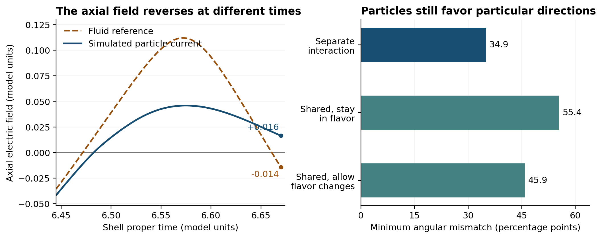

# Which collisions share the energy of a pulse on the shell?

HDblast asks whether a disturbance in five-dimensional space could deposit energy on a three-dimensional shell and help produce a hot early universe. An earlier calculation showed that eight broad collisions per particle, on average, could bring selected streams close to a thermal gas in a fixed box. Here we measure which particles the proposed interaction actually hits, let their electric current change the field accelerating them, and follow the expanding shell through 97.86% of the separate-interaction reference pulse's cumulative absolute work. Times and energies below are in the published model's units. [Earlier collision study](https://zenodo.org/records/24426913) · [Physics sources and normalization](SOURCES.md)

**At time 7.05 the particles have averaged 9.45 collisions, yet one stream population still puts 76.4% of its energy density into pressure along one principal direction.** A directionally uniform ultrarelativistic gas would have about 33.3% along each direction. The most energetic quarter of particles carries 61.0% of the energy and averages only 5.79 collisions. Across the whole population, particles with fewer than eight collisions carry 58.8% of the energy and 66.6% of the axial stress. Four sample and time-step choices give 9.45–9.66 collisions on average and a 29.5–31.2% gap to the fitted thermal particle counts in the inherited 20 bins. The 7.05 result uses 16,384 opposite-charge pairs, 8,192 time steps and the original incoming wave. [Live field and particle histories](live/) · [Particle contact histories](live/COHORTS.json)

## What distinguishes frequent collisions from effective energy sharing?

We took the particles at 7.05, froze the expansion, removed the field and particle source, and gave the gas eight additional encounters per particle on average. With the proposed resonance, the particles initially in the highest-energy tenth averaged **2.49** encounters. With a constant cross section they averaged **7.98**. The two runs use the same initial momenta, relative-flux law and angular scattering law and stop after exactly the same number of accepted collisions. The resulting count gaps from a common thermal gas are **20.49%** and **3.66%**, respectively. The box clocks differ. Repeating the comparison at two earlier starting times and with a second particle sample gives the same ordering. [Matched-count experiment and all twelve runs](freeze/README.md)

## Does the field supply the energy the particles receive?

At time 6.67 the earlier fluid current would have taken 470.80 units of axial work from the simulated field, while particles moving in that imposed field would have received 681.19. When the particles themselves supply all three components of current, the axial work agrees on both sides at **495.14**. Of the initial 613.39 units of axial field energy, 111.62 leave through the wall and 6.63 remain. The tiny additional incident contribution is included in the numerical budget. The second axial field reversal moves from 6.66085 with the prescribed fluid current to 6.72190 on the finest fixed-inflow particle run. Independently returning radiation through the curved five-dimensional region preserves the first two reversals and the large pressure imbalance. The small late electric field shows substantial sample sensitivity, so its final amplitude is unresolved. [Input fields and work](fields/README.md) · [Limit from the speed of light and current history](diagnostic/README.md) · [Finite-region return calculation](return/README.md)



## Could the three particle species together already look hot?

Three perpendicular streams can give similar pressures along all three directions while leaving too many particles traveling close to the original beam axes. In the separate-interaction run at 7.05, the simulated angular counts for all three streams differ by about **10.15 percentage points or more** from any one boosted thermal gas, allowing any temperature and bulk direction and allowing each transverse pulse to rotate around its beam. This is a bound on the measured sample. Counting particles in cones provides information that an average pressure loses. [Angular tests, definitions and sampled distributions](triad/)

A second calculation lets a pair of particles scatter into a different species through a shared resonance. At 7.05, allowing these changes lowers the largest pressure divided by energy density for one species from **0.861** to **0.564**, even though the mean number of encounters falls from 4.88 to 4.30. Summing over all three species gives principal pressures of about 0.325, 0.325 and 0.349. An independent solver lets each species have its own changing population and current. It finds 4.34 encounters per particle and a largest pressure of 0.568–0.571 in the three individual species. Using those independently simulated particles, a fourth-order angular measurement bounds the count discrepancy from every axially symmetric angular distribution at more than 7.23 percentage points on the finest sample. Weighting the directions by particle energy gives a 14.48-point lower bound. [Species-changing interaction](flavor/README.md) · [Independent three-species calculation](independent/)

## Physical scope

The calculation tests redistribution of energy after a specified pulse and a specified source of charged particles. The radius, particle births and outer source history come from the existing benchmark. The returning-wave test uses the recorded bulk geometry. The particles are classical, spatially homogeneous on the shell for each retained mode and undergo the specified binary collisions. These results identify a limitation of one proposed route to a hot gas. Establishing a hot early universe would also require a self-consistent origin for the source population, a wider set of interactions and a prediction that can be tested against observations. A direct follow-up is to calculate whether the highest-energy particles can exchange momentum across species fast enough when the geometry and source respond to the same energy budget.

## Reproduce the calculation

From this study's directory, alongside the polarization and scattering studies in the same research tree, authenticate the inputs and regenerate the results with the following commands. The output location must be new or empty. Numerical subdirectories carry the equations, assumptions and model parameters used in each comparison.

```sh
python -I -B -S study.py
python -I -B study.py --verify --output-dir ../axial-current-results --jobs 2
```

The numerical replay uses Python 3.12, NumPy 2.3.5, SciPy 1.17.0 and a C++17 compiler available as `g++`. To redraw the figure with Matplotlib, run `python -I -B figure.py --snapshots ../axial-current-results/live/snapshots --output axial-response.png`.
