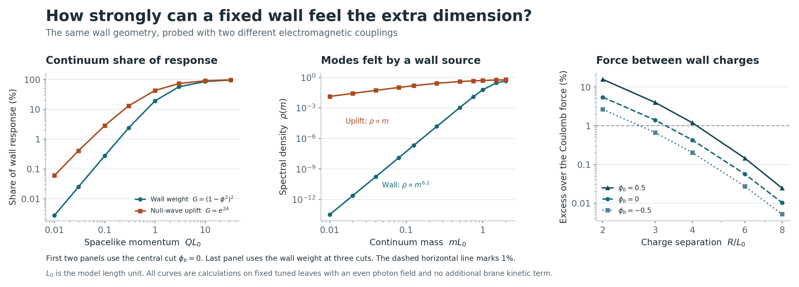

# Can five-dimensional gravity predict how light interacts with the wall?

HDblast asks whether a higher-dimensional event could have given rise to a hot universe like ours. In the previous calculations a changing field could create light, but we had to choose how strongly the two interacted. Here we test a more restrictive idea. Suppose an ordinary traveling light wave and its gravitational field must fit inside the project's five-dimensional geometry while preserving the shape of the extra dimension and the scalar field that supports it. Under these conditions there is just one allowed shape for the electromagnetic coupling along the wall profile, up to its overall strength. We then test what this choice does to light.

The separation condition was already derived in the gauge-localization literature. The project-specific results here are its explicit realization on the tuned HDblast wall, the change in coupling between the project's endpoint geometries, and a quantitative comparison of the electromagnetic response and radiation excited by small wall motion. The two interactions we compare give different, calculable answers even though both allow an ordinary massless photon. [Freitas, Alencar and Landim, section 5.2, Eq. 62](https://arxiv.org/abs/2001.01267) · [Scope and other primary papers](literature.md) · [Previous project edition](https://doi.org/10.5281/zenodo.24383815) · [Initial experiment plan](https://github.com/maldonado-research/HDblast/issues/157#issuecomment-7028753213)

## What gravity fixes

The metric has the form $ds^2=dy^2+e^{2A(y)}\hat g_{\mu\nu}(x)dx^\mu dx^\nu$. The function $A$ describes how lengths along the wall scale with position $y$ in the extra dimension. We add an electromagnetic action with a positive scalar-dependent coefficient $G(\phi)$. For a source-free four-dimensional light wave with nonzero stress, $\hat F^2=0$ and a constant radial photon profile, the tangential Einstein equation requires $G(\phi(y))e^{-2A(y)}$ to be constant. The other bulk equations and the static boundary conditions then admit an explicit local solution. This is a restriction on an added Maxwell sector and on the class of solutions admitted by it. A wave that changes the wall profile, a generic electromagnetic field, or an independent interaction on the wall can evade the selection argument.

For this choice, the four-dimensional photon kinetic normalization $I^2$ is proportional to $\int_b^\infty e^{2A(y)}dy$ with a single fixed five-dimensional normalization for all cuts $b$. Evaluating at the archived launch and first-minimum field values gives $\Delta\log I=+0.23986$ on one branch and $-0.28143$ on the other. The strong example in the previous edition assumed a change of $+3$ in both cases. The selected bulk coupling does not supply that example on these endpoint geometries. Continuing the null solution all the way down the infinite throat is a separate difficulty. The scalar derivative of the chosen weight diverges at its limiting vacuum, and the local wave stress seen in a natural frame can grow without bound there. [Proof, explicit wave, endpoint values and limits](bounds/BOUNDS.md)

## Does any light reach the extra dimension?

We compared this coupling with the project's previous choice $G=(1-\phi^2)^2$. Both allow extra-dimensional waves with arbitrarily small effective mass. The amount that a wall signal can excite depends on how strongly those waves reach the wall.

| Test on the central wall | Previous localized coupling | Coupling selected by the fixed-profile wave |
| --- | ---: | ---: |
| Extra modes' share of a steady current's response at $QL_0=0.1$ | 0.28% | 2.84% |
| Extra modes' share at $QL_0=1$ | 19.07% | 42.72% |
| Relative correction to the charge potential at very large separation $r$ | falls as $r^{-7.2}$ | falls as $r^{-2}$ |
| Energy sent into extra-dimensional modes by a very slow small wall excursion, at fixed incident wavelength | falls as $T^{-3.6}$ | falls as $T^{-1}$ |

Here $Q$ is spatial wave number, $L_0$ is the model wall width, and $T$ is the duration of a Gaussian wall displacement. The first two rows measure the response to a steady spatial current. The last row concerns a pre-existing light wave incident on a moving reflecting wall. Wall motion supplies energy as well. These two experiments have distinct energy accounting. The scale $L_0$ and coupling to ordinary charges would need independent physical calibration to compare these numbers with laboratory measurements.

- For a **static current** the response was evaluated directly on the half-line and checked against independent variational bounds. A spectral calculation with outgoing waves reproduces the response of the earlier weight after its massless pole is removed. For the selected weight there is a logarithm in the low-momentum correction, with a coefficient fixed by the project geometry. [Spacelike response](euclidean/EUCLIDEAN.md) · [Outgoing spectrum and dispersion checks](retarded/RETARDED.md)
- For **charges confined to the wall**, the earlier coupling gives a force 5.45% stronger than its four-dimensional long-distance law at a central-wall separation of two wall widths. It reaches the 1% level at 3.27 wall widths. The other two cuts give 4.15 and 2.69 wall widths. [Potential, force and numerical checks](forces/FORCES.md)
- For a **prescribed moving wall**, the two slow-pulse powers in the table imply a measurable difference within the model. Doubling the duration of a sufficiently slow excursion at fixed displacement and incoming wave number reduces the excited continuum energy by a factor of about 12 for the earlier coupling and by a factor of two for the selected one. A derived relation also connects the slow-pulse energy to the static charge potential, canceling the unknown amplitude of the low-mass spectrum. An independent finite-box calculation checks the outgoing-wave answer. [Moving-wall source, paired prediction and finite-box tests](pulse/PULSE.md)

## What remains open

This study supplies a conditional electromagnetic law on fixed cuts and response predictions that can distinguish it from an alternative. The original Einstein–scalar HDblast action does not specify a photon sector. The pulse experiment prescribes the wall motion in a fixed bulk metric and begins with light already present. To connect the result to the Big Bang, the incident higher-dimensional disturbance must determine the motion, its stress must satisfy the moving-wall gravitational and scalar junction equations, and the outgoing energy must be tracked into particles and a thermal state. A successful comparison with the sky would also require an observable that distinguishes this history from other early-universe models.

## Reproduction

The five experiments, source code, numerical results and pinned historical inputs are included. From this directory run the following commands with Python 3.12, NumPy 2.3.5 and SciPy 1.17.0. The optional figure also requires Matplotlib.

~~~sh
python -I -B -S reproduce.py
python -I -B reproduce.py --verify --jobs 2
~~~

[Source provenance](SOURCES.json) · [Replay](reproduce.py) · [Figure source](figure.py) · [Zenodo edition](https://doi.org/10.5281/zenodo.24385102)
