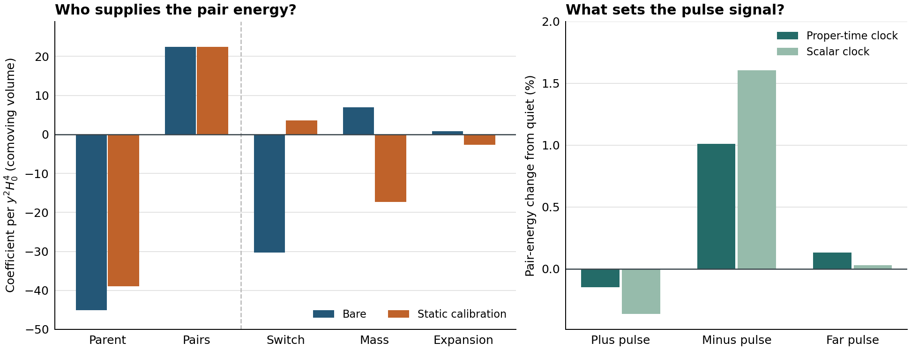

# Where does the energy in the emitted fermion pairs come from?

HDblast asks whether a disturbance in a higher-dimensional spacetime can start a hot, expanding universe on a four-dimensional shell. The preceding calculation produced fermion–antifermion pairs on simulated shell histories. We now follow the response of the parent scalar field as well, and calculate the work performed by the changing interaction, mass and scale factor. This lets us test a necessary step toward reheating. Does the energy in the pairs equal the energy lost by their parent? [Previous study](https://doi.org/10.5281/zenodo.24357388) · [Study protocol](https://github.com/maldonado-research/HDblast/issues/157#issuecomment-6998610938)

**On the retained quiet wall the parent loses more energy than the pairs carry away.** The excess is accounted for by work exchanged with the prescribed inputs. Two calibrations yield the same pair energy at leading order and differ even on the sign of the work performed by switching the interaction. Both satisfy the energy equation. The table uses the wide switch, the fine native grid and a cutoff of 120 on the total comoving energy of a fermion pair.

| Coefficient per $y^2 H_0^4$ per comoving volume | Bare model | Statically calibrated model |
|---|---:|---:|
| Change in parent energy due to coupling | −45.0352 | −38.9830 |
| Energy in outgoing pairs | +22.5106 | +22.5106 |
| Work by changing the coupling | −30.3259 | +3.5427 |
| Work by changing the parent mass | +6.9559 | −17.2998 |
| Work by expansion, all sectors | +0.8454 | −2.7153 |

The first two rows add to the last three. Positive work means energy enters the modeled matter system. We evaluate all entries relative to the uncoupled evolution on the same wall at the same readout. The initial state of the daughters is their conformal vacuum. The parent uses the archived Gaussian state. Subtracting the outgoing yield of a different parent prepared in its fork vacuum is a separate experiment. For that comparison the daughter energy difference is −0.58955 at cutoff 120. Negative excess is consistent with positive energy in both outgoing states. [Energy equations and numerical settings](solver/METHODS.md) · [Independent calculations](check/CHECK.md)

## Which parts survive a change of cutoff?

Doubling the comoving cutoff from 240 to 480 changes the computed quiet-wall pair energy by $1.4\times10^{-9}$ around **22.51057473**. That figure describes a cutoff test of this history. The original native wall itself has a larger discretization uncertainty. On changing from the coarse to the fine wall at cutoff 120 the energy shifts from 22.53317 to 22.51057. Over the 240–480 interval the inferred bare switch work changes from −131.94 to −542.94. Even after applying the static calibration it changes from +5.099 to +7.126. Assigning a universal fraction of the outgoing energy to the switch, parent or higher-dimensional pulse from these numbers would therefore be unjustified. [All finite-cutoff budgets](solver/BUDGETS.json) · [Time, frequency and energy checks](solver/CHECKS.json)

The origin of the discrepancy can be calculated without fitting a curve. The static calibration cancels the zero-frequency shift in the parent oscillator’s restoring force. For the fine quiet history, its change to the switch work equals $0.00239086\Lambda^2-0.162149\log\Lambda+0.216524$ for $\Lambda>8$, using $H_0$ units. It leaves the outgoing pair energy unchanged at this order. The underlying static subtraction still leaves a logarithmic frequency dependence in the parent response. These are properties of the specified spectral model. The same spectral weight recovers the standard moving-particle decay width in flat spacetime. [Derivation and normalization checks](theory/THEORY.md)

A second calculation removes the value and first derivative of the retarded response at a chosen spacelike momentum. It isolates a finite memory of the switched source. After the switch closes, two choices of that normalization give the same response to a native mode, and direct integration of the causal kernel gives the same answer. This controls a part of the continuum matter response. A covariantly matched total stress tensor for the expanding shell remains to be derived. For all four parent preparations, integrating the continuum response and directly adding outgoing pair energies give the same change from the fork-vacuum control to within $4.2\times10^{-11}$ in model units. [Continuum response and dissipated work](memory/MEMORY.md) · [Four quantum preparations](memory/STATE_DIFFERENCE.md)

## How much of the signal is associated with a pulse?

At equal proper time, relative to quiet, the plus pulse reduces outgoing energy by **0.147%**, the minus pulse raises it by **1.009%**, and the far pulse raises it by **0.130%** at cutoff 120. Each direction persists on both grids at both tested cutoffs. The far pulse provides a particularly clear example. Its extra pair energy is positive in both calibrations. Its parent-energy change relative to quiet is +0.01141 in the bare calculation and −0.03517 in the statically calibrated one. The background already produces pairs in the absence of an incoming pulse. [Pulse controls and independent work integral](pulses/PULSES.md) · [Pulse comparison protocol](https://github.com/maldonado-research/HDblast/issues/157#issuecomment-6998631142)

## Can the shell field itself time the interaction?

The quiet trajectory alone cannot decide what activates the coupling. Its scalar field crosses the switching interval only once, so we can construct a coupling $F(\phi)$ that exactly reproduces the prescribed time dependence on that trajectory. The alternatives make different predictions once we freeze the function and apply it to the three pulsed histories.

| Fine grid at cutoff 120, change in outgoing energy from quiet | Proper-time switch | Coupling set by the shell scalar |
|---|---:|---:|
| Plus pulse | −0.147% | −0.366% |
| Minus pulse | +1.009% | +1.603% |
| Far pulse | +0.130% | +0.030% |

The quiet pair energy agrees between these clocks by construction. The **0.594 percentage-point** separation on the minus arm is much larger than the change on repeating that comparison on the coarse wall (about 0.0004 percentage points). At cutoffs 240 and 480 the corresponding fine-wall separations are 0.5950 and 0.5958 percentage points. The scalar-clock model specifies a candidate source of switching work through the additional force conjugate to $\phi$. In this test the trajectories are replayed with that coupling. Evolving them with its force is the next test of the proposed mechanism. [Scalar-clock construction, assumptions and numerical checks](clock/CLOCK.md) · [Exploratory test design](https://github.com/maldonado-research/HDblast/issues/157#issuecomment-6998719638)

## Implications for a hot Big Bang

The calculation is perturbative through $y^2$. It holds the archived scale factor and mass history fixed. The finite energy budgets prescribe the switch in proper time. The clock comparison also calculates the outgoing energy for a scalar-dependent coupling. The finite reservoir represents the massless Dirac two-point function at this order. The exercise establishes an energy account on those histories. A four-dimensional model supplied with the same histories and state has the same matter calculation. A physical origin test would require a dynamical source for the interaction, matched matter and gravitational stresses with a common renormalization prescription, and a coupled evolution that predicts a radiation era distinguishable from four-dimensional alternatives. This study supplies neither an observed primordial signal nor a reheating temperature. [Literature, D-Blast 3 and other Maldonado projects](sources/SOURCES.md)

## Reproduce this edition

From this study directory in the GitHub checkout or in the extracted Zenodo ZIP, run the commands below. The first verifies the file and input hashes and the main numerical identities using the standard library. The second installs the versions used in the replay. The third recomputes the finite budgets, pulse contrasts, independent particle spectra, symplectic controls and continuum checks into a temporary directory and compares them to the archived results. The figure can be regenerated with Matplotlib and the included figure.py.

~~~sh
python -I -B reproduce.py
python -m pip install numpy==2.3.5 scipy==1.17.0
python -I -B reproduce.py --verify
~~~

[Historical input manifest](SOURCES.json) · [Offline edition](https://doi.org/10.5281/zenodo.24358059)
