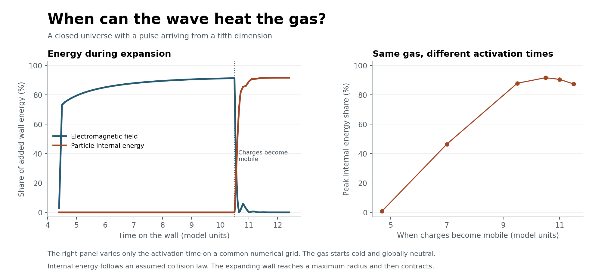

# Can the waves from a higher-dimensional pulse heat charged matter?

An electromagnetic pulse can drive a bounce in the published five-dimensional HDblast model. That left a gap between waves carrying energy and matter getting hot. In the calculation here, cold carriers can draw energy from the waves, develop a current, and turn ordered motion into internal energy through an assumed collision law. In one run the particles’ internal energy accounts for **91.66% of the added energy on the wall**. The radius grows by only **1.11%** while this share exceeds 90%, then the model universe begins contracting again.

The timing and strength of the interaction matter. Making the same charges mobile earlier gives **0.86%** peak internal energy. A second experiment activates mobility smoothly when the local field becomes predominantly electric. It reaches **91.51%** without specifying an activation time in advance. Both positive examples assume a pre-existing supply of neutral carriers, a very large charge-to-mass response and effective collisions. The microscopic origin of those assumptions and the formation of a thermal plasma remain open.

## Following the energy

The computation starts with a closed, three-dimensional wall at rest inside a five-dimensional spacetime. The wall already exists. Two sources emit finite electromagnetic pulses from a short distance away. The retained bulk regions, both waves, the wall radius, a scalar field and the charged gas all respond to the energy transfer. Three equivalent field directions and populations with opposite charges keep the summed stress isotropic. The initial cold rest density is 0.0001 in units of the wall tension. Accounting for this mass changes the initial bulk mass from 4 to 3.99679984. The scalar transfers energy back to the electromagnetic field on its way down a prescribed potential. The separate radiation fluid stays at zero. [Equations, data and controls](coupled/COUPLED.md) · [Parent calculation](https://doi.org/10.5281/zenodo.24387565)

In the primary run the gas becomes mobile near the first magnetic-field zero after the scalar has descended. At that instant the carriers are cold, and almost all the electromagnetic energy is electric. An electric force does work on the charges, and drag between the oppositely moving populations converts directed motion into internal energy. The gas uses a relativistic equation of state and its current acts back on the wave. The model adds no energy when mobility turns on. In expansion, the intrinsic internal share crosses 90% at radius 9.6541. Expansion stops at 9.7616. Percentages exclude the ever-present wall tension and the gas rest energy is accounted for separately in the numerator. For the selected case the maximum share changes by less than 0.001 percentage point between the 48- and 64-element early radial grids.

The same prescribed gas has $Q=10^8$ for its projected charge-to-mass response, collision rate $\nu=6$ per curvature time and the previously chosen 13.2-million-fold change in the gauge kinetic coefficient. At fixed gas, pulse and gravity, the main explanation for the timing effect comes from Faraday’s law. When carriers screen the electric field, the comoving magnetic field changes slowly. Across six tested activation times the electric share of the wave energy at onset predicts the measured fraction transferred by electric work to within **1.09 percentage points**. With no collisions, the gas can acquire directed momentum but its intrinsic internal energy stays zero. [Phase comparison](coupled/phase.py) · [All coupled runs](coupled/CHARGED.json)

The locally triggered comparison waits for the scalar to finish its descent and the magnetic energy share of the wave to fall below 1%, then increases mobility smoothly over half a curvature time. The wall's local state determines the onset. The choice of the rule and the collision rate still comes from the modeler. Relaxing the magnetic threshold to 5% or 10% gives peak internal shares of 89.18% and 85.59% on the common comparison mesh. [Local response, errors and failed controls](gate/GATE.md)

## What does “hot” mean in this experiment?

The fluid result measures energy stored in the particles' own rest-frame random degrees of freedom. The relation between that internal energy and pressure is supplied by a fluid closure. Three independent calculations test how much more would be needed to claim thermal equilibrium.

* **Already existing, dilute charges.** For a separate weakly loaded seed with mass 0.1, unit charge and elastic directional scattering, the largest random energy among eight tested rates is only 0.00000526% of the electromagnetic energy at turnaround. The current is too small to drain the wave appreciably. An independent 65,536-particle simulation checks the moment calculation. [Dilute-particle study](kinetic/KINETIC.md)
* **Current versus thermal equilibrium.** On the actual field history, a collisionless Fermi gas first gains expansion-adjusted energy and then returns it when the signed potential crosses zero. In a separate controlled relaxation experiment, two mechanisms reduce the same current by 99%. Scattering only in angle leaves the mismatch in the radial momentum distribution intact. Momentum redistribution removes 99% of that mismatch. The rates and the final equilibrium pair abundance require microscopic input. [Distribution and entropy test](theory/SPECTRUM.md)
* **Particles created from vacuum.** A charged quantum scalar on the closed wall gives an independent particle-production calculation. At a late instant with zero gauge potential, the mean per-state occupation in the second energy level is about 600 times greater than in the first for a massless unit-charge species. A positive-temperature equilibrium population decreases with energy. The finite-time particle definition, source switch-off and particle mass affect that comparison. Two smoothed readouts give only 0.162–0.163% probability of even one pair in the lowest 33 angular shells for that species on the whole sphere. Shorter-wavelength modes also contribute, especially during the original short pulse. An all-frequency, interacting quantum energy density requires additional physics. [Quantum test](quantum/PAIRS.md) · [Mass and uncharged controls](quantum/MASS.md)

There is a quantitative cost to identifying the quantum particles with the cold carriers. If their quantum charge is one and they have the required $Q=10^8$, a conformally coupled scalar’s lowest-mode energy on the initial closed sphere would exceed its rest energy by about **87 million times**. Its particle count also depends on the physical wall tension and curvature length. The calculated excitations cannot simply be relabeled as the model's initial pressureless gas. [Normalization and limits](synthesis/BRIDGE.md)

This study supplies an example of energy transfer within a specified model. It supplies neither an absolute temperature nor an observation of a higher-dimensional blast. A next test that could change the conclusion is to derive carrier creation, mobility and collisions from a common charged-matter theory, then let that same distribution act back on the wave. It would have to create the required abundance, maintain a nearly thermal spectrum and keep the universe expanding for an interval consistent with the observed hot history. [Prior research and recent literature](literature.md)

## Reproduce the calculations

Use Python 3.12, NumPy 2.3.5 and SciPy 1.17.0, a C++17 compiler available as g++, and the patch utility. The repository supplies the original Maxwell solver, a 29,558-sample history, the charged extension, and eight numerical products. The full replay rebuilds the history and runs the particle calculations on the newly generated data. Matplotlib is optional and is used only to regenerate the figure.

~~~sh
python -I -B -S study.py
python -I -B study.py --verify
python -I -B figure.py
~~~

[Calculation plan](https://github.com/maldonado-research/HDblast/issues/157#issuecomment-7048108897) · [Prior source and sampling](background/BACKGROUND.md) · [Version archive](https://doi.org/10.5281/zenodo.24405438)
