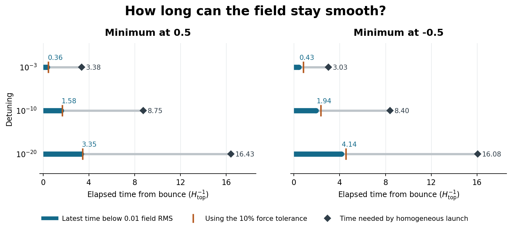

# Can the closed hilltop stay smooth long enough to produce a radiation era?

**The homogeneous launch fails a quantum smoothness test on all six histories studied.** The earlier classical model could expand long enough for radiation to take over if a spatially uniform scalar started extremely close to an unstable maximum. We allowed the field to vary across space and asked how long even the best-prepared quantum state could keep its large-scale ripples small. At the reference detuning, the two classical solutions need **3.38 and 3.03** time units just to reach their first small displacement from the top. The quantum limits for one group of ripples are **0.365 and 0.431** time units. All times use the inverse hilltop expansion scale of the corresponding model. [Earlier classical launch and radiation calculation](https://doi.org/10.5281/zenodo.24377289) · [Full-interval bound and proof](minimax/MINIMAX.md)

The blue bars use the nine components of the $n=2$ scalar harmonic on a closed three-dimensional space. The tolerance is a spatial root-mean-square field variation of $0.01$ reduced Planck units. The orange ticks use each potential's own force tolerance, the nearest displacement where the force differs by 10% from its linear approximation. The dark diamonds mark the time needed by the corresponding marginal homogeneous solution to reach a displacement of $10^{-5}$ from its maximum. That marker precedes oscillation, decay and radiation equality. [Figure code](figure.py) · [Harmonic and force calculations](harmonics/HARMONICS.md)

## Why adjusting the initial state has a limit

An unstable hilltop magnifies small differences in field position. In quantum mechanics one can also choose how the initial position and velocity fluctuate together. Such a choice can make a ripple small at a particular time. To keep it small during a long wait, both its initial position and its later position must be sharply defined. These two measurements become increasingly incompatible as the instability grows.

We calculated the smallest possible peak spatial RMS **over all quantum states with finite second moments** of the chosen real-line field modes in the linearized model. The solution uses the commutator of the field at the two times and a bound on its growth between them. A particular Gaussian state attains the lower bound on stationary closed de Sitter space. The proof permits squeezing, correlations between modes and mixed states. For any subset of harmonics unstable throughout the wait, the squared optimum is

$$
\mathcal E^2(T)=\frac{\kappa}{2}\sum_{n\in I}(n+1)^2 B_n(T).
$$

Here $B_n(T)$ is the amplitude generated at time $T$ by unit initial field velocity and zero initial displacement, and $\kappa$ is the bounce commutator in the unit-spatial-RMS normalization. A reduced initial kinetic-energy budget can shorten the allowed time further. With the larger, independently calibrated 10% force tolerances, the limits at the reference detuning become **0.456 and 0.811**. The time shortfall survives this change. [Derivation, energy budgets and six comparisons](minimax/MINIMAX.md) · [Measured tolerances](harmonics/HARMONICS.json)

A second test asks whether the field could be inside the tolerance with high probability at both times, even in a state with unusual tails. For **a single real component** of the quadrupole, the longest stationary-background intervals admitting 95% probability at both endpoints are 0.438 and 0.522 at reference detuning and half-width 0.01. This test uses the sharp Landau–Pollak concentration relation. It concerns two marginal measurement probabilities for the same preparation. The probability for an unmeasured cosmological history would require a prescription for histories and their dynamics. [Probability bounds, nine-component extension and independent checks](bounds/THEORY.md)

## Gravity, velocity and the first departures from uniformity

We solved the linearized Einstein and scalar-field equations on the slightly rolling **actual tuned closed backgrounds**, including the gravitational constraints. The physical scalar commutator at the time-symmetric bounce follows from the scalar and metric contributions to the canonical form. This provides an independent endpoint lower bound on the rolling solution. Its crossings of the $0.01$ tolerance agree with the stationary horizons to numerical precision in all six cases. At those crossings the homogeneous field is still within $10^{-17}$ reduced Planck units of the top. The calculation also monitors the Einstein constraint through 360 mode-and-time comparisons. [Rolling scalar and gravitational response](rolling/ROLLING.md)

Choosing a nonzero homogeneous starting velocity bends the curve of finely balanced launches. On either side of the critical displacement, eight classical evolutions at the two largest tested speeds confirm the change in the order of radiation equality and turnaround. An independent 50-decimal calculation resolves offsets that would be lost by subtracting two ordinary floating-point field coordinates. These results explain how to tune a classical field and velocity jointly. [Nonzero-velocity launches and direct event checks](manifold/MANIFOLD.md)

We checked the quantum endpoint limit on four early trajectories with a compensating starting velocity. The field can initially move either toward or away from the top. At detuning $10^{-3}$ and signed speeds $v=\pm\sqrt{0.06}$, the $0.01$ RMS crossings range from **0.361 to 0.369** on the positive-minimum branch and **0.431 to 0.432** on the negative-minimum branch. The later classical first passage through the potential minimum occurs after time 4 in all four cases. These examples confirm that the early obstruction survives the tested change in velocity. [Canonical normalization and velocity controls](rolling/ROLLING.md)

A concrete quantum preparation gives another check. We initialized a finite set of scalar harmonics in a specified Gaussian state and propagated each field and velocity covariance. For the quadrupole alone at reference detuning, its spatial RMS reaches the force tolerance by 0.193 or 0.365, respectively. Adding higher harmonics or changing spatial smoothing changes when a chosen variance criterion is crossed. The inverted scalar potential has no ordinary oscillator ground state, so the example specifies a reference frequency; the optimized lower bound above does not need one. [Initial state, smoothing and finite-band energy tests](harmonics/HARMONICS.md)

We then evolved a classical ripple in the full nonlinear scalar potential on a prescribed closed space. It started as a single spatial harmonic with exactly zero mean. During evolution it generated both a mean field and a higher harmonic. Reversing the sign of the input and halving its size isolated a mean response proportional to the square of the input amplitude. At early time 0.12 the mean response was positive in the potential with the positive minimum and negative in the other potential. Spatial variation can therefore change the mean motion already at second order in this controlled example. Stress sourcing the nonlinear geometry and the quantum average over initial conditions lie outside this fixed-metric experiment. [Nonlinear radial evolution and controls](nonlinear/NONLINEAR.md)

## Physical interpretation

The result identifies an inconsistency in treating these tuned four-dimensional scalar histories as smooth for the entire delay while applying the stated quantum field model. It gives a time at which that description needs to change. It does not determine what an inhomogeneous universe does afterward. Some regions could roll at different times, and energy in gradients could affect both the expansion and the subsequent production of particles. The observation of a thermal early universe would still need to be matched to a predicted matter sector and an expansion history. The same four-dimensional scalar potentials can produce the tests in this study without a higher-dimensional blast.

Recent work on positive-curvature bounces distinguishes states that can be prepared adiabatically from unstable low-frequency modes. On compact slices, extending a linear perturbation to a solution of full gravity can also impose global charges at second order. The Gaussian attaining the scalar optimum has been established in the stated linear field space. A physical quantum state of the full five-dimensional system would require its own construction. We also counted negative scalar directions of the complete round Euclidean four-sphere at each stationary point. The counts are 3,185 and 1,716. The usual single-negative-mode Hawking–Moss interpretation does not supply a tunnelling probability here. [Primary papers, Euclidean hypotheses, source archive and observational scope](literature/README.md)

The next question for a simulation is whether patches with different field values can collectively sustain expansion and transfer energy to radiation. A nonlinear calculation that includes the spatial Einstein constraints, field gradients and a calibrated matter channel could distinguish that outcome from collapse or a patchy, nonthermal state. Comparing with sky observations would then require propagating metric perturbations through the radiation era.

## Reproduction

From the study directory, verify the bundled files with Python's standard library, then regenerate the results offline with Python 3.12, NumPy 2.3.5, SciPy 1.17.0 and mpmath 1.3.0. The figure also uses Matplotlib.

~~~sh
python -I -B -S reproduce.py
python -I -B reproduce.py --verify --jobs 2
python -I -B figure.py --output /tmp/preparation.png
~~~

[Source checksums](SOURCES.json) · [Capsule checksums](SHA256SUMS) · [Initial experiment record](https://github.com/maldonado-research/HDblast/issues/157#issuecomment-7019927615) · [Nonlinear follow-up record](https://github.com/maldonado-research/HDblast/issues/157#issuecomment-7020053111) · [Zenodo edition](https://doi.org/10.5281/zenodo.24378057)
