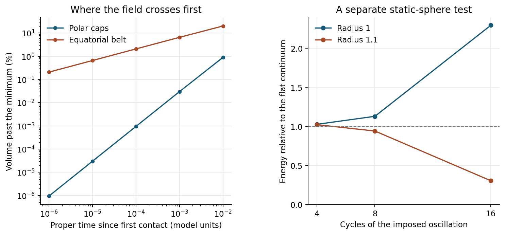

# How much of a closed universe crosses the potential minimum?

A field rolling into a potential well can give energy to other fields. For the higher-dimensional blast hypothesis, the open question is whether this process could make the early universe hot. We followed eight initially expanding solutions from their time-symmetric bounce, allowing an uneven field to change the geometry through Einstein’s equations. In one of the two fitted potentials, part of space crosses the bottom of the well in all four runs. In two runs the same region slows, reverses direction and crosses back. The starting shape of the ripple determines how much space takes part.

These results concern an effective four-dimensional model. A higher-dimensional origin, the probability of the assumed initial conditions, and an observable that distinguishes that origin from other early-universe mechanisms remain open. [Parent study](https://doi.org/10.5281/zenodo.24378925) · [Study protocol](https://github.com/maldonado-research/HDblast/issues/157#issuecomment-7021704984) · [Test-field protocol](https://github.com/maldonado-research/HDblast/issues/157#issuecomment-7021775989) · [First-passage follow-up](https://github.com/maldonado-research/HDblast/issues/157#issuecomment-7022010533)

## Following the rolling field

The two model labels give the position of the potential minimum in the original field coordinate, $\phi_m$. Each run starts with a small smooth quadrupole ripple of signed amplitude $A$. Flipping its sign exchanges the roles of two isolated poles and a whole equatorial surface. Times below are dimensionless proper times measured by observers freely falling from the bounce.

| Position of minimum | Seeds | First passage | What happened next inside the fitted range |
|---|---|---|---|
| $-0.5$ | $+0.001$, $+0.0005$ | The poles crossed at 0.4884 and 0.5519. | The same poles reversed and passed back at 0.6428 and 0.7067. Total spatial volume was still growing on both returns. |
| $-0.5$ | $-0.001$, $-0.0005$ | The equator crossed at 0.5891 and 0.6531. | The total volume was still growing, although the poles were already contracting. The available evolution ended during the first passage. |
| $+0.5$ | All four signed seeds | No region crossed within the tested evolution. | The field reached the limit of the potential fit elsewhere first. Its subsequent motion is undetermined. |

For the $+0.5$ potential, the region rolling toward the minimum still had a finite field gap when the opposite region reached the fitted boundary. The radial light-travel bound on the computed geometries puts the past causal footprints of these two events at least 0.600 radians apart on the initial slice. Smooth local data can therefore be followed farther in principle. The calculation gives no quantitative crossing time beyond the global stop. [Causal separation and bounds](causality/NOTE.md)

For both polar reversals the force from the potential at the turn exceeds the spatial-derivative force by more than a factor of 1,000. Repeated passage through the minimum in the original direction would mark one full oscillation. No sampled trajectory completed one inside the calculated interval. The two finest spatial resolutions agree on event times to better than $10^{-10}$ model-time units. Moving the guard 100 times closer to the fitted boundary moves its time by up to $1.25\times10^{-5}$. An independent regional energy-conservation integral checks the work done by expansion and the energy that moves between polar caps and the equatorial belt. [Event table and convergence](rollout/NOTE.md) · [Regional energy balance](patches/PATCHES.md)

## Measuring how much space passes the minimum

One hundredth of a model-time unit after each run’s first contact, **0.895–0.902%** of proper volume was beyond the minimum in polar runs and **20.245–20.276%** in equatorial runs. At the moment of first contact the crossed volume itself was zero in either case. The field still carried substantial kinetic energy inside the wider well window. Its local rest energy above the minimum exceeded the lower window-edge energy by factors of 6.67–7.33 at first contact.

The initial growth has a simple explanation. The angular thickness of the newly crossed region grows with the square root of elapsed time. A patch that starts at a point must grow in three spatial directions, so its volume begins as time to the power $3/2$. A whole surface of simultaneous contact need only grow in thickness, so its volume begins as time to the power $1/2$. The measured exponents are 1.49998 and 0.49999. The surface result depends on the imposed symmetry. The mathematical result generalizes to a smooth first contact with positive velocity and a nondegenerate transverse maximum on the chosen slices. [Derivation, coefficients and energy tests](patches/PATCHES.md)

How sensitive is the equatorial result to exact symmetry? In an auxiliary calculation we let different parts of the equator start at slightly different times. With two points starting first, the earliest volume again grows as time to the power $3/2$. For a smooth angular timing offset proportional to the square of the sine of angular distance from a first contact, the volume reaches half the simultaneous-surface prediction when the elapsed time equals the full spread in onset times. The spread was specified by hand. Its value for an actual perturbation requires a nonspherical Einstein–scalar solution. [Angular timing calculation](interpretation/UNFOLDING.md)

The left panel follows the evolving geometry for $\phi_m=-0.5$ and $|A|=0.001$. The right panel uses an externally held, static sphere for $\phi_m=+0.5$. Radii are in inverse hilltop Hubble units. The dashed line is the flat-continuum energy for the identical pulse.

## Can another field respond?

We propagated one angular sector of a free massless scalar on the actual evolving geometry. We specified its initial quantum state at the bounce and a convention for measuring its excitations at a later time. Even homogeneous closed de Sitter space gives a finite answer with this convention. The controls therefore include the exact homogeneous solution and the same uneven geometry with constant kinetic weight. The matter parameter $Z\propto 1/f$ in the main calculation is fixed by the archived model.

For $\phi_m=+0.5$, $A=+0.001$ and time 0.12, the sum of the 132 squared off-diagonal pair-mixing amplitudes for one angular state, using even radial labels 2 through 24, was about $1.59\times10^{-6}$ with the model’s matter weight and $2.72\times10^{-11}$ with constant weight. This test shows that the calibrated matter coupling can mix different wave patterns on the same spacetime. The sum depends on the selected modes and measurement convention. At time 0.47, before either first crossing for $\phi_m=-0.5$ and $|A|=0.001$, reversing the seed changed the instantaneous occupation of the lowest tracked mode from 0.00653 to 0.00905. Neither a temperature nor a total radiation density follows from these finite-mode quantities. [Time-dependent calculation and controls](dynamic/DYNAMIC.md) · [Instantaneous spectra and first-order splitting](intrinsic/NOTE.md)

We also followed the same three low radial modes **through the actual first passage**, evolving each state continuously from the bounce. For the lowest tracked mode, the instantaneous counts bracketing the event were measured on the following slices.

| Where first crossing occurs | Matter weight, before → after | Constant weight on the same geometry, before → after |
|---|---|---|
| Poles | 0.006980 → 0.007301 | 0.008466 → 0.008995 |
| Equator | 0.018568 → 0.019459 | 0.013887 → 0.014368 |

These samples lie 0.005 model-time units before and after that run’s first passage. The endpoint increase was smaller than the constant-weight increase in the polar run and larger in the equatorial run. The modes cover the whole space and the two first passages occur at different times. The comparison shows a continuous, state-dependent response across each event. It gives no unique local burst energy attributable to crossing. The three monitored low-mode occupations changed by less than $1.1\times10^{-10}$ when the maximum radial label increased from 24 to 36, and by less than $4\times10^{-16}$ from 36 to 48. [Before and after first passage](passage/PASSAGE.md)

A separate calculation isolates the effect of spatial curvature on a prescribed source. On a static three-sphere the allowed frequencies are discrete. For the identical imposed 16-cycle drive, increasing the radius from 1.0 to 1.1 inverse hilltop Hubble units changed the daughter energy from **2.296 to 0.304 times** its flat-continuum value on the $+0.5$ branch. On the $-0.5$ branch the ratios were **0.935 and 0.998**. This provides a controlled example of both enhancement and suppression when a source has a limited frequency range. The oscillation was supplied externally. Its energy cannot be assigned to the simulated cosmological patches. [Static sphere and mode sums](spectrum/SPECTRUM.md) · [Independent continuum calculation](checks/SPECTRAL.md) · [Reheating literature](literature/README.md)

To test whether this model produces a hot universe requires energy transfer that reduces the rolling field’s energy, a radiation energy density computed with a controlled quantum-state and subtraction prescription, and interactions that can bring the products into equilibrium. The fitted field range already limits how long this can be tested in each potential. None of the eight runs establishes a higher-dimensional cause for the Big Bang.

## Reproduce the calculations

The capsule includes its historical inputs, their source paths and SHA-256 digests, numerical outputs and per-mode records. From this directory, verify the archive with Python’s standard library and rerun the nine numerical calculations with the indicated dependencies.

~~~sh
python -I -B -S reproduce.py
python -m pip install numpy==2.3.5 scipy==1.17.0
OPENBLAS_NUM_THREADS=1 OMP_NUM_THREADS=1 python -I -B reproduce.py --verify --jobs 2
~~~

The numerical replay regenerates the tables in a temporary directory, checks them against the archived results with numerical tolerances and evaluates independent identities. The figure can be regenerated with Matplotlib by running `python figure.py --output crossing.png`. [Pinned inputs](SOURCES.json) · [Checksums](SHA256SUMS) · [Replay code](reproduce.py)
