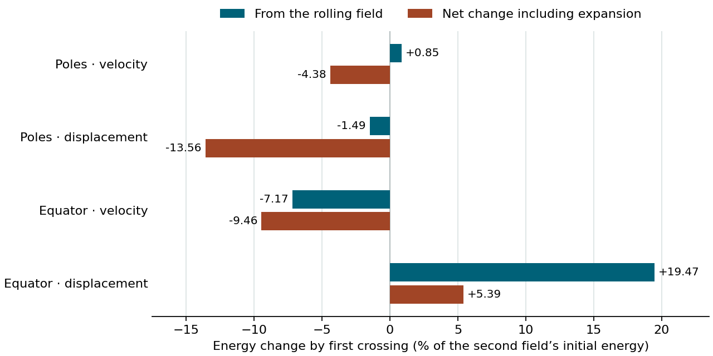

# Does an uneven rolling field give energy to a second field?

In this closed four-dimensional model, a rolling field can give energy to a second wave. It can also take energy back. We found both directions of transfer before the rolling field first crossed the minimum of its potential. In the run with the biggest gain, the first field supplied 19.47% of the second field’s initial energy. Motion and expansion of the geometry used part of that gain. The second field ended the interval with 5.39% more energy than it started with.

The second field began as a deliberately small classical wave. At the crossing, even the run with the largest gain put only **0.00121% of the total scalar energy** in that field. This study establishes a mechanism for exchanging energy in the assumed model. It leaves open whether a higher-dimensional event prepared these fields, how the second field was originally populated and whether the universe ever became radiation dominated or hot. [Preceding first-passage study](https://doi.org/10.5281/zenodo.24379598) · [Investigation protocol](https://github.com/maldonado-research/HDblast/issues/157#issuecomment-7022932138)

## Following the energy through first passage

We evolved Einstein’s equations simultaneously with both scalar fields. The parent has the archived potential, with its minimum at field coordinate $\phi_m=-0.5$. The second field, called the daughter, has no potential. Its kinetic weight is $Z(\Theta)=f(\Theta_*)/f(\Theta)$, the scalar–matter coupling inherited from the preceding study. The numerator fixes the units of the daughter field at the top of the well. Energy in both fields contributes to gravity. The daughter also exerts an equal and opposite exchange term on the parent.

Two signed ripples of the parent determine where first passage occurs. For each, we started a standing daughter wave in two ways. In the **velocity** case, its field value was initially zero and its velocity varied across the sphere. In the **displacement** case, its field value varied and its initial velocity was zero. Within each preparation we repeated the simulation with constant $Z$ and matched the original initial stress point by point. We also halved the daughter amplitude and ran a zero-daughter control. Changing the starting phase changes the spatial distribution of kinetic and gradient energy, even when the total initial energies are nearly equal.

| Site of first contact | Daughter preparation | Direct work from the parent | Net change of daughter energy |
|---|---|---:|---:|
| Poles | Velocity | +0.85% | −4.38% |
| Poles | Displacement | −1.49% | −13.56% |
| Equator | Velocity | −7.17% | −9.46% |
| Equator | Displacement | +19.47% | +5.39% |

Each entry integrates over the **entire closed spatial slice**, from the bounce to that simulation’s own first contact. Percentages use the starting daughter energy as their denominator. A negative entry for direct work means that the daughter gave energy to the parent. In the last row, 14.08 percentage points of direct work went into pressure work on the changing spatial geometry. The directly transferred energy was about **3.245 parts per million** of a separate fixed reference energy, the stationary hilltop energy density times the original round-sphere volume. Halving the initial daughter amplitude preserved all four signs. With constant $Z$ the direct work vanished exactly. With zero daughter amplitude and velocity the classical daughter stayed empty.

In the 34 primary and refinement evolutions the integrated parent and daughter accounts closed separately within $2.6\times10^{-12}$ and $3.9\times10^{-18}$ reference energy units. The two zero-daughter first-crossing times agree with the preceding single-field calculation within $10^{-12}$ model-time units. The simulations check the positive initial conformal geometry, evolution constraints and the valid field interval of the potential. The scalar pressure-to-energy ratios at first contact in the four main runs range from about $-0.32$ to $+0.99$. Each describes a prepared wave on one slice. [Coupled equations, initial data and convergence](coupled/COUPLED.md)

## Does the sign at first crossing persist?

For the positive parent ripple the same polar region turns around and passes back through the minimum. We followed the fully coupled system through that return with both daughter preparations. The endpoints in the table below refer to events on the same polar worldline. Energy is integrated over the whole closed slice. All entries use the daughter's own launch energy.

| Daughter preparation | Launch to first crossing | First crossing to turn | Turn to second crossing | Direct work, launch to second crossing | Net daughter energy change at second crossing |
|---|---:|---:|---:|---:|---:|
| Velocity | +0.85% | +1.02% | −0.81% | +1.06% | +1.15% |
| Displacement | −1.49% | +0.39% | +5.36% | +4.26% | −17.28% |

In the displacement case, the daughter had given the parent energy by first crossing and had received energy from it overall by second crossing. Its net energy still fell, as the field did pressure work on the changing geometry. Total spatial volume was expanding at the return. The two crossings with opposite velocities span part of an oscillation. A later crossing in the original direction would be needed to complete one full period. [Return through the minimum and numerical controls](coupled/RETURN.md) · [Exploratory follow-up record](https://github.com/maldonado-research/HDblast/issues/157#issuecomment-7023112284)

## Why a gain can reverse

For a daughter with kinetic energy density $K$ and spatial gradient energy density $G$, direct local power into the daughter is

$$
Q_\chi=(\partial_t\ln Z)(G-K)=-\tfrac12(\partial_t\ln Z)T_\chi ,
$$

where $T_\chi$ is the trace of its stress-energy tensor. Here $t$ is proper time in the chosen slicing, and $K,G$ are in the same energy units. The sign depends on both the motion of the parent and how energy is stored in the daughter. The pressure work of an expanding or contracting geometry enters the energy equation separately. Thus a constant positive decay rate cannot reproduce the four coherent-field outcomes in the table. Scattering, dephasing or a different initial state could affect a later averaged description. The classical Maxwell field in four dimensions has zero trace and receives zero direct power from this universal conformal rescaling. Couplings to other matter require their own calculation. [Local energy balances](coupled/COUPLED.md) · [Comparison with published reheating models](literature.md)

There is an exact homogeneous check. A spatially uniform daughter conserves $P=a^3 Z\dot\chi$, so $a^6\rho_\chi=P^2/(2Z)$. Returning to the same parent value restores the same scaled energy. This daughter has pressure equal to its density, whereas ordinary radiation has pressure one third of its density. Fully coupled round-universe controls verify this scaling in both archived potentials. Starting a parent exactly at its maximum with a pre-existing daughter charge can move the parent even though its potential slope initially vanishes. [Homogeneous equations and independent integrations](homogeneous/NOTE.md)

## How large can the transfer be for other waves?

On the preceding study’s fixed first-passage backgrounds we derived a bound that applies to any positive-energy free massless daughter, with all wavelengths allowed. We used positivity of the kinetic and gradient energies, the measured directional expansion rates and the maximum of $|\partial_t\ln Z|$ at each time. Over a window of 0.005 model-time units on either side of first contact, the analytical inequality gives the following numerical estimates for the absolute direct work divided by the daughter energy **at the beginning of that window**.

| First contact | All-wavelength ceiling, evaluated on the numerical background | Range reached in one optimized angular sector, radial labels up to 24 |
|---|---:|---:|
| Poles | about 0.714% | −0.668% to +0.697% |
| Equator | about 4.221% | −3.850% to +4.109% |

In the last column the signs can change on exactly the same prescribed geometry and parent history. The calculation varies the initial field and velocity and evaluates the extrema of the resulting energy-transfer matrix. We kept the maximizing initial wave fixed and evolved it again while doubling the maximum radial label from 24 to 48. The same initial waves delivered **97.65% and 97.41% of the respective numerical ceilings** at the higher cutoff. This quantifies how close specially prepared waves can come to the allowance in the inequality. It does not specify how often such waves would occur. The upper bounds and examples use the same interval and denominator. The inequality is exact under its assumptions. Its tabulated coefficients come from numerical spacetimes and numerical extremum searches. These two rows refer to short windows on the fixed parent solutions. The larger 19.47% in the first table accumulated from the bounce on a fully coupled trajectory. [Derivation of the bounds](bounds/NOTE.md) · [Extremizing wave configurations and convergence](checks/PHASE_WORK.md)

## What can be inferred for a quantum field?

We compared states that differed by one extra quantum in a specified initial wave. This cancels their common vacuum contribution. Over the equatorial first-passage window, the rolling field did $+0.01961$ units of direct work on one extra quantum in radial mode 4 and $-0.00172$ units for mode 2. These are energies per extra excitation, in inverse model-time units, in one angular sector. Independent checks separated coupling work from metric work on the same evolving geometry.

The unrestricted vacuum calculation has a different problem. Even in a homogeneous closed de Sitter control, the instantaneous particle prescription gives a logarithmic short-wavelength dependence for the energy in just one angular sector. A separate comparison of bounce states also shows a logarithmic high-frequency energy difference when all angular modes are included. The finite-state differences remain well defined for the tested modes. A cosmological prediction for spontaneous radiation needs a physically specified ultraviolet state, a renormalized stress-energy tensor and its feedback on the geometry. A temperature further requires a model for interactions and equilibration. [Quantum work and analytic ultraviolet checks](work/WORK.md)

## Reproduce the results

The 15 vendored files come from the parent Git revision in the source manifest. The standard-library check authenticates the complete file inventory and prior inputs. The numerical replay evolves the fields anew, compares six result sets, checks both energy balances and tests the finite-mode examples against the independent continuum bounds.

~~~sh
python -I -B -S reproduce.py
python -m pip install numpy==2.3.5 scipy==1.17.0
OPENBLAS_NUM_THREADS=1 OMP_NUM_THREADS=1 python -I -B reproduce.py --verify --jobs 2
~~~

The optional `--output-dir` argument keeps the regenerated JSON files in a separate directory. To regenerate the plot, install Matplotlib and run `python figure.py --output exchange.png`. [Pinned source objects](SOURCES.json) · [Archive checksums](SHA256SUMS) · [Reproduction code](reproduce.py)
