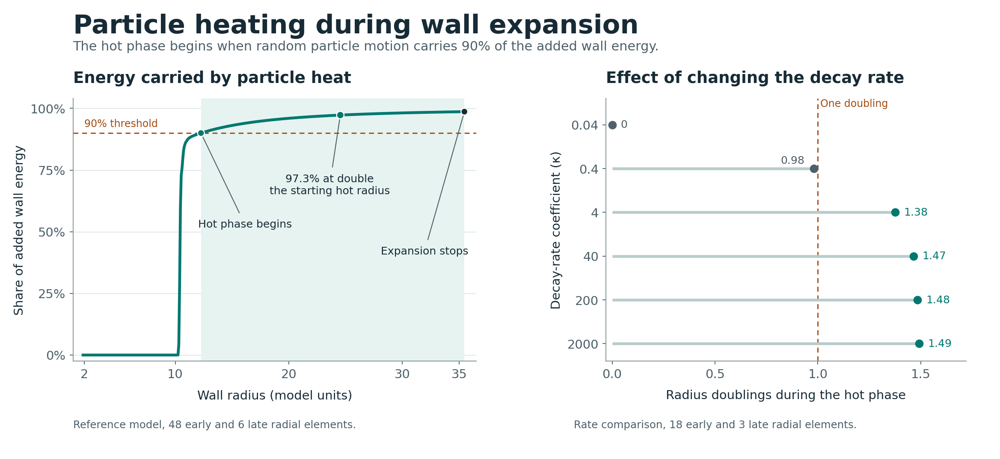

# Can a pulse make the particles that heat an expanding wall?

**November 20, 2026.** A pulse transfers energy from a fifth dimension to a small, closed model universe that already exists. Earlier work tested two parts separately. One simulation heated a gas that had been supplied at the start. Another showed that a pulse could set an initially quiet neutral field oscillating. Here the same simulation follows that field as it gives energy to newly created charged particles. The particles draw much more energy from an electric field. The reference wall grows **2.89 times in radius** while random particle motion carries at least **90% of its added surface energy**. The wall eventually stops expanding and begins to contract. A microscopic interpretation of the reference particles faces a quantitative inconsistency. [Earlier hot-expansion study](https://github.com/maldonado-research/HDblast/pull/190) · [Earlier driven-field study](https://github.com/maldonado-research/HDblast/pull/191)



## What the simulation measures

The wall starts at radius 2, at rest, with vanishing surface fields, zero neutral excitation and zero daughter density. A prepared pulse in the bulk supplies energy. When the wall scalar moves the equilibrium of a second field, that field begins oscillating. The model assigns it a local rate for giving energy to opposite charges. A field accelerates the charges, and a prescribed drag helps turn directed motion into random motion. Every stage contributes to the same wall and bulk equations. The stable background wall tension is excluded from the denominator of the hot fraction. The charged gas carries the measured numerator, which excludes rest mass and coherent streaming energy. Local energy conservation is checked at each transfer. [Equations and 35 coupled runs](coupled/JOINED.md)

| Quantity in the reference run | Value |
|---|---:|
| Radius at the start of the continuous 90%-hot interval | 12.2676 |
| Random particle share when that radius has doubled | 97.29% |
| Radius at the end of the interval and first expansion maximum | 35.4590 |
| Hot growth using 48 early and 6 late radial elements | 2.8905 times |
| Hot growth using 96 early and 9 late elements | 2.8983 times |
| Electric work divided by energy supplied at birth, at peak heat | About 25,300 |

Changing the strength of an earlier gauge release was essential for the reference result. The preceding parameter choice peaked near 28%. Taking out the incident pulse, the neutral-field drive or the decay leaves the daughter sector empty. With electrically neutral daughters the random share peaks at 0.0021%. Switching off prescribed drag leaves a 62% peak through the model's mixing of populations born at different times. Changing the incoming dose from 0.123 to 0.12295 gives a peak of 22%; raising it to 0.12305 keeps the decay threshold closed up to the radius-120 cutoff. The value 2.89 refers to a selected and tested benchmark. [Controls, energy checks and resolution tests](coupled/JOINED.md)

## What the particles would have to do

* **The decay takes time.** A separate weak-coupling quantum calculation tests fermion creation on the matched parent history with the gauge interaction and depletion switched off. On a long, smoothly sampled interval, two switching profiles give 1.010 and 0.998 times the local rate prediction. In a short window around the energy threshold, the ratio is 2.27. A good long-window average can coexist with a sizeable error near the opening. [Time-dependent fermion calculation](quantum/FERMIONS.md)
* **The reference particles face conflicting requirements.** Their electric current must extract enough energy by the time the wall first becomes hot. With three equal weakly coupled fermion species, allowing up to 5% mass change still leaves the allowable charge-and-decay strength at least 64 times too small on this same history. The electric field is itself strong enough to warrant a separate calculation of direct pair creation. [Causal work and mass bounds](audit/EXPOSURE.md)
* **Quantum states can fill up.** For three spin-½ species in the primary magnetic field, only one branch can receive sharp two-body births through the middle 98% of production. In one production window, a model with one thermal elastic scattering channel needs to clear occupied birth states at a mean rate exceeding 44,000 per wall time unit at the minimum action required for drag. The fluid uses a drag rate of 18. An actual microscopic calculation must distinguish how fast states empty from how fast directed momenta relax. [Spinor states and collision bounds](kinetics/KINETICS.md)

## Can a different mass scale pass these checks?

A second calculation follows the source in detail and averages the free neutral field over its rapid oscillations afterwards. At the mass where both methods can be compared, this changes the time of decay opening by 0.0045%, the final daughter rest energy by 0.028%, and the duration of hot growth measured in logarithmic radius by 0.42%. The heavier family increases the particle mass while shrinking both the amplitude and the width of the source in inverse proportion. These changes are specifications of a different model family. The experiment does not assign a measured mass to a real particle.

At $mL=4\times10^{10}$ and $Q=10^7$ the wall grows **2.25 times** while hot. A single trial normalization keeps the daughter mass shift below 0.121% and requests at most 11.2% of a generous count of available quantum states over six birth windows. A shorter-time check changes the conclusion. Near an electric-field reversal, the prescribed source calls for **285 times** the instantaneous supply of empty states crossing a sharp birth momentum. Even the minimum normalization needed for the modeled drag exceeds this supply by a factor of 16.5 at the peak. The mismatch is narrow in time. Integrating the deficit at the trial normalization over the central 98% of births gives about 0.105% of the total requested population. Finite energy width, scattering and a quantum production law can change this comparison. [Mass hierarchy](envelope/ENVELOPE.md) · [Cumulative state count](kinetics/MANY.md) · [Instantaneous birth test](kinetics/SWEEP.md)

The instantaneous test suggests how to change the model. Along this family the maximum action compatible with births scales roughly as the fourth power of mass, while the minimum action for elastic drag grows as the third power. We tested **one further 100-fold increase** and fixed the action at five times that minimum. The wall again grows **2.25 times** during its hot phase. Across **99.998% of the requested births**, the highest angle-integrated demand is **82.28%** of the estimated empty-state crossing supply. Halving the time step gives 82.28% again. An independent calculation using the energy of the narrow source checks the numerical precision needed at this mass. This case survives that sharper test. A single elastic channel at the specified action would still need to deliver at least **20% of its thermal unitarity ceiling** at the most demanding tested hot state. The calculation has yet to produce that interaction or the required distribution of occupied states. The particle masses and source parameters have no independent calibration. [Narrow-source precision test](envelope/ENVELOPE.md) · [Time-resolved state counts](kinetics/SWEEP.md)

## Connection to the Big Bang hypothesis

This experiment addresses how a pre-existing, cold model surface could acquire hot matter from a prepared external pulse. The model prescribes the pulse, the way the fields interact, a decay rate and a drag law. Its growth ends at a finite maximum radius. The effect is sensitive to the incident energy and to the history of the electric field. A viable physical explanation still needs microscopic interaction rates, a credible source for the pulse, a sustained expansion history and a prediction that distinguishes it from standard cosmology. The study gives no measurement of an extra dimension or of an event that started our universe. [Literature and observational context](literature.md)

The question and the original comparison cases were recorded publicly before reporting these results. The gauge scan and heavier-source family are exploratory follow-ups. [Prospective question](https://github.com/maldonado-research/HDblast/issues/157#issuecomment-7052225091)

## Reproducing the calculations

The full replay was tested with Python 3.12, NumPy 2.3.5, SciPy 1.17.0 and a C++17 compiler. The study includes previous input histories, full parameter sets, energy checks, and scripts for each table. The figure can be regenerated from the coupled result using Matplotlib.

```sh
python -I -B -S study.py
python -I -B study.py --verify --output-dir /tmp/hdblast-coherent-decay-replay
```
