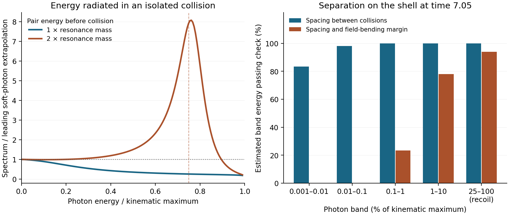

# Can collisions on the shell turn the particle beam's energy into light?

HDblast asks whether a disturbance in a higher-dimensional space could start a hot universe on a shell. In the preceding model, an incident pulse left charged particles moving in preferred directions. The most energetic 10% carried 36.4% of the gas energy and accounted for only 1.2% of the predicted collision participants at the final time. Here we ask a different question. When the charged particles do collide, how much of their energy can they shed by making light? [Previous primary study](https://doi.org/10.5281/zenodo.24427724) · [High-energy particle measurements](https://github.com/maldonado-research/HDblast/tree/9467ffbc67e9540da6762fecd1c44e5e22c80522/research/HDBLAST_ENERGETIC_PARTICLES_20261121)

**For the recorded pulse and the assumed electromagnetic coupling, the isolated collisions emit about 11 parts in a quadrillion of the final gas energy as single photons.** We reconstructed 154,876 accepted collisions in the finest late simulation, used the same elastic interaction that generated them, and integrated photon energies from zero up to the maximum allowed by energy and momentum conservation. Four late sample and time resolutions give $1.101$–$1.112\times10^{-14}$. These are expected emitted energies under a specified radiation law. The shell geometry, particle supply and original colliding trajectories are inputs to the calculation. [Collision records](events/README.md) · [Finite-energy calculation and checks](hard/README.md)

## Where the light comes from

A photon can carry off just enough energy to bring a fast incoming pair into the energy range where the interaction is strongest. This familiar effect is called *radiative return*. In this simulation, photons with more than one quarter of the allowed maximum energy carry **83.45% of all the emitted photon energy**. About **34.30% of the total** comes from energetic photons emitted before scattering that bring a pair from above the specified resonance window back into it. Extending the low-energy formula over the full spectrum underestimates the total. The full calculation gives **1.436 times** that extrapolation. The amount remains small because the inherited coupling of an individual particle to the photon is very weak, $\alpha=1.44\times10^{-16}$. The separate neutral resonance controls the much more frequent elastic collisions. [Spectrum and definition of the resonance window](hard/README.md) · [Source physics and normalization](SOURCES.md)

| Expected emitted energy divided by the final charged-gas energy | Shell time 6.67 | Shell time 7.05 |
|---|---:|---:|
| One photon emitted in scattering, full energy range | $2.42\times10^{-15}$ | $1.10\times10^{-14}$ |
| Soft approximation in the 0.1%–1% photon-energy band alone | $1.52\times10^{-17}$ | $6.90\times10^{-17}$ |
| Charged pair annihilation into two photons | $6.82\times10^{-31}$ | $9.94\times10^{-29}$ |

Times are wall proper times in the model's units. The photon band refers to a fraction of each pair's kinematic maximum in its center-of-momentum frame. The soft row describes part of the single-photon spectrum. For pair annihilation, an independent upper bound on the full late population puts its emitted fraction below $1.28\times10^{-22}$ on the four tested time grids. [Soft photon interference](soft/README.md) · [Direct annihilation and bounds](annihilation/README.md)

In the left panel a pair with twice the resonance mass as its initial energy can return to the resonance by emitting about three quarters of its maximum photon energy. In the right panel the first four bands use the soft estimate and the last uses the finite-energy spectrum. The orange bars add a conservative limit on how much the surrounding smooth field can bend the particle trajectories while a photon forms. The hard-band check uses the original outgoing tracks' next-event times as a proxy after recoil. [Formation test and its limits](formation/README.md)

## What the calculation settles

Under local four-dimensional vacuum electromagnetism and the model's isolated neutral-vector interaction, single-photon emission and direct two-photon annihilation are much too weak to move an appreciable share of the beam energy into radiation during the simulated interval. For scale, a mechanism on the same collision history would have to remove an energy-weighted average of **2.15% of the incident pair energy per collision** to transfer one tenth of the final gas energy. Individual particles can participate repeatedly. A stronger mechanism would eventually require recomputing the particle and field histories. [Energy budget and event spacing](formation/README.md)

The calculations treat the charged daughters as unpolarized Dirac particles. Their masses, charges, field histories and coupling are assumed model inputs. The stated result covers the measured channel over a finite interval. Photon propagation and reabsorption in the five-dimensional setting, coherence between different encounters, and additional interactions in a complete microscopic theory could change the energy distribution. The study supplies a test of one heating proposal. Connecting higher-dimensional dynamics to the observed hot Big Bang still requires a successful mechanism and an observable prediction.

An independent calculation integrates the massive initial- and final-state radiation formulas directly over each recorded pair. At time 7.05 its result for the emitted energy fraction is $1.10110185\times10^{-14}$, in agreement with the spin-amplitude calculation. [Independent radiator calculation](audit/README.md)

## Reproduction

The archived edition includes source, recorded results and required inputs for an offline replay. Use Python with NumPy, SciPy and a C++17 compiler. From the study directory, authenticate the files and regenerate the numerical results with the following commands. Use a new or empty output directory. The calculation modules give their individual controls and assumptions.

~~~sh
python -I -B -S study.py
python -I -B study.py --verify --output-dir ../collision-photon-results --jobs 2
~~~

The reference run uses Python 3.12.14, NumPy 2.3.5 and SciPy 1.17.0. The workflow pins the Linux image by its digest. The checksum list identifies the historical inputs included in the standalone archive. [Historical inputs](parent-inputs.sha256)
