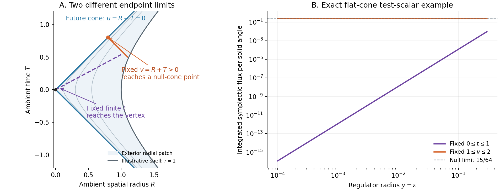

# HDBLAST: covariant flux and physical domains at a regular cone

13 October 2026. A reproducible technical continuation of the
[regular-shell spectral checkpoint](https://doi.org/10.5281/zenodo.23335485).
The prior DOI identifies that earlier checkpoint; this continuation has no
separate DOI and does not alter its published files.

The new calculation derives the actual Einstein–scalar symplectic current
on the generic longitudinal solution slice, including mixed spectral values
and the doubled shell balance. It shows exactly why the radial endpoint
condition alone cannot settle flux through a finite null-cone segment.
The full physical state space and higher-dimensional Big Bang origin remain
unestablished.

- [Technical note (PDF)](manuscript/COVARIANT_FLUX_AND_PHYSICAL_DOMAINS.pdf)
  and [readable source](manuscript/COVARIANT_FLUX_AND_PHYSICAL_DOMAINS.md).
- [Results and limits](RESULTS.md), [next calculations](NEXT_CALCULATIONS.md).
- [Action-derived current](covariant/COVARIANT_CURRENT_AND_CONE_LIMITS.md),
  [independent calculation](independent/INDEPENDENT_CURRENT_DERIVATION.md),
  [domain and exact comparator audit](domain/DOMAIN_AND_CHARACTERISTIC_FLUX_AUDIT.md),
  [tensor and gauge analysis](tensor/TENSOR_SMOOTHNESS_AND_GAUGE_DOMAIN.md).
- [Bounded primary-literature comparison](literature/CONE_PHASE_SPACE_PRIOR_ART_20261013.md).



The right panel is an exact flat test-scalar comparator. It is not a
numerical gravitational solution, a positive energy flux, or observational
evidence. The left panel displays the local conformal cone geometry.

## Reproduction

Use Python **3.12.14** and the pinned symbolic dependencies:

```sh
python -m pip install -r requirements.txt
python -I -B reproduce.py --output ../cone-replay-001
```

Choose a fresh output directory outside this capsule. The runner verifies
every capsule file and the seven copied prior documents before execution,
then runs all four checkers in normal and optimized Python from a relocated
copy. It compares their results to the reviewed receipts, exercises corrupt
input and injected-failure controls, and checks that neither capsule changed.
`CHECK_CONTRACTS.json` records the exact algebra/control inventory. The
analytic proofs and stated hypotheses remain necessary; check counts are
not numbers of independent theorems.

The immutable Git revision and the externally pinned CI workflow establish
which manifest is intended. For an additional explicit binding, supply
`--manifest-sha256` with the pin in the corresponding review/CI record.
`--verify-only` uses the standard library and checks integrity without running
the algebra. The prior scientific package is not replayed by this runner.

The [figure instructions](figures/README.md) describe optional plot regeneration;
the exact symbolic limits are part of the domain checker. The manuscript
includes its LaTeX source and build record. Third-party paper bodies are not
redistributed; identifiers, retrieval receipts and selected reading scopes
are recorded in the literature folder.

## Interpretation and declarations

The conditional null-current result assumes actual solutions with uniform
differentiable characteristic expansions. Constructing those solutions with
the registered shell conditions and proving a complete zero-charge gauge
quotient remain open. The exact flat comparator is a separate test-field
problem. The tensor horizon diagnostic has direct prior art; its smoothness
obstruction does not delete the massless radial profile from an energy
completion. Radial and inertial energy norms must be distinguished.

Ricardo Maldonado, Independent Researcher, ORCID
[0009-0009-3937-6527](https://orcid.org/0009-0009-3937-6527).
No funding; no known competing interests. Substantial OpenAI Codex assistance
was used for derivations, symbolic verification, literature organization and
drafting. Separate agent processes supplied internal review, not external
peer review. The note remains a technical draft for author review; no new
APS submission or claim of APS readiness accompanies this checkpoint.
