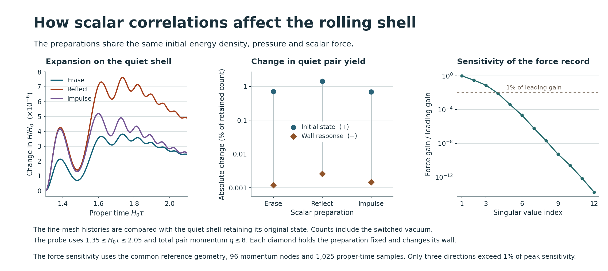

# Can scalar correlations change the expansion of a rolling shell?

**Yes, in the HDblast finite-band model.** Two states with the same initial energy density, pressure and force on the shell scalar subsequently drive different expansion histories. In the quiet fine-grid simulation, reversing the correlation between the parent field and its momentum raises the final parent energy density by **1.372%**, the expansion rate by **0.00275%**, and the total count of emitted fermion pairs in the modeled band by **1.412%**. We also constructed a pair of states whose initial rates of change of pressure and force match each other. Their later expansion rates and pair counts still differ. [Study plan posted before the coupled comparisons](https://github.com/maldonado-research/HDblast/issues/157#issuecomment-6997439750) · [Cumulative Zenodo edition](https://doi.org/10.5281/zenodo.24357251)

## A common past for the scalar and the five-dimensional shell

The earlier moving-parent study bounded changes in the signal on supplied shell histories. Here the same five-dimensional Einstein–scalar solver evolves the shell in response to the scalar population's energy density, pressure and reciprocal force at each time step. A finite band of one minimally coupled scalar starts in the model's instantaneous vacuum. Its covariance evolves on the rolling shell and feeds back throughout the common history. Immediately before adding the bulk pulses, at proper time $s=H_0\tau\simeq1.30372$, we use the computed field variance $X$, momentum variance $P$ and symmetric field–momentum correlation $C$ to define four preparations.

| Preparation | Change at the branching time |
|---|---|
| Retain | Continue the dynamically generated covariance. |
| Erase | Set $C$ to zero at each momentum while keeping $X,P$. |
| Reflect | Change $C$ to $-C$ while keeping $X,P$. |
| Uniform impulse | Shift each canonical momentum by the same coefficient times its field. Choose that coefficient from the initial covariance to preserve the integrated energy and pressure. The scalar force also matches. |

All four start with the same bulk and shell data within each quiet or pulse comparison. Retaining, erasing and reflecting also preserve the occupation at each momentum. The impulse redistributes occupations. Its coefficient follows from an exact algebraic identity, with no fit to the emitted particles. Its finite-duration oscillator test approaches the ideal operation as the duration decreases. The altered states are controlled choices made at the branching time. The unaltered state is generated by the simulated common history. [Preparations, junctions and compatibility](initial/JUNCTIONS.md) · [Impulse and zero net work](impulse/IMPULSE.md) · [Previous fixed-history study](https://doi.org/10.5281/zenodo.24356875)

## Expansion and pair emission

The table uses the fine mesh and the common readout $s=2.10$. The pair column gives the coefficient of $y^2$ in the number of pairs per unit comoving volume in $H_0^3$ units, on the quiet history with the wide switch. It includes the switched vacuum contribution within the total pair-momentum band $0\leq q/H_0\leq8$. Each of the last three columns compares the pulse with the quiet solution for **the same preparation**, using its own quiet count as the denominator. The distant-compensated case has a positive front with the compensating disturbance placed farther away.

| Preparation | Quiet expansion $H/H_0$ | Quiet parent density $\rho_\chi/H_0^4$ | Quiet total pairs | Nearby positive | Nearby negative | Distant-compensated positive |
|---|---:|---:|---:|---:|---:|---:|
| Retain | 0.17668894 | 97.6303 | 0.769816 | −0.1697% | +0.9849% | +0.0928% |
| Erase | 0.17669138 | 98.3002 | 0.775252 | −0.1698% | +0.9870% | +0.0933% |
| Reflect | 0.17669381 | 98.9700 | 0.780687 | −0.1699% | +0.9890% | +0.0939% |
| Uniform impulse | 0.17669145 | 98.2758 | 0.775130 | −0.1704% | +0.9916% | +0.0940% |

The signs of the three total-count contrasts survive both spatial meshes, both interaction windows and both daughter-frequency ranges in the four tested preparations. Subtracting the switched vacuum on each wall gives the opposite sequence of pulse-minus-quiet signs. The earlier fixed-wall counterexamples used other occupations, initial conditions and switch times. This study characterizes a specified family of dynamical preparations. The two positive count contrasts still have the same sign, so the sign alone cannot distinguish all three disturbances. [Native evolution and readouts](native/NATIVE.md) · [Fermion-pair amplitudes and controls](emission/EMISSION.md)

In the quiet fine calculation, applying the reflected state to the original wall increases the pair count by 1.41465% of the retained quiet count. Evolving the shell with that same reflected state changes the count by a further −0.00256 percentage points. Here “wall response” includes changes in both the scale factor and the rolling scalar that sets the parent mass. A diagnostic that interchanges these histories at the same proper times assigns +0.94 parts per million to the scale factor and −26.22 parts per million to the mass, relative to the reflected-state count on the unaltered wall. This symmetric decomposition uses two hypothetical combinations of histories alongside the two physical simulations. [Mass and scale-factor comparison](emission/BACKGROUND_SPLIT.json) The reflected-minus-retained change in $H/H_0$ is $4.87\times10^{-6}$ on the fine mesh and $4.99\times10^{-6}$ on the coarse one. These are paired within-mesh differences. Comparing the two meshes tests their stability without providing a continuum error bound. [Figure source](figure.py) · [Independent proper-time evolution and energy balance](audit/AUDIT.md)

## What the initial sources miss

The first three preparations have the same occupation, density, pressure and scalar force at the branching time. The correlation $C$ can change their time derivatives. For the nearly pure generated state, $C$ is positive at all 24 native momentum nodes on both meshes. At fixed $X,P$ there, preserving the original initial force derivative also fixes $C$ in the pure-state limit. The reflected and erased states therefore have a change in a higher time derivative of the boundary data at preparation. The numerical intervention tests one-sided evolution following that change. [Purity bound and original boundary data](initial/JUNCTIONS.md)

A follow-up control compares two **different mixed states**. Their correlations are weighted to cancel the first two relevant momentum moments, so their initial density, pressure, force and the first time derivatives of all three agree. Both share the same derivative mismatch with the earlier natural history. At the fine quiet readout their expansion rates differ by $4.50\times10^{-7}H_0$; the coarse difference is $4.52\times10^{-7}H_0$. Their fine wide-window total pair counts differ by **0.14566%** of the erased-state count. This shows why matching one more derivative between the two states still leaves their later response undetermined. [Matched-derivative states and numerical results](native_smooth/SMOOTH.md) · [Pair controls](emission/SMOOTH.json)

There is also a conditional mathematical result. For a common sufficiently smooth background, shared initial $X,P$, compact momentum support and nonzero scalar coupling at the branching time, an exact force record beginning there determines the initial difference in $C(q)$ almost everywhere. Successive odd derivatives reveal its even momentum moments. Recovery from finite-precision data is much harder. In the numerical quiet-wall transfer calculation only three directions exceed 1% of the strongest force response in the specified norms. These are properties of the transfer operator. Converting them to observational sensitivity requires an instrument and a noise model. [Proof and exact arithmetic check](moments/FORCE_JET.md) · [Numerical sensitivity](moments/CONDITIONING.md) · [Literature and research archive](LITERATURE.md)

## Physical scope and independent replay

The parent stress, scalar force and five-dimensional geometry evolve together. The massless Dirac pairs are a weak probe measured at leading order in $y^2$. The calculation omits their subsequent gravitational reaction. It uses a preferred comoving cutoff and the previous model's instantaneous subtraction for the parent stress. Demonstrating a hot Big Bang would require an energy-conserving evolution of the daughters, a sufficient radiation density and a comparison with cosmological observations. The present experiment addresses the earlier question of whether the initial matter sources suffice to predict the model shell's later response.

The capsule contains the fork snapshots, 36 new trajectories, scientific reports and source validators. In a checkout of HDblast or the offline Zenodo bundle, use the following commands from this study directory. The default check uses Python's standard library. The numerical replays use NumPy and SciPy. [Pinned historical inputs](SOURCES.json) · [Offline download](https://doi.org/10.5281/zenodo.24357251)

~~~sh
sha256sum -c SHA256SUMS
python -I -B reproduce.py
python -m pip install numpy==2.3.5 scipy==1.17.0
OPENBLAS_NUM_THREADS=1 python -I -B -O reproduce.py --full
OPENBLAS_NUM_THREADS=1 python -I -B -O reproduce.py --native --jobs 2
~~~
