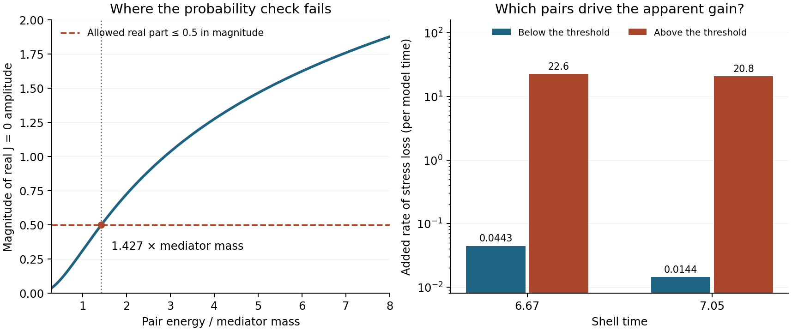

# Can exchanging the massive vector erase the preferred direction of the particle streams?

The higher-dimensional blast model needs a mechanism that turns directed motion on its expanding shell into a hot gas with comparable pressure in every direction. The earlier simulation let opposite charges briefly form a heavy neutral particle, a process called resonant scattering. A local coupling to that same heavy particle can also let two particles scatter by exchanging it, including pairs with the same charge. We calculated the initial effect of that exchange on the particle populations already simulated. [Charged-particle simulation](../HDBLAST_AXIAL_CURRENT_20261121/README.md) · [Collision records](../HDBLAST_COLLISION_PHOTONS_20261121/events/README.md)

**Nearly all of the rapid initial drop in pressure difference predicted by the added interaction comes from energies where the calculation fails a probability check.** At shell time 7.05 in the largest sample, the original interaction gives an initial rate of change of normalized pressure difference of about −0.36 per unit wall time. Including the exchange diagrams gives about −21. At time 7.05, 99.93% of the *additional* decrease comes from pair energies above the point where a calculated scattering amplitude exceeds an exact probability bound. At time 6.67 the corresponding share is 99.80%. This benchmark identifies where the proposed extension needs correction before it can support a prediction of rapid heating. [Wall-frame calculation](crossed-stress/README.md) · [Probability check](unitarity/README.md)

The left panel shows where the real scattering amplitude reaches the probability limit. The right panel uses a logarithmic scale to show the additional pressure-change rates above and below that energy. [Figure source](figure.py)

| Quantity in the 16,384-pair late sample | Result |
|---|---:|
| Incoming pair energy where the tested amplitude exceeds the probability bound | 1.42749 times the mediator mass |
| Recorded resonant collisions above that energy | 29.16% |
| Fraction of incident collision energy represented by those events | 38.52% |
| Relative rate with which all pairs scatter away from their incoming axes, including exchange | 8.41 times the isolated-resonance rate |
| Fraction of the increase in that angular rate coming from pairs above the threshold | 94.46% |

The angular rate counts deflections in each pair's center-of-mass frame. The wall-frame calculation boosts the outgoing particles back to the shell and measures how they change the gas pressure there. Both use the measured phase-space populations. They apply to the instantaneous collision terms on those populations. Evolving a new particle distribution would also change which pairs scatter and the currents that drive the fields. [Fixed-energy spin sums and population census](crossed-exploration/README.md) · [Wall-frame results](crossed-stress/STRESS.json)

The probability test applies to an equal-helicity partial wave of a specified pointlike, single-flavor, lowest-order exchange model for both like and unlike charges. Other components may require corrections even below this threshold. In 18.74% of the recorded late collisions, probability conservation requires the diagonal amplitude to move by more than half its calculated magnitude in the complex plane. An exact scattering theory conserves probability. The size and sign of the physical high-energy stress change remain open. The original resonant histories and their single-photon calculation use a different collision prescription. [Partial-wave derivation](unitarity/README.md) · [Single-photon study](../HDBLAST_COLLISION_PHOTONS_20261121/README.md)

## Reproduce the calculations

From this study directory in a checkout containing the three predecessor simulation studies and the collision-photon study, use Python 3.12, NumPy 2.3.5, SciPy 1.17.0 and a C++17 compiler. The runner authenticates the predecessor inputs, regenerates the histories, reconstructs the collision records and compares each scientific output with its archived values. The hosted workflow runs this same calculation.

~~~sh
python -I -B study.py --verify --jobs 2 --output-dir /tmp/hdblast-crossed-vector-results
~~~

[Reproduction script](study.py) · [Source input digests](parent-inputs.sha256)
