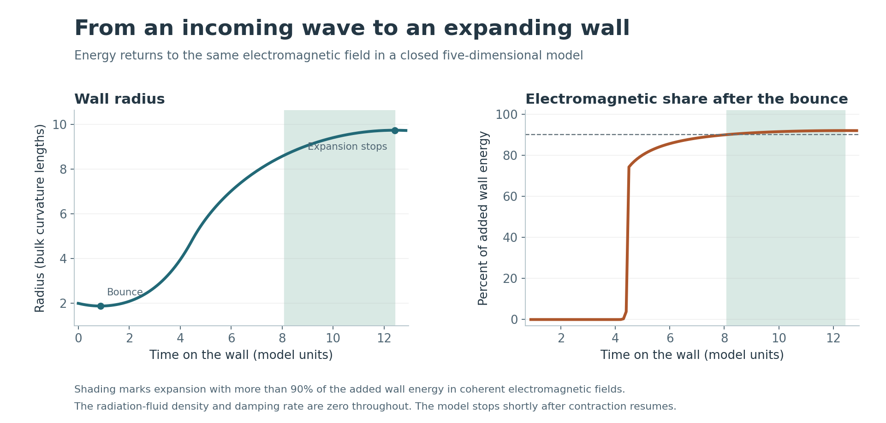

# Can a higher-dimensional pulse load a field and get its energy back as light?

A finite electromagnetic pulse can make a closed model universe contract, bounce and enter a short period of expansion in which the electromagnetic field supplies over 90% of the added energy on the wall. The incoming wave travels from an emitting surface at a finite distance. The five-dimensional metric, wave, four-dimensional surface field and wall radius all evolve. For the primary example a single positive electromagnetic coupling transfers energy in both directions. The independent radiation fluid and damping term are set to zero.

The cost of that result is measurable. The chosen surface gauge kinetic coefficient grows by a factor of about **13.2 million** from its initial value. Three equally excited fields produce isotropic stress, and the inputs on the two sides have matching phases. The resulting radiation is a coherent classical field. This calculation starts with a finite wall and a prescribed source. Its relation to the observed hot Big Bang remains an open question.

## Follow the energy

The wall initially has radius 2, zero expansion speed and zero added matter energy. Its tuned tension and a positive mass parameter of 4 on each bulk side are present before irradiation. Two identical sources a proper radial distance 0.002 inside the wall emit compact pulses measured by their own clocks. The wave first gives a canonical scalar field kinetic energy. As the scalar climbs a specified potential its pressure becomes negative. The contracting wall turns at radius **1.881** and expands. The early part of the trajectory also occurs in controls without later electromagnetic energy release.

A magnetic field remains on the curved wall after the pulse. As the scalar descends its potential, the chosen gauge coefficient rises a second time, transferring energy from the scalar into this field. Some energy continues to escape into the bulk. The directly computed surface electromagnetic stress has pressure equal to one third of its energy density. It passes 90% of the wall's added energy during expansion at radius **8.630**. The radius then grows to **9.744**, another **12.9%** or **0.1214 e-folds**, before contraction resumes. The electromagnetic share peaks at **91.97%**. Energy and flux are checked on both the emitting tube and the wall. An equation of state alone would not establish a thermal spectrum or predict a temperature. [Forward source, evolution and checks](loading/FORWARD.md) · [Machine-readable runs](loading/LOADING.json)

Holding the incoming pulse fixed while removing the second rise in gauge coupling suppresses electromagnetic domination after the bounce. Both smaller and larger increments than the successful example can miss the 90% threshold. A separate run that deposits scalar energy into the earlier effective radiation fluid gives **0.606 e-folds** of fluid-dominated expansion. These tests use different transfer laws. Their difference measures how the predicted history depends on the matter model.

## Why curvature matters

On a flat wall a normally incident wave drives the scalar through its tangential electric field. On a round three-sphere the lowest vector harmonic also has a tangential magnetic field. For a common triplet amplitude $\mathcal A$, proper time on the wall and radius $a$, their squared strengths are $E^2=\dot{\mathcal A}^2/a^2$ and $B^2=4\mathcal A^2/a^4$. The scalar force from the surface term $-K(\psi)F_{ab}F^{ab}/4$ is $K_{,\psi}(E^2-B^2)/2$. The magnetic term can reverse the transfer. The closed vector harmonic, isotropic Abelian triplets and their coupling to scalars have precedents. The question tested here is what happens when the waves are launched in five dimensions and the moving wall and bulk must obey their matching and energy equations. [Primary literature and previous HDblast tests](literature.md)

* On the fixed wall at $R/K_0=4$ the integrated electric and magnetic impulses are 1.422 and 2.122 in model units. The difference gives scalar velocity −0.700. Moving the emitter changes the sign at the same wall radius and the same incident energy. At $R/K_0=32$, 86.71% of the incident energy ultimately remains in scalar motion. With much larger radius the result approaches the 90.49% flat benchmark. An exact Bessel-wave scattering calculation checks propagation and port normalization. [Fixed-wall test](fixed/FIXED.md) · [Independent spectral check](fixed/BESSEL.md)
* A separate fully gravitating calculation keeps the emitter at a **fixed areal radius** of 1.65. With an initially expanding wall and a different material, the wall turns to contraction, then turns back to expansion near radius **1.854**. A nearby parameter choice appeared to bounce at coarse resolution and continued contracting on finer meshes. The study retains that failed example. [Fixed-radius source and convergence study](gravity/GRAVITY.md)
* Prescribing the incident wave **at the wall** gives a complementary way to solve the junction and check the short-pulse limit. Reconstructing the surrounding spacetime shows that reproducing this exact trace requires a weak continuing input at a nearby tube. Directly prescribing a compact pulse at the tube gives a different history. [Wall data and impulse limit](loading/LOADING.md) · [Spacetime reconstruction](identities/COLLAR.md) · [Exact bulk benchmark and constraint identities](identities/IDENTITIES.md)

## What the successful example requires

In a closed geometry the wave can seed a magnetic field, but its energy after the initial pulse is small. Write $E_s=K(E^2+B^2)/2$ for the surface electromagnetic energy density and $q$ for the net energy flux into the wall from **one** of its two identical sides. An exact balance is

$$
\frac{d}{d\tau}\frac{a^4 E_s}{K}
=\frac{a^4}{K}\big(2q-\dot K E^2\big).
$$

When the incident characteristic at the wall has ended, $q=-E^2$. For nondecreasing $K$, the scaled electromagnetic energy $a^4 E_s$ can then grow at most in proportion to $K$. In the wall-prescribed comparison, reaching 90% requires at least a **49,779-fold** increase after the scalar reaches its descending edge. The chosen increase is **50,001-fold**. At a source specified away from the wall, waves may return after the source switches off and the flux must remain in the balance. The size of the required coefficient change, the pulse shape, the separation of source and wall, and the relative phases are physical constraints for any proposed origin of this effect. [Return into the same Maxwell triplet](loading/RETURN_FIELD.md)

The calculation supplies a classical coupling and a scalar potential. It assumes the original emitting material, perfect rotational symmetry and a wall of finite starting radius. It does not derive those from a higher-dimensional blast, account for charged matter or calculate thermalization. A particularly important test is to couple the radiation to charged particles, with a physically normalized gauge coupling, and see whether a hot plasma can form without undoing the bounce. A tensor perturbation spectrum and an observational comparison would require further equations.

## Reproduce

Use Python 3.12 with NumPy 2.3.5 and SciPy 1.17.0. The forward proper-distance solver requires a C++17 compiler available as `g++`. For the supplied figure also install Matplotlib. Run from the directory containing this README.

~~~sh
python -I -B -S reproduce.py
python -I -B reproduce.py --verify --jobs 2
python figure.py
~~~

[Source input hashes](SOURCES.json) · [Original calculation plan](https://github.com/maldonado-research/HDblast/issues/157#issuecomment-7031224875) · [Specified test of electromagnetic energy return](https://github.com/maldonado-research/HDblast/issues/157#issuecomment-7031341071) · [Previous release](https://doi.org/10.5281/zenodo.24386416) · [This version](https://doi.org/10.5281/zenodo.24387565)
