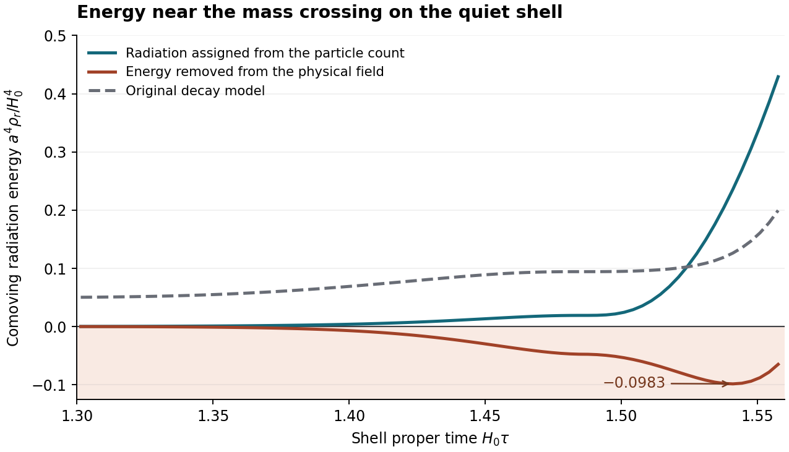

# Does changing the particle basis fix the radiation model?

The previous HDblast study found that radiation on a rolling shell depended on the upper momentum cutoff. One possible response is to define particles by a mode adapted to expansion and damp that mode toward its vacuum. We tested this proposal by measuring both the energy removed from the physical field and the energy assigned to daughters by particle counting. The two quantities can have opposite signs. In the simulated quiet history the proposed energy source drives an initially empty radiation fluid below zero, even when the field starts in the new bath's own vacuum. [Prior cutoff calculation](https://github.com/maldonado-research/HDblast/issues/157#issuecomment-6995280895) · [Starting question](https://github.com/maldonado-research/HDblast/issues/157#issuecomment-6995672424) · [Archival edition](https://doi.org/10.5281/zenodo.24356257)

## What happens on the original shell?

We used the measured quiet, nearby positive, nearby negative and distant-compensated positive histories of the earlier five-dimensional model. The shell geometry and scalar trajectory are held fixed. One real field has mass $m/H_0=100|\phi-0.5|$ and comoving band $0\leq k\leq8$ in the original crossing normalization. The daughter fluid begins empty. The original model damps the physical oscillator towards its ground. The alternative damps an oscillator defined by a leading adiabatic mode of $u=a\chi$. Its vacuum is a squeezed state of the physical oscillator. At each time we compare two sources for free-streaming daughters: signed energy removed by damping from the physical Hamiltonian, and positive energy assigned by counting quanta in the damped basis. Both candidate radiation densities obey the same redshift law.

The solid lines use the alternative bath **and its own vacuum as the initial state**. At preparation the two powers vanish, and both daughter densities are zero. Nevertheless, on the quiet shell the signed quantity reaches $a^4\rho_r/H_0^4=-0.09834$ near $H_0\tau=1.541$. An independent time-stepping method also finds a negative density. Across the quiet and nearby-positive histories, the two solvers agree on all twelve final density comparisons within $1.97\times10^{-5}H_0^4$. The positive count grows while the signed transfer is negative. With the earlier physical-ground preparation and the same alternative bath, the minimum is $-0.07363$. A classical, initially empty massless fluid cannot supply this energy. The target of the original decay law coincides with the physical ground, and its two energy assignments agree.

At the late cut $H_0\tau=2.10$, all the reported radiation densities are positive. The relative effects of the incoming pulses retain their signs for both assignments on the stored walls.

| Preparation and readout | Quiet density in $H_0^4$ | Nearby positive | Nearby negative | Distant positive |
|---|---:|---:|---:|---:|
| Original vacuum and bath | 37.1576 | −0.1714% | +1.0167% | +0.0994% |
| Alternative vacuum and bath, signed physical transfer | 36.8413 | −0.1715% | +1.0243% | +0.1016% |
| Alternative vacuum and bath, positive count | 36.8396 | −0.1743% | +1.0344% | +0.1011% |

The agreement of the late signs conceals the earlier energy deficit. The alternative initial state also carries $0.49951\,H_0^4$ of physical field energy above the original ground at preparation. Its effects on the full gravitational initial conditions would have to be included in a self-consistent calculation. [Wall evolution and energy account](evolution/EVOLUTION.md) · [Independent propagator](independent/TRANSFER.md)

## Where does the extra energy come from?

An exact finite example consists of a field oscillator and a second oscillator that receives its quanta. For transmissivity 0.64, two states with the same particle count each transfer $0.09E$ to the second oscillator, where $E$ is one energy quantum. With the physical field initially in its ground state, the field also **gains** $0.09E$ and the external control supplies $0.18E$. Reversing the relevant squeezing phase produces the same daughter energy but the field loses $0.36E$ and the control receives $0.27E$. These figures can be recovered by measuring the energies of both oscillators at the beginning and end of the interaction. [Collision calculation](collision/COLLISION.md)

More generally, at fixed physical Hamiltonian a positive-rate linear Lindblad jump containing a creation term supplies energy to the physical vacuum. Several such terms contribute with the same sign. Changing only the particle definition therefore cannot guarantee positive daughter production **and** equality with physical energy removed from the field on every state. In the specified expanding-space basis, the discrepancy even grows linearly with a formal high-momentum cutoff for a physical-vacuum probe at nonzero mass and expansion. [Conditional result and assumptions](THEORY.md) · [Analytic integral and numerical checks](controls/LOCAL_POWER.md)

These tests rule out treating this particular change of loss basis as a self-contained passive decay into free radiation. They leave open a driven bath with an explicit energy source, and decay generated by interactions between actual parent and daughter fields. The relevant cosmological test would compute the daughter stress, parent depletion, interaction energy and scalar work together through the mass crossing, and check whether the resulting radiation can dominate the expansion. [Primary literature and microscopic alternatives](LITERATURE.md)

## Reproduce

From this study directory in the repository, run the following commands. The first checks file hashes, recalculates the instantaneous ground-state probes with the Python standard library, and compares saved independent solutions and three momentum quadratures (24, 48 and 96 nodes). The full replay additionally requires NumPy and SciPy. The project CI uses Python 3.12, NumPy 2.3.5 and SciPy 1.17.0.

~~~sh
python -I -B reproduce.py
OPENBLAS_NUM_THREADS=1 python -I -B reproduce.py --full
~~~

The same commands work on the standalone archival files when the study and its inputs are extracted under a common root. The figure can be redrawn with Matplotlib using plot_radiation.py. [Historical inputs and hashes](SOURCES.json) · [Earlier source-work edition](https://doi.org/10.5281/zenodo.24355836)
