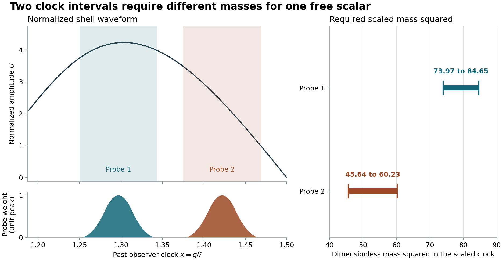

# Can the shell waveform distinguish a higher dimension?

18 November 2026 · Conditional model comparison for the HDBLAST shell · [Zenodo edition](https://doi.org/10.5281/zenodo.24351909)

**The registered shell waveform rules out one freely propagating constant-mass scalar on the same four-dimensional background. A collection of four-dimensional fields can reproduce the entire linear waveform exactly.** The difference comes from the number of dynamical fields and the freedom to prepare their initial states. The nonzero shell signal established in the previous edition remains compatible with either dimensional description. [Earlier waveform edition](https://doi.org/10.5281/zenodo.24351089)

| Information retained by the observer | Result for a four-dimensional comparison |
| --- | --- |
| Two signed window means | A fixed smooth quadrupolar pulse driving one massive field can match both by varying its mass and one common gain. |
| The waveform inside two short time intervals | The two integrals of the free one-field equation require disjoint values of its constant mass squared. This excludes every mass for this one-field readout when forcing vanishes on both test intervals. |
| The full linear scalar trace, including the initial quiet interval | A countable set of free positive-mass fields on the shell’s four-dimensional de Sitter background reproduces it. The masses, correlated initial data and linear readout come from the shell’s radial operator. |



The two-window ratio lies strictly between **−0.36754 and −0.36459**. Its precision comes from using the common physical gain in both windows. The mass test integrates the waveform on two separately specified supports. It avoids numerical differentiation. The two intervals for the dimensionless squared mass $(m\rho_b\ell)^2$ are **(73.97, 84.65)** and **(45.64, 60.23)**. For several free fields, the same test bounds the product of their squared-mass spread and the cancellation among their signed contributions. The registered normalization sets $\ell=10^{-6}$. [Ratio and waveform test](SINGLE_FIELD_TEST.md) · [Concrete one-pulse fit](FORCED_COMPARATOR.md)

The exact four-dimensional representation uses one field for each eigenmode of a finite radial collar whose outer endpoint is beyond causal reach. The prepared fields can have a vanishing *summed* readout before the signal reaches the shell. Finite truncations approximate the full readout on the admitted interval to arbitrary precision. This representation also reproduces the leading angular variance because that coefficient is determined by the linear trace. It covers the registered angular sector and background observer clock. An independently constrained preparation, gravitational backreaction, nonlinear observables, other sectors and cosmological data would add requirements to the comparison. [Spectral construction and its limits](TOWER.md) · [Explicit finite-truncation bound](TRUNCATION.md)

An observational test now needs an independent restriction on the competing models. One possibility is a source and receiver with calibrated couplings, applied across several angular sectors with a shared preparation budget. Until such restrictions are specified, precision on this single scalar trace alone cannot establish the ambient dimension or the physical origin of the Big Bang. [Earlier project results](PORTFOLIO.md) · [Related literature](LITERATURE.md)

## Reproduce

Run these commands from this directory with Python 3.12. The checks use the standard library. The inputs are copies of the previous edition’s certified continuous waveform cells and source reports. `SHAPE.json` contains exact fractions. The separate pulse calculation certifies a family of solutions of the comparison equation. The spectral representation is a continuum proof and does not require numerical eigenvalues. [Immutable source register](SOURCES.json)

```sh
sha256sum -c SHA256SUMS
python -I -B shape.py > /tmp/hdblast-shape.json
cmp SHAPE.json /tmp/hdblast-shape.json
python -I -B pulse_replay.py > /tmp/hdblast-pulse.json
cmp pulse_bounds.json /tmp/hdblast-pulse.json
python -I -B cutoff.py > /tmp/hdblast-cutoff.json
cmp CUTOFF.json /tmp/hdblast-cutoff.json
```

Matplotlib is optional for regenerating the figure. The model background and earlier analytic waveform enclosures are retained assumptions. The fixed four-dimensional comparator fields are classical probes. No source population, observation likelihood or telescope data enter the calculation.
