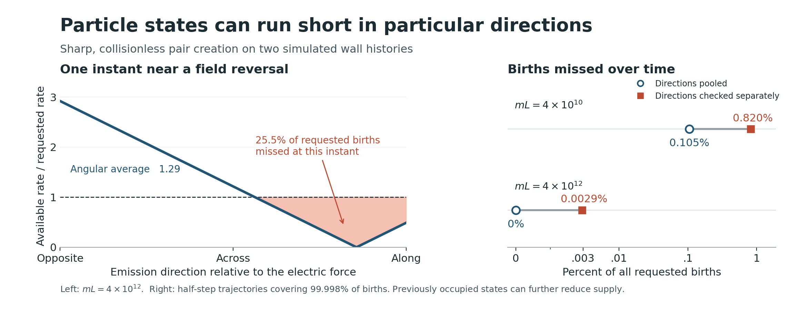

# Direct angular integration and source conservation



Near a reversal of the electric field in the heavier model, the supply of new momentum states averaged over directions was **1.29 times** the required rate. In directions nearly tangent to the moving birth surface, some particles lacked an available state. At this instant 25.5% of the requested isotropic births exceeded the directional capacity. Reversals occupy a small share of the production history. For this same case the estimated directional shortfall averaged over the run was **0.002899%** of all requested births. The diagram fixes the history and assumes a sharp birth momentum, an empty state at each crossing, and independent supply across infinitesimal angular elements. [Numerical results](AUDIT.json)

## Independent integration

For outgoing direction cosine $u$ of the positively accelerated sign, write $c=\dot k$, $d=\mu QaX$, and $t=\dot N/(12k^2)>0$. The canonical shell center has velocity $-d$ along the positive triad axis, giving normal speed $c-du$. An optimistic empty-state hard cap accepts a fraction $A(u)=\min(1, |c-du|/t)$ of isotropic demand. For the loss $1-A$ the angular profile is piecewise linear. A three-point Gauss rule on each linear segment integrates its products with $1,u,u^2,P_4(u)$ exactly up to floating-point arithmetic. The audit averages over proper time with a separate three-point rule on regular steps. Steep changes in electric acceleration use adaptive quadrature after locating all absolute-value branch endpoints. The input histories are the two native and two half-step tables from the finite wall solver. They cover cumulative rest fractions $10^{-5}$ through $1-10^{-5}$, or 99.998% of the total requested population. [Audit code](audit.py)

| Daughter mass $mL$ | Resolution | Requested births above the directional cap | Mean accepted $u$ relative to the positive triad axis | Cubic fourth moment |
|---:|---|---:|---:|---:|
| $4\times10^{10}$ | Native | 0.820391% | $-2.8454\times10^{-6}$ | $-0.00107152$ |
| $4\times10^{10}$ | Half step | 0.820418% | $-2.8457\times10^{-6}$ | $-0.00107156$ |
| $4\times10^{12}$ | Native | 0.00289920% | $-8.16\times10^{-9}$ | $-3.87466\times10^{-6}$ |
| $4\times10^{12}$ | Half step | 0.00289926% | $-8.20\times10^{-9}$ | $-3.87476\times10^{-6}$ |

The mean $u$ here keeps the same axis throughout electric reversals. The angular profile of the negative charge is its mirror. The past occupation of a particular label and a physical scattering or coherent production law can affect the actual yield.

## Current and stress of births

Define $A_j=\tfrac12\int_{-1}^1 u^jA(u)\,du$, and let $q_0$ be the attempted comoving rest injection rate. With $R=M/(2m)$, the accepted comoving rates are
$$
 \dot D_b=q_0 A_0,\quad \dot E_b=R\dot D_b,\quad
 \dot S_b=q_0\sqrt{R^2-1}\,A_1 .
$$
$S$ sums signed directed momentum in the model's charge-aligned axes. An oppositely charged partner has opposite physical momentum and charge. The pair cancels its total spatial momentum while its two contributions to the electric current add. For an expanding birth shell and a positive acceleration the clipped directions are preferentially on the positive side. This gives $A_1\le0$. In the limit $|d|\ge |c|+t$ a triangular loss band of half-width $t/|d|$ centered on $c/d$ gives $1-A_0=t/(2|d|)$ and $A_1=-(c/d)(1-A_0)$.

For each of the three equal orthogonal species axes $e_i$, the angular second-moment tensor is $A_2 e_i e_i^T+(A_0-A_2)(I-e_i e_i^T)/2$. Summing the three tensors gives $A_0 I$. Thus the *summed* birth stress is isotropic under this exact triad symmetry even if each angular population is strongly anisotropic. Its pressure divided by its energy source is $(R^2-1)/(3R^2)$ at fixed birth energy. The azimuthal average of $n_x^4+n_y^4+n_z^4-3/5$ at fixed $u$ is $2P_4(u)/5$. The surviving fourth moment measures angular structure in the newborn population. It is defined at injection on the simulated wall; it has no measured sky interpretation.

For gas primitives $U=E-\sqrt{D^2+S^2}$, $v_c=S/\sqrt{D^2+S^2}$ and $\gamma_c^{-1}=D/\sqrt{D^2+S^2}$, the source contributes
$$
 \dot U_b=(R-\gamma_c^{-1})\dot D_b-v_c\dot S_b.
$$
The parent loses precisely $\dot E_b$. In the gas rest frame with mean drift $v$, the excess above the wall-frame birth energy is $(\gamma-1)\dot E_b-\gamma v\dot S_b$ and can have either sign. The rest-frame excitation above the actual rest injection remains nonnegative because $\dot E_b^2\ge\dot D_b^2+\dot S_b^2$. A pressure or viscosity law for one flavor after birth, or a specification of the final distribution in occupied states, requires additional physics. [Live angular source](../feedback/angular.hpp)

## Cross-checks and reproduction

Seventy-five exactly integrated rational examples test angular moment signs, the triad tensor, and the conserved four-vector ledger. Eighty-five tests call the actual C++ header used by the live calculation. They include zero and tiny electric acceleration, threshold tangencies, strong translation, both field orientations and two vacancy laws. The independent factorized-vacancy reference integrates $|c-du|/(|c-du|+t)$ with adaptive angular quadrature. Charge-class source fixtures separately verify the energy and signed momentum terms including examples with negative frame-change corrections. The tests are numerical and algebraic checks on the specified model.

After the native trace step, run the following from the study root with the trace directory used for the replay.

```sh
python -I -B audit/audit.py --native /tmp/hdblast-traces --prior prior --output /tmp/AUDIT.json
python -I -B audit/figure.py --output /tmp/directions.png
```
