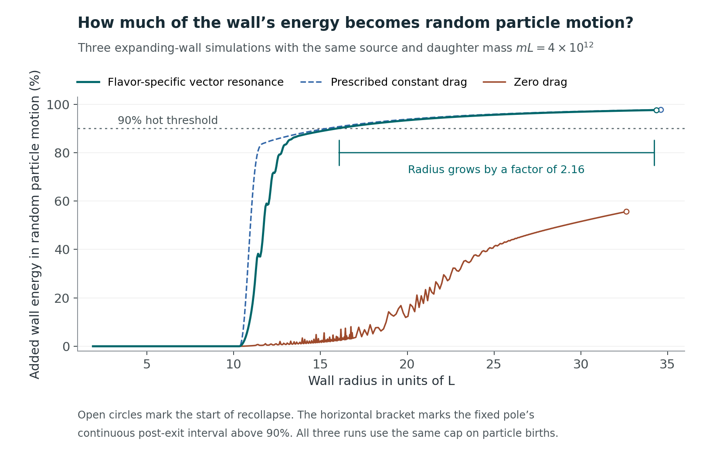

# Heating with one interaction throughout the evolution

Can two streams of oppositely charged particles convert electric acceleration into random motion fast enough to heat the wall? We replaced the constant damping rate in the preceding heavy-particle example with one fixed, elastic spin-one resonance. Its rate varies with the density, temperature and speed of the streams. The gas starts empty, the external pulse and parent decay produce the charged population, and the calculation follows the electric current and the wall geometry together through the first turnaround. The parameters were selected by exploring the previous **late**, hot history. The resulting startup behavior is a separate calculation at the same parameters. [Previous benchmark](https://doi.org/10.5281/zenodo.24407984) · [Parameter selection](../scattering/RESONANCE.md)

| Collision and birth prescription | Peak random energy share | Radius at start of hot interval, in units of $L$ | Maximum radius, in units of $L$ | Growth while hot |
|---|---:|---:|---:|---:|
| Zero drag, directional cap | 55.65% | — | 32.628 | Never reached 90% |
| Constant $18/L$, directional cap | 97.74% | 15.358 | 34.599 | 2.2529× |
| Fixed vector interaction, directional cap | 97.62% | 15.933 | 34.355 | 2.1563× |
| Same with halved time step | 97.62% | 15.936 | 34.355 | 2.1558× |
| Fixed vector interaction, smooth independent vacancies | 97.62% | 15.933 | 34.355 | 2.1563× |

Here “hot” means an expanding, post-transition interval on which the streams' intrinsic random energy is at least 90% of the **total added wall energy**. At the doubling of the hot radius this share is 97.26% in the fixed-pole calculation. The wall has a pre-existing radius, a constant background tension and a finite bulk energy supply. The hot-growth factor is measured from the onset of this interval. All cases subsequently turn around. [Machine-readable results](EVOLUTION.json) · [Evolution code](evolve.py)

## From a cross section to a self-consistent electric current

The pole mass is $8300m$ with fractional width $0.30$, daughter mass $mL=4\times10^{12}$ and $S_0=\sigma L^4=1.04156\times10^{54}$. For invariant mass squared $s$ measured in units of $m^2$, put $b=.30(s+2)\sqrt{1-4/s}$. The unpolarized elastic transfer cross section used throughout is

$$
m^2\sigma_T=\frac{12\pi}{s-4}\frac{b^2}{(s-8300^2)^2+b^2}.
$$

The calculation averages the momentum transferred in a collision between opposite equal-temperature streams, including the relative flux and two Lorentz boosts. It divides the resulting force density by the directed momentum density of the evolved fluid. With $\Theta=T/m$, four-velocity $u=\gamma v$, comoving rest $D$ summed over both charge signs and three equal axes, and wall radius $a$ in units of $L$, the rate in wall time is

$$
L\nu=\frac{S_0 D}{6a^3\gamma(mL)^3}\,C(\Theta,u).
$$

Here $C=\nu m^2/n_{\rm target,proper}$ in natural units. Its value comes from the cross section and the distributions. The factor of six selects the opposite charge on the same axis. The momentum equation uses $-\nu S$ and the random-energy equation receives the corresponding work. The electric current, field amplitude, gravitational expansion, parent depletion and injected particle momentum are updated on the same time steps. Equal axes preserve isotropy of the total stress. The implementation retains the Taub–Mathews enthalpy of the parent fluid solver when converting the force density to a relaxation rate. [Force integral and limiting cases](DERIVATION.md) · [Fresh-state decay prescription](../feedback/FEEDBACK.md)

The coupled dynamics distinguish electric work from collisional heating. In the native pole run the integrated signed field-to-gas work is 41.537 and its absolute integral is 137.290 in the solver's comoving energy units. If $W_+$ and $W_-$ are the cumulative magnitudes of forward and reverse exchange, $W_{\rm net}/W_+=2W_{\rm net}/(W_{\rm abs}+W_{\rm net})$. This ratio is **46.46%** with the pole and **0.994%** with zero drag. In the latter case the gas repeatedly gives most of the forward electrical work back to the field. In the pole run 98.04% of absolute work takes place at $\Theta<100$ or $|v|>0.1$, outside the domain of the preceding hot, slow-drift approximation. The maximum stream Lorentz factor is 35.71 with the pole and 323.38 with zero drag. The cold-beam resonance would require $\gamma=4150$. Off-resonance scattering and the spread of individual particle energies enter the calculation. [Thermal kernel](thermal.py) · [Late-time switch controls](../scattering/LIVE.json)

## Sharing the resonance among three flavors

The 2.156-fold result gives each incident flavor a dedicated elastic channel. Three copies with the same masses, widths and couplings implement that choice. If a single resonance couples equally to all three flavors, its fixed total width must be shared. We reran the full charge-odd momentum equation at the same mass and total width with branching fractions $B_i=1/3$. A spin-averaged parity-even pole then has a cross-section weight $B_i B_j$ for $i\bar i\to j\bar j$. The per-flavor coupling falls to keep the fixed total width. The incident partner density still counts only the appropriate opposite charge on the same axis. [Spin and flavor projection on this benchmark](https://github.com/maldonado-research/HDblast/blob/93b41992fece0db35de2eb51ed5289d1b31bec02/research/HDBLAST_DIRECTIONAL_TRANSPORT/transport/DRAG.md)

Each outgoing charge has mean four-momentum $P^\mu/2$ for fixed pair total $P^\mu$. Thus the outgoing charge-odd first moment vanishes for each destination flavor. Summing all final flavors gives $B_i\sum_j B_j=1/3$ of the dedicated-channel rate. Rotational equivalence of the three axes with equal populations also balances the mean energy and number exchanged between flavors. In this closed set of fluid moments the peak random share is **97.42%**, and the hot radius grows **2.068-fold**. Counting only events returning to the original flavor gives a partial-channel weight of $1/9$ and hot growth of **1.960-fold**. The latter is a diagnostic that discards genuine collisions into other flavors. Each stream's higher angular moments and any departure from its assigned thermal distribution would require a kinetic evolution. [Shared-pole calculations](FLAVOR.json) · [Replay](flavor.py)

## Checks and scope

The analytic reduction of the force integral was compared with a direct sampling calculation, cold limits, ultra-relativistic limits and the independently derived hot slow-drift kernel. The initial four-scramble sample at $\Theta=10$ and relative stream rapidities $\pm4$ differed from the reduced result by about 0.8%. A larger run at this point, with twelve scrambles of $2^{21}$ incident momentum pairs, gave $5.19678\times10^{-7}$ versus $5.19726\times10^{-7}$ from the reduced integral, a relative difference of 0.0093%. The coarse interpolation table has a maximum sampled relative error of 0.83% across its validation set. Halving the spacing in both coordinates of the collision table changed the native hot growth from 2.156252 to 2.156241. With both the refined table and halved time step, the factor was 2.155816. [Independent table refinement](REFINEMENT.json) [Kernel checks](BOOST_CHECK.json) · [Direct sampling test](SAMPLING.json) · [Resolution of the sampling difference](../scattering/CONVERGENCE.json)

The two streams are approximated by classical Maxwell–Jüttner distributions in their own rest frames, even as particles enter in narrow momentum states. The finite elastic channel transfers momentum but cannot by itself generate a photon bath or demonstrate chemical or kinetic equilibrium. The full momentum distribution, Pauli factors for final states of scattering, other channels of a microscopic theory and the origin of the prescribed bulk pulse remain open. The parameter choices demonstrate one finite solution within this closure. The size, duration and radiation entropy of that solution are constrained separately. [Entropy constraints](../cosmology/BUDGET.md)

Reproduce from the capsule root with `python -I -B boost/evolve.py --base prior --output /tmp/EVOLUTION.json --jobs 2`.

By the first hot crossing the hard-cap pole run had accumulated $\int\nu\,d\tau=27.19$ momentum-relaxation times along the evolving fluid, rising to 535.27 by radius doubling. This is a time integral of a collective relaxation coefficient. Individual particles enter at different times and have different collision probabilities. [Event-integrated rates](EVOLUTION.json)
