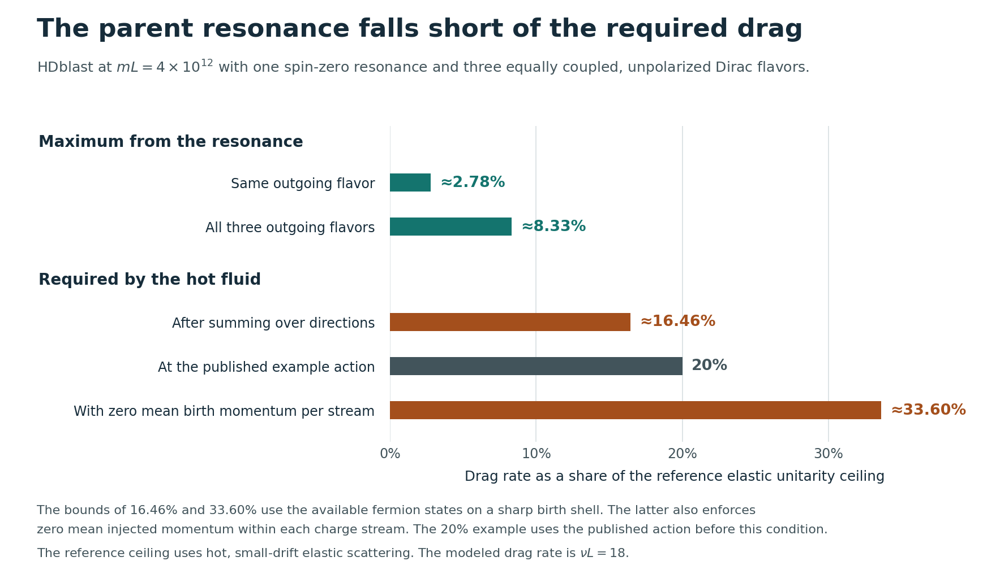

# Which interactions can produce and slow the charged particles on the HDblast wall?

HDblast follows a finite incoming pulse on a closed wall. In the latest model that pulse excites a neutral scalar, the scalar decays into charged fermions, and an electric field accelerates them. In a selected fluid run, the particles' random internal energy exceeds 90% of the added wall energy while the radius grows by a factor of 2.89. The heating calculation prescribes a local decay law and momentum relaxation. This study tests the particles and interactions that could realize those laws. It extends the closed-wall occupation and amplitude methods developed in the TOE comparison. [Original coupled calculation](../HDBLAST_COHERENT_DECAY_20261120/README.md) · [TOE closed-wall benchmark](https://github.com/maldonado-research/Unified-Theory-of-Everything/blob/d9fa25bbca056135c7e808ca006ac2807a9190d5/checkpoint_2026_11_20/wall_fermions/00_READ_FIRST.md)

**A single neutral scalar resonance shared equally by three unpolarized Dirac flavors supplies too little hot drag in the heavy benchmark.** Even at its most favorable action consistent with the published instantaneous, angle-summed birth-state test, the fluid at $mL=4\times10^{12}$ requires 16.46% of the reference elastic unitarity ceiling. The scalar can provide at most 2.78% through same-flavor elastic scattering, or 8.33% for the charge-odd momentum after counting every outgoing flavor. Preserving the fluid’s zero mean birth momentum separately for each charge stream strengthens the required fraction to **more than 33.59%**, using one resolved field reversal. Even the inclusive resonance then falls short by a factor of **4.03**. The result identifies a concrete need for another source of drag, a modified particle-production law, or different microscopic assumptions. [Spin and flavor derivation](transport/DRAG.md) · [Zero-momentum test](replay/MOMENT.md) · [Numerical comparison](transport/DRAG.json)

[Download the figure as a PDF](hot-drag.pdf)

## How many births can use the available states?

At a given time, the allowed birth momenta lie on a sphere that changes size and shifts under electric acceleration. Where a patch of that sphere moves tangentially to itself, its supply of new fermion states can be small. A spin-zero parent decaying at rest in the isotropic, field-free birth law used by the fluid requests equal numbers in every solid angle. Thus surplus states in one direction cannot directly accommodate daughters with a different assigned momentum. A second restriction comes from births at different times reaching the same momentum state during subsequent collisionless propagation.

| Published daughter mass $mL$ | Shortfall found by summing directions first | Shortfall from requiring isotropy in each direction | Lower estimate including repeated use of states |
|---:|---:|---:|---:|
| $4\times10^{10}$ | 0.10516% | 0.82042% | at least 1.2816% |
| $4\times10^{12}$ | 0% | 0.002899% | at least 0.004789% |

Numbers refer to the published trial action at each mass, using the half-time-step trajectory and the central 99.998% of the reference yield. Percentages use the archived total-yield normalization. The last column gives conservative numerical estimates of lower bounds on the stated interpolated trajectories. In the heavier case, roughly 29 births per million face a directional shortage. Accounting for already used states raises the lower estimate to about 48 per million. Around one field reversal the instantaneous directional shortage briefly reaches 25.5%. Integrated over the episode, most requested births remain outside the identified shortfall. The calculation keeps the original trajectory fixed. A revised source, scattering, finite birth bandwidth or different electromagnetic transport would require a new evolution to predict the change in heating. [Angular state counting](ANGULAR.md) · [Numerical replay](replay/README.md) · [Independent reversed-order integration](independent/README.md) · [Previously occupied states](memory/MEMORY.md)

## Can an anisotropic source avoid the directional shortfall?

Allow the source to put particles in any available direction while retaining the fluid's condition of zero mean directed momentum at birth for each sign. This is more freedom than isotropic emission. Near a measured electric reversal the greatest possible zero-momentum rate is about 59.53% of the request at the heavy trial action. At a snapshot where the translational shell speed is four thirds of the radial shell speed, summing all directions would indicate that only 78.99% of available states are needed. Accounting for their momentum shows that an empty distribution still has insufficient states. This one event imposes a necessary action ceiling of about $6.20\times10^{53}$. The resulting drag requirement is 33.60% of the reference ceiling. The test uses a sharp birth shell and the electric field linearly interpolated over that accepted time step. A different microscopic law could give each sign a nonzero mean momentum at birth and change the fluid's momentum equation. [Construction and two-grid check](replay/MOMENT.md)

## How much energy goes into fluctuations during the drive?

The interaction that shifts the minimum of the parent potential also couples fluctuations of the parent and the driving scalar. Starting both in the incoming vacuum, we evolved them through the narrow source pulse on the classical trajectory. Modes in the physical momentum band $m/8\le p\le64m$ take up $0.00989942\,m^4$ of energy per physical volume in the leading, locally flat, two-scalar approximation. At the heavier trial action, that is about 0.896% of the energy subsequently held by the homogeneous parent. Increasing the action makes this ratio smaller while increasing the number of requested fermion births. At the highest action allowed by the published angle-summed birth test the same band still carries about 0.737% of the outgoing parent energy. With the stronger zero-momentum condition the minimum band cost rises to about **1.50%**. The band is a positive finite contribution. The total feedback of all fields and modes on the wall has yet to be computed. [Coupled mode equations and controls](pulse/PULSE_MODES.md) · [Numerical result](pulse/PULSE_MODES.json)

## Scope and reproduction

The source and daughter masses, charge response, and three-flavor assignment are choices in an effective model. $mL$ is the daughter mass times the bulk curvature length in natural units. The thermal rates assume local field-free binary scattering in an unpolarized, dilute, ultrarelativistic gas with small relative drift. The birth calculations use the earlier sharp, locally collisionless shell approximation. The two apply at different parts of the history. A kinetic evolution with specified additional channels must supply the required momentum relaxation, carry occupation across times, and account for the energy transferred to the gas. The calculations give no observational evidence for the proposed origin of the universe. [Physics inputs and literature](source/SOURCES.md) · [Search and citation ledger](source/SOURCES.json)

Use Python 3.11 or newer, NumPy, SciPy and a C++17 compiler named `g++`. The study reads the previously archived HDblast files in the adjacent directory. The directional replay recompiles the original evolution with read-only diagnostics and checks the seven source digests. The independent check repeats the two time grids and reverses the order of the angular and time integrations. Saved substeps are used to evaluate the collisionless bounds. From this directory run

~~~sh
python verify.py --full
~~~

Without `--full` the checker verifies the files and runs the transport normalization and analytic momentum-space controls. The optional plot regeneration uses Matplotlib and `python figure.py`. [Verification code](verify.py) · [Checksums](SHA256SUMS)
