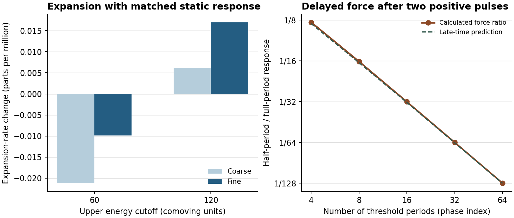

# Which measurements of the emitting field can constrain HDblast?

The HDblast hypothesis proposes that an event in a higher-dimensional space could have started the hot expansion of our universe. The previous simulation showed that the emitting field could make the shell expand slightly faster or slower for the same leading particle energy. Here we ask what another measurement could tell us. A static measurement determines how strongly the field pushes back when displaced slowly. A time-dependent measurement tests how it reacts while the disturbance is changing and after the drive stops. [Previous gravity calculation](https://doi.org/10.5281/zenodo.24360096) · [Study archive](https://doi.org/10.5281/zenodo.24361277)

## A test in the expanding shell

We imposed the same static correction to the parent restoring force at all 24 momenta in two versions of the model. One retained particle-pair energies up to 60 in the model's comoving units, the other up to 120. We chose the common calibration after inspecting the earlier slopes, deliberately selecting a case that could expose different outcomes. We recorded the signs predicted from those earlier data before evolving the matched shells. The expanding five-dimensional geometry and its matter then evolved from the original initial conditions in 16 fresh runs. [Dated prediction](https://github.com/maldonado-research/HDblast/issues/157#issuecomment-7001899995) · [Equations, errors and direct numerical test](gravity/gravitational.md)

| Upper energy cutoff | Coarse grid | Fine grid |
|---|---:|---:|
| 60 | −0.0212 ppm | −0.00985 ppm |
| 120 | +0.00624 ppm | +0.01698 ppm |

The table gives the leading **change in the expansion rate** at proper time 2.10, relative to the same uncoupled shell, for illustrative coupling $y=0.1$. The shell continues expanding in each case. The signs survived halving the strength step on both grids. The grid shift is comparable to these small effects. The separation between the two cutoffs is more stable, about 0.027 parts per million on either grid. The sign difference is demonstrated for the two computed grids. Establishing either sign in a continuum spacetime requires further refinement. Unlike the previous same-cutoff test, these two cutoffs also admit different outgoing particle energies. The imposed static calibration has yet to be measured in a physical system.

## What a second measurement buys

For a frozen shell, the response at zero frequency fixes the static term. Its slope in squared imaginary frequency supplies a second measurable parameter related to inertia. Holding both fixed allows a prediction for the remaining frequency dependence of the specified positive bath spectrum. Across 24 momenta and four test frequencies, the largest missing fraction of this remainder falls from **6.70% at cutoff 60** to **0.109% at 480**. These percentages describe the residual frequency response of the model. They are separate from the change in cosmic expansion. [Spectral results](response/RESULTS.md) · [Independent test with a driven Hamiltonian](audit/HAMILTONIAN.md) · [Bounds and their assumptions](theory.md)

The existing 64-frequency sampling can miss much of this particular low-frequency curvature at the smallest native momentum. Even with a longer energy interval, that sampling can leave too few points near the lower threshold. Changing integration variable concentrates the calculation there. Sixteen nodes in the transformed variable reproduced the continuous finite-band curvature to about one part in ten trillion over these 384 probes. This control distinguishes an error in evaluating the continuous spectrum from the deliberate choice to retain a finite set of oscillators. [Independent quadrature check](audit/HAMILTONIAN.md)

We used drive waveforms taken from the fine quiet shell to ask how well these two measurements predict the force from the energy band between 60 and 120. With a static restoring force alone, the weighted root-mean-square force error was **20.42%**. Including the kinetic response reduced it to **10.53%**. Both local formulas give exactly zero net work after a complete smooth pulse. The explicit oscillators retain **2.573972** units of energy in the prescribed-drive normalization. A separate Fourier calculation recovered the same value. The work identity and the Cauchy–Schwarz inequality give a lower bound of **1.06%** on the force error for any approximation that returns zero net work in this test. A model that aims to explain reheating must therefore track something capable of retaining the transferred energy. This experiment isolates the driven part of the response and supplies no cosmic temperature. [Drive protocol](https://github.com/maldonado-research/HDblast/issues/157#issuecomment-7001993658) · [Force calculation](driven/DRIVEN.md) · [Independent work and error bound](driven_check/ENERGY.md)

## A prediction after the force is switched off

We also tested two externally applied positive pulses with equal total integrated drive. In the continuous spectrum, spacing them by half a period at the lowest bath frequency cancels the leading late force. Spacing them by a full period reinforces it. At the stated sample phases, the half-period signal fell from **12.05%** of the full-period signal after four periods to **0.781%** after 64. An abrupt upper cutoff can overwhelm this long-time signal with an oscillation of its own. A smooth upper edge and an independent frequency integral recover the predicted decay. The same mechanism works in an ordinary four-dimensional bath with this spectrum. The unequal pulse responses provide a test of the emitting material, and supply no measurement of spacetime dimension. [Time-domain derivation and data](memory/memory.md) · [Dated pulse prediction](https://github.com/maldonado-research/HDblast/issues/157#issuecomment-7001918750)

## What remains open

A gravitational calculation with both the static and kinetic responses physically fixed would require the corresponding pressure, energy density and scalar force on the moving shell. The frequency and time-domain tests here determine properties of the model's retarded force. A fluctuating quantum bath supplies additional stresses. The proposed hot origin still requires a demonstrated stage in which ordinary radiation dominates and an observable that distinguishes HDblast from four-dimensional alternatives. [Primary literature and Maldonado project sources](sources.md)

## Reproduce the calculations

Run these commands from this study directory in the repository or its standalone Zenodo archive. Python 3.12, NumPy 2.3.5 and SciPy 1.17.0 were used for the numerical replay. The first command checks the study and its 17 pinned historical files using only the Python standard library. The second rebuilds the numerical comparisons, including the 16 coupled gravity integrations. The optional figure command also uses Matplotlib.

~~~sh
python -I -B -S reproduce.py
python -I -B reproduce.py --verify --jobs 2
python -I -B figure.py --output /tmp/hdblast-matching.png
~~~

[Input revisions](SOURCES.json) · [Release checksums](SHA256SUMS)
