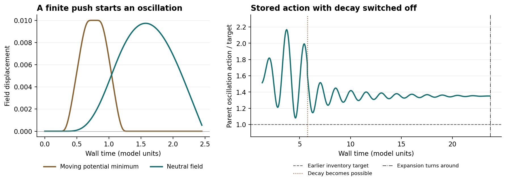

# Can the pulse supply the neutral field as well as the energy that later heats matter?

The preceding hot-expansion study started with a small population of neutral particles. A separate calculation adapted the TOE changing-mass method to ask whether vacuum fluctuations could supply that population. For one free conformally coupled scalar on the earlier geometry, fewer than **525** particles in expectation were possible by the opening of the decay channel in the chosen particle basis. The earlier benchmark required **more than 1.50 billion** for its mass and charge assumptions. This study investigates a different physical input. A rolling field acts directly on a neutral field whose classical amplitude initially vanishes, and gives up energy as the neutral field begins to oscillate. [Changing-mass test](https://github.com/maldonado-research/HDblast/pull/189) · [Hot-expansion study](https://doi.org/10.5281/zenodo.24407401)

**The direct interaction can supply enough coherent oscillation energy in a self-consistently expanding wall.** At the end of the drive, the neutral field held 1.51 times the earlier target when expressed as oscillation action. At the first instant decay became energetically possible, it held 1.67 times the target. At this instant the mass was changing rapidly. The field’s pressure was about 77% of its energy density. Identifying that state with a gas of cold particles would require additional physics. In a continuation that kept decay switched off, the action stayed above target throughout the subsequent expansion at the final mass. At maximum radius it was **1.35 times** the target.



## The test

Take the two-stage, closed-wall geometry with one finite incoming pulse profile applied symmetrically on both sides. Remove the initial neutral dust and charged gas. Start with $a=2$, $H=0$, zero scalar amplitudes and velocities on the wall, and bulk mass parameter $\mu=4$ to satisfy the constraint. The finite pulse sets the original wall scalar $\psi$ rolling. Add a canonical neutral scalar $\chi$ with positive potential

$$
U(\chi,\psi)=\tfrac12 M(\psi)^2[\chi-v(\psi)]^2.
$$

The minimum $v(\psi)$ makes a smooth, compact excursion of chosen amplitude $g$, then returns to zero. The backreaction $-\partial U/\partial\psi$ enters the equation of the driving scalar. The density and pressure of $\chi$ enter the gravitational and energy equations. The main run uses $g=0.01$, a drive active for $0.03<\psi<0.18$, and daughter mass $mL=1$. The dimensionless parent mass rises from 1.9 to 2.1 through the decay threshold at $\psi=0.53$. The wall can exchange energy and pressure with the simulated bulk annulus. No fluid is inserted when the threshold opens. [Coupled calculation and control results](coupled/PARENT.md) · [Parameter definitions](coupled/cases.json)

For a free homogeneous oscillator define $I=a^3\rho_\chi/M$. The reference cold population has target $I_*=2^3(10^{-4})/1.9=0.00042105$ at $mL=1$. The corresponding whole-sphere coherent displacement occupation, in the local oscillator basis, is $2\pi^2S_0I$, where $S_0=\sigma L^4$. The common normalization cancels in $I/I_*$. The large absolute particle requirement above belongs specifically to the earlier weak-coupling reference. On this new trajectory the neutral field first reaches $I/I_*=1.51414$ at the end of the drive. The moving-minimum work, mass work and pressure work were tracked separately. The two scalar energy budgets carry equal and opposite interaction work. [Action, pressure and energy audit](analysis/COHERENT.md)

| Time or control | Result |
|---|---|
| Drive off, same incoming pulse | No coherent neutral supply |
| Pulse off, same interaction | The wall contracts before reaching the drive |
| Decay first allowed | $I/I_*=1.67352$, with $|\dot M|/M^2=5.19$ |
| After the mass settles, at first maximum | $I/I_*=1.35152$ with no decays |
| Separately tuned heavier field, $mL=16$ | About 1.82 times its own target survives to maximum, with 82 complete periods and small cycle-averaged pressure |

A different amplitude, drive duration, or pulse dose can prevent the wall from ever reaching the chosen threshold within the computed domain. At dose 0.12305 the field already held 1.50 times the target when the drive ended, yet it missed the threshold before the radius limit. This distinguishes supplying energy from delivering it at a useful stage of expansion. The fixed-radius cutoff is recorded for each censored control.

## Independent checks and physical limits

An independent canonical-variable calculation reconstructs the opening ratio on the measured trajectory within a relative difference below $1.2\times10^{-7}$. A separate compact two-scalar calculation starts its rolling source with twice the benchmark rest energy. In the tested interval it transfers about 72% of that source energy through the interaction. In yet another check, adding the same linear drive to the earlier *conformally coupled* quantum model while holding its earlier geometry fixed gives a coherent increment of 1.41655 times the reference count. The free-field vacuum result remains the fluctuation contribution in that prescribed-background calculation. These tests use different trajectories, curvature couplings or masses, as identified in their notes. [Numerical reconstructions](replay/REPLAY.md) · [Connection to the earlier vacuum calculation](conformal/FORCED.md)

Driven coherent scalar oscillations have precedents. For example, Batell and Ghalsasi derive a shift of a scalar’s potential minimum from a specified thermal interaction. That illustrates an avenue for deriving a source from microscopic physics. The pulse-dependent minimum used here was chosen as an effective interaction, and the model supplies no evidence that it exists in nature. [Thermal Misalignment of Scalar Dark Matter](https://arxiv.org/abs/2109.04476)

These results distinguish **three steps**. The simulation produces a coherent neutral field from an initially zero mean, checks its energy source, and follows its averaged pressure if it remains stable. Converting that oscillation into daughter particles, following their current and collisions, and sustaining the hot expansion from the same initial data remain to be demonstrated together. In particular, the decay coefficient used for the earlier 3.34-fold hot expansion would give a width larger than the mass at $mL=1$ on the final plateau, if interpreted as the simple perturbative decay law. A further live test raises the daughter mass to $mL=400$. Choosing a drive narrow enough to excite this heavier field gives 2.58 times its mass-specific target at the opening, with $|\dot M|/M^2=0.0291$. Keeping the original broad drive at the same amplitude gives negligible excitation. The old decay coefficient would now give a maximum width-to-mass ratio of 0.0709, yet its effective squared Yukawa coupling divided by $4\pi$ would still be 5 in the simplest single-channel interpretation. A small width near threshold alone cannot justify perturbation theory. The two numerical successes still require a dynamical conversion test. Observations and an origin for the initial wall and pulse remain separate requirements. [High-mass source and width controls](coupled/NARROW.md)

## Reproduction

Use Python 3.11 or newer, NumPy, SciPy and a C++17-capable g++. The release includes its inputs and runs offline. The first command checks the manifest and physical acceptance tests. The second compiles the solver, regenerates the numerical products into a fresh directory and compares them to the archive. Matplotlib is used only for the optional figure.

```sh
python -I -B -S study.py
python -I -B study.py --verify --output-dir /tmp/hdblast-parent-replay
python -B figure.py
```

The earlier history and conformal oscillator helper are pinned to their original file digests. All dimensionless numbers describe the supplied equations and preparation. [Reference data and license](https://github.com/maldonado-research/HDblast/blob/add30482b0aba462518c062f119bfa991f3d038e/LICENSE)
