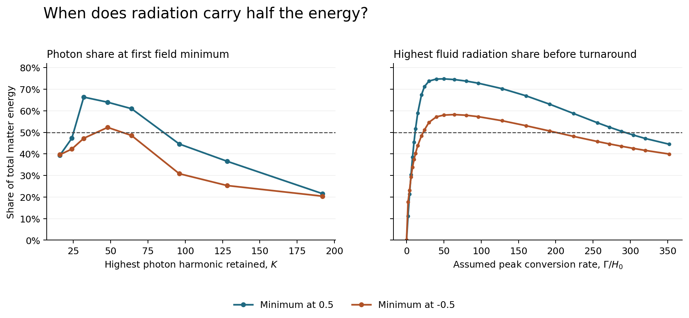

# Can the rolling field produce light before expansion stops?

The preceding study placed an upper bound on ordinary light already present at a closed-universe bounce. We now start with **zero photons** and give the rolling field a specific way to create them. The calculation follows where their energy comes from, what happens to the expansion, and whether the light persists after the interaction stops changing.

**In two finite models, the photon energy exceeded the energy left in the parent field. The outcome changed when we included shorter wavelengths.** With the same strong interaction, photons carried **63.98% and 52.29%** of the matter energy at the first minimum of the two potentials when we kept harmonics through 48. Extending the equations through harmonic 128 reduced the shares to **36.60% and 25.34%**. At 192 they were **21.56% and 20.40%**. These are directly calculated fractions in different regulated models. We have yet to establish which, if any, gives the energy share in the full theory.



The left panel uses an end-to-end change $\Delta\log I=3$ in the electromagnetic coefficient. The right panel uses a separate fluid model, with its highest radiation share measured over the whole first expansion. Each point on the left comes from evolving the photons and their energy source together. The fluid equations on the right assume a conversion rate directly. [Research plan recorded before the results](https://github.com/maldonado-research/HDblast/issues/157#issuecomment-7025474763) · [Preceding study](https://doi.org/10.5281/zenodo.24381850)

## Where did the photons come from?

With the usual free electromagnetic action, a round expanding universe leaves the conformal photon vacuum empty. We added a positive coefficient $I(\Theta)^2$ in front of the electromagnetic term $-F_{\mu\nu}F^{\mu\nu}/4$. As the field $\Theta$ rolls, it changes the oscillator dynamics of each transverse light wave. Energy passes between the field and those oscillators. The switch is part of the field law. No laboratory clock turns it on or off.

In the primary weak test, $I$ increases by a factor $e^{0.1}\approx1.105$ between 20% and 80% of the field's journey to its first potential minimum and is constant on both sides. This gives an unambiguous incoming vacuum and outgoing photon number while the geometry is round. On the prescribed reference trajectories the outgoing photons at first minimum carry **0.773% and 1.228% of the unperturbed parent energy**. Changing only the width of the transition to 15–85% of the journey gives **0.426% and 0.699%**. Zero change in the coefficient gives exactly zero production. The ratios on a prescribed background use the original parent energy as denominator. The table below uses the total energy of a system in which that parent loses energy. [Harmonic spectra, time profiles and checks](gauge/GAUGE.md)

## What survives when we let the parent pay the energy cost?

We evolved the scalar, the closed-universe radius and every photon oscillator through a specified highest harmonic $K$, including both polarizations. The initial half quantum of each oscillator is subtracted as described in the calculation. During the transition the rolling field can receive energy back from the electromagnetic field and even change direction. Once $I$ is constant, the photon excess is freely propagating and its comoving energy is conserved.

| Strong exploratory interaction, $I_f/I_i=e^3\simeq20.1$ | First potential minimum at $+0.5$ | First potential minimum at $-0.5$ |
| --- | ---: | ---: |
| Photon share at the first minimum, $K=48$ | 63.98% | 52.29% |
| Highest photon share in the following constant-coupling interval that starts at switch-off, $K=48$ | 64.23% | 52.61% |
| Expansion while photons carried at least half after switch-off, $K=48$ | 0.02170 e-folds | 0.06168 e-folds |
| Photon share at the first minimum, $K=128$ | 36.60% | 25.34% |
| Highest photon share on the same type of constant-coupling interval, $K=128$ | 36.92% | 25.61% |

At $K=48$ the positive branch reaches its maximum radius while photons are still the majority. On the negative branch the field re-enters the interaction region while they are still the majority. We stop the constant-coupling comparison at those respective events. The quoted durations correspond to increases in radius of about **2.2% and 6.4%**. These collisionless photons have no demonstrated thermal distribution.

Why does the choice of $K$ matter? While $I$ is moving, short waves respond even if they later end very close to their vacuum. The leading contribution to the instantaneous energy of this finite system grows as $K^2$ at fixed trajectory. Including more waves changes the forces on the parent during the transition. Their later outgoing energy can therefore change even after the coupling has settled. An independent solution using position and momentum covariances confirms the results at fixed $K$. It takes a theory valid at short distances and a properly renormalized stress and force to compare different cutoffs as descriptions of the same physics. [Backreaction, conservation checks and upper bound](feedback/FEEDBACK.md) · [Duration and equality crossings](feedback/COAST.md)

## A bound that holds for any time profile with a given total change

For vacuum initial data write $V=\int|d\log I|$ along the actual trajectory. The occupation in every harmonic obeys $n_L\le\sinh^2 V$. The exact mode count on the three-sphere and Einstein's energy constraint then bound the photon fraction in any chosen range of wavelengths. For the archived normalization and $V=0.1$, photons with initial frequencies at most **one-quarter of the reduced Planck scale** can supply at most **0.433%** of the total energy during the first expansion. Even reaching a sufficiently large set of modes to permit half requires harmonic 93 or higher, with initial frequency about **0.82 times the reduced Planck scale**. Reaching that frequency is necessary under these assumptions and may still yield very little light. The bound uses total variation. If the field travels back and forth, the absolute difference between its endpoints can underestimate $V$. The physical ultraviolet cutoff of the higher-dimensional theory has yet to be determined. [Derivation](feedback/FEEDBACK.md)

An independent smooth example has an exact photon spectrum, providing a normalization and sign check for wave production. A separate compact switch has strictly constant endpoints and a rigorous bound on its omitted high-frequency energy. The latter bound applies to that reference profile. The rolling-profile tables have their own numerical convergence tests. [Analytic benchmarks](checks/CHECKS.md)

## Can we obtain the interaction from the fifth dimension?

A minimally coupled photon confined to the shell is unaffected by the shell's overall conformal rescaling. For a photon that lives in the archived infinite bulk, a constant transverse profile has infinite normalization even though gravity has a finite normalization integral. The original geometry alone supplies neither the switched coefficient nor its magnitude.

We give two explicit extensions. A field-dependent electromagnetic term localized on the shell implements the chosen interaction directly and contributes to the scalar and gravitational boundary equations. Its coefficient is an additional input. Alternatively, weighting the bulk gauge action by $(1-\phi^2)^2$ gives a normalizable constant profile on the static tuned branch and an analytic projected coupling. This smooth bulk example has different endpoints and predicts changes of opposite sign along the two rolls. It has a continuum of higher-dimensional excitations extending to zero mass. Mixing with those modes must be treated before attributing four-dimensional photon yields to that bulk model. [Derivation on the archived geometries](origin/ORIGIN.md)

## What conversion rate would suffice?

An independent dynamical benchmark assumes a dissipative rate with peak $\Gamma/H_0=\gamma$ on the same field interval. It removes energy from the scalar and adds exactly that amount to radiation. On the two reference launches, the sampled radiation-majority bands extend between approximately **11.45 and 292.31**, or **22.18 and 199.71**, respectively. These are local threshold pairs for the declared scan and rate law. At the locally optimal rates, radiation reaches **74.82% and 58.24%** of the matter energy before expansion stops. Pushing the rate higher eventually slows the field enough to reduce its energy supply. In some runs the radiation share peaks after conversion ceases because the field then dilutes faster. We have not derived this damping rate from the electromagnetic interaction. [Fluid benchmark, event ordering and conservation](fluid/FLUID.md)

## Status of the hypothesis

There is now an explicit energy-conserving route from an initially empty photon state to a short radiation majority in specified finite closed models. The predicted majority changes when the shortest retained wavelength changes. A physical next test is to match the scalar kinetic and gravitational terms at the same calibration while changing the regulator, or to evolve the five-dimensional sector that supplies the ultraviolet completion. That calculation would have to preserve a radiation majority long enough for interactions to establish a thermal population, and ultimately identify an observable that distinguishes a higher-dimensional origin. [Literature and scope](literature.md)

## Reproduction

The five numerical products use Python 3.12, NumPy 2.3.5 and SciPy 1.17.0. From this directory run

```bash
python -I -B -S reproduce.py
python -I -B reproduce.py --verify --jobs 2
```

To retain regenerated outputs, pass `--output-dir` with a fresh external directory. The replay uses the archived inputs offline after installing the dependencies. To redraw the figure, run `python figure.py` with Matplotlib installed. [Source manifest](SOURCES.json) · [Replay and cross-checks](reproduce.py)
