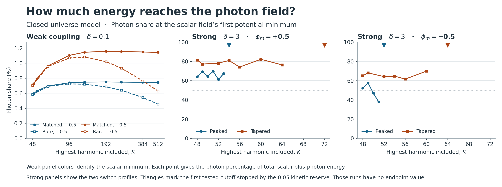

# How much of the light prediction survives adding shorter waves?

The HDblast project asks whether an event in a higher-dimensional universe could lead to a hot, expanding universe like ours. One link in that chain is the conversion of energy into radiation. In this study a field rolls downhill and changes the strength of its interaction with electromagnetism. We follow the field, the photons it creates and the expansion of a closed model universe together.

The previous study found that adding shorter waves changed the answer considerably. Here we calibrated each model so that the field has the same resistance to slow changes. With a weak interaction, the predicted photon share then changed by only **0.71% or 1.26%** as the highest included harmonic rose from 192 to 512. The corresponding changes without calibration were **33.46% and 38.33%**. These are relative changes. The light itself carried about **0.74% and 1.14%** of the total field-plus-photon energy at the upper cutoff. The two values come from two different potentials studied in the project. [Previous study](https://doi.org/10.5281/zenodo.24382645) · [Plan recorded before the primary comparison](https://github.com/maldonado-research/HDblast/issues/157#issuecomment-7027295444)

## When can the light carry most of the energy?

The strong example changes the electromagnetic coefficient $I$ by a factor of $e^3$, about 20, over a specified field interval. With the original peaked interaction, the photons carried 63.98% or 52.29% of the total energy at the first field minimum when the highest harmonic was 48. Including just two more shells left **64.40% or 46.94%**, even after calibrating the slow response. On the second branch the radiation had fallen below half while the kinetic coefficient was still comfortably positive. By cutoffs 54 and 52 respectively the evolving scalar reached the specified lower limit for that coefficient. The calculation stops there, with the outgoing energy undetermined. [Equations, energy balances and cutoff scan](matched/MATCHED.md)

We derived an upper limit on the total coupling change that the calibrated field can sustain along a given trajectory. Spreading the change over the available field interval can approach this limit. We constructed a broader interaction using the radius history of the earlier calculation, then evolved the whole system again, including the light's effect on that radius. At cutoff 56, photons carried **74.09% and 61.56%**. At 60, the shares rose to **82.15% and 69.81%**. In those last two examples the photons stayed above half while the universe's radius grew by just **2.59% and 10.53%**, up to its first turnaround or the field's return to the interaction. Both branches reached the kinetic limit by 72. This exploratory design shows how much the *shape* of the interaction matters. It supplies a transient radiation majority in finite models with specified interactions. [Bound, construction and duration of the radiation majority](reach/REACH.md)

## What can a slow measurement tell us about a fast event?

- **A second measurement controls a different part of the response.** A slow probe fixes the leading resistance to motion. Adding a second probe frequency makes the residual response at a third frequency converge as more modes are included. For the specified static-sphere probe, that remaining response tends to 233.508 in the study's units, with an analytic error bound. The corresponding response still grows logarithmically if only the slow measurement is used. [Derivation, held-out frequency and time-domain test](probe/PROBE.md)
- **Some short-wave energy survives after the field stops changing.** On the prescribed weak trajectories, modes 49–768 account for 24.09% and 42.18% of the outgoing photon energy summed through 1536. The reversible terms used to approximate the stress vanish at switch-off. The escaping photons remain. [Mode calculations and energy accounting](band/BAND.md)
- **Two slow measurements do not determine the amount of light.** We constructed two finite photon models with positive energies, identical low modes and exactly the same first two slow-response coefficients. For the same rolling history, one produced 6.04% or 7.59% more total light than the other. This gives an explicit counterexample to inferring a unique yield from those two numbers alone. [Construction and bounds](completion/COMPLETION.md)
- **A known finite spectrum can be simplified and tested.** We compared the full band of 144 added harmonics with smaller sets of positive oscillators that preserve specified low-frequency response moments. Keeping 32 effective oscillators reproduces the weak photon share to about one part in ten billion in these runs, yet misses the strong share by 3.60% or 1.73% relative to the full calculation. Using 64 reduces both strong errors below 0.006%. Its target is the original finite model through harmonic 192 with the original scalar coefficient. [Positive quadrature and coupled tests](compressed/COMPRESSED.md)

## What would connect this to the Big Bang?

These computations establish properties of particular mathematical models. We have yet to derive the electromagnetic interaction and its short-distance response from the proposed higher-dimensional event. Even two local terms that give the same response at every static radius can act differently on an expanding universe. A calculation on an evolving geometry could distinguish them. A further step would be to include charged particles, follow whether the radiation reaches thermal equilibrium, and derive a prediction that could distinguish this history from other early-universe scenarios. The present fractions cannot be compared directly with the light we observe today. [Primary literature and curvature example](literature.md)

## Reproduce the calculations

The archive includes the six numerical products and the historical inputs used by the solvers. With Python 3.12, NumPy 2.3.5 and SciPy 1.17.0 installed, run these commands from this directory.

~~~sh
python -I -B -S reproduce.py
python -I -B reproduce.py --verify --jobs 2
~~~

The first command checks the bundled files. The second recalculates the results, compares them with the archived values and runs consistency checks across the six experiments. Relative photon shares throughout this note are evaluated at the first potential minimum, after switch-off, unless a different comparison is specified. The outgoing fractions in the prescribed-trajectory and fully coupled calculations use the denominators identified in their respective notes. [Historical source inventory](SOURCES.json) · [Replay code](reproduce.py) · [Figure script](figure.py) · [Zenodo edition](https://doi.org/10.5281/zenodo.24383815)
