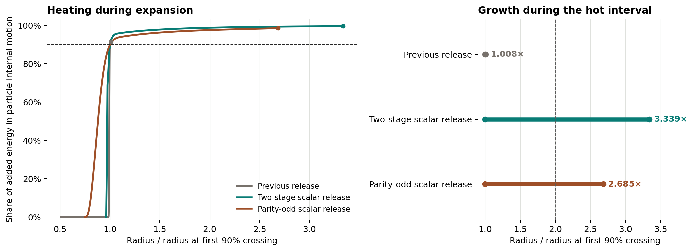

# Can a five-dimensional pulse leave a wall hot while its radius doubles?

In two numerical examples, yes. The earlier HDblast model heated charged particles just as its closed wall was running out of room to expand. The new simulations make the electric field available earlier. The wall then grows to **3.34** or **2.68 times** its radius at the start of sustained heating, before it begins to contract. Each example uses one finite pulse profile incident symmetrically from the two sides. Neither requires another pulse or energy left in the scalar potential after the release. [Prospective doubling criterion](https://github.com/maldonado-research/HDblast/issues/157#issuecomment-7051064414) · [Previous study](https://doi.org/10.5281/zenodo.24406309)

Here “hot” means that at least 90% of the added wall energy is in random internal motion of the charged particles. The fixed wall tension is excluded from that energy. The particle model assigns pressure from its local equation of state. Establishing that real particles share a common temperature requires a microscopic scattering and equilibration calculation.



| Model | Radius as the hot interval starts | Radius at first turnaround | Growth factor during the hot interval | Peak internal energy share |
|---|---:|---:|---:|---:|
| Earlier single-stage release | 9.69 | 9.76 | 1.00773 | 91.49% |
| Two-stage release with positive electromagnetic kinetic coefficient | 10.75 | 35.91 | 3.33937 | 99.54% |
| Release with an additional parity-odd electromagnetic interaction | 10.96 | 29.44 | 2.68472 | 98.52% |
| Recalibrated larger initial wall | 28.43 | 29.51 | 1.03791 | 91.73% |

The most informative case uses the same field content as the earlier release. The initial higher-dimensional pulse deposits energy in a scalar field. Two stages then change how the electromagnetic field stores that energy. During the time between them, an electric component builds up. When the second stage releases the remaining scalar energy, newly formed charged particles can draw on the electric field while the wall is still expanding rapidly. At exactly twice the first hot radius, the particles’ internal share is **98.73%** and the ratio of total added pressure to energy density is **0.3418**, close to the value **1/3** for radiation. Higher radial resolution changes the hot growth factor from 3.33937 to 3.33931. A separate, exploratory check finds a factor of **2.35** across successive saved hot states in which the total pressure stayed within 5% of the radiation value. [Two-stage experiment](exit/EXIT.md) · [Pressure and curvature tests](criterion/CRITERION.md)

A mathematical constraint explains why timing matters. If the wall is closed and the kinetic coefficient is large, with little rest mass and zero remaining potential, the radius times the expansion rate at hot onset must be roughly **1.73** or larger for a doubling to remain possible. It was **0.13** in the previous model, **3.31** in the two-stage model and **2.60** in the parity-odd model. The exact inequality includes the finite mass and field terms, and allows energy exchange with the bulk. A separate phase bound explains why waiting for an initially magnetic radiation field to rotate into an electric one can use up too much of the expansion. [Curvature derivation](criterion/CRITERION.md) · [Magnetic-to-electric phase bound](phase/PHASE.md)

The parity-odd run uses a different interaction between the rolling scalar and electromagnetism. It makes the field about **95.63% electric** by the end of the scalar release. Turning that interaction off, even when matching the idealized energy jump, removes sustained heating at the chosen settings. Merely increasing the initial radius also failed in the tested preparations. The radius-4 comparison shown above used about twice the total input pulse energy of the historical run. Equal-total-energy comparisons are documented separately. [Parity-odd model and controls](axion/AXION.md) · [Initial-radius controls](radius/RADIUS.md)

## What could invalidate these examples?

The two-stage potential, kinetic coefficient, initial neutral particles and collision law are model inputs. Changing the input dose from 0.123 by ±0.000005 still gives a doubling in the two-stage run. Changes of ±0.00005 miss the completed scalar exit within the integration limits. A no-pulse control contracts without a rebound. All three principal hot solutions in the table (earlier, two-stage, and parity-odd) eventually turn around. The integrated region is a finite annulus beside the wall. The model assumes the wall and the incident pulse exist. A five-dimensional geometry that generates them remains to be supplied. [Control runs](exit/EXIT.json) · [Earlier source model](https://doi.org/10.5281/zenodo.24406309)

An additional test allowed small electromagnetic ripples on each *prescribed* wall history. In the two-stage case one tested harmonic could gain **10.9 million times** its initial energy. In the parity-odd case one polarization at harmonic 8192 could gain **1.63 × 10²²** times its initial energy. These are linear response factors. Determining how much energy actually leaves the uniform solution requires specifying the starting fluctuations, ultraviolet cutoff and dimensional normalization, and letting their energy feed back on the scalar, particles and geometry. A conditional sum over selected quantum modes identifies circumstances in which ignoring that feedback would be inconsistent. [Angular perturbations](helicity/HELICITY.md) · [Quantum excitation budget](occupation/OCCUPATION.md)

The examples meet a quantitative target recorded publicly before the results. Their shapes and parameters were selected in an exploratory search. They establish the possibility of sustained model heating during expansion under these assumptions. They supply no observational evidence for a higher-dimensional cause of the Big Bang. Observational tests require a history that lasts long enough, a physical energy scale, specific matter species and quantitative predictions for data such as the light-element abundances or the cosmic microwave background. [Primary literature and observational context](literature.md)

## Reproduce

Run the following commands from this directory with Python 3.11 or newer, a C++17-capable g++ and the command-line patch utility. The first command checks the manifest and physical acceptance tests on the archived data. The second rebuilds the solvers in temporary directories, reproduces the ten numerical products, and compares them to the archive. Multiple trajectories run concurrently. The optional plot script uses Matplotlib.

```sh
python -I -B -S study.py
python -I -B study.py --verify --output-dir /tmp/hdblast-hot-replay
python -B figure.py
```

The three files in `prior/` are byte-identical to the preceding neutral-parent study. The accompanying articles document the equations, control parameters, source terms, numerical tolerances and branch-specific limitations. [Capsule verifier](study.py) · [Full release history](https://github.com/maldonado-research/HDblast)
