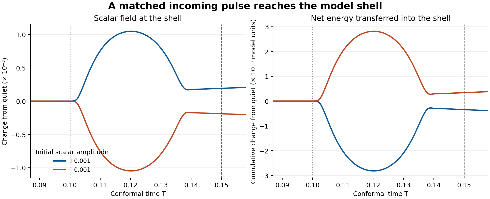

# Can an incoming pulse reach the shell without disturbing its initially quiet exterior?

Yes, in this five-dimensional Einstein–scalar model. We constructed a pulse with identical quiet data near the shell and beyond the pulse, verified its physical distinction from the quiet scalar field, and followed it to the shell. The field on the shell changed. The registered B1 particle-production channel stayed inactive throughout the measured interval. An earlier B1 calculation used a displaced initial profile and did produce particles. This experiment sets that displacement to zero in both pulse and quiet runs. [Zenodo edition](https://doi.org/10.5281/zenodo.24354840) · [Preceding energy budget](https://doi.org/10.5281/zenodo.24354293) · [Time-stamped plan](https://github.com/maldonado-research/HDblast/issues/157#issuecomment-6992771340)

## Solving the matching problem

An inserted scalar pulse carries momentum and modifies the gravitational constraints. Changing its amplitude alone in the earlier, restricted trial left a mismatch in the metric gradient. Here the shell is at $Z=0$, with the bulk at $Z<0$. The compact scalar disturbance is initially directed toward increasing $Z$. Each construction supplies both the scalar and its accompanying gravitational initial data. All use the B1 potential and tension, and the identity conformal chart on a regular radial patch. [Earlier one-pulse calculation](https://github.com/maldonado-research/HDblast/issues/157#issuecomment-6992402829)

* **A finite amplitude with verified matching.** Keep the initial planar area radius and its expansion fixed to the quiet values. Allow the other metric data to respond. The two constraints reduce to a single linear differential equation for the change in the planar mass function. For the specified bump there is exactly one nonzero matching amplitude in $0<\eta\le0.003$. It lies in **$(0.00201,0.00203)$**. An outward-rounded computation bounds the mass mismatch with opposite signs at the bracket ends and bounds its second amplitude derivative strictly below zero. The scalar invariant $(\nabla\phi)^2$ at the same scalar-field value exceeds the quiet-branch value by more than **0.007738** at one interior comparison. This difference distinguishes the pulse from a relabeling of the quiet geometry on that branch. The initial mass contributions from the potential, kinetic/gradient terms and scalar momentum cancel at the matching cut. [Equations and stress integrals](invariant/MASS_MATCH.md) · [Certificate, assumptions and replay](invariant/interval/README.md)
* **An independently chosen small scalar pulse.** We derived two ways to compensate its gravitational effect using three smooth functions behind the pulse. One varies an initial metric velocity, the other adds scalar profiles. In each construction the three controls can change the three outer mismatches independently near the quiet solution. The implicit function theorem then supplies exact initial matching for sufficiently small seeds on the stated regular analytic background. The permissible amplitude range in this argument is unspecified. Finite examples with particular profiles have separately measured numerical residuals. The metric-velocity construction preserves the single scalar bump used for the primary evolution. [Metric controls](controlled/MATCHING.md) · [Exact wall-rank witness](theory/WITNESS.json) · [Scalar controls and two different completions](scalar/MATCHED_PULSES.md)

## What reached the shell?

For the primary case we gave the scalar a positive amplitude of 0.001 on $-0.14\le Z\le-0.10$. The gravitational controls were placed at $Z\le-0.152$. The initial data near the shell equal the quiet reference. A bulk light ray from the nearest scalar support edge can first arrive at conformal time $T=0.10$. The first characteristic from the compensating controls can arrive at $T=0.152$. The prespecified endpoint $T=0.15$ therefore tests a response before those controls can act directly on the wall. [Study plan](STUDY_PLAN.md)

On the finest of four grids the pulse raised the shell scalar relative to quiet by a peak **0.00104929** at $T=0.12019$. An independently discretized calculation on null characteristics gave **0.00104926**. A run of the original B1 fourth-order solver, with the matched initial deviation supplied to its existing evolution, gave **0.00104927**. Reversing the scalar pulse gave a peak change of **−0.00104889** on the finest primary grid. The mass-matched near-root, in its own paired experiment, gave **+0.00216483** at $T=0.1205$. The largest absolute shell field in that last run was 0.002782. The registered particle-production crossing is $\phi_*=0.5$. The original solver also recorded zero particles and zero radiation for the primary run and its quiet control. [Time histories and convergence](evolution/EVOLUTION.md) · [Original-solver comparison](original/ORIGINAL.md)



The dotted line marks the nearest scalar characteristic and the dashed line marks the primary endpoint. Both vertical axes subtract the corresponding quiet simulation. The energy panel counts flux from both copies of the bulk into one shell and uses the initial comoving-volume normalization. Its curves can reverse direction as the field rises and falls. [Figure generator](plot_pulse.py)

## What the energy transfer means

At the common proper-time cut corresponding to $T=0.15$ in the quiet run, the positive pulse moved **0.00034394 model units out of the shell relative to quiet**. The negative pulse moved **0.00033897 units into it**. On this empty-matter branch the varying tension accounts for the transfer. An independent estimate of the wall gradient uses only samples strictly inside the bulk. At the positive pulse's own coordinate cut the absolute rate integrates to 0.005419, much larger than the magnitude of the net transfer, 0.000343. The discrepancy between the flux and the pressure-corrected tension work there is $5.8\times10^{-10}$ in these units. Grid and baseline errors are larger. [Energy equations and sign controls](INTERFACE.md) · [Four-grid numerical results](INTERFACE.json)

This establishes a local mechanism by which physically distinct initial bulk data perturb the model shell. An event that creates such a pulse, a physical scale for it, and an evolution producing a hot particle bath remain open. The computations cover a finite interval of a planar model. They supply no observational identification of the Big Bang. [Primary literature and related results](literature/SOURCES.md)

## Reproduction

Python 3.12 with its standard library replays the two endpoint tests, two rank calculations, wall histories, sign and energy balances, and cross-solver comparisons. The data package includes the recorded wall scalar and metric, their time derivatives, interior samples, constraint diagnostics and run-specific metadata. The C++17 executable independently verifies the finite-amplitude bracket, concavity and invariant separation. Its documented IEEE binary64 assumptions apply. From this directory run

```sh
sha256sum -c SHA256SUMS
python -I -B reproduce.py
python -I -B -O reproduce.py
c++ -std=c++17 -O2 -fno-fast-math -ffp-contract=off invariant/interval/bracket.cpp -o /tmp/hdblast-bracket
/tmp/hdblast-bracket
```

Full evolutions use NumPy and SciPy. The individual notes give regeneration commands. The Zenodo ZIP includes the pinned historical solver files alongside this study. Ricardo Maldonado’s HDblast project prepared this work with AI-assisted derivation, analysis and numerical checking. [Historical source hashes](SOURCES.json) · [Zenodo archive](https://doi.org/10.5281/zenodo.24354840)
