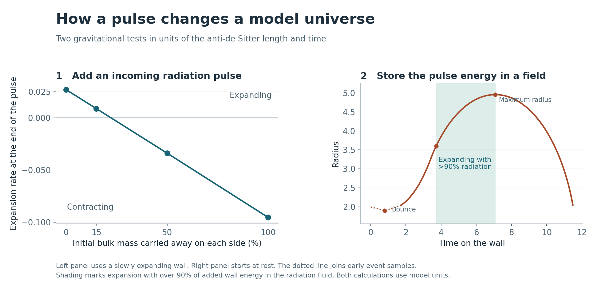

# From a bulk pulse to a bounce and an expanding radiation fluid

A finite pulse from a fifth dimension can drive an initially stationary closed model universe through contraction, a bounce and a short period of radiation-dominated expansion. This example requires a wall field that stores the incoming energy with sufficiently negative pressure and subsequently releases it. When the wall absorbs the pulse directly as ordinary radiation, its initially stationary radius decreases and cannot bounce under the same gravitational sign conditions.

## Follow the energy through the bounce

Set the initial wall radius to 2 in units of the bulk curvature length. The wall has tuned tension and zero added matter energy. The bulk already contains energy and the wall already exists. Prescribe identical smooth outward pulses from two finite-radius spherical emitters. Each carries away 94% of its side's initial bulk mass parameter over 0.005 units of retarded time. Allow the wall to absorb the incoming power coherently into a canonical scalar field. Initially the potential energy and the scalar velocity both vanish.

The pulse sets the field moving. As it climbs the chosen potential, kinetic energy is converted to stored energy with negative pressure. The scalar respects the null energy condition. The wall, which initially contracts, now bounces at radius 1.8996. When the scalar reaches the end of the finite plateau, a specified positive damping law transfers its motion into a fluid with radiation pressure. That fluid passes 90% of the added wall matter energy at radius 3.5914. The radius continues to grow to 4.9336, roughly 37% further, before the closed universe contracts again. The growth above 90% is 0.3175 e-folds. These are dimensionless model predictions.

Holding the pulse fixed and removing the scalar potential prevents the bounce. Lowering the emitted fraction to 85% prevents the field from reaching the plateau. A complementary calculation starts with an imposed scalar force, reconstructs the supplying positive null pulse and independently verifies the turning radius. In that family, switching off damping leaves the radiation component empty and reducing the force can leave the field stranded on the plateau. These controls distinguish energy delivery, negative pressure and radiation production. The potential, conversion of incident flux to coherent motion, and damping into a radiation fluid are three separate assumptions. The calculation checks their energy budgets and geometric consistency. Establishing these interactions from a physical action, producing a thermal particle distribution and matching observations remain open. [Pulse specified at emission](junction/PRESCRIBED_SOURCE.md) · [Scalar capture and threshold](junction/SCALAR_CAPTURE.md) · [Exit into radiation](junction/RADIATION_EXIT.md)

## Gravity and energy arriving from the bulk

The wall is a three-dimensional sphere bounding two ordinary interior regions of five-dimensional anti-de Sitter spacetime. A smooth pulse of massless matter travels outward from a finite emitting radius on one or both sides. Retarded time and a *decrease* in the mass inside each outgoing pulse describe positive energy reaching the wall. This specifies the direction left ambiguous when an increasing mass in advanced time was used as an example in the January notes. The model assumes total absorption, nonnegative bulk masses, tuned positive wall tension and deposited radiation with pressure equal to one third of its energy density. Both gravitational junction conditions and the flux into the wall are enforced.

For a wall that stores the incoming energy as ordinary radiation, these assumptions make the radius concave in wall proper time, including unequal illumination. A simple symmetric example begins with dimensionless radius 2, expansion rate 0.04 and zero wall radiation. A smooth pulse lasting 0.025 in retarded time and carrying away 15% of the initial bulk mass parameter on each side leaves the wall expanding at 0.00881. Increasing that fraction to 50% reverses the expansion, with final rate −0.03385 and positive wall radiation density 0.06082 in tension units. If pulse duration tends to zero, the calculated reversal threshold for these initial conditions is 33.07%. The threshold depends on the width at finite duration. The sign theorem also covers radiation arriving from just one of the two sides. At the same starting radius and energy density, a wall whose extra matter has vacuum pressure instead of radiation pressure can begin expanding from rest. With empty anti-de Sitter interiors the exact example is $a(\tau)=2\cosh(\tau/2)$. The negative pressure is supplied in its initial matter. This comparison gives a concrete target for a mechanism that would convert a pulse into stress capable of starting expansion. The deceleration condition also extends to more general spherical bulk matter, including counterstreaming radial radiation, provided both enclosed masses and both bulk normal pressures stay nonnegative. [General pressure criterion and vacuum comparison](junction/NORMAL_PRESSURE.md)

The source at the emitting radius and the material's ability to absorb its radiation are inputs. [Junction equations, examples and assumptions](junction/JUNCTION.md) · [HDblast study of an earlier incident pulse](https://doi.org/10.5281/zenodo.24354840)

## A pulse, a push and a retained light wave

On a different, flat wall supported by a scalar field, Maxwell theory admits a light mode that stays near the wall and waves that propagate into the extra dimension. A compact pulse can contain some of the bound light from the outset. We explicitly remove that component from the initial data. The fixed reflecting wall then feels a transient pressure and the bound mode remains empty. The scattering phase changes when the electromagnetic coupling changes, even with complete reflection.

Give the boundary inertia, a spring and a passive damping channel, and solve for its motion under that same wave pressure. For the tested weak, balanced packets, doubling the incident energy gives approximately four times the energy deposited in the damping channel and eight times the projected bound-light energy. A direct projection and a separate time integral check the small bound-light signal. For incident energy 0.04 and the selected electromagnetic coupling, 0.850% reached the damping channel by time 36 and about 1.48 parts per million was projected into bound light. Its magnitude depends on the chosen material. The matter in this example has a specified mechanical response. In the frozen tuned gravitational solution the unaltered scalar boundary condition actually fixes the wall at rest. Even if the scalar source is adjusted, a nontrivial rest-to-rest excursion in that fixed mirror geometry requires negative surface null energy somewhere. For bounded rest-to-rest motion, the integral of surface null energy along a complete light ray on this specific wall is also strictly negative. These results delimit the physical assumptions needed to interpret the previous prescribed Gaussian motion. [Fixed-wall scattering](scattering/SCATTERING.md) · [Pressure-driven motion](response/RESPONSE.md) · [Geometric compatibility of wall motion](response/COMPATIBILITY.md) · [Previous study](https://doi.org/10.5281/zenodo.24385102)

## Can the wave represent a finite blast?

The preceding exact plane-wave construction raised a question about the horizon at the far end of the extra dimension. A wave train of compact duration passes before an infalling observer reaches any finite point on the modeled Poincaré horizon. The background there admits a local continuation. A slowly decaying tail can instead give infinite tidal curvature. If the field amplitude along the wave falls as $u^{-p}$, an infaller sees unbounded wave Ricci curvature for $p<2$. Boundedness of the unweighted electromagnetic field requires $p\ge3$ in that test.

The exactly parallel, source-free plane wave has a different limitation. Maxwell's equations force any square-integrable transverse profile on the entire flat plane in this restricted family to vanish. A wave can be brief and still extend infinitely far sideways. Modeling a finite event calls for angular spread, additional field components or different sources or geometry. [Horizon and localization calculations](horizon/HORIZON.md) · [Comparison with earlier literature and a 2026 dark-bubble beam model](literature.md)

## What remains open?

The spherical calculation has a finite total pulse and a closed wall of finite starting radius. It gives an expanding radiation fluid for a limited time, followed by recollapse. It has no predicted temperature, thermal particle distribution or spectrum of perturbations. The scalar used for coherent absorption is an added field confined to the wall. It differs from the bulk scalar supporting the flat photon calculation. A physical next step is to derive the conversion of incident radiation into wall matter from an explicit interaction and test its stability when the incident pulse is uneven across the wall. Comparison with cosmology also requires a sufficient expansion history and a prediction distinguishable from conventional early-universe physics.

## Reproduce

Install NumPy 2.3.5 and SciPy 1.17.0 in a Python 3.12 environment. The first command checks the archived inputs and file integrity with the standard library. The second recomputes the four numerical products and checks their physical identities. Run from the directory containing this README. Matplotlib is optional for redrawing the figure.

~~~sh
python -I -B -S reproduce.py
python -I -B reproduce.py --verify --jobs 2
python figure.py
~~~

[Historical input hashes](SOURCES.json) · [Public test specification](https://github.com/maldonado-research/HDblast/issues/157#issuecomment-7030080189) · [Scalar test specification](https://github.com/maldonado-research/HDblast/issues/157#issuecomment-7030252945) · [Radiation-exit specification](https://github.com/maldonado-research/HDblast/issues/157#issuecomment-7030272290) · [Versioned archive](https://doi.org/10.5281/zenodo.24386416)
