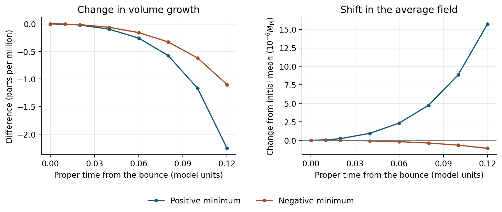

# How do the first uneven regions of a closed HDblast universe gravitate?

The preceding study found that a field perched on an unstable maximum could not stay sufficiently uniform for the long wait needed by two homogeneous HDblast histories. What happens when we let different places start at different field values and allow gravity to respond? We solved the nonlinear initial gravitational constraints and evolved a closed, spherically symmetric spacetime containing a canonical scalar. In both archived potentials the universe starts expanding and the average field moves. Over the tested interval its volume grows more slowly from its own starting size than it would with the field stationary at the maximum. [Previous quantum test](https://doi.org/10.5281/zenodo.24378057) · [Dated experiment plan](https://github.com/maldonado-research/HDblast/issues/157#issuecomment-7020982503)

The dots show signed-pair averages from the nonlinear spacetime evolutions for initial amplitudes of ±0.001 reduced Planck units. Lines connect samples. On the left, each volume is divided by its *own* value at the bounce before comparison with the stationary solution. On the right, the initial proper mean is subtracted separately for each sign. Time is measured in inverse reference hilltop expansion units. [Numerical data](evolution/results.json) · [Figure source](figure.py)

## What the first part of the expansion looks like

| Measurement at proper time 0.12, averaged over the two ripple signs | Positive-minimum potential | Negative-minimum potential |
|---|---:|---:|
| Difference in volume growth from the uniform solution, using each launch’s own initial volume | −2.258 parts per million | −1.102 parts per million |
| Difference in total volume from the uniform solution, comparing actual sizes at the same time | +47.557 parts per million | +32.139 parts per million |
| Change in proper mean scalar field, in reduced Planck units | +0.000015746 | −0.000001093 |
| Acceleration of the volume radius divided by that radius, in units of the homogeneous value | 0.999282 | 0.999744 |

The sign of the volume difference depends on which question is asked. The gravitational constraint sets the initial spatial geometry. For these seeds it gives a larger initial volume. The rippled universe can therefore be larger at the same time even though it has grown by a smaller fraction. Both examples are still accelerating at the comparison time. The numbers quantify a small effect during the initial roll. [Constrained initial data](initial/INITIAL.md) · [Independent second-order calculation](perturbative/VOLUME.md)

A seed with equally balanced peaks and dips on the reference round sphere need not average to zero using physical volumes. We repeated the experiment with a small constant offset and solved the constraint again until the initial **proper** mean vanished. The average still moved in the same direction on each branch. Halving the seed amplitude cut the sign-averaged change by approximately four. This establishes the early response to these deterministic classical seeds. Selecting a distribution of seeds from the quantum state is a separate calculation. [Evolution and controls](evolution/NOTE.md) · [Initial-time check through fourth order](checks/BOUNCE.md)

A separate extension followed each of the eight nonzero raw seeds until the peak field reached the previous study’s limit of 0.04 or 0.08 reduced Planck units. Those events occurred at times 0.229–0.290 on the positive-minimum branch and 0.349–0.415 on the negative-minimum branch. All eight were expanding and had positive volume-radius acceleration at their respective endpoints. Their cumulative volume growth was about 59–75 and 265–282 parts per million below the matching uniform growth, respectively. Each endpoint has its own time. The extension includes comparisons at common times and spatial and temporal refinements. [Endpoint measurements](evolution/results.json)

## A limit that goes beyond the simulated amplitudes

Let a small volume element follow the freely falling observers who were at rest on the initial slice. Write $r$ for the cube root of its volume relative to its own starting volume, and $b(x)=\cosh(hx)$ for the corresponding homogeneous linear growth. Here $u$ is the scalar potential in the archived units, $h^2=u(0)$ its value at the maximum, $\Pi$ the local proper-time derivative of the field, and $\sigma_{ij}$ the shear of the observers. Einstein’s equations and the Raychaudhuri equation imply

$$
\left[b^2(r/b)'\right]'=-br\left[h^2-u(q)+\frac{\Pi^2+\sigma_{ij}\sigma^{ij}}{3}\right].
$$

Time symmetry makes the initial derivative zero. While the scalar stays at or below the hilltop potential energy and the observers' trajectories form a regular slicing, the right side is nonpositive. The normalized local growth $r/b$ and whole-slice volume ratio $V(x)/[V(0)b^3]$ can only stay constant or decrease. The sign follows for finite amplitudes without assuming spherical symmetry, as long as the stated time symmetry, matter and regularity assumptions hold. The supplied implementation checks that the fitted potential satisfies the potential-energy premise over the field ranges examined. A lower potential, field motion and shear all enter the comparison with a definite sign. Field gradients also affect the initial geometry and subsequent motion. [Proof, potential bounds and numerical cross-check](perturbative/VOLUME.md)

This limit concerns relative growth in a specified congruence. It gives neither a turnaround time nor a temperature. It also leaves open whether the rippled spacetime can expand long enough for radiation to take over after the field leaves the tested range. Answering that would require following the evolution farther, adding the particle-producing matter sector, and measuring its energy relative to the field and geometry.

## How the solution was tested

- The nonlinear Hamiltonian constraint was solved on the closed three-sphere for both signs of the quadrupole and both potentials. The momentum constraint is identically satisfied on the time-symmetric slice. Off-grid residuals, positivity and an analytic expansion give checks of the starting solution. The electric Weyl curvature, which measures directional tidal gravity, is nonzero on the rippled slice. We recovered it from two independent curvature expressions. [Initial solver](initial/constraint.py) · [Tidal curvature calculation](tidal/TIDAL.md)
- The coupled evolution uses Gaussian proper time and regular functions at the poles. Spatial and temporal refinements, constraint residuals, the stationary control, a moving homogeneous comparison, and an independent initial-time Taylor series test the solution. At the common time 0.12 the second-order calculation agrees with four geometric measurements on both branches to within 0.10% at amplitude 0.001 and 0.024% at 0.0005. The much longer classical waiting intervals from the previous study lie beyond these evolutions. [Coupled solver and limits](evolution/NOTE.md) · [Independent comparisons](perturbative/COMPARISON.json)
- Full nonlinear spherical Einstein–scalar cosmology has prior work going back decades. The contribution here is the calculation for the two HDblast potentials and the explicit comparison with their homogeneous histories. The equations evolved here are four-dimensional and contain one classical scalar. They do not distinguish a higher-dimensional origin from a four-dimensional model with the same effective potential. [Primary literature and project sources](literature/README.md)

## Reproduce the calculation

From this directory run the standard-library integrity check and then the numerical replay. The reference environment uses Python 3.12, NumPy 2.3.5 and SciPy 1.17.0. Matplotlib is needed only to regenerate the figure.

~~~sh
python -I -B -S reproduce.py
python -I -B reproduce.py --verify --jobs 2
python -I -B figure.py --output /tmp/gravity.png
~~~

[Historical input checksums](SOURCES.json) · [Study checksums](SHA256SUMS) · [Archived edition](https://doi.org/10.5281/zenodo.24378925)
