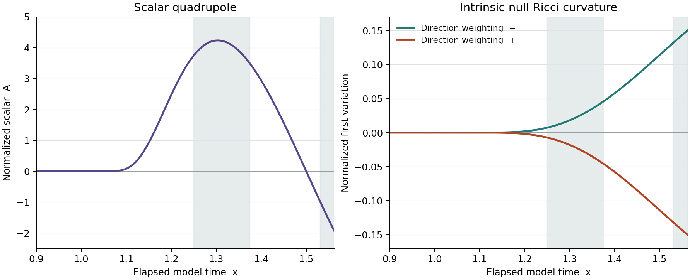

# Joint scalar and intrinsic curvature signals on the shell

**The registered HDBLAST packet makes intrinsic null Ricci curvature negative in some directions on the shell and positive in others.** This holds for every sufficiently small nonzero amplitude of the specified local solution. In four-dimensional Einstein gravity with positive Newton constant, matter satisfying the pointwise null energy condition gives nonnegative Ricci curvature in every null direction. Such matter cannot produce the predicted shell geometry under those equations. A four-dimensional model in which observers couple to a scalar-dependent metric can still reproduce the entire *linear* metric and scalar signal. [This Zenodo edition](https://doi.org/10.5281/zenodo.24352632) · [Prior scalar-only comparison and matched preparations](https://doi.org/10.5281/zenodo.24352252)

## Two measurements of the same packet

The earlier study predicted how a scalar field varies across the shell after a wave arrives from its interior. Here the second measurement uses the Ricci tensor of the four-dimensional metric on the shell. Both measurements use the same observers, initial packet, angular labels and elapsed clock. The trace of the Ricci tensor follows the scalar at first order. Its spatial trace-free part follows a different time profile, determined by the dynamics at the shell boundary. The independently computed interval averages below use dimensionless model units. Each row has its own fixed normalization. [Metric reconstruction and transfer](METRIC.md) · [Curvature trace and normalization](NUMERICAL_CURVATURE.md)

| Calculated first-order signal | First time window, 5/4 to 11/8 | Second time window, 49/32 to 25/16 | Ratio of second mean to first |
| --- | --- | --- | --- |
| Scalar quadrupole $A$ | Positive | Negative | −0.36754 to −0.36459 |
| Spatial trace-free Ricci coefficient $M$ | 0.03912 to 0.03932 | 0.23770 to 0.23863 | 6.0456 to 6.0996 |



Shading marks the same clock windows in both panels. The left curve connects the centers of the scalar cell enclosures. The right curves use the first variation for two differently weighted ensembles of local null directions, in units specified by the full-sky test. The scale of a finite perturbation and a conversion to instrumental sensitivity remain unknown. [Figure code](plot_signals.py) · [Exact curvature intervals](NULL_SKY.json)

## What the negative sign means

At each observer one can form a null vector from the observer’s unit velocity and a unit spatial direction. The intrinsic contraction $R_{ab}k^a k^b$ is the Ricci term that enters the focusing equation for light. Two averages using only nonnegative angular and time weights give opposite signs. Hence at least one sampled contraction must be negative. This can also be obtained at one specified angular label using two orthogonal spatial axes, or using one smooth direction at each point on the full cut. These are local curvature measurements in the model. The optical expansion of a beam also depends on its initial data and shear. [Full-sky derivation and independent replay](NULL_CONVERGENCE.md) · [Two point directions](NULL_DIRECTIONS.md) · [One direction per observer](ANGULAR_EXPOSURE.md)

The sign has a specific origin in the five-dimensional solution. The scalar contributes a nonnegative term to five-dimensional null Ricci curvature. In projecting the gravitational equations onto the shell, the normal projection of the bulk Weyl curvature enters with a minus sign. It outweighs the local scalar term in a direction with negative intrinsic null Ricci curvature. Earlier brane models already show that a lower-dimensional metric can have this property. The result here identifies the sign, directional pattern and clock windows of the particular registered packet. [Existing Gauss projection](https://github.com/maldonado-research/HDblast/blob/59651ab35b954ef268c81a771e9ec8064691f9ad/research/HDBLAST_INTRINSIC_SHELL_BUDGET_20261101/expansion/GAUSS_IDENTITY_STANDARD_APPLICATION.md) · [Primary literature and prior examples](LITERATURE.md)

## Which four-dimensional descriptions survive?

| Four-dimensional explanation | Outcome under its stated assumptions |
| --- | --- |
| Einstein gravity, with the observed metric as its physical metric and all matter satisfying the pointwise null energy condition | Excluded for the registered small nonzero shell metric by a negative null curvature measurement. This requires no prior on the mass distribution or the source energy. |
| Regular vacuum metric $f(R)$ gravity about the same de Sitter background | Where the perturbing matter trace vanishes, its linear scalar curvature must vanish or obey one free constant-mass equation. Two integrals of the predicted curvature require incompatible masses. [Assumptions, degenerate cases and forced alternative](VACUUM_FR.md) |
| A conformal metric whose only scalar coupling is proportional to the reported scalar | With zero linear Einstein-frame trace perturbation, at least one of two weighted curvature-to-scalar ratios differs by more than 10.246% for an exact scalar match. [Derivation and error convention](COMPARISON.md) |
| Canonical scalar fields with separate, mass-dependent couplings to the reported scalar and the physical metric | An explicit four-dimensional construction matches the entire induced metric and scalar through first order on the admitted interval. Its Einstein-frame and observer metrics differ. [Field equations and couplings](COMPARISON.md) |

## A second-order test

The exact shell relation $R(h)=F(\Phi)+|D\Phi|^2$ ties the curvature to the field and its gradients. A whole-cut angular weight cancels the temporal gradient contribution. After multiplication by the squared radius inferred from the cut volume, the remaining quadratic signal is **four times the leading scalar variance**. The equality concerns the coefficients in the perturbation expansion and avoids division at zeros of the signal. Other weights isolate the temporal gradient power or bound the gravitational cost of preparing fields that cancel in the early scalar readout. [Cut-radius test and numerical bounds](NUMERICAL_CURVATURE.md) · [Gradient powers](GRADIENT_POWERS.md) · [Early curvature in the Einstein frame](OBSERVABILITY.md)

The particular four-dimensional completion with a linear scalar readout and linear conformal exponent fails the Gauss test at quadratic order on the initial cut. With nonlinear couplings a four-dimensional theory can instead satisfy this one constraint through quadratic order. Matching the metric and scalar separately at that order remains open. Requiring one set of couplings to work for independent source preparations imposes a further cubic compatibility condition. That is a proposal for multiple controlled preparations, beyond the single packet analyzed here. [Specified completion](TOWER_SECOND_ORDER.md) · [Explicit quadratic alternative](QUADRATIC_FREEDOM.md) · [Independent-preparation condition](INDEPENDENT_PREPARATIONS.md)

The predictions concern a classical local shell solution, one angular sector and its admitted observer interval. The research portfolio and literature review found no independent astronomical measurement of these two shell observables or a physical map to a particular Big Bang event. Negative intrinsic null convergence alone cannot determine the ambient dimension. [Project history and D-Blast 3 review](PORTFOLIO.md)

## Reproduce

Run the following from this directory using Python 3.12 and the standard library. The script runs each exact arithmetic calculation and compares its output with the archived report. The continuum derivations, small-amplitude arguments and scope of each comparison are in the linked notes.

```sh
sha256sum -c SHA256SUMS
python -I -B reproduce.py
```

The inputs are byte-identical copies of the prior continuous waveform cells, transfer bounds, shape report and analytic shell parameter box. The null-curvature report independently integrates the same endpoint equation with a different cell algorithm. NumPy and Matplotlib are needed only to regenerate the figure. [Input origins and hashes](SOURCES.json)
