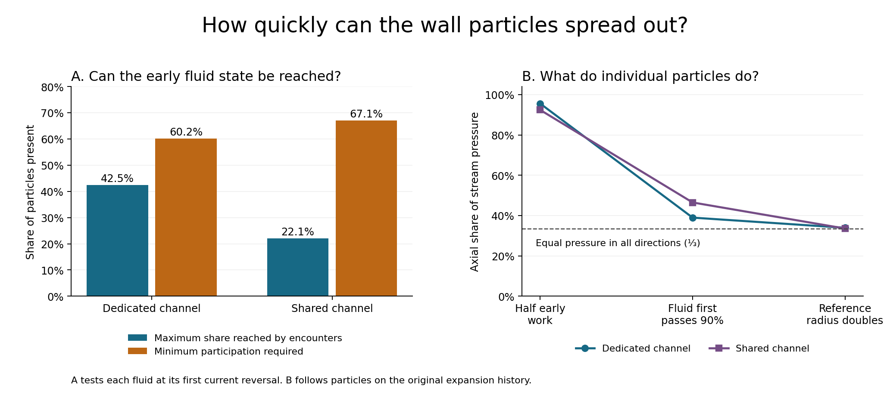

# Can the particles made by the wall actually reach the assumed thermal state?

In the HDblast model, an incoming five-dimensional pulse does work on a shell that represents our universe. A changing field on the shell excites a modeled neutral parent population. Those parents decay into charged particles, which the shell's electric field accelerates. The preceding calculation represented these particles as moving fluids. It assumed a thermal spread of energies to calculate collisions. We tested whether the specified collisions can actually produce the early current and pressure of those fluids, then followed individual particles to see how the answer changes the expansion. This is a calculation for a proposed source of a hot universe. The particle interaction, initial pulse and shell have yet to be identified in nature. [Preceding calculation](https://doi.org/10.5281/zenodo.24408924) · [Question recorded before the calculation](https://github.com/maldonado-research/HDblast/issues/157#issuecomment-7055120076)

**Result.** In both benchmark fluids, the specified collisions cannot turn the newborn particles fast enough to produce the pressure assumed when the current first reverses. When the particles, field and gravity evolve together in the dedicated case, scattering still puts most of the added energy into a spread of particle momenta. At radius doubling the simulated gas pushes almost equally in all directions while retaining a clearly nonthermal energy spectrum in both of the largest runs. [First-reversal test](ballistic/REVERSAL.md) · [Coupled particle evolution](live/RESULTS.md)

## A collision test that the earlier fluid fails

The charged particles are born with very little momentum across their local electric field. Between collisions the field can accelerate them in either direction along its axis. The parallel magnetic field can turn their transverse momentum, and expansion weakens it. These effects put a tight limit on how rapidly the particles can acquire the sideways motion of a thermal gas. We compare two versions of the earlier model. In the **dedicated** version, each of three particle types has its own elastic interaction. In the **shared** version the types share one mediator and can change type when a pair collides. The calculation keeps the interaction strength, width, masses, source and normalization from the published benchmark. [Source parameters and event rate](history/RESULTS.md)

**Both earlier fluids fail at their first current reversal.** Consider the particles already born when their average electric current first changes sign. In the dedicated case, the model supplies about 42.5 collision participations per 100 particles. Yet at least 60.2 different particles need to be touched to produce its pressure along the field. In the shared case the comparison is 22.1 participations versus 67.1 particles. Grant every collision to a different particle, chosen to remove the most forward pressure, and the unhit particles alone still supply **1.99** and **4.86 times** the entire allowed pressure. Assigning an additional 1% to the event budget and widening all birth momentum intervals by 500 daughter mass units preserves both exclusions. [First-reversal calculation](ballistic/REVERSAL.md)

Two other tests locate the problem over the course of the pulse.

* At the point when 1% of the whole run's absolute electrical energy exchange has occurred, the maximum allowed encounter rate leaves over **33%** of the dedicated population and over **56%** of the shared population in the narrow range of transverse momentum at birth. The corresponding thermal distributions predict roughly **three and six particles in 100 million**. This test allows arbitrary momenta for the collision partners. The percentages count the particles already present at that time. [Derivation and numerical bounds](ballistic/TUBE.md)
* At halfway through the absolute electrical exchange in the dedicated fluid, reproducing its current and its pressure along the field at the same time would require **at least 45.3%** of the particles to have collided. The fluid's own rate supplies **at most 25.0%**, even if every encounter reaches a different particle. The joint bound uses the fact that the very same population must carry both the current and the pressure. [Joint bound](ballistic/STRESS.md)

These contradictions apply to simultaneous reproduction of the archived birth history, forces, collision count and fluid properties within the specified model. Letting the evolving particles change the electromagnetic field, the collision rate and the expansion gives a physically different solution. A process that deflects the particles transversely between binary collisions would also change the test. Reaching the original thermal spread by the 1% marker, on the same density and birth histories, requires at least roughly **540 and 670 daughter-mass units of extra transverse impulse** (root mean square over all particles then present, with the speed of light set to one). A future calculation of transverse fields can test against these numbers. [Minimum sideways impulse](ballistic/KICK.md) [Kinetic literature and transverse plasma dynamics](SOURCES.md)



## Resolving the particles

A particle simulation in a box supplies a simple check. Two lower-energy beams lost 99% of their initial directed motion after eight initial collision times. Even then, the fraction of particles below an energy threshold differed by as much as 14.7 percentage points from a thermal distribution. A sample started in equilibrium gave a gap of 0.83 points. The first collision of two equal and opposite momenta can change their directions while leaving both individual energies exactly as they were. Later collisions can broaden the energy spectrum. [Box experiment with equilibrium controls](box/RESULTS.md)

On the earlier expansion and birth histories, a second calculation lets the electric field respond to the sampled current and retains the particles' three momentum components, including their magnetic rotation. At the earlier model's radius-doubling time, the longitudinal pressure in both examples is close to the one-third expected for equal pressure in all directions. In the shared case, 4.57% of the 4,096 representatives remained unscattered on average across two runs. Larger axisymmetric runs put the unscattered share higher. Thus the onset of a nearly isotropic pressure, the approach to a thermal energy spectrum and the removal of the narrow injected population are separately measurable. The precise size of that surviving population remains sensitive to the time step and sample size. [Three-axis particle calculation](driven/ORIENTATION.md) · [Time, particle-number and field controls](driven/RESULTS.md)

A separate fluid check measures numerical-grid and distribution effects. On the original radial grid, a thermal fluid with exact relativistic gas thermodynamics gives a hot radius factor of 2.0675 for the shared case. Assigning all the particles a common energy in a stream's rest frame gives 1.9987. With 144 early radial elements these estimates rise to 2.1135 and 2.0429, respectively. Going from 96 to 144 moves each by less than 0.0002. The difference in the encounter force remains. Even distributions with identical particle densities, mean flows and stresses can have substantially different collision integrals. [Spatial refinements and two fluid descriptions](closure/RESULTS.md) · [Matched-moment examples](moments/RESULTS.md)

## What changes when the particles can change the expansion?

The live calculation couples the particle current to the electric field and particle energy and pressure to the five-dimensional wave region and shell gravity. Neither the expansion nor the birth history is prescribed from the old fluid solution. We tested the dedicated interaction in this calculation. The collisionless control retains injection, gravity and electromagnetic acceleration. The internal-motion index used in the earlier perfect-fluid study and a second energy accounting in the wall's own frame can now be tested separately. [Live equations, controls and numerical checks](live/RESULTS.md)

The original index uses the zero-energy-flow frame of each stream. In the two 512-particle runs it stays above 90% while the radius grows by factors of 2.289 and 2.290. With collisions switched off the same index can still briefly exceed 90%, and the longest radius factor falls to 1.578. Requiring roughly equal pressure along the three directions in addition reduces the two scattering runs' uninterrupted factors to 1.87 and 1.59. The tolerance is five percentage points around a one-third axial pressure share. The finite number of particles also affects how often that threshold is crossed. [Live measurements](live/LIVE.json) · [Single-snapshot sampling control](live/ANGULAR_NOISE.md)

For the second measure, subtract the smallest wall-frame energy that particles with this number and net momentum could have. The difference is actual energy above perfectly coherent motion, bounded by the sampled gas energy. In the collisionless control its peak is **83.3% of the added wall energy**. With the dedicated interaction it passes **97%** in the tested runs. At 2,048 particles, two independent random seeds give bounded shares of **96.6% and 93.3%** at the instant the radius has doubled relative to the start of a qualifying interval under the original index. Under this bounded measure, the longest uninterrupted intervals above 90% span radius factors of **1.36 and 1.84**, respectively. At the reference doubling in each live run the axial share of pressure is 32.1% and 33.1%, close to one third, while the cumulative particle energy distributions differ from a fitted thermal distribution by **21.9 and 37.8 percentage points**. About 22% and 38% of the sampled particles are still in the narrow range of transverse momentum in which they were born. A particle can scatter and return to that range. The inferred distribution and threshold durations change with particle count and seed. An equilibrium distribution throughout a radius doubling remains unverified. [Higher particle count](live/EXTENDED.json) Every expanding solution examined here eventually reaches a maximum radius. [Full calculation](live/RESULTS.md)

## Scope and reproduction

The wall is spatially homogeneous along its surface, has three equal field directions and is evolved over one finite pulse. The particle mass, large charge-to-mass ratio, and isolated, elastic vector interaction are benchmark assumptions. The previous release also found a large shortfall in the conventional entropy estimate. Redistribution of energy among the assumed charged particles does not establish production of photons and light species, the measured cosmic entropy or a lasting radiation era. Those questions require additional dynamics and comparison to observations. [Predecessor release and entropy calculation](https://doi.org/10.5281/zenodo.24408924) · [Primary literature and comparison with other projects](SOURCES.md)

The archive includes the small subset of the preceding solver needed to regenerate the trajectories. Python 3.12, NumPy 2.3.5, SciPy 1.17.0 and a C++17 compiler reproduce the numerical products. The figure can be regenerated separately with Matplotlib and `python figure.py`. To verify the supplied files and reproduce the calculations, run these commands in this study folder. The second command takes a new or empty output directory outside the study and uses temporary disk space for the native trajectories.

```sh
python -I -B -S study.py
python -I -B study.py --verify --output-dir /tmp/hdblast-kinetic-results
```

The full replay checks conservation, reproduces deterministic results numerically, and checks stochastic diagnostics using their stated ensemble tolerances. A passing replay is a reproducibility check on this implementation. Independent physical tests and observations remain open.
