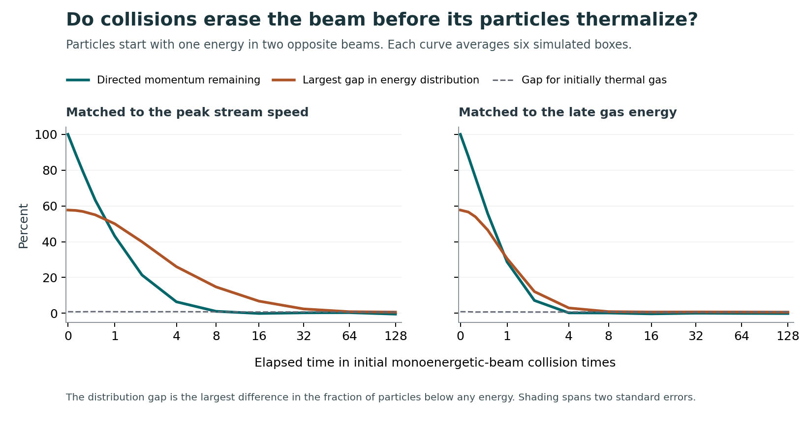

# Can elastic scattering turn narrow particle beams into a thermal gas?

In the earlier wall simulation, collisions could redirect enough electrical energy into random particle motion to keep the wall hot while it expanded. The calculation assumed that each moving stream already had a thermal distribution of particle energies. Here a particle-by-particle experiment asks how long the specified interaction takes to develop one. The result depends on the initial particle energies. Two beams can lose nearly all their directed momentum while their energy distribution is still visibly different from equilibrium. [Earlier wall calculation](https://github.com/maldonado-research/HDblast/pull/194) · [Collision law and measurements](METHOD.md)

Each simulated box contains 4096 positive and 4096 negative particles. The two signs move in opposite directions with the same initial particle energy. After a pair scatters, both outgoing momenta enter subsequent collisions. An equilibrium control starts with a Maxwell–Jüttner distribution at the same total energy. Time is measured in units of the starting mean collision time of the corresponding narrow beams. These units differ between the two energies.



## Loss of direction and redistribution of energy

At the lower energy, the beam speed matches the greatest bulk drift speed in the earlier flavor-specific wall calculation. After eight reference times only **1.11% ± 0.22%** of the initial directed momentum remains. Yet at one energy threshold the fraction of particles below that energy differs from the expected thermal fraction by **14.73 ± 0.14 percentage points**. A control that started in equilibrium shows a largest difference of **0.83 ± 0.12 points** at the same time. There were 3.09 collisions per particle on average by this point. By 16 reference times the directed momentum and pressure anisotropy are consistent with zero across the ensemble, while the distribution gap remains **6.81 ± 0.19 points**. Only later does the energy distribution approach the equilibrium control.

A simple reason for the delay is visible in the collision kinematics. In the initial collision of two equal, opposite momenta, the box frame is the pair's center-of-momentum frame. The first collision can change the particles' directions while leaving each particle's energy exactly at its starting value. A broad spread of energies requires subsequent collisions between particles with different directions or energies.

| Starting energy per particle | Reference times elapsed | Mean collisions per particle | Directed momentum remaining | Pressure anisotropy | Largest gap in pooled energy distribution |
|---|---:|---:|---:|---:|---:|
| $35.71m$ | 8 | 3.09 | 1.11% | 3.32% | 14.73 points |
| $35.71m$ | 16 | 5.76 | −0.09% | 0.02% | 6.81 points |
| $35.71m$ | 64 | 21.76 | 0.39% | −0.19% | 0.89 points |
| $6616m$ | 4 | 6.86 | 0.24% | 7.09% | 2.97 points |
| $6616m$ | 8 | 14.33 | 0.18% | 1.22% | 0.93 points |
| $6616m$ | 16 | 29.19 | −0.31% | 0.42% | 0.71 points |

At the higher energy, each particle initially carries the mean energy of a thermal particle at the earlier hot-radius doubling temperature. By eight reference times the pooled energy-distribution gap is **0.93 ± 0.06 points**, close to the equilibrium control's **0.88 ± 0.09 points**. Pressure retains a small directional bias and the mean squared particle energy is about 1.3% below its thermal expectation at that time. At sixteen reference times both are within two ensemble standard errors of their equilibrium values. These comparisons probe the energy distribution, angular moments, and momentum of the gas. [All measured moments and uncertainties](BOX.json)

Changing only the initial energy spread while keeping particle number, total energy and total momentum fixed changes the initial rates. At the lower energy, splitting the particles evenly between 15% and 185% of the mean kinetic energy gives almost the same collision rate, 0.9986 times the monoenergetic value. The initial directed-momentum relaxation is **1.683 times** as fast. At the higher energy, the same split increases the initial collision rate by **3.183 times** and momentum relaxation by **3.200 times**. These factors follow directly by summing the four types of initial incident pairs. The lower-energy split changes mean momentum per sign by 0.0851%, and the higher-energy split by less than 0.0000030%. [Initial distributions and analytic rate sums](run.py)

## Connection to the expanding wall

At the hot-radius doubling density of the earlier benchmark, one higher-energy reference time is $0.06627L$ in natural units. The frozen box takes about $0.53L$ to reach the eight-time snapshot. The local expansion time there is about $78.38L$. From doubling to turnaround the actual wall passes through a target column equivalent to **153.04–191.67** of these reference times. This is a comparison of available particle density and time with a *fixed reference cross section*. The wall has continuing expansion, a changing field, and its own distribution. The box demonstrates kinetic relaxation for two specified preparations. Its times do not establish how many collisions any particular particle experienced during wall heating. [Reference column calculation](run.py) · [Wall event history](../history/RESULTS.md)

## Numerical checks

The six-seed results above use continuous event times and equal simulation weights. Doubling the particles per sign to 8192 changes the lower-energy distribution gap at eight reference times from 14.735 to 14.688 points and the higher-energy gap from 0.932 to 0.896 points. In the larger run, by 128 reference times the respective pooled gaps are 0.49 and 0.56 points. Across all preparations and numerical controls the largest reported relative energy error per collision is below $9\times10^{-16}$, the total-energy error stays below $2\times10^{-13}$, and total momentum stays within $4\times10^{-14}$ of zero in units of $2Np_0$, with $p_0$ the initial monoenergetic beam momentum. The quoted uncertainties are standard errors of the seeded means.

A separate algorithm allows each particle at most one collision per step. In the higher-energy monoenergetic case it records 184.48, 207.47 and 221.23 mean collisions per particle by time 128 for steps 0.1, 0.05 and 0.025. The continuous-time result is **236.56 ± 0.11**. Even the finest batch step undercounts collisions by 6.5%. The main results use the continuous-time process. [Code and estimator definitions](METHOD.md) · [Quick replay output](QUICK.json)

Run from the study root with Python, NumPy, SciPy and a C++17 compiler. The optional figure also uses Matplotlib.

```sh
python -I -B box/run.py --quick --prior prior --output /tmp/QUICK.json --jobs 2
python -I -B box/run.py --prior prior --output /tmp/BOX.json --jobs 2
python -I -B box/figure.py --input /tmp/BOX.json --output /tmp/relaxation.png
```
