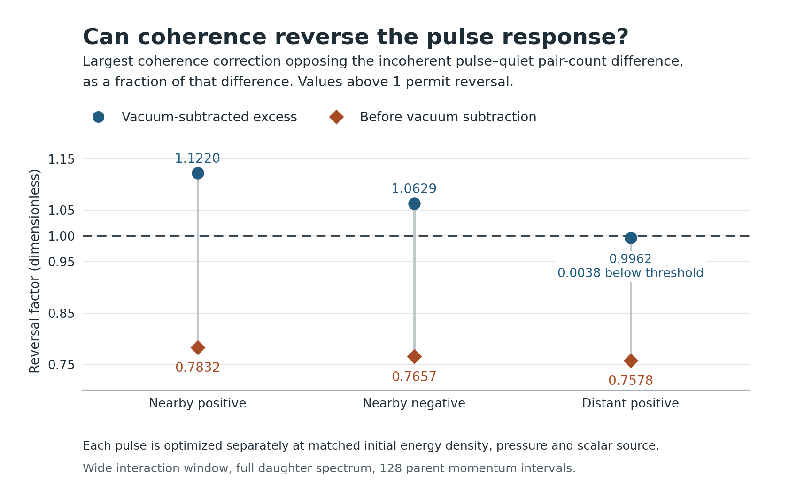

# Which preparation data fix the direction of the pair-count response?

The moving-parent study found two scalar states with equal occupation and initial free-field energy that gave opposite fermion-pair responses to each of three bulk pulses. Here we also match the initial pressure and the force that the parent field exerts on the shell scalar. **On the fine shell with the wider interaction window, all three total pair-count changes retain their signs across the resulting family of Gaussian preparations on the numerical momentum grid.** Two of the three *vacuum-subtracted* signals can still reverse individually. [Archived source-matching study](https://doi.org/10.5281/zenodo.24356875) · [Original moving-parent calculation](https://doi.org/10.5281/zenodo.24356734) · [Follow-up question posted before the test](https://github.com/maldonado-research/HDblast/issues/157#issuecomment-6996927941)

We prescribe one real scalar per mode on average in the initial momentum band $0<q/H_0\le8$. The original and comparison states have the same occupation at every momentum and share the same stored shell histories. A weak, spatially uniform switched Yukawa interaction produces massless fermion–antifermion pairs. In the fine wide-window test we integrate the resolved spectrum without the optional daughter-energy cutoff. Each count is per initial mean parent in a fixed comoving volume and restricted to pairs whose total momentum lies in the modeled band. The three comparisons use the corresponding quiet wall and the same initial state in both arms. [Definitions and original numerical controls](../HDBLAST_MOVING_PARENT_20261119/primary/MOVING.md)

## How much of each pulse signal can the phase cancel?

A score of 1 cancels the number-diagonal pulse-minus-quiet signal. A score above 1 allows its sign to reverse. The table gives independently computed optima on the 128-interval momentum quadrature with both initial source constraints. Each pulse may choose its own best state. A value below 1 excludes reversal even with this freedom on that grid. In both count conventions the nearby positive pulse has a negative number-diagonal contrast, while the other two have positive contrasts.

| Pulse | Excess above matched vacuum, separable covariance | Excess above matched vacuum, full quantum covariance | Total before vacuum subtraction, full quantum covariance |
|---|---:|---:|---:|
| Nearby positive | 0.79339 | 1.12202 | 0.78322 |
| Nearby negative | 0.75160 | 1.06292 | 0.76568 |
| Positive with distant compensation | 0.70439 | 0.99616 | 0.75777 |

The total counts include the same momentum band's vacuum contribution on each wall. The resulting lower bounds on the magnitudes of the three total-count contrasts are approximately 21.68%, 23.43% and 24.22% of their respective number-diagonal values. The distant-compensated excess is much closer to cancellation. Its independent maximum reaches 99.616% of the contrast. Actual admissible states attain the nearby excess reversals separately at this resolution. The restricted separable states fall short for all three excesses. [Independent direct-amplitude calculation](source_check/SOURCE_TRANSFER.json)

## Why pressure and force constrain the phase

Let $R(q)=\mathrm{Re}\langle a_{\mathbf q}a_{-\mathbf q}\rangle$ in the instantaneous energy basis with a real positive initial mode. The free energy is fixed by occupation. Vanishing of the changes in scalar force and isotropic pressure imposes two additional real-moment equations. With $E_i(q)=\sqrt{m_i^2+(q/a_i)^2}$ they are

$$
\int_0^8 \frac{q^2 R(q)}{E_i(q)}\,dq=0,\qquad
\int_0^8 \frac{q^4 R(q)}{E_i(q)}\,dq=0.
$$

The imaginary part can still change the later stress. At the fixed occupation $n=1$, the phase and amplitude of the complex correlation $c(q)$ can range over the disk $|c|\le\sqrt{2}$. The disk $|c|\le1$ is achievable by classical mixtures of product coherent states. We optimize the pulse response over those disks with the two linear source constraints. The calculation uses the small difference in the initial masses and scale factors when matching both meshes. [Derivation, time derivatives and junctions](SOURCE_MATCH.md)

The constrained optimization also tests simultaneous reversal across 24 pulse, mesh, window and energy selections. At 96 Gauss momentum nodes the fine wide-window upper bound is 0.996172, and the combined 24-case upper bound is 0.993631 even when only the fine-mesh pressure and force constraints are imposed. Requiring both meshes to match their own initial sources narrows the admissible set further. The independent calculation reconstructs the spectrum on the fine shell using oscillator transfer matrices and direct frequency quadrature. Both compare a realizable covariance against a bound from the two moment constraints. In particular, the independent calculation tests the pulse-dependent vacuum contribution to the total count directly. The numerical bounds refer to the stated momentum grids. They have been tested under refinement. A rigorously bounded continuum integral would require additional error estimates. [Optimization and convergence across meshes](source_match/SOURCE_MATCH.md) · [Independent bounds and attainable states](source_check/INDEPENDENT.md)

## Physical scope

The totals give a conditional prediction for these initial data and this readout. The two positive number-diagonal signals still share a sign, so the sign alone cannot distinguish those two disturbances. Unknown scalar occupations, a different pair-momentum selection or a change in the dynamical wall can affect the inference. Matching the initial pressure and scalar force makes the two states agree in the initial matter contributions to the junction equations. They can develop different stress moments later, and both populated states change the sources relative to the original stored wall. A fully coupled evolution is the next test of whether this conditional sign prediction survives.

## Reproduction

In a checkout containing the preceding moving-parent study and its five historical inputs, run these commands from this directory. The first calculation verifies the results and their source hashes. The full replay recomputes the independent amplitudes and correlation bounds at the specified resolutions. The figure reads the independent results at 128 momentum intervals. [Figure source](match_figure.py)

~~~sh
sha256sum -c SHA256SUMS
python -I -B reproduce.py
python -m pip install numpy==2.3.5 scipy==1.17.0
OPENBLAS_NUM_THREADS=1 python -I -B -O reproduce.py --full
~~~
