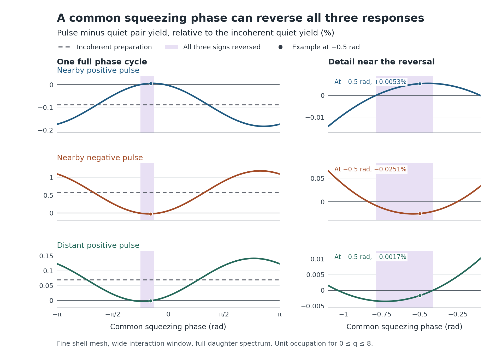

# Can fermion pairs reveal the sign of a bulk disturbance?

On the HDblast model shell, the same incoming disturbance can increase or decrease the number of emitted fermion pairs, depending on how the parent scalar field was prepared. We found explicit preparations with the same initial particle occupations and the same mean initial free-field energy that give opposite responses for all three simulated disturbances. A change in the pair count alone therefore cannot identify the disturbance in this family of experiments. [Study plan recorded before the calculation](https://github.com/maldonado-research/HDblast/issues/157#issuecomment-6996700109) · [Zenodo edition and numerical archive](https://doi.org/10.5281/zenodo.24356734)

## One shell history, two ways to prepare the particles

The four stored histories describe a quiet rolling shell, nearby positive and negative fronts, and a positive front with its compensating disturbance placed farther away. We introduce a real scalar with one particle on average per momentum mode over $0<q/H_0\le8$, coupled weakly to a massless Dirac field that begins empty. In the first preparation the initial state is diagonal in particle number. In the second it has a definite phase relation between opposite momenta. On each history we count emitted pairs, subtract the count for the matched switched vacuum, and compare that excess with the quiet shell prepared in the same way. “Per parent” means division by the initial mean population in a fixed comoving volume. The readout occurs after the interaction has switched off. [Equations, units and switching windows](primary/MOVING.md)

| Initial scalar state, fine mesh and wider window | Quiet excess pairs per initial parent, divided by $y^2$ | Nearby positive | Nearby negative | Distant-compensated positive |
|---|---:|---:|---:|---:|
| No initial pair coherence | 0.297910 | −0.08919% | +0.58212% | +0.06909% |
| Two-mode squeezed, common phase −0.5 rad | 0.068627 | +0.02305% | −0.10892% | −0.00741% |

Each percentage uses its own row's quiet excess as denominator. The same common phase reverses the three excess signs on both wall meshes, in both interaction windows and with either the full daughter spectrum or a common total-energy cutoff. We selected the phase after inspecting the first fine-grid calculation. An independent evolution squaring the positive emission amplitudes reproduces the contrasts. [Phase dependence and sharp bounds](coherence/COHERENCE.md) · [Direct amplitude calculation](independent/SQUEEZE.json)

The shaded region in the figure shows the phase interval where all three displayed responses reverse. The vertical scale uses the quiet number-diagonal excess as a common denominator. [Figure source](figure.py)

## Does the reversal require quantum entanglement or vacuum subtraction?

**Classical correlations suffice for the excess count.** A mixture of independent coherent-state products can have $n(q)=1$ and $c(q)=\langle a_{\mathbf q}a_{-\mathbf q}\rangle=\exp[i(q^2/20-2.43)]$, with $q$ in units of $H_0$. For example, draw a circular complex Gaussian amplitude $u$ of unit mean squared magnitude for one mode and give the opposite mode the amplitude $c(q)u^*$. Mixing these products gives the required covariance. The same smooth function reverses all three excess-count signs in each of eight combinations of mesh, window and daughter-energy range. We found the function by exploring these model histories. Doubling the momentum and waveform resolution preserves the result. A 2% reduction in correlation strength also preserves all 24 signs. [Construction and resolution tests](phase_feasibility/FEASIBILITY.md)

**The emitted count before subtraction is a separate test.** With the constant squeezing phase in the table the three total pair-count responses from the modeled momentum band retain the original signs. A different two-mode squeezed preparation, $c(q)=\sqrt{2}\exp[i(-2.2+3(q/8)^2)]$, reverses all three of those total counts in the fine-mesh, wide-window calculation. The latter example includes the switched vacuum contribution within the same parent band. It also reverses the number and energy responses in the narrower window, with the energy cutoff, and per unit final physical volume on that mesh. Vacuum production from modes outside the band would require additional input to predict the unrestricted count. The explicit phase profiles establish possible responses on the stored geometries. A physical model for preparing these correlations would be needed to predict which one occurs. [Independent amplitudes, vacuum terms and two phase choices](independent/squeeze.py)

| Initial state, before vacuum subtraction | Quiet pairs from the modeled band per mean initial parent, divided by $y^2$ | Nearby positive | Nearby negative | Distant-compensated positive |
|---|---:|---:|---:|---:|
| Number-diagonal | 0.360319 | −0.10564% | +0.66813% | +0.07509% |
| Squeezed, $\theta(q)=-2.2+3(q/8)^2$ | 0.034638 | +0.15368% | −0.89980% | −0.09352% |

Both rows use the fine mesh and wider window. Each contrast is relative to the total quiet count in its own row. Destructive interference can bring the positive total below the matched quiet vacuum count of $0.062409\,y^2$. [Positive amplitudes and numerical convergence](independent/INDEPENDENT.md)

## What changes when the parents move?

For the quiet wide-window shell, a scalar at rest yields $0.494140\,y^2$ excess pairs. At $q/H_0=8$ the yield falls to $0.222940\,y^2$. The number-diagonal uniform population emits $6.60064\,y^2H_0$ of daughter energy per initial parent on average. Motion enforces a lower limit on the pair's total conformal energy. Accounting for that limit contributes 4.35% of the count at the highest tested parent momentum. The spin-summed spectral weight and the two emission branches have precedents in published curved-spacetime decay calculations. The numerical pulse and state comparisons here use the HDblast histories. [Populations and threshold](primary/MOVING.md) · [Primary literature and search coverage](LITERATURE.md)

A directed parent at $q/H_0=8$ on the quiet shell gives $P_{zz}/\rho=0.38453$ along the beam and $P_{xx}/\rho=P_{yy}/\rho=0.30773$ across it. Isotropically mixing all directions gives $p=\rho/3$ for the free massless daughters. The direction, reference state and volume convention matter for relating these coefficients to measurements. For example, the distant-positive contrast in the table's squeezed excess count becomes positive when expressed per unit final physical volume because the histories have different final scale factors. [Angular stress](angular/BEAM.md) · [Momentum and finite-time energy balance](calibration/LEDGER.md)

## What this means for the Big Bang hypothesis

The shell trajectories and the interaction switch were supplied to the calculation. It predicts a conditional matter response at leading order in the squared Yukawa coupling. The initial population itself carries energy. For the number-diagonal state, inserting its energy and scalar force into the native expansion equation at the stored geometry changes two individual terms by +1.62% and −2.39% of the recorded squared expansion rate. A dynamical test would prepare the scalar correlations from a specified incoming state, solve the matter and gravitational junction conditions together, and track a physically defined daughter-energy measurement. The current result supplies a counterexample to inferring a bulk disturbance from the sign of one particle observable. The origin of a hot, expanding universe remains open. [Preparation energy and junction terms](scales/README.md)

## Reproduce the calculation

The five historical inputs are pinned by size and SHA-256. In an HDblast checkout, run the following commands from this study directory. The first science check needs only Python. The full numerical replay uses NumPy and SciPy. The archival edition provides the same inputs for a standalone run. [Input manifest](SOURCES.json) · [Zenodo download](https://doi.org/10.5281/zenodo.24356734)

~~~sh
sha256sum -c SHA256SUMS
python -I -B reproduce.py
python -m pip install numpy==2.3.5 scipy==1.17.0
OPENBLAS_NUM_THREADS=1 python -I -B -O reproduce.py --full
~~~
