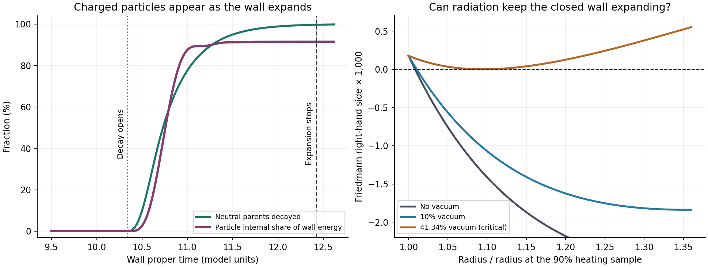

# Can a neutral parent supply charged matter on a curved HDblast wall?

A finite pulse in a five-dimensional model makes a closed, three-dimensional wall rebound. As a scalar field on the wall evolves, the neutral particles become heavy enough to decay under the model’s continuum decay law. The calculation follows the positive and negative particles produced by that law. In the selected run, those particles draw energy from an electric field. The fluid model assigns **91.49% of the energy above the wall's background tension to the particles' internal motion** at its peak during expansion. Once this share exceeds 90%, the radius grows just **0.773%** before the wall turns around. [Study plan](https://github.com/maldonado-research/HDblast/issues/157#issuecomment-7049238016) · [Preceding study](https://doi.org/10.5281/zenodo.24405438)

The decay law comes from a familiar particle process. The parent population, the way its mass depends on the scalar field, the electric response, and the fluid's momentum relaxation rate are inputs. The calculation tracks what these assumptions buy and where specific particle interpretations fail. The original hypothesis concerns the origin of our observed hot Big Bang. Connecting this short-lived model expansion to that event requires a sustained hot phase and a prediction that can be tested against astronomical measurements.

*Left:* The decay fraction and internal-energy share have different denominators. The latter is the share of total added wall energy, including the scalar and electromagnetic field. *Right:* For hypothetical continuations from the first sampled 90% crossing, the Friedmann right-hand side must stay nonnegative for a radius to be accessible. The gap below zero prevents the expanding wall from crossing it. The orange curve just touches zero and approaches that radius asymptotically. [Figure source](figure.py)

## What the decay supplies

In units with $c=\hbar=1$, a neutral scalar parent with mass $M=2mR(\psi)$ can decay in flat-space vacuum into a Dirac particle and antiparticle of fixed mass $m$ when $R>1$. An energy-conserving decay on a stationary closed wall must also match an allowed pair state. Its rest-frame vacuum width, measured in units of the bulk curvature time $L$, is

$$
\Gamma L =\kappa R(1-R^{-2})^{3/2}, \qquad
\kappa=\frac{mL}{4\pi}\sum_i y_i^2.
$$

Below threshold we set the on-shell width to zero. The three equally populated flavors correspond to the three gauge directions. The primary uses $R_i=0.95$, $R_f=1.05$, threshold $\psi_*=0.77$, scalar interval width 0.03, and $\kappa=100$. The chosen threshold targets the electric phase seen in the previous study. The changing masses draw energy from the scalar field. Parent number, daughter number, electric work, wall gravity and returning bulk waves evolve together. With the selected source, the wall bounces at time 0.867 and the decay opens at 10.341. Half of the parents have decayed by 10.731 and 90% by 11.272, all in wall time units. [Coupled calculations, controls and equations](coupled/DECAY.md)

The principal energy source is measurable in the simulation. At peak internal share, integrated electric work per unit comoving coordinate volume is 4.5131, while initial daughter kinetic energy from the decays totals 0.00003800 in the same units. For this preparation, even converting *every* parent at the maximum mass could supply only 0.00004211 at birth. The electrical work exceeds that ceiling by more than 100,000 times. Switching off the charge leaves less than 0.001% of total added energy as particle internal motion. Keeping the original threshold but changing the incoming pulse dose from 0.123 by just 0.00005 in either direction reduces the calculated peak to about 70% in the coarse runs. [Parameters and 22 runs](coupled/DECAY.json)

## Three ways to test the particle interpretation

| Question | Calculation and outcome |
| --- | --- |
| Can a particular particle fit on the wall? | At the illustrative charge normalization $q=1$, matching the simulated force-to-mass parameter $Q=10^8$ makes the particles too light for the parent to produce a pair in any allowed instantaneous state on the neutral reference's open-gate expansion. At the instant of zero magnetic field, the parent energy is $1.19\times10^{-8}$ model units and the lowest pair costs about 0.314. A time-varying field can itself excite a selected mode at much higher charge. [Closed-space spectrum](spectrum/SPECTRUM.md) |
| Does a local decay rate describe a short event? | On the prescribed neutral trajectory, finite-time quantum amplitudes for weak decay yield 2.16 times the integrated local prediction at $mL=8$, and 1.005 times it at $mL=128$. The calculation uses free continuum daughters and a specified switching window. Counting the states and their occupation remains important on the actual compact, electrically driven wall. [Survival and finite-time calculation](survival/SURVIVAL.md) |
| Can particles scatter at the assumed rate? | At $mL=100$ and illustrative late electromagnetic strength $1/137$, the ceiling for one isotropic elastic partial wave scattering off opposite charges in the hot, small-drift gas is 0.0378 per time unit. The fluid uses 6. A different mass and wall tension, with an additional elastic interaction fitted at the peak, gives rates from 4.31 to 6.00 in six late snapshots. Its behavior during early acceleration and formation of equilibrium remain open. [Particle counts, quantum occupancy and interaction rates](consistency/CONSISTENCY.md) |

## Fast particles and genuine heat

In a separate test we removed collisions and let the produced particles and the electromagnetic field respond to each other, retaining the primary run's geometry and birth history and closing off further bulk flux. By the reference turnaround, **90.85% of the initial coherent field energy** had passed to particles on net. They then carried 83.30% of total added energy. Within one charge and flavor, about 45% traveled forward and the rest backward. Their mean absolute speed along the field was 0.99996 times the speed of light. Almost all their pressure in their energy frame was directed along the same axis. The three gauge directions together give isotropic total spatial stress, even though the individual distributions retain strong directionality. This explicitly shows how a large transfer can occur while the population remains out of equilibrium. [Collisionless kinetic calculation](kinetic/KINETIC.md) · [Independent current reconstruction](coupled/COHORTS.json)

## What would permit a longer hot era?

At the first recorded expanding sample above 90% internal share, the wall radius is 9.69. Holding that total energy and bulk mass fixed and assuming subsequent isolation, a permanent vacuum share above **25.61%** would be needed for unbounded expansion even if the remaining material were pressureless. For radiation, the threshold rises to **41.34%**. At this slice less than 10% of the same budget is still available once particle internal energy is counted. Alternatively, a radiation-only wall at the same heating density would have to reach **radius 19.29 at heating** to double before recollapse. This target can be used to test a changed preparation. It does not assume the emitter can attain it. [Derivation and radius targets](expansion/EXPANSION.md)

## Reproduction

Python 3.12, NumPy 2.3.5, SciPy 1.17.0 and a C++17 compiler (`g++`) were used for the numerical replay. The archived historical input is included. From this directory run

~~~sh
python -I -B -S study.py
python -I -B study.py --verify --output-dir /tmp/hdblast-decay-replay
~~~

The first command checks the manifest using the Python standard library. The second regenerates all seven numerical products, runs physical checks and compares every result with its archived value. Use a new or empty output directory. The chart can be rendered separately with Matplotlib and `python -I -B figure.py --output /tmp/neutral-parent-decay.png`. [Historical data provenance](prior/README.md) · [Literature and links to related research](literature.md) · [Zenodo edition](https://doi.org/10.5281/zenodo.24406309)
