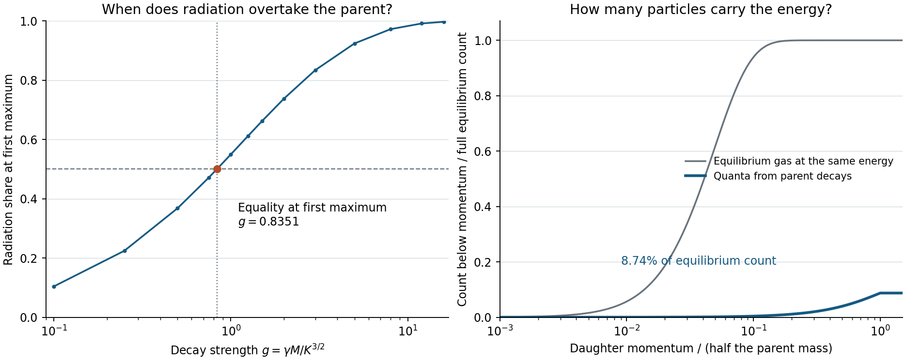

# Can an oscillating shell field supply a hot early universe?

An oscillating field can give energy to massless particles. Two practical questions determine whether that process helps HDblast. Does the model universe keep expanding long enough for radiation to carry most of its energy? If it does, how many particles share that energy?

At the reference displacement in the D-Blast 3 archive, both closed universes turn around before the field settles into nearly harmonic motion. A separately prepared flat universe can reach radiation domination. At the largest detuning tested, its radiation contains **8.74% or 5.39%** of the equilibrium particle count when radiation first equals the oscillating field in energy. Following the particles to 90% radiation gives **7.18% or 4.43%**. The individual particles carry too much energy, on average, to resemble a thermal gas. [Momentum distributions and count at the same energy](spectra/SPECTRA.md)

In a second experiment, we varied how close to the hilltop the closed model starts. We found trajectories that reach radiation equality before turnaround. At detuning $10^{-3}$ the transition requires a displacement roughly $10^{16}$ to $10^{21}$ times smaller than the archive reference. The sensitivity is a prediction of the specified classical model. How the initial field would be prepared to that precision is open. [Closed-launch calculation](hilltop/HILLTOP.md)

*Left*, an oscillation-averaged universe with positive curvature, starting from the early pure-matter limit. Each point gives the radiation share at its first maximum size. *Right*, the flat positive-minimum control at equality, starting at $H_i=m/50$ with detuning $10^{-3}$. Each curve counts particles below the indicated momentum, divided by the total equilibrium count at the measured radiation energy. [Figure source](figure.py)

## From the shell field to particles

Folder 146 studied several detunings, small changes to the model's brane potential. Its original potential A approaches a massless endpoint. Here we use **modified potential B**, with a stable interior minimum at either $\phi_m=+0.5$ or $-0.5$. A rolling field can overshoot a minimum, return and oscillate. Its energy then behaves approximately like nonrelativistic matter. The calculation assumes that matter sees the induced metric $g_J=A^2g_E$, where $A=f^{-1/2}$. A specified daughter field is essential to calculate the rate of energy transfer. This changes both the source and the particle species from the earlier prescribed Dirac-pair pulses. [Archive and literature](literature/README.md) · [Earlier pulse study](https://doi.org/10.5281/zenodo.24376497)

For **one real, minimally coupled, massless scalar**, the leading decay width of a parent of mass $m$ is

$$
\Gamma=\frac{\alpha^2m^3}{32\pi M_{\rm Pl}^2},\qquad
\alpha=M_{\rm Pl}\left.\frac{d\ln A}{d\sigma}\right|_{\rm minimum}.
$$

Here $\sigma$ is the canonical field and $M_{\rm Pl}$ is the reduced Planck mass. The factor $1/(32\pi)$ makes the calibrated width about one hundredth of the archive's dimensional estimate with a unit coefficient. At detuning $10^{-3}$, the respective widths are $3.153\times10^{-5}$ and $5.554\times10^{-5}$ in units of the initial hilltop Hubble scale. Massless Dirac fermions and conformally coupled massless scalars have zero width through this linear trace coupling at tree level. Other interactions and trace anomalies depend on the matter sector. Independent calculations check the geometry and the decay phase space. [Particle channels, units and threshold checks](widths/WIDTHS.md)

We also solved the quantum wave equation for an initially empty daughter field on a controlled, oscillating metric with flat regions before and after the oscillations. Its emitted energy agrees with the long-duration width to 9.04%, 2.25% and 0.61% for 8, 16 and 32 cycles, respectively, at modulation amplitude $10^{-3}$. Much of the finite-duration difference is predicted by the pulse envelope. The long train puts mean daughter momentum at $0.5011m$, as expected for a nearly stationary parent decaying into two massless particles. The conformal and constant-metric controls give zero. This experiment checks local emission with well-defined initial and final particle states. A cosmological roll also changes the ambient scale factor and requires an initial quantum state on that geometry. [Quantum modes, spectrum and finite-window checks](modes/MODES.md)

## Two races against time

In the closed background evolution we solve for the scalar, radiation and scale factor from the time-symmetric bounce. The initial displacement in the archive is $H_{\rm top}/(2\pi M_{\rm Pl})$ in dimensionless canonical-field units. A microscopic width derived for near-sinusoidal oscillations becomes applicable only after the oscillations form. In the primary calculation we switch it on after two consecutive cycles meeting stated expansion-rate and harmonicity criteria. A separate sensitivity test applies the width from launch. In that test the radiation shares at the first turnaround are **0.00256%** and **0.00581%**. The positive-minimum universe subsequently contracts, bounces and expands again to a slightly larger maximum. The continuation ends at a specified field boundary. Inferring ultimate collapse from the first turnaround would miss that second bounce. [Resolved trajectories and numerical controls](background/BACKGROUND.md)

For the long period after oscillations have formed, we solve for a pressureless parent decaying into radiation, both coupled to the expansion. For early pure matter, define $S_i=\rho_{m,i}/(3M_{\rm Pl}^2H_{\rm top}^2)$, $M=S_i a_i^3$ and $\gamma=\Gamma/H_{\rm top}$. With the archive curvature convention $h^2=S+R-K/a^2$, the boundary is $K_{\rm crit}=1.12766656(\gamma M)^{2/3}$. At lower positive curvature, radiation catches up before the first turnaround. Using measured flat post-oscillation states as finite starting points and varying $K$ gives critical initial curvature shares of **2.05%** and **2.96%**. The calculation recomputes the expansion rate at each curvature. The original closed launches follow their own field dynamics from the bounce. [Curvature calculation, comparison proof and finite starts](curvature/CURVATURE.md)

A second experiment varies the closed bounce itself. Starting closer to the unstable top makes the field linger there while the closed universe expands. Following that trajectory into the oscillating era gives a transition from turnaround first to radiation equality first. At detuning $10^{-3}$ the transition occurs around **$4.6\times10^{-22}$ and $8.9\times10^{-17}$ times the archive's reference displacement** on the positive- and negative-minimum branches. By the first passage through the minimum, the marginal closed universes have grown to about 35 and 28 times their initial sizes. The corresponding archive launches grew by factors of only about 1.11 and 1.14 by that passage. The quoted displacements are offsets from the stationary point of the specified classical potential. They span distances far below the absolute accuracy with which the underlying hilltop location is known. We tracked their growth using logarithms, then checked the result by evolving directly from the closed bounce. Varying the matching scale, time and oscillator phase also tests the boundary. The long decay era uses an oscillation average. Reducing the detuning tightened the required displacement relative to the reference. Over ten decades in detuning the measured powers were 3.825 and 2.989, in agreement with the independently calculated growth rates of the two unstable hilltops. The calculation assigns no probability to preparing such a state. [Closed hilltop launches and sensitivity checks](hilltop/HILLTOP.md)

## What the results mean for HDblast

We now have a specified channel linking an oscillating modulus to radiation, a quantitative test for whether radiation can overtake the modulus during expansion, and a spectrum that tests the word “hot.” Both the curvature boundary and the count deficit depend on the stated dynamics. A four-dimensional model with the same potential, masses and coupling reproduces these tests. The archive's earlier dimensional temperature and nucleosynthesis estimates depended on assumptions about radiation domination and rapid thermalization. This study supplies neither an ordinary-matter temperature nor a nucleosynthesis prediction. The manufacture of extra quanta, their transfer into observed matter, and a distinguishing signature of five-dimensional dynamics remain open.

The closed-launch result suggests testing quantum preparation first. Specify the initial state of the field on the closed space and calculate the spread and growth of fluctuations over the expanding patch. That would show whether the homogeneous launch survives until oscillations form. Tomberg’s 2026 hilltop study gives a way to compute noise from field modes and shows why the choice of smoothing scale and boundary conditions matters. For histories that reach equality, an independent next step is to specify an interaction with ordinary matter and calculate whether it makes additional particles fast enough. For the original closed launch, particle creation during the early anharmonic roll calls for a different test, with a quantum state on the closed spatial geometry and a calculation of its stress tensor. That energy is absent from the harmonic-width treatment. [Primary sources and limits of the comparison](literature/README.md)

## Reproduce the calculations

The standalone study includes the two historical input files used in the calculations. From this directory, verify their checksums and rerun the numerical studies using Python 3.12, NumPy 2.3.5 and SciPy 1.17.0. The optional plot uses Matplotlib.

~~~sh
python -I -B -S reproduce.py
python -I -B reproduce.py --verify --jobs 2
python -I -B figure.py --output /tmp/modulus.png
~~~

[Source provenance](SOURCES.json) · [File checksums](SHA256SUMS) · [Initial experiment record](https://github.com/maldonado-research/HDblast/issues/157#issuecomment-7018476842) · [Secondary closed-launch experiment](https://github.com/maldonado-research/HDblast/issues/157#issuecomment-7018554997) · [Zenodo edition](https://doi.org/10.5281/zenodo.24377289)
