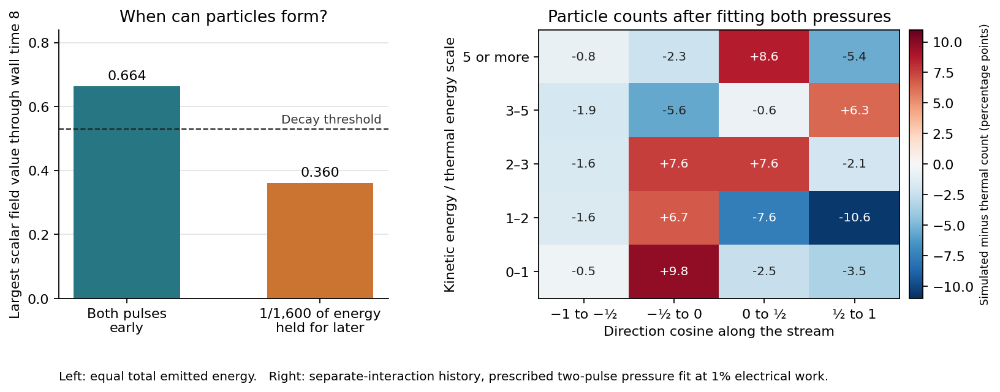

# Can a two-polarization pulse produce a hot gas on the HDblast shell?

HDblast asks whether a pulse in a higher-dimensional space could deposit enough energy on an expanding shell to account for an early hot universe. This study tests two steps in that proposal. First, can the incident pulse trigger the production of charged particles? Second, once those particles exist, does their motion resemble a hot gas? In these simulations the first step is sensitive to the pulse energy and timing. The second step can appear successful if the only measurements are two pressures.

## Producing particles takes a particular pulse

We evolved the pulse, the shell, and the energy exchanged with the scalar field that controls particle production. At the reference energy, sending both extra waves early produced charged particles near wall time 6.256. Moving just **one part in 1,600 of the total emitted energy** from the early pulse to a later pulse kept the channel closed through wall time 11. Withholding that portion altogether gave nearly the same scalar field at time 8. The change was already underway before the late pulse arrived. [Energy budgets and withholding control](source/README.md)

The reference energy was also special. Changing the source dose by **0.1% upward or downward** closed the channel even with both waves sent early. The higher dose brought the scalar to about 0.5270, just below the 0.5300 opening threshold. Three numerical grids agreed on which cases opened. These three dose settings leave the width of the successful interval unresolved. All times and energies here are in model units. [Nine matched dose and timing comparisons through time 11](sensitivity/README.md)

The left panel uses the original time interval ending at 8. The right panel tests the distribution on a prescribed shell in the separate-interaction history. Each cell gives the simulated fraction minus the thermal fraction for that energy and direction, in percentage points. Both panels can be regenerated from the deposited measurements. [Figure source](figure.py)

## Matching two pressures leaves a measurable discrepancy

A drifting hot gas pushes equally hard in the two directions perpendicular to its motion. We tested whether two electric waves sent at different times could produce those two pressures locally. The comparison is made early in heating, when cumulative absolute electrical work reaches 1% of its reference total. We repeated it on two histories from the previous study with different assumptions about the interactions.

| Measured quantity | Separate interactions | Shared interaction |
|---|---:|---:|
| Total emitted energy of the pressure-fitted waves, in units of the original pulse energy | 1,356 | 492 |
| Two sideways pressures divided by thermal pressure, with the field from both particle currents included | 0.982, 1.011 | 0.972, 1.017 |
| Fraction of particles that would have to change energy or direction bin to match the thermal counts | 47.2% | 55.7% |

We used 20 broad bins in energy and direction. Even with both sideways pressures within 3% of their targets, nearly half or more of the particles would have to change bins to match the hot-gas distribution. Including the electric and magnetic fields generated by both sideways particle currents changed the median direction by less than 0.08 degrees. These strong pulses are tests on prescribed shell histories. Their energy cost is hundreds of times the reference source budget. [Charged-particle trajectories and measured bin counts](orbits/README.md) · [Calculation with both induced currents](feedback/README.md)

A family with a much smaller energy budget gives a complementary result. We allowed 70 coefficients describing wave shapes, directions and times to vary together. With additional emitted energy capped at 0.16% of the reference pulse, the weaker local sideways pressure, averaged over particles in a particular half of the shell, can reach at most 0.62% or 2.64% of its thermal target on the two fine-time histories. This bound uses uniform particle births and subsequent collisionless motion in the specified fields. Evolving the trajectories and testing other families of spatial patterns give additional checks on what happens when the wave energy concentrates into small regions. [Pressure bound](bound/README.md) · [Wave propagation and energy normalization](fields/README.md) · [Additional angular patterns](fields/SPIN.md)

## What would advance the hypothesis?

A viable source must produce particles over a measurable range of pulse energies and turn those particles in enough different directions to pass the energy-and-direction count test within the available energy budget. A finer scan near the successful dose can locate the interval and trace the energy exchanges responsible. The momentum comparison also provides a target for a physically specified scattering mechanism. The present models evolve angularly averaged gravitational feedback in the production calculation and two transverse particle currents on fixed histories in the motion calculation. A fully coupled angular evolution and an observable signal distinguishing this proposal from other early-universe mechanisms remain open. [Original scope of the test](https://github.com/maldonado-research/HDblast/issues/157#issuecomment-7067237711) · [Primary literature and model provenance](SOURCES.md)

## Reproduce the calculation

The capsule checks its inherited inputs against the predecessor manifest. The reference configuration uses Python 3.12, NumPy 2.3.5, SciPy 1.17.0 and a C++17 compiler. From this directory, run the two commands below. The second writes transient traces and results to a new or empty directory.

~~~sh
python -I -B -S study.py
python -I -B study.py --verify --output-dir ../polarization-results --jobs 2
~~~

[Predecessor archive](https://doi.org/10.5281/zenodo.24423944) · [This study on Zenodo](https://doi.org/10.5281/zenodo.24424913)
