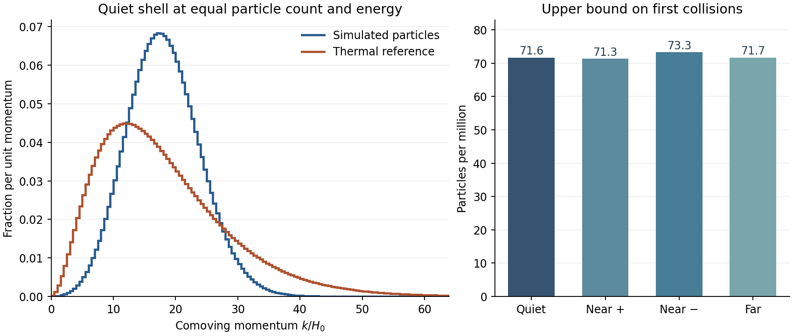

# Can particles from the shell collide often enough to form a hot gas?

HDblast proposes that a disturbance in a higher-dimensional space could have supplied energy to the early universe. Earlier simulations followed energy from an expanding shell into pairs of massless particles. This study asks what happens to the individual particles after emission ends. The archived production interaction switches off. To test a route to heating, we allow an additional elastic collision between a particle and an antiparticle from the emitted gas.

**In the four recorded shell histories, at the illustrative production coupling $y=0.1$, the upper bound on the fraction that could experience even one collision is fewer than 74 per million.** This bound allows the collision partners to redistribute their momenta. It applies to one isotropic elastic quantum scattering channel on the short recorded interval. In the quiet case the gas would also need 8.18 times as many particles to reach chemical equilibrium at its existing energy. [Collision-test protocol](https://github.com/maldonado-research/HDblast/issues/157#issuecomment-7016401650) · [Previous emission study](https://doi.org/10.5281/zenodo.24374531) · [This edition](https://doi.org/10.5281/zenodo.24375564)

The left panel uses a Fermi–Dirac reference distribution with the same particle number and energy as the simulated particles. The right panel shows upper limits for one distinguishable channel through shell time 2.16. Zero is allowed in every case.

## What the shell emitted

The source gives the total energy and momentum of each pair. The original scalar interaction emits the two massless daughters isotropically in the pair's rest frame. Transforming to the shell frame yields a uniform distribution of comoving momentum $k$ between $(\omega-q)/2$ and $(\omega+q)/2$, conditional on the pair's comoving energy $\omega$ and momentum $q$. Each pair contributes exactly one particle of each sign. Summing the daughter energies reproduces the independent archived pair energy. On the quiet wall, the previously studied upper band accounts for just 2.30% of particles and 4.14% of energy. We include the entire modeled band $q<\omega<120$ in the primary collision test. [Momentum spectra, occupation bounds and normalization checks](daughters/DISTRIBUTIONS.md)

The population starts dilute. The leading per-spin occupation across all modeled momenta is below 0.000165 on all four histories at $y=0.1$. The initial state nevertheless contains pair correlations. Reconstructing its one-particle spectrum permits an independent-particle kinetic benchmark. Following the quantum dynamics of the two original partners together would require a separate calculation.

## An upper bound even when targets change

The two signs are equally populated. We assume a homogeneous, isotropic gas on each prescribed shell, no other targets, massless particles, independent incoming collision partners and elastic scattering in a single distinguishable isotropic channel. The quantum ceiling on its total cross section is $16\pi/\hat s$ in natural units, where $\hat s$ is squared center-of-mass energy. In this case the total and transport cross sections coincide. Forward-dominated forces, additional partial waves, other species and number-changing reactions require different collision terms. [Partial-wave normalization and reheating literature](literature/README.md)

Scattering that makes some targets very soft can enhance later encounters. We derived a bound that allows this feedback. The particles still awaiting their first encounter have an inverse-momentum moment no larger than they had initially. The already scattered fraction can move to low momenta, but the Pauli principle limits how many fermions can occupy those states. If $F$ is the fraction that has collided and $x$ measures exposure using the freely redshifting initial spectrum, those two restrictions give $dF/dx\le 1+C F^{2/3}$, with $C$ computable from the initial distribution. Integrating the inequality allows repeated scattering of the particles that have already collided. The analytic comparison and an independent differential-equation integration give the same limits. This sharper test followed the initial fixed-spectrum calculation. [Full derivation, controls and assumptions](envelope/ENVELOPE.md) · [Evolving-target test](https://github.com/maldonado-research/HDblast/issues/157#issuecomment-7016466688)

| Prescribed shell history | Upper limit on particles with a first collision, per million | Upper limit on initial energy carried by those particles, per million |
|---|---:|---:|
| Quiet | 71.65 | 62.67 |
| Nearby positive pulse | 71.31 | 62.36 |
| Nearby negative pulse | 73.30 | 64.18 |
| Distant pulse | 71.72 | 62.73 |

The calculation starts at the measured end of the emission window on each wall and stops at shell proper time 2.16 in native units. The quiet scale factor grows by about 2% over that interval. For even 10% of the particles to experience one collision through this channel, a necessary conformal time interval from switch-off is at least 292 times the measured interval on every wall. The later scale factor and any later sources are unknown. This calculation gives no age in seconds for our universe.

## How close can the gas get to equilibrium?

At fixed particle number and energy, the quiet-shell spectrum starts at least 0.27891 away from its Fermi–Dirac equilibrium shape in total variation. That means there is a set of momentum bins to which the simulation and the equilibrium reference assign probabilities differing by almost 28 percentage points. The freely redshifting particles keep their comoving momenta. Even if every particle that collides could be moved to the most favorable bin, the distance can decrease by at most the fraction that collides. The evolving-target bound therefore leaves a distance of **at least 0.27884 on the quiet shell** at the endpoint (0.27891498 minus 0.00007165, rounded down). [Surviving particles and equilibrium test](survival/README.md) · [Spectral-test protocol](https://github.com/maldonado-research/HDblast/issues/157#issuecomment-7016431913)

We also tested a specific isotropic contact law, $\sigma=\kappa\hat s$. Its coefficient is a free parameter. In the classical gas the loss rate of an original tag depends only on the opposite sign's energy density. That comoving energy is conserved by charge symmetry even while the targets redistribute. We used this to calculate survival probabilities and necessary collision exposures. A separate angular calculation showed that the first collisions in this model would broaden the simulated spectrum toward the thermal second and third moments. The optical depth determines how much broadening can actually occur. [Contact-law rates and first collisions](transport/CONTACT.md) · [Energy redistribution in one collision](shape/SHAPE.md)

There is a second restriction if the goal is chemical equilibrium. An isolated charge-symmetric gas of this one Dirac species with zero chemical potential would have 8.14–8.19 times the modeled number of particles at the same energy for $y=0.1$. Elastic collisions preserve the number of each sign. Scattering from other species, or the production of additional particles, could change these conclusions. To test such a route, a model must identify the interaction, specify its particle population and evolve it against expansion. These calculations supply a falsifiable restriction on the proposed heating mechanism. Establishing a higher-dimensional origin also requires a distinguishing observable. [Chemical-equilibrium comparison](shape/SHAPE.md) · [Review of existing project interactions](portfolio/README.md)

## Reproduce the numbers

Run the following commands from this study directory in the repository or the self-contained Zenodo ZIP. The first authenticates the study and four pinned historical inputs using the Python standard library. The second reconstructs the spectra and runs all four histories and the collision, equilibrium and redistribution calculations. The reference environment uses Python 3.12, NumPy 2.3.5 and SciPy 1.17.0. The optional figure uses Matplotlib.

~~~sh
python -I -B -S reproduce.py
python -I -B reproduce.py --verify
python -I -B figure.py --output /tmp/hdblast-post-gate-transport.png
~~~

[Pinned source files](SOURCES.json) · [Study checksums](SHA256SUMS)
