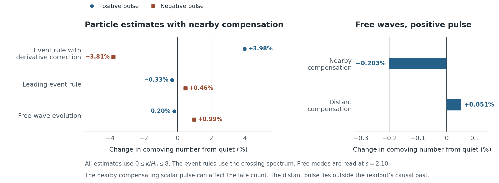
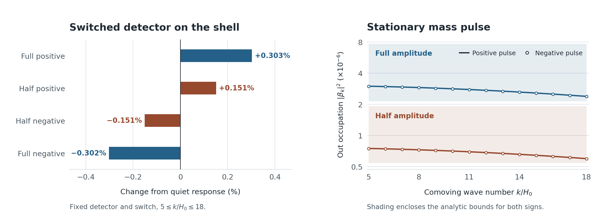

# Does an incoming bulk pulse change particle production on the shell?

On the original rolling B1 background, an incoming disturbance advances or delays the shell field's passage through the particle threshold. The local rule that converts this crossing into particles and a direct quantum wave calculation give **opposite signs for the change in particle count** on the same two matched pulse histories. Moving the second, compensating part of the positive disturbance outside the observation's causal past also reverses the small late wave response. A crossing speed alone is insufficient to predict the count for these histories. [Public study plan](https://github.com/maldonado-research/HDblast/issues/157#issuecomment-6994280612) · [Zenodo edition](https://doi.org/10.5281/zenodo.24355584)

## The rolling shell and its control

Start from the same evolving five-dimensional numerical solution at conformal time $T=1.11$. Launch a positive or negative scalar pulse with its required gravitational perturbation. Adjust a second scalar bump farther out so the initial geometry matches the rolling reference on both sides. Leave the original particle mass law $m/H_0=100|\phi-0.5|$, threshold, coupling and decay prescription in place. Also evolve a copy with no added pulse. The unperturbed solution already crosses the threshold. The experiment measures modulation of production that the rolling background already supports. [Initial data and units](classical/ROLLING.md)

The incoming front can reach the shell at $T=1.210$. On the fine grid the positive front advances the crossing from $T=1.230400$ to $1.229991$. The negative front delays it to $1.230806$. The nearer compensator first has causal access at $T=1.255$. It can therefore affect the late spectrum, while the first crossing precedes its arrival. All particle numbers below refer to the same comoving momentum band $0\le k/(a_{*,0}H_0)\le8$, with $a_{*,0}$ the quiet crossing scale factor. The compared physical mode energies stay below the B1 gravitational scale throughout this wave calculation.

| Fine-grid estimate | Quiet | Positive front and near compensator | Negative front and near compensator |
|---|---:|---:|---:|
| Registered event target at crossing | 3.609286 | 3.752859 (+3.98%) | 3.471790 (−3.81%) |
| Event target with leading crossing term only | 3.683268 | 3.671131 (−0.33%) | 3.700226 (+0.46%) |
| Direct, undecayed free modes at $H_0\tau=2.10$ | 3.514078 | 3.506934 (−0.20%) | 3.548930 (+0.99%) |

The direct calculation evolves a minimally coupled field on the same shell histories. The late particle definition uses a specified adiabatic basis. The reported ordering survives the two bulk grids, alternative initial time, basis and readout times tested. The positive packet arriving at the crossing lasts about $0.063 H_0^{-1}$, shorter than the nominal formation time $0.088 H_0^{-1}$. That branch fails the registered rule's local applicability check. The sign discrepancy concerns these histories and assumptions. Direct evolution here neglects the quantum field's effect on the background and its decay. [Wave solver and controlled comparisons](classical/ROLLING.md)

**What changes when the compensator is moved?** For the full positive front, moving the remote scalar data so they first have causal access at $T=1.71$ leaves the crossing target unchanged at displayed precision. The same late free-wave comparison now gives **+0.051%**, compared with **−0.203%** for nearby compensation. For the distant geometry, the corrected local rule predicts a fractional increase about 78 times as large as the directly propagated one. The later evolution retains information about the incoming profile outside the immediate crossing. The isolated response includes the gravitational perturbation required by the incoming front. [Distant-compensation experiment](far/FAR.md)

**Does the radiation balance close?** At common proper time $H_0\tau=2.15$, the original coupled gas model gives +3.67% and −3.35% changes in radiation for the two near-compensated pulses. In paired bulk runs with the fitted derivative correction disabled, the changes are −0.62% and +0.94%. An independent reconstruction of decay and expansion reproduces the original late component densities to within 0.006%. The total energy ledger closes to within $4.2\times10^{-7}$ of the work done by the rolling scalar in the six corrected runs. How much radiation results depends on how particles are created. [Radiation and work audit](rolling_audit/ROLLING_ENERGY.md) · [Coupled model](classical/ROLLING.md)

## The quiet shell below the particle threshold

The preceding release supplied four resolutions of a pulse incident on a quiet shell. Its induced geometry and field vary, but the original threshold is never reached. We used those histories to test one free, conformally coupled massive field. Its curvature coupling, state and kinematic regime differ from the rolling experiment. The primary band $5\le k/H_0\le18$ uses the initial quiet scale factor $a(0)=1$. The full band satisfies the per-mode energy screen through the readout at $H_0\tau=0.15$. Its upper edge reaches about 99% of the nominal gravity scale, so this screen alone gives little margin for unknown high-energy physics. [Background release](https://doi.org/10.5281/zenodo.24354840) · [Validity and energy bounds](validity/VALIDITY.md)

| Question | Result for the positive pulse |
|---|---|
| Would a specified finite-duration detector respond differently? | For gap $20H_0$ the band contribution to its transition probability increases by 0.3030% relative to quiet. It decreases by 0.3025% for the opposite pulse. The pre-arrival contrast vanishes at recorded precision. |
| Is the detector responding to a change of mass or geometry? | Applying the pulse mass on the quiet geometry recovers 99.94% of the positive contrast. A leading adiabatic wave approximation recovers about 75%. |
| Does the evolved field state change? | At $k=10H_0$ the squared relative mixing between pulse and quiet modes is $2.69082\times10^{-6}$. The equal-time field variance in the band changes by +0.0690%. |
| Could a prescribed mass pulse produce well-defined outgoing particles? | In a separate stationary experiment with the shell-derived mass modulation and a specified smooth return, the exact occupation on the finest positive history is bounded between $2.147118\times10^{-6}$ and $7.681557\times10^{-6}$ at every $k$ in the band. The external apparatus supplies the work. |

A switched detector has a nonzero baseline response even in a vacuum. Subtracting the identical quiet protocol tests whether the pulse changes its response. For a free field, the time dependence of its mass, expansion, preparation and readout all matter. These results give neither the heat deposited in a closed system nor an astronomical detection. A four-dimensional field with the same prescribed metric, mass history and initial state gives exactly the same probe observables. [Detector and independent replay](detector/DETECTOR.md) · [State and covariance derivation](modes/MODES.md) · [Rational scattering certificate](scattering/SCATTERING.md) · [Dimensional interpretation](IDENTIFICATION.md)

## Reproduce the calculations

Extract the versioned archive or use the full repository. From this directory run the following. The default checks use Python 3's standard library. The full numerical checks were run with Python 3.12, NumPy 2.3.5 and SciPy 1.17.0.

~~~sh
python -I -B reproduce.py
python -I -B reproduce.py --full
python -I -B replay_rolling.py --bulk
~~~

The last command starts the original coupled evolutions again. The numerical supplement includes compact shell histories, input digests, both figures and the scripts that produced them. Matplotlib is needed only to redraw the figures. The literature search covered original treatments of crossings, quenches, particle bases and detector switching, including 2025–2026 papers. The project review covered eight public repositories, nine Zenodo concept series and the relevant D-Blast 3 pulse calculation. [Study plan](STUDY_PLAN.md) · [Pinned historical inputs](SOURCES.json) · [Literature with equations](literature/SOURCES.md) · [Project catalog](literature/PORTFOLIO.md)

The outstanding physical test is to evolve the quantum source, its stress and the decay products together on the same geometry and verify the energy lost by the source. Establishing a thermal plasma or a higher-dimensional origin for the Big Bang would require further dynamics and evidence.
