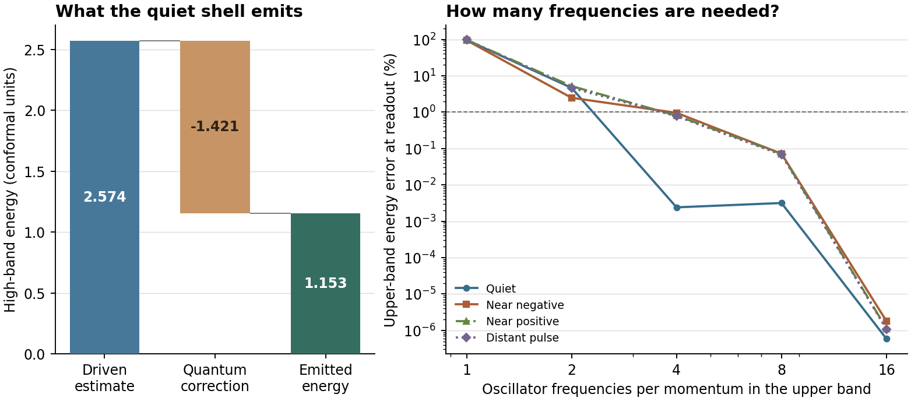

# How much energy does the shell emit, and how accurately can a few frequencies predict its effect on gravity?

HDblast proposes that an event in a higher-dimensional space could have supplied energy to our early universe. The preceding calculation established that some energy stays in a set of oscillators after an external drive ends. This study tests which part of that number counts as pair emission, and follows the corresponding energy, pressure and force into the five-dimensional gravity equations. **Four frequencies per parent momentum reproduced the high band's effect on expansion to within about 0.55% on the tested incoming pulse.** The comparison applies to a finite energy band, specified vacuum and short time interval. [Earlier driven-energy study](https://doi.org/10.5281/zenodo.24361277) · [Protocol recorded before the primary runs](https://github.com/maldonado-research/HDblast/issues/157#issuecomment-7015073318) · [This edition](https://doi.org/10.5281/zenodo.24374531)

## The energy left by a drive and the energy in emitted pairs

The two questions use different orderings of the quantum field operators. In the quiet-shell example, the prescribed-drive calculation gives **2.573972** conformal energy units for the upper band. Counting emitted excitations in an initially empty band adds a commutator correction of **−1.421458**, giving **1.152514** in the same units. The correction follows from the parent's canonical quantum equations on this wall. Dividing by the scale factor 1.235706 gives **0.932676** proper energy units per normalized comoving volume. All of these energies are coefficients of the coupling squared $y^2$. The split-band result agrees with the difference between the independently archived particle energies at cutoffs 120 and 60. The pulse histories give the same agreement. [Quantum energy account, stationary control and preparation changes](quantum/SPECTRUM.md)

## How much can the initial quantum state change the answer?

On the same quiet-shell trajectory, we allowed the parent field to distribute its initial energy differently across all 24 modeled momenta. With the same starting energy available, **no allowed preparation can lower the upper-band emission below 0.919004 proper units**, compared with 0.932676 for the archived preparation. That caps the possible reduction at **1.466%**. We obtained the minimum by constructing a state that attains a mathematical lower bound. The three disturbed shells gave reductions between 1.454% and 1.463%. If the initial energy is free to grow, emission can fall much further. Attaining the unrestricted quiet minimum requires 83% more initial free-parent energy. These bounds assume the same prescribed geometry, band, coupling order and vacuum in the daughter field. The effect of a changed preparation on spacetime itself remains open. [Derivation, finite-grid minima and preparation costs](floor/FLOOR.md) · [Unrestricted-bound protocol](https://github.com/maldonado-research/HDblast/issues/157#issuecomment-7015238836) · [Equal-budget protocol](https://github.com/maldonado-research/HDblast/issues/157#issuecomment-7015331720)

## Replacing the upper band while preserving its energy budget

We kept the original 64 frequency nodes for the low band and selected new positive weights and frequencies only for the band from 60 to 120. The selection used the spectral measure before loading any shell trajectory. Each rule matches the static restoring response and its first slope in squared imaginary frequency. We assigned each retained oscillator the vacuum fluctuations required by the same Hamiltonian. From it we calculated the explicit pair, parent, interaction and local compensation contributions to density, pressure and scalar force. These sources enter the junction conditions at every integration stage. The underlying continuous spectrum represents the leading massless-fermion pair channel in this model. [Source construction and numerical checks](source/README.md) · [Mathematical guarantees and time limits](theory/THEORY.md)

We evolved the quiet shell at two resolutions and tested a nearby incoming disturbance of negative amplitude on the fine grid. The reference uses 64 nodes in the high band. To isolate the high band's contribution we subtract a separate solution with only the low band. Negative values of the numerical coupling parameter help measure the derivative at zero. They have no physical interpretation as a negative squared Yukawa coupling.

| Test of the four-frequency model | Quiet shell, fine grid | Near-negative pulse, fine grid |
|---|---:|---:|
| Error in the upper band's emitted energy at readout | 0.00241% | 0.954% |
| Error in the upper band's expansion-rate contribution at readout | about 0.11% | 0.545% |
| Error over the expansion-response history, in its integrated norm | about 0.0093% | 0.202% |

The common readout is shell proper time 2.10. The direct subtraction for the quiet endpoint was so small that its apparent sign changed with the numerical step. Four additional runs isolated the source difference and checked it against the gravitational boundary equation. They place the quiet discrepancy near 0.11% on the fine grid. The near-negative result comes from the original direct test. Adding the upper band increases the expansion derivative relative to the low-only calculation on these shells, while the **total** particle-coupling correction to the expansion rate remains negative. This distinction matters when interpreting small contributions to gravity. [All 24 primary and four precision-control evolutions](gravity/GRAVITY.md) · [Precision-control protocol](https://github.com/maldonado-research/HDblast/issues/157#issuecomment-7015211027)

We also tested the source on the near-positive and distant pulses. At four frequencies, the high-band yield errors were about 0.80% and 0.77%, respectively. Sixteen frequencies reduced the largest readout error in this yield to about two parts in a hundred million across the five tested grid–history combinations. Such accuracy is specific to the tested source, drives and interval. A finite bath can recur at later times, and a good match at imaginary frequency alone gives no comparable guarantee on rapid real-time disturbances. [All tested orders and histories](source/COMPARISON.csv) · [Bounds for retarded response and vacuum noise](theory/THEORY.md)

## Does the energy spectrum tell us whether the material is hot?

The leading excitation within each parent momentum mostly occupies one coherent wave packet in this preparation. We defined two frequency filters using the quiet history and combined them with opposite relative phases. The quiet signal differed by **7.22%** between the two outputs, using the difference divided by their sum. Erasing coherence between the bands preserved the energy at every frequency and made that contrast exactly zero. The filters also showed a contrast on each of the three incoming pulses. This is a hypothetical measurement in the Gaussian pair-channel representation. It demonstrates how energy alone can conceal physically different correlations. [Packet calculation, timing sensitivity and control](packets/PACKETS.md) · [Detector protocol](https://github.com/maldonado-research/HDblast/issues/157#issuecomment-7015108648)

This establishes a reproducible model for the **leading mean gravitational response** of a short-lived source containing quantum vacuum fluctuations. The underlying fixed-resolution simulation already carried that response. The advance is a checked reduction of its high-frequency sector and a quantitative distinction between stored drive energy and emitted particles. We did not propagate stochastic fluctuations of the spacetime metric. Establishing a hot Big Bang would still require particle scattering and thermalization, an epoch of radiation domination, and an observational test that can distinguish four- and higher-dimensional origins. [Primary-source review and research portfolio](literature/README.md)

## Reproduce the study

From this directory in the repository or standalone Zenodo archive, run the commands below. The first uses only the Python standard library to authenticate the capsule and its historical inputs. The second regenerates the quadratures, source tables, quantum checks and native gravity runs. It uses Python 3.12, NumPy 2.3.5 and SciPy 1.17.0. The optional figure command uses Matplotlib.

~~~sh
python -I -B -S reproduce.py
python -I -B reproduce.py --verify --jobs 2
python -I -B figure.py --output /tmp/hdblast-quantum-memory.png
~~~

[Historical input versions](SOURCES.json) · [File checksums](SHA256SUMS)
