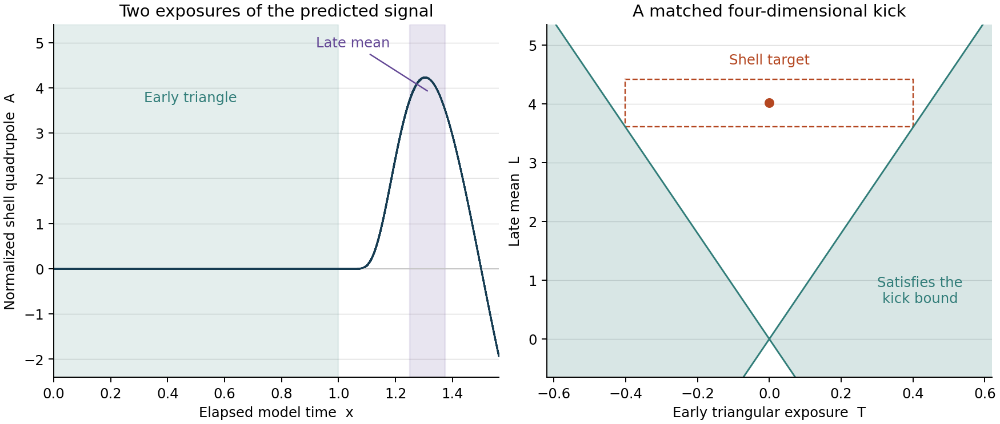

# What can a quiet shell reveal about its source?

In the HDBLAST model, a wave packet starts away from a shell. An observer on the shell initially sees no change in the scalar field. Later, the observer sees a distinct angular pattern. Could four-dimensional fields on the shell itself produce those two observations? The answer depends on how the fields are prepared. The result below uses one angular pattern on the same local de Sitter background and observer clock as the earlier model. [Previous waveform comparison](https://doi.org/10.5281/zenodo.24351909) · [This edition](https://doi.org/10.5281/zenodo.24352252)

**A kick applied to the same combination of fields that the detector reads cannot reproduce two finite exposures of the predicted signal.** Let the clock run from zero at preparation to one at the wavefront. The early exposure $T$ weights the signal by $2(1-x)$ on $0\le x\le1$. The late exposure $L$ averages the signal from $5/4$ to $11/8$. Every such four-dimensional kick gives $|L|\le9|T|$ for any choice of nonnegative masses, any number of canonical fields with convergent readout, and any common gain. The model predicts $T=0$ and $L>4.013$ in its fixed amplitude units. At least one of the two exposures must therefore differ by **at least 10% of the target late signal**. [Proof and exact calculation](KICK.md)



The dashed square shows the size of an equal absolute error allowed on both measurements when it first reaches the impulse bound. The shaded region in the right panel shows a necessary inequality for the comparison fields. Parameters inside that region still have to solve the field equations. The left panel uses certified continuous time cells from the previous edition. All plotted quantities are calculated model values.

| Preparation of the four-dimensional fields | Measurements | Minimum mismatch in at least one measurement, relative to that test’s late target |
| --- | --- | --- |
| Instantaneous change of velocity at zero through the detector’s coupling | Early triangular exposure and late uniform mean | At least 10% |
| Single-sign drive through that coupling, acting anywhere in the first quarter of the clock | Same two exposures | At least 1/13, about 7.69% |
| Displacement from rest with same-sign source and detector products, including release of a static bias | Early quadratic exposure anchored to release, late triangular exposure, both with specified geometric weights | More than 48.70% |
| Mixed displacement and velocity at zero, each with same-sign products across fields | Initial readout, early triangle and late uniform mean | At least 5% |

The static release can occur anywhere from zero to $31/32$ if the early exposure starts at the release. The two contributions in the mixed case can have opposite signs. The percentages refer to the late target for the specified exposures. The experiment description fixes the clock, relative gain, readout and preparation. Absolute detector gain is unnecessary for the percentages. Field masses, initial energy and field count need no numerical upper cap for these results. [Finite-duration drive](KICK.md) · [Displacement from rest](RECIPROCAL.md) · [Mixed preparation and its signed contributions](MIXED.md)

## How a four-dimensional explanation can still work

A common source and detector put the same coupling into each field twice. For an impulse, each mode’s initial velocity is proportional to that coupling and the detector multiplies by it again. The early responses therefore add with a common sign. Distinct source and receiver profiles allow the signs to differ. The exact four-dimensional reconstruction in the preceding edition uses initial data taken from the interior of the higher-dimensional packet and a detector at the shell. In that realization the displacement and velocity contributions each reverse sign infinitely often as mass increases. Their polynomially weighted sums all vanish. Those statements concern an ideal model with an exactly quiet interval. The two-exposure bounds above instead have explicit finite error margins. [Signed spectral moments and their derivation](MOMENTS.md)

Even if signs and phases are free, an independent limit on both bandwidth and prepared amplitude can test a four-dimensional alternative. For example, suppose the scaled modal frequencies are at most 4 and each of nine specified finite exposures can differ from its predicted value by 0.0005 amplitude units. Matching them requires a total absolute modal amplitude above **38.50** in the normalization defined in the calculation. The frequency ceiling and tolerance illustrate the criterion. A physical application requires independently justified instrument and source parameters. A different detector sensitive to acceleration reproduces the registered shell response with a uniform bound on the ratio of two dimensionless initial energies. This specifies which detector freedoms an energy comparison has to address. [Bandwidth and amplitude test](BANDWIDTH.md) · [Alternative detector and energy identity](ENERGY_AND_READOUT.md)

An inverse timing test is also possible. If a single-sign drive through the detector’s coupling reproduces the early and late means within 0.0005 model units each, it must act beyond $x=0.8147$, where $x=1$ is the wavefront. A later drive, signed preparations, or separate source and receiver couplings remain viable explanations. Deciding which of these is physically plausible calls for independent information about the source and receiver. The model currently has no observational identification of this shell signal or of a higher-dimensional event at the Big Bang. [Timing bound](KICK.md) · [Current literature](LITERATURE.md) · [Author portfolio and D-Blast 3 sources](PORTFOLIO.md)

## Reproduce the bounds

Run from this directory with Python 3.12 and the standard library. The arithmetic uses exact fractions. The two continuous-mode inequalities are proved analytically over all masses. The replays check the arithmetic constants and their application to the archived shell enclosures.

```sh
sha256sum -c SHA256SUMS
python -I -B kick.py > /tmp/hdblast-kick.json
cmp KICK.json /tmp/hdblast-kick.json
python -I -B reciprocal.py > /tmp/hdblast-release.json
cmp RECIPROCAL.json /tmp/hdblast-release.json
python -I -B angle.py > /tmp/hdblast-mixed.json
cmp ANGLE.json /tmp/hdblast-mixed.json
python -I -B bandwidth.py > /tmp/hdblast-bandwidth.json
cmp BANDWIDTH.json /tmp/hdblast-bandwidth.json
```

The source register pins the base revision, hashes and provenance of the inherited inputs. The figure can be regenerated separately with NumPy and Matplotlib. [Source register](SOURCES.json) · [Figure code](plot_exposures.py) · [Working calibration question](https://github.com/maldonado-research/HDblast/issues/151)
