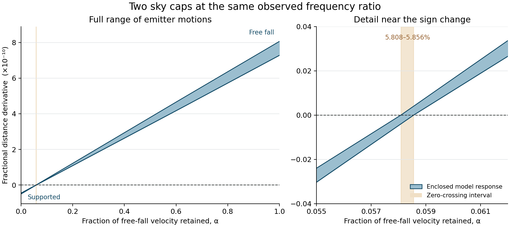

# How emitter motion changes the shell’s distance at a fixed redshift

Trace light back from one shell observer and compare two circular patches, each one tenth of the observer’s sky. Select the emitting events using the same emitted-to-received frequency ratio in both patches, using the usual convention $1+z=\nu_{\rm emit}/\nu_{\rm receive}$. **Which patch covers more area depends on how the emitters move.** The first patch grows when the emitters fall freely from the initial quiet cut. It shrinks when an imposed acceleration holds them at rest in the chosen conformal coordinates. Both emitter populations probe the same perturbed metric and coincide in the background. [Zenodo edition](https://doi.org/10.5281/zenodo.24353248) · [Geodesic emitter calculation](FREE_FALL.md) · [Physical definition of the supported control](FIXED_REDSHIFT.md)

## The comparison

The receiving observer sits on a zero of the prepared quadrupole where its angular gradient also vanishes. For a cap of solid angle $\Omega$ define the area distance as $D=\sqrt{\mathrm{area}/\Omega}$. The table shows the first derivative of $(D_+-D_-)/(2L)$ with respect to the signed canonical disturbance amplitude, evaluated at zero. Here $L$ is the unperturbed distance, and the plus and minus labels refer to caps facing the first and second quadrupole axes. The numbers below are conservative outward bounds. The first row fixes actual affine length along each ray. The last two fix a frequency ratio corresponding to the same source in the reference geometry.

| Endpoint choice | Test emitters | Fractional distance contrast per unit amplitude |
| --- | --- | --- |
| Fixed observer-normalized affine length | Emitter motion does not enter the endpoint definition | $(3.7210,\,4.1805)\times10^{-25}$ |
| Fixed observed redshift | Freely falling from rest on the initial quiet cut | $(7.2804,\,8.0630)\times10^{-10}$ |
| Fixed observed redshift | Externally supported | $(-4.9925,\,-4.5093)\times10^{-11}$ |

The reference value $z_*\simeq-2.405\times10^{-14}$ is a slight **blueshift** in the locally contracting shell. Its small rate of change along a ray makes the redshift-selected endpoint sensitive to the emitter’s velocity. Perturbing that velocity moves the selected emitting event and changes its area distance. These numbers describe derivatives in model units. An actual fractional change also depends on the perturbation amplitude. [Exact redshift bounds](REDSHIFT.json) · [Independent enclosure](REDSHIFT_CHECK.json) · [Earlier affine calculation](../HDBLAST_FINITE_LIGHT_CONES_20261118/README.md)

For a specified control that retains a fraction of the freely falling peculiar velocity, the sign changes at about **5.8%**. The free-fall effect includes the emitter's entire velocity history between the quiet cut and emission. The direct metric term at emission and the velocity term have opposite signs. [Control calculation](SOURCE_CONTROL.md) · [Exact arithmetic for the endpoint and history](REDSHIFT_BOUNDS.md)

## Dependence on distance and unknown velocities

The opposite signs hold for **every reference source clock** between reception at $49\ell/32$ and the tested endpoint $99\ell/64$, with $\ell=10^{-6}$ and positive source distance. The fixed-redshift contrast for free fall lies between $6.37\times10^{-10}$ and $8.75\times10^{-10}$ per unit amplitude over this interval. In the limit as the source approaches the receiver, the derivative of the fractional contrast stays finite for the geodesic population. It measures the direction dependence of the local redshift–distance slope caused by shear of that congruence. The supported population's contrast tends to zero. [Continuous bounds and local Hubble law](LOCAL_LIMIT.md) · [Continuum replay](CONTINUUM.json)

Pairing each patch with the patch opposite it in the sky removes a common velocity dipole. A sufficiently small velocity field with quadrupole angular dependence can still reproduce or cancel the whole redshift-selected signal. Comparing those same rays at independently measured affine lengths restores the separate optical focusing test before caustics. A four-dimensional scalar–tensor construction already matches the full physical metric through first order. The distance result with the same tracer prescription is therefore compatible with that alternative. Applying either test to the universe requires an identified emitter population, physical calibration, and an observed distance or source size. The local solution does not identify an event that caused the Big Bang. [Velocity tolerances and cancellations](VELOCITY.md) · [Four-dimensional comparison](../HDBLAST_JOINT_CURVATURE_20261118/COMPARISON.md) · [Literature](LITERATURE.md) · [Related project history](PORTFOLIO.md)

## Reproduce

From this directory, run the following in a repository checkout or in the extracted study ZIP. The numerical replays use Python 3.12 and its standard library. All interval endpoints are rational. The figure additionally uses Matplotlib.

~~~sh
sha256sum -c SHA256SUMS
python -I -B reproduce.py
python -I -B -O reproduce.py
~~~

The ZIP includes the preceding GitHub optical study, the joint-curvature inputs used here and the directly referenced project sources at their registered revisions. [Input inventory](SOURCES.json)
