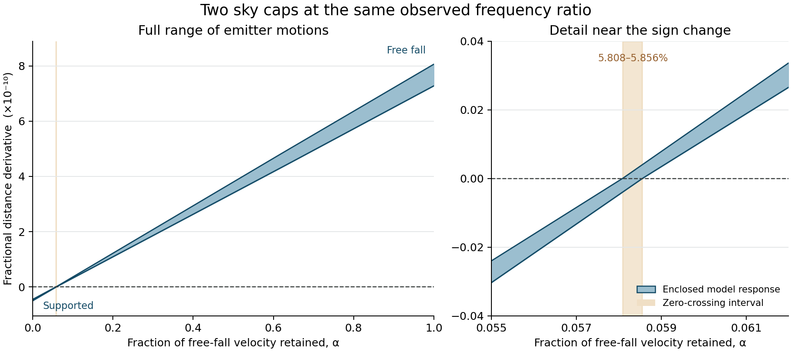

# How much emitter motion is enough to change the sign?

Let $\alpha$ denote the fraction of the freely falling emitter's first-order peculiar velocity that remains in the source population. The emitters start at rest on the same quiet slice. In the specified conformal frame one way to realize this interpolation at linear order is to apply a fraction $1-\alpha$ of the acceleration needed to hold the sources at their fixed spatial coordinates. The peculiar velocity equation with those initial data is linear in this applied force. Its solution is $\alpha$ times the freely falling velocity. The physical light metric, receiving observer, sky caps and target observed frequency ratio are identical throughout this comparison.

Write $R(\alpha)$ for the zero-amplitude derivative of $(D_+-D_-)/(2D_{A,0})$ at that fixed frequency ratio. The change in endpoint Doppler shift is linear in the emitter velocity. Thus
$$
R(\alpha)=R(0)+\alpha[R(1)-R(0)]
         =|R(0)|(\alpha K-1),\qquad
K=\frac{2\ell\int_0^{X} M(x)dx}{\cosh q_0\,M(X)\sin\theta}.
$$
The redshift calculation encloses $K$ between 17.0792 and 17.2164, $R(0)<0$ and $R(1)>0$. The gain, angular factor, common curvature scale, and choice of units for the distance cancel from the position of the zero. Reciprocating the positive rational interval for $K$ gives
$$
0.0580844 < \alpha_* =1/K < 0.0585507 .
$$
Retaining less than 5.80844% of the free-fall velocity guarantees the supported-clock sign at this order. Retaining more than 5.85507% guarantees the freely falling sign. At the actual crossover the linear term is zero and higher-order terms determine any finite-amplitude residual. The numerical interval quantifies the uncertainty in the crossover from the input bounds.

The blue band encloses the model coefficient in each panel. The two panels use the same physical normalization per unit canonical amplitude, with different vertical ranges. The narrow vertical band is the interval for the zero. The plot uses the intersection of two enclosures: convex interpolation of the certified endpoint bands and evaluation of $|R(0)|(\alpha K-1)$ with the common scale retained.

These coefficients depend on selecting sources by observed frequency. The fixed-redshift rule gives an endpoint displacement divided by $\tanh q_1$, which is very small on this segment near the turnaround of the shell scale factor. That factor amplifies the endpoint contribution to the fractional distance. At a fixed affine distance a different calculation applies. The target is a tiny model blueshift, approximately $-2.405\times10^{-14}$. Independent emitter motion, frequency, source size and relative distance calibration would be needed for an observational use. The calculation supplies no instrumental resolution or measured source acceleration. [Fixed-redshift calculation and numerical bounds](REDSHIFT_BOUNDS.md) · [Exact source-control bounds](SOURCE_CONTROL.json) · [Arithmetic checker](source_control.py)
