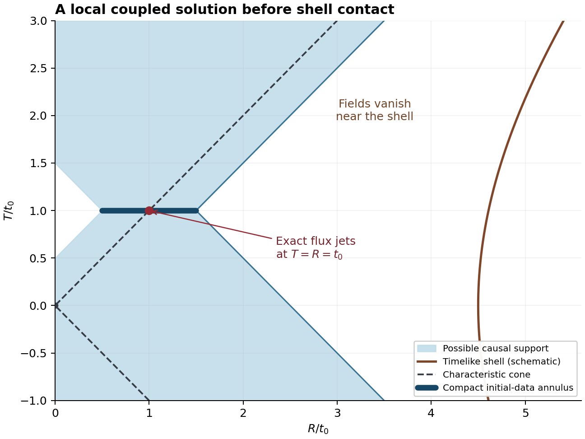

# HDBLAST: regular cone evolution and actual local coupled flux

13 October 2026. A technical continuation on the fixed nonconstant
regular Einstein–scalar background.

The calculation converts the radial scalar master into a smooth ambient
wave equation and reconstructs all metric/scalar components without cone
singularities. Full residual identities establish that these fields solve
the coupled linearized equations. Compact Cauchy data then give two
non-gauge solutions with nonzero local cone symplectic flux, satisfying
either doubled-shell parity before their support reaches the shell.

- [Technical note (PDF)](manuscript/REGULAR_CONE_EVOLUTION.pdf) and
  [readable source](manuscript/REGULAR_CONE_EVOLUTION.md).
- [Results and limits](RESULTS.md), [next calculations](NEXT_CALCULATIONS.md).
- [Full reconstruction](reconstruction/SMOOTH_AMBIENT_RECONSTRUCTION_AND_LOCAL_FLUX.md),
  [independent derivation](independent/INDEPENDENT_REGULAR_MASTER_AND_LOCAL_RADIATION.md),
  [canonical and background checks](canonical/ROOT_AUDIT.md).
- [Selected primary literature](literature/CONE_EVOLUTION_PRIOR_ART_20261013.md).
- [Exact shell laws and the bounded Cauchy symplectic result](boundary/BOUNDARY_LAWS_AND_LOCAL_CAUCHY_PHASE_SPACE.md).



The figure is a geometric schematic, not a numerical perturbation solution.
The flux is an antisymmetric symplectic bilinear, not positive energy or
reheating. Global evolution after shell contact, a completed physical
state space, nonlinear stability and a higher-dimensional Big Bang origin
remain unestablished. This is a sufficient local family, not a claim to
represent every gravitational perturbation.

## Reproduction

Use Python 3.12.14 and the pinned dependencies:

```sh
python -m pip install -r requirements.txt
python -I -B reproduce.py --output ../regular-cone-replay-001
```

Choose a fresh output directory outside the capsule. The runner authenticates
the manifest and copied prior inputs, relocates the capsule, runs exact
checks normally and with `-O`, compares reviewed receipts, and exercises
corruption and injected-failure controls. `CHECK_CONTRACTS.json` gives the
explicit inventory. An external manifest pin may also be supplied through
`--manifest-sha256`; the Git revision and narrow CI workflow bind that pin.
`--verify-only` performs standard-library integrity checking.

The analytic existence theorem and its stated hypotheses are necessary;
symbolic check counts do not prove PDE existence, external novelty or a
cosmological mechanism. This capsule does not replay the earlier scientific
package. Third-party paper bodies are not redistributed.

The final replay checks **92 exact identities and 20 wrong-formula controls
per mode**. Independent implementations overlap on purpose; these counts
are not numbers of separate theorems.

## Publication and declarations

This GitHub continuation has no separate Zenodo DOI. The preceding spectral
edition remains [10.5281/zenodo.23335485](https://doi.org/10.5281/zenodo.23335485),
within the preserved concept family
[10.5281/zenodo.17088132](https://doi.org/10.5281/zenodo.17088132).
The earlier cone-current checkpoint remains unchanged.

Ricardo Maldonado, Independent Researcher; ORCID
[0009-0009-3937-6527](https://orcid.org/0009-0009-3937-6527).
No funding; no known competing interests. Substantial OpenAI Codex assistance
was used for derivations, programming, literature organization and drafting.
Separate agent reviews are internal checks, not external peer review.
This is a technical draft for author review. No new APS submission or claim
of APS readiness accompanies it; the earlier rejection remains unchanged.
