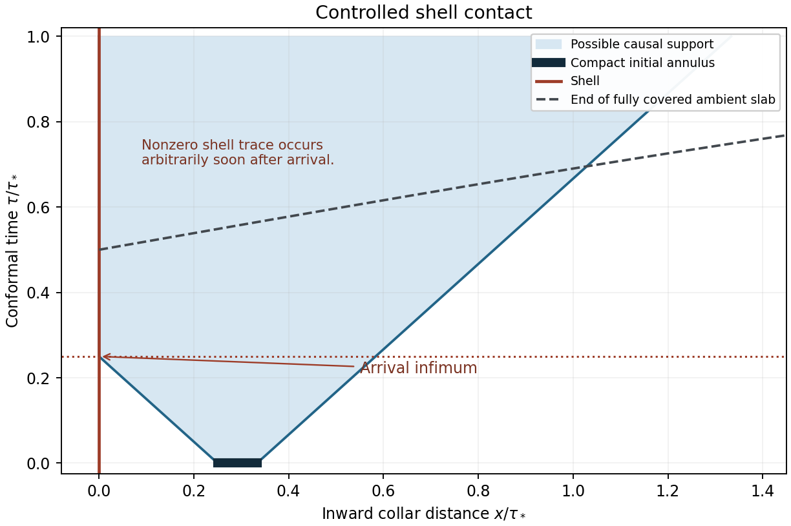

# Smooth coupled perturbations through timelike shell contact

13 October 2026 (America/Los_Angeles). Conditional linearized research on the
fixed nonconstant regular Einstein–scalar shell background.

The preceding local-cone calculation stopped before shell contact. This
checkpoint constructs a new family of smooth perturbations in a near-shell
annulus, proves that selected states actually reach the shell, and verifies
all coupled metric and scalar junctions afterward. A sufficiently thin annulus
has a weakly nondegenerate physical symplectic pairing; selected pairs retain
a nonzero total pairing through contact, including the odd moving-shell term.

- [Technical manuscript (PDF)](manuscript/SHELL_CONTACT.pdf) and [source](manuscript/SHELL_CONTACT.md).
- [Results and limits](RESULTS.md), [next calculations](NEXT_CALCULATIONS.md).
- [Constructive existence proof](existence/FINITE_SLAB_SHELL_CONTACT_EXISTENCE.md).
- [Full junctions, current and thin-annulus pairing](junctions/FULL_PACKET_JUNCTION_SUFFICIENCY_AND_CURRENT.md).
- [Bounded primary-source comparison](literature/SHELL_CONTACT_PRIOR_ART_AND_ASSUMPTIONS.md).



This schematic shows possible causal support, not an evolved waveform. The
construction permits arbitrary smooth radial profiles and a fixed finite set
of angular harmonics on a controlled finite slab. Actual activation is proved
for selected pure-displacement and pure-velocity states whose support infimum
sets the arrival time. The earlier near-cone flux pair is a different family;
its continuation to the shell is not established here.

A nonzero total symplectic pairing is an antisymmetric bilinear statement,
not positive energy, a nonzero local shell flux, reheating, or evidence for a
higher-dimensional Big Bang origin. General angular completion, nonlinear
integrability and physical-state completeness remain unresolved.

## Reproduce the exact checks

Use Python 3.12.14 and the pinned dependencies:

```sh
python -m pip install -r requirements.txt
python -I -B reproduce.py --output ../shell-contact-replay-001
```

Choose a fresh output directory outside this capsule. The runner authenticates
all files and copied prior proofs, relocates the capsule, runs the two programs
normally and with `-O`, compares reviewed results byte for byte, and exercises
source corruption and injected scientific errors. `--verify-only` requires
only the standard library; `--manifest-sha256` accepts an external manifest pin.
The Git revision and narrow CI workflow bind that pin.

The exact inventory is **84 positive algebraic identities and 14 wrong-formula
controls per mode**: 21/4 for coordinates and 63/10 for junctions/current.
These are overlapping checks, not 84 independent theorems. Analytic existence,
compatibility, activation and scope require the accompanying proofs; symbolic
identities alone do not certify a PDE existence theorem.

The original junction checker is preserved with an exact, reversible,
path-only portable adaptation. Five prior proof bodies and two original
manifests are authenticated; earlier scientific packages are not rerun.
Optional plotting uses NumPy/Matplotlib and is separate from symbolic replay.
Third-party full paper bodies and raw conversation history are not included.

## Publication and declarations

This GitHub checkpoint has no separate Zenodo DOI. The preceding archived
spectral edition remains [10.5281/zenodo.23335485](https://doi.org/10.5281/zenodo.23335485),
within concept family [10.5281/zenodo.17088132](https://doi.org/10.5281/zenodo.17088132).
Automatic GitHub-to-Zenodo archiving remains off; no integration setting is
changed by this checkpoint.

Ricardo Maldonado, Independent Researcher; ORCID
[0009-0009-3937-6527](https://orcid.org/0009-0009-3937-6527).
No funding; no known competing interests. Substantial OpenAI Codex assistance
was used for derivations, programming, source review and drafting. Separate
agent checks are internal review, not external human peer review. This is a
technical draft for author review, with no new APS submission or assertion
of APS readiness. DX13808's rejection remains unchanged.
