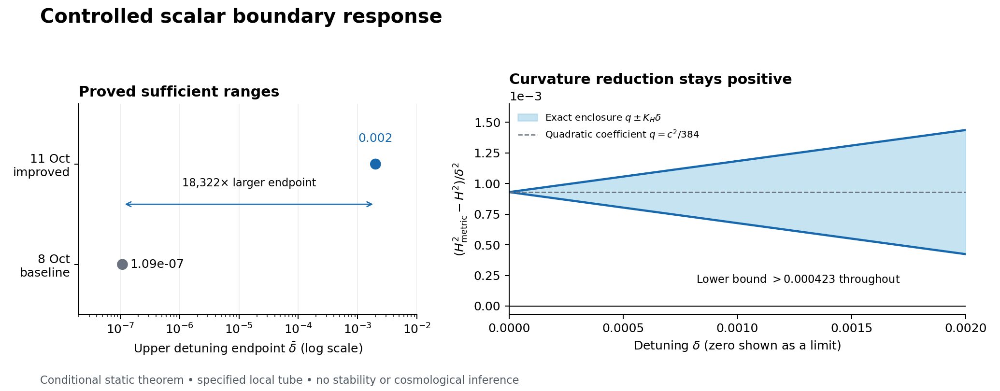

# Controlled scalar boundary response: 11 October 2026

**A stronger conditional mathematical result, with reproducible exact checks.**
For the specified five-dimensional Einstein–scalar boundary problem, regular-cone
Jacobi identities prove that the metric residual strictly decreases along the
scalar-junction locus. This removes an unnecessarily restrictive sufficient
uniqueness inequality from the 8 October construction. A sharper endpoint
estimate and correctly rescaled norm then certify the registered model for
**every `0 < delta <= 0.002`**, within the stated local tube and `T >= 1/k`.

The previous sufficient interval ended at approximately `1.0915542913e-7`.
The new endpoint is about **18,322 times larger**. This compares proved
sufficient ranges, not the full physical domain of either model. It does not
certify the rounding error of historical numerical trajectories.

Start with [the result and its limits](RESULTS.md),
[the full proof](theory/JACOBI_ENDPOINT_MONOTONICITY.md), or
[the standalone technical note](manuscript/scalar-response-monotonicity.pdf).
The [8 October construction](baseline/UNIFORM_BRANCH_THEOREM.md) is retained
unchanged as the baseline used by the new proof. Its historical pending-review
labels describe the time of computation; [separate dated review receipts](baseline/README.md)
record the subsequent internal checks without altering the frozen source.



## Reproduce

Python 3.12 was used. From an environment with the declared dependencies:

```sh
python -m pip install --only-binary=:all: -r requirements.txt
python -I -B reproduce.py --output /tmp/hdblast-scalar-response-replay
```

Use a new output directory. The runner authenticates the frozen inputs,
regenerates the rational certificate, executes a separately implemented checker
and 36 symbolic identity checks, and exercises rejection controls. Normal and
optimized Python executions are compared. No network, private archive, numerical
ODE solver, account credential, or external data download is needed for replay.
The optional figure script uses `matplotlib==3.10.1`; it does not participate in
any mathematical pass/fail decision.

## Evidence and scope

- [Exact certificate](bounds/RESCALED_BOUND_CERTIFICATE.json): eight explicitly
  distinguished parameter/estimate variants; the primary uniform certificate
  specifies the exact-decimal model.
- [Independent review](review/FINAL_ANALYTIC_REVIEW.md): full analytic review
  and an independent rational/polynomial implementation, including corrupted
  certificate rejection. This is internal AI-assisted review, not external
  peer review or a machine-checked formal proof.
- [Literature update](literature/LITERATURE_UPDATE_20261011.md): bounded searches
  and selected primary-source reading, including established curved-wall
  Hamilton–Jacobi work. No first-in-the-literature claim is made.

The quadratic curvature coefficient was already reported in the project. The
advance here is the structural uniqueness argument and controlled finite
interval, with sharper error bounds. Perturbative stability, a dynamical energy
transfer mechanism, thermalization, and a distinctive observational prediction
remain open. **A higher-dimensional origin of the Big Bang is not established.**

This research capsule supplements the project record; it does not replace the
previous author-approved APS submission files. No journal submission is made by
this release. Data and code availability: all inputs needed for the exact checks
are included here. The project DOI family is
[10.5281/zenodo.17088132](https://doi.org/10.5281/zenodo.17088132).

Ricardo Maldonado, Independent Researcher;
[ORCID 0009-0009-3937-6527](https://orcid.org/0009-0009-3937-6527).
OpenAI Codex and collaborating AI agents assisted substantially with derivation,
code, internal checking, literature synthesis, and writing. AI systems are not
authors; exact backend model versions are not independently authenticated.
The author has reported no funding or known competing interests.
See [LICENSE](LICENSE) for the inherited project licensing terms.
