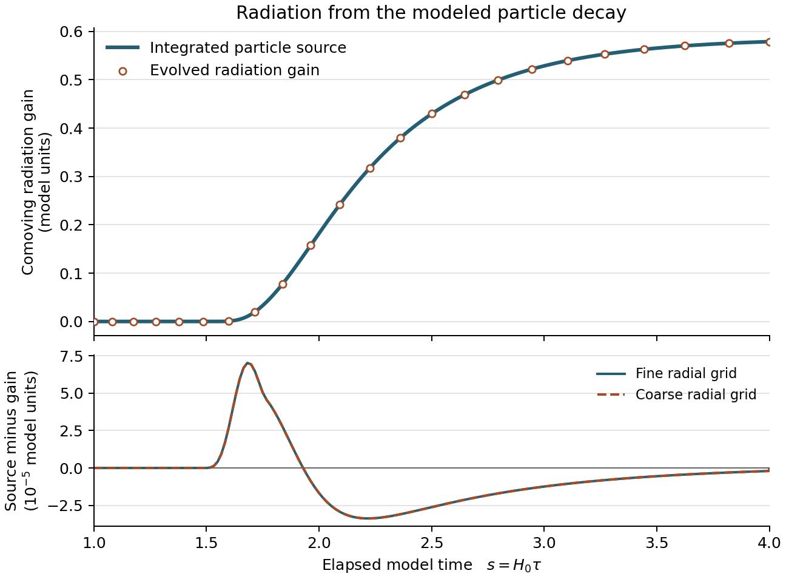

# How much radiation do the modeled sources supply?

In the HDblast particle-production run, decay of a modeled particle population supplies **0.5790045** units of weighted radiation on the finer grid between shell times 1 and 4. The separately evolved radiation field gains **0.5790054** units. The integrated source falls short by 1.46 parts per million over the interval. An earlier simulation used a prescribed friction law. Its balance depends more strongly on the time window and numerical grid. Both calculations test local energy transfer in a numerical model. A hot Big Bang interpretation still needs a physical chronology, a budget for the supplying reservoir, and predictions for particle populations or abundances. [Thermal-history research question](https://github.com/maldonado-research/HDblast/issues/157) · [Origin and volume-history analysis](https://doi.org/10.5281/zenodo.24353557)

## The measured balance

Each CSV tabulates the forward clock $x=H_0\tau$, weighted radiation $E$, and weighted source $q$ per unit $x$. The factors of $a^4$ remove the dilution expected for radiation. The balance predicts $E(x_1)-E(x_0)=\int_{x_0}^{x_1}q(x)\,dx$. We subtract the endpoint radiation values, then independently integrate the source using every saved interior point and two interpolated endpoints. A signed residual in parts per million is $10^6(\int q\,dx-\Delta E)/\Delta E$. The two models use different energy normalizations.

| Archived model and grid | Clock interval | Rows | Radiation gain | Integrated source | Residual (ppm) |
| --- | --- | ---: | ---: | ---: | ---: |
| Particle decay B1, coarse | 1–4 | 155 | 0.5787591964 | 0.5787584224 | −1.34 |
| Particle decay B1, fine | 1–4 | 155 | 0.5790053592 | 0.5790045125 | −1.46 |
| Friction B2, S1 | 1–2 | 103 | 1.7039283 × 10⁻⁵ | 1.7039853 × 10⁻⁵ | +33.46 |
| Friction B2, S2 | 1–2 | 102 | 1.7040828 × 10⁻⁵ | 1.7044116 × 10⁻⁵ | +192.94 |
| Friction off B2, S1 | 1–2 | 57 | 0 | 0 | undefined |
| Friction off B2, S2 | 1–2 | 56 | 0 | 0 | undefined |
| Friction B2, S1 | 10–11 | 93 | 2.7183898 × 10¹³ | 2.7176366 × 10¹³ | −277.07 |
| Friction B2, S2 | 10–11 | 91 | 2.7261363 × 10¹³ | 2.7259355 × 10¹³ | −73.65 |

The particle-decay gains on the two radial grids differ by 0.0425% relative to the coarse value. On the fine grid the running source integral and the running gain differ by as much as 0.00007014, about 121 parts per million of the full-window gain. Thus their final agreement hides larger intermediate numerical differences. The friction residual grows on refinement in the earlier interval and shrinks in the later one. These comparisons do not establish a convergence order or an error bar for the underlying evolution. [Full numerical results](RESULTS.json)



The upper curves coincide at the plotting scale. The lower panel resolves their cumulative numerical difference on each grid. Both panels use simulated quantities. The optional figure script uses Matplotlib. [Figure code](plot_transfer.py)

## Particle decay and its normalization

B1 uses $a=\exp[A_b(x)-A_b(0)]$, $r_b=H_0^{-1}=7.838285538073243$ in model units, and $R=\kappa_5^2\rho_{\rm rad}$ as stored by the solver. The CSV columns are

$$
E=r_b a^4R,\qquad
q=b a^4\frac{y^2}{8\pi}
\big[\mu_0^2+G^2(\phi_b-\phi_*)^2\big]\widehat n .
$$

The particle number density $\widehat n$ and shell scalar $\phi_b$ were saved independently of the radiation variable. They supply the rate in the displayed formula. The source and radiation share the same evolution and background. The selected cell has detuning 0.1, $\phi_*=0.5$, $G=100$, $y=1$, $\mu_0=0$ and $b=6.49\times10^{-6}$ at the model's $M_5$ cutoff. Radial spacings near the shell are 0.001 and 0.0005. We chose the 1–4 interval retrospectively to include source onset within both reliable histories. The original analysis found a maximum radiation fraction of about 0.01162 in these two runs and no qualifying plateau. [Source law](https://github.com/maldonado-research/HDblast/blob/a011dee2b490faa56ae81d3165b4b5fa5bbfe636/research/HDBLAST_CHECKPOINT_20260930/B1_derived_chi_source/shell_matter.py) · [B1 evolution](https://github.com/maldonado-research/HDblast/blob/a011dee2b490faa56ae81d3165b4b5fa5bbfe636/research/HDBLAST_CHECKPOINT_20260930/B1_derived_chi_source/evolve_b1.py) · [Audited interpretation](https://github.com/maldonado-research/HDblast/blob/a011dee2b490faa56ae81d3165b4b5fa5bbfe636/research/HDBLAST_CHECKPOINT_20260930/B1_derived_chi_source/README.md)

## Prescribed friction and its controls

B2 uses $a=\exp(\ln a)$ from the stored logarithmic scale factor with $a(0)=1$, $r_b=H_0^{-1}=78.82837596647016$ and $\widehat v=v/H_0$, where $v=d\phi_b/d\tau$. Its proper-time law $dR/d\tau+4HR=Yv^2$ gives

$$
E=a^4R,\qquad q=\frac{Y}{r_b}a^4\widehat v^2 .
$$

The source uses saved scalar velocity. Radial spacings near the shell are 0.0003 on S1 and 0.00015 on S2. The seed offset is 0.01 and the model detuning is 0.001. The two active grids share the last complete unit interval 10–11 before the earlier sampled reliability cutoff. The original classifier stops before the first measured near-shell constraint residual above 0.05. Constraints were sampled on a subset of saved outputs. A large $a^4R$ is a comoving quantity in model units. Determining a physical temperature requires the unweighted density, physical units and the particle content. The original study classifies the four selected runs as inconclusive. [B2 evolution](https://github.com/maldonado-research/HDblast/blob/a011dee2b490faa56ae81d3165b4b5fa5bbfe636/research/HDBLAST_CHECKPOINT_20260930/B2_delta1e-3/evolve_a1.py) · [Reliability classifier](https://github.com/maldonado-research/HDblast/blob/a011dee2b490faa56ae81d3165b4b5fa5bbfe636/research/HDBLAST_CHECKPOINT_20260930/B2_delta1e-3/b2_analyze.py) · [B2 audit](https://github.com/maldonado-research/HDblast/blob/a011dee2b490faa56ae81d3165b4b5fa5bbfe636/research/HDBLAST_CHECKPOINT_20260930/B2_delta1e-3/AUDIT.md)

On each grid the active $Y=1$ and source-off $Y=0$ histories share the early interval 1–2. Every exported source-off radiation value and rate equals zero. The archived chart parameter $x_c$ also changes from 11.3 in the active runs to 1.6 in the controls, which limits any causal comparison. The control reliability intervals end at 2.457 on S1 and 7.493 on S2. Both end before the late active window. [Run summaries and input digests](PROVENANCE.json)

## Reproduce the calculations

From this directory run the following with Python 3.10 or later. The public balance replay uses only the standard library.

```sh
python -I -B thermal_balance.py > reproduced.json
cmp RESULTS.json reproduced.json
```

The replay checks the eight CSV digests, columns, row counts, clock ordering, interval endpoints and source-off zeros. It computes each trapezoid exactly from the published decimal values and rounds once when reporting the results. The largest cumulative defect is the maximum absolute difference at the published nodes. The relative residual is undefined for a zero gain. [Replay program](thermal_balance.py) · [Published series](data)

Each export retains every original interior clock sample. At each boundary we interpolate the **weighted** energy and the **weighted** source separately, linearly in $x$. Each binary64 output value uses 17 significant digits for round-trip conversion. The source register lists the public run-summary links and SHA-256 digests for the summaries, original histories, derived tables and relevant public project code. The B1 run summaries identify the same evolution code as the public revision. The exact B2 producer was authenticated in the project archive against its recorded SHA-256. A later public revision adds a bounded-chart option and its documentation and preserves the heating and recorded-column formulas. This analysis postprocesses the saved histories. [Provenance register](PROVENANCE.json)

A reader with an original history can also regenerate its table using NumPy and the corresponding public run-summary JSON. The extractor verifies both inputs and the output against their recorded digests. For example, run `python -I -B derive_rows.py b1_fine original.npz summary.json > derived.csv`. The public balance replay requires only the tables distributed here. [Optional extractor](derive_rows.py)
