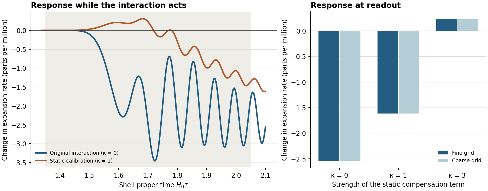

# How does particle emission change the expansion of a five-dimensional shell?

The HDblast hypothesis asks whether energy from a higher-dimensional event could start the hot expansion of our universe. We tested one link in that proposed chain. In a simulated five-dimensional spacetime, a field on an expanding shell transfers energy into pairs of massless particles. We let the shell and the surrounding geometry respond to that transfer. **The same amount of emitted energy can accompany a slightly slower or slightly faster expansion.** Which outcome occurs depends on how the emitting field responds to the interaction. This makes that response a physical input that a predictive version of HDblast must fix. [Earlier energy calculation on prescribed trajectories](https://doi.org/10.5281/zenodo.24358059) · [Study archive](https://doi.org/10.5281/zenodo.24360096)

## What we calculated

We compared the rate of expansion at the same time on each simulated shell. The clock reads $s=H_0\tau=2.10$ at the endpoint. The calculation uses the first response in $y^2$, where $y$ sets the strength of the interaction between the emitting field and the particles. The table converts the measured slopes to parts per million at an illustrative $y=0.1$. All the shells in the table continue expanding. A negative entry means slower expansion than on the same shell with the coupling turned off.

| Parent-field calibration | Coarse grid | Fine grid | Outgoing energy on the fine grid |
|---|---:|---:|---:|
| Original interaction ($\kappa=0$) | −2.536 ppm | −2.542 ppm | 22.51057 |
| Static restoring force matched ($\kappa=1$) | −1.615 ppm | −1.615 ppm | 22.51057 |
| Triple static compensation ($\kappa=3$) | +0.227 ppm | +0.240 ppm | 22.51057 |

These are quiet-shell results at comoving pair cutoff 120, evaluated with a centered strength step of 0.01. The energy column is the coefficient of $y^2H_0^4$ per unit normalized comoving volume. The dimensionless parameter $\kappa$ sets how much of the interaction-induced shift in the parent's restoring force is compensated. The first two calibrations predict a zero crossing near $\kappa=2.74$ on the fine grid. We specified the third value after seeing those results, recorded the prediction, then ran its geometry independently. Halving the strength step preserved both signs on both grids. The three calibrations represent different finite models. Choosing among them requires a physical measurement or a microscopic prediction of the parent response. [Primary protocol](https://github.com/maldonado-research/HDblast/issues/157#issuecomment-7001042262) · [Exploratory third-calibration protocol](https://github.com/maldonado-research/HDblast/issues/157#issuecomment-7001212633) · [Calculation and numerical controls](calibration/CALIBRATION.md)

We evolved the bulk Einstein–scalar equations and the original quantum parent on two spatial grids. The new energy density, pressure and scalar force enter the equations at each integration stage. A single interaction clock, set by the shell scalar on the fine quiet history, is held fixed across four incoming histories and both grids. The full first-order response uses the explicit particle source on each zero-coupling background. Corrections from the changed geometry to the emitted energy start at the next order, $y^4$. The archive includes 32 primary source tables and 92 native evolutions including controls and strength refinements. The third calibration adds eight independent evolutions regenerated by the release checks. [Source and interpolation](source/README.md) · [Equations and native results](bulk/METHODS.md) · [Independent checks of expansion and energy flux](audit/AUDIT.md)

## What the result says about a hot Big Bang

The simulated particles lose energy as massless radiation should as the shell expands. At readout they carry **0.1223% of the modeled shell matter energy** in the fine quiet, statically matched example at $y^2=0.01$. That denominator excludes tension and gravity. Over the short interval after the interaction ends, $a^2H$ falls by 3.135%. A flat four-dimensional universe containing only radiation would keep it constant. The example therefore produces radiation but falls short of demonstrating a hot, radiation-dominated era. [Radiation protocol](https://github.com/maldonado-research/HDblast/issues/157#issuecomment-7001073449) · [Energy fractions and expansion test](radiation/RADIATION.md)

A further check asks whether expansion alone could reveal the extra dimension. On the quiet trajectory $Ha^3$ fell to about 54% of its earlier value. That excludes flat or open four-dimensional Einstein-gravity models whose total pressure stays below or equal to their total energy density throughout the interval. A four-dimensional scalar field with a fitted negative potential can nevertheless reproduce each individual history. This behavior already appears at zero coupling. Identifying an extra dimension would require an independent observable that distinguishes the models. [Four-dimensional comparison and forward check](comparator/CANONICAL.md) · [Relevant literature and project records](literature/REFERENCES.md)

The next physical question is whether independent measurements of the parent's restoring force and time-dependent response fix the gravitational prediction as the energy cutoff changes. Connecting the model to our universe would also require showing how ordinary matter thermalizes and identifying an observable that competes with four-dimensional explanations. [Short-time analytic check](theory/ONSET.md)

## Reproduce the study

From this study directory inside the repository or the Zenodo bundle, run the following commands. The first authenticates the released files and eleven pinned upstream inputs with the Python standard library. The second checks the released histories and independently repeats the third calibration. The third also rebuilds all 32 sources and 92 primary and control histories. The numerical runs use Python 3.12, NumPy 2.3.5 and SciPy 1.17.0. They write temporary files outside the capsule.

~~~sh
python -I -B -S reproduce.py
python -I -B reproduce.py --verify --jobs 2
python -I -B reproduce.py --regenerate --jobs 2
~~~

The time series, readouts, archive hashes and source revisions are available in the released data. To redraw the figure, unpack the archived runs and call the plotting script with NumPy, SciPy and Matplotlib installed.

~~~sh
python -IB bulk/pack_runs.py unpack --archive bulk/RUNS.zip --runs /tmp/hdblast-gravity-plot
python -IB figure.py --runs /tmp/hdblast-gravity-plot --output /tmp/hdblast-gravity.png
~~~

[Matched-time measurements](bulk/READOUTS.csv) · [Time histories](bulk/HISTORIES.csv) · [Native input revisions and hashes](SOURCES.json) · [Release checksums](SHA256SUMS)
