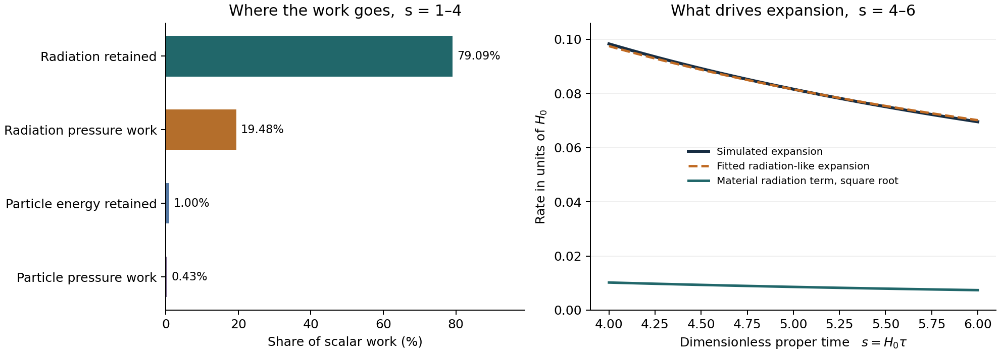

# Where does the simulated radiation get its energy?

This study follows the work done by the shell scalar in the HDblast B1 particle-production model. Its massless radiation is an evolved matter component. The surrounding five-dimensional curvature also contributes to expansion and can dilute much like radiation. Accounting for one process does not establish that the local shell represents the hot Big Bang. [Zenodo edition](https://doi.org/10.5281/zenodo.24354293) · [Original registered matter model](https://github.com/maldonado-research/HDblast/tree/07317e899a7b8ecb3367add9d6e5a27d6e777aea/research/HDBLAST_CHECKPOINT_20260930/B1_derived_chi_source)

## Matter work and the expansion

In the selected simulation, the scalar creates massive particles, increases their mass as it changes, and transfers energy to radiation when they decay. The accounting uses two radial grids and the same forward proper-time interval $1\le H_0\tau\le4$ as the earlier radiation calculation. On the finer grid **60.20%** of the scalar work increases the mass energy of the particles already present, and **39.80%** supplies newly created particles. By the end, **79.09%** of the work remains in radiation. Radiation pressure work during expansion accounts for another **19.48%**. Particle energy and particle pressure work account for almost all of the remainder. The total matter balance differs by about 28 parts per million of the energy gained on the fine grid; errors of opposite sign partly cancel. The initial discrete particle insertion has a small measurable cost. [Matter budget and eight subintervals](ledger/RESERVOIR.md) · [Independent particle-number and insertion check](check/PAID_PRODUCTION_AUDIT.md)

The right panel shows a different, later window, $4\le H_0\tau\le6$. Over its 0.165 e-folds, the expansion rate fits $Ca^{-2}$ at the saved points to within **0.84%** when the normalization $C$ is free. Material radiation contributes only **1.075%–1.126%** to the fine-grid expansion-rate squared. The large positive Weyl term and a smaller negative vacuum term explain how the shape can be misleading. Converting the material energy density to a temperature would additionally require a physical value for $H_0$, species content and thermalization. [Expansion and density-derived reference temperature](clock/EXPANSION.md)

## Could faster decay supply a radiation era?

An optimistic test converts all remaining particle energy to radiation while holding the recorded total matter density, tension, expansion rate and Weyl term fixed. For 1,360 saved states across eight cutoff parameter choices and both grids on $3\le H_0\tau\le6$, even this conversion gives at most **1.854%** of $H^2$ in the model's radiative term. The most favorable sample requires **557.67 times the available total matter density** to meet both project thresholds with the same recorded expansion and Weyl term. This is an algebraic diagnostic on frozen states. A dynamical change to the source alters the geometry as well. The historical plateau classification remains inconclusive. [Nonlinear conversion envelope and input samples](conversion/CONVERSION.md)

## Which way does energy cross the shell?

The answer depends on which energy is counted. The modeled particles receive positive work. Including the change in shell tension reverses the sign of the total interface transfer: over this interval the net transfer is **from the shell toward the two interiors**. The tension term in the balance is about 5,130 times larger in magnitude than the particle and radiation work. The tension's pressure-corrected contribution and the change in tension energy per comoving volume are different because the volume expands. [Signed balance, action and orientation](geometry/BOUNDARY_WORK_AND_RESERVOIR.md)

We reran both original radial grids and saved the interior fields at every recorded time. Eleven wall histories matched the archived trajectories exactly through the tested interval. A fourth-order gradient built from points strictly inside the bulk independently gives the same net direction. Even after subtracting the much larger tension work, this interior estimate recovers the small positive matter term to 0.053% on the coarse grid and 0.013% on the fine grid in the integrated comparison. Lower-order stencils can obscure that smaller signal. Both routes use the same numerical evolution. [Instrumented runs and wall-gradient test](interior/WALL_FLUX.md)

The extra energy arriving at the outer edge need not stay in a thin region of the bulk. We checked both faces of a fixed shell-adjacent region and included the work done by the evolving metric. On the fine grid, the wall supplies 37.796 units per copy, the inner face removes 57.829, and the metric contributes 4.380. The signed scalar energy changes by −15.653 in these units. A separate check compares changes of the five-dimensional planar mass function with integrals of the scalar stress at three fixed coordinate surfaces and across two radial intervals. The mass function includes the potential; the planar-orbit normalization and the size of the region are specified. These calculations close local budgets and leave the initial global blast energy undetermined. [Finite-region stress balance](geometry/LIVE_COLLAR_BALANCE.md) · [Geometric mass calculation](mass/MASS_BALANCE.md)

## How to reproduce the findings

From this directory, run the following in Python 3.12 or use the archive guide. The public numerical replays need only the standard library. The optional full reruns use NumPy and SciPy. This edition was prepared with AI-assisted analysis and numerical verification. Individual subdirectories identify the original simulation data or optional packages used to regenerate derived tables.

~~~sh
sha256sum -c SHA256SUMS
python -I -B reproduce.py
python -I -B -O reproduce.py
~~~

[Primary literature](literature/LITERATURE.md) · [Project and publication inventory](portfolio/PORTFOLIO.md) · [Reheating research tracker](https://github.com/maldonado-research/HDblast/issues/157)
