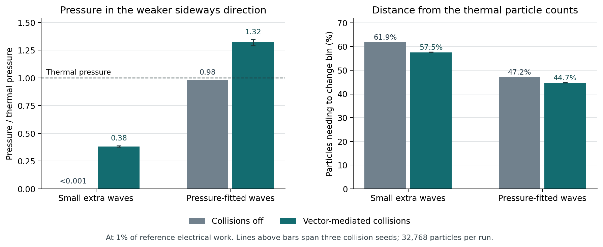

# Can collisions turn the energy in the HDblast particle streams into a hot gas?

In the HDblast model a higher-dimensional pulse accelerates positive and negative particles in opposite directions on an expanding shell. A hot gas needs particles moving in many directions. We tested whether the model's specified interaction can turn that directed energy into random motion. The particles already carry enough energy for this to happen in a controlled box. On the expanding shell, relatively few of them collide during the measured interval.

## What happened on the expanding shell?

We followed the lower-energy pulse from the previous study, kept the birth history and axial field prescribed, and let both sideways electric currents respond to the particles. The added waves in this example cost 0.16% of the reference pulse energy. By the time 1% of the reference run's electrical work had accumulated, **7.53%** of particles had collided. Their weaker sideways pressure increased from less than a millionth of the moving hot-gas value to **38%** of that value. The discrepancy across 20 bins in energy and direction fell from **61.91% to 57.53%**. At the later 5% work marker, **12.62%** had collided and the discrepancy was **55.87%**. A 55.87% discrepancy means that fraction of particles would have to change bins to reproduce the reference counts. [Direct collision calculation, assumptions and controls](live/README.md)

We also tested the gas as a whole for this one beam direction, combining its positive and negative charges. At 5% work the three principal pressures were **0.0019, 0.0021 and 0.9960** times the energy density in the gas's own energy rest frame. A very hot gas with random directions has three nearly equal values of one third. Most of the motion along the beam persists at this time. An average over other beam orientations can change the total pressure of the full collection of species.

The figure compares the two pulses at the early 1% electrical-work marker in the separate-interaction model. Each uses the same outer waveform with collisions switched off and on. The high-cost pulse had previously been adjusted to match two sideways pressures at this marker. Adding real collisions pushed both pressures above their fitted values. [Figure source](figure.py)

## Where could a hot gas come from?

We took the same early particle populations, stopped the forcing and expansion, and allowed only opposite charges to scatter elastically with broad deflections. Each simulated encounter conserved energy and momentum. After **eight collisions per particle on average** the directed motion had largely randomized in both tested histories. The three pressures were within 1.3% of the one-third prediction, and energy-and-direction counts were within 1.8 percentage points of a common thermal-gas prediction for each sign on the finest samples. That prediction uses the number, energy and momentum already present in the box. The common gas moves slowly relative to the wall. Each original thermal reference stream moved rapidly.

Small deflections take longer. In the control permitting all charge pairings and turns of at most 30 degrees in the collision frame, the charge signs still moved in opposite directions at about 0.56 times the speed of light after eight collisions per particle. By 128 collisions their residual speeds fell below 0.0032 times the speed of light. These are specified collision exposures in a fixed volume. A physical mechanism on the evolving shell must supply its own rate and angular distribution. [Closed-box kinetics and equilibrium checks](kinetic/README.md)

## What can be concluded across possible scattering patterns?

- A particle that has not collided still follows its original trajectory on fixed fields. Accounting for birth times and the maximum microscopic rate leaves a measurable excess in particular bins. [Survival calculation](survival/README.md)
- Only some pairs reach the energies where the model's vector resonance scatters efficiently. For the smaller pulse a cell-by-cell calculation bounds the fraction that could have collided by the 1% work marker at **30.07%** and **6.773%** on the separate and shared interaction histories with prescribed fields. It permits unlimited changes of momentum once a particle is hit. The dynamical simulation above includes the altered sideways currents and is a separate calculation. [Rate derivation, secondary collisions and numerical enclosures](rate/README.md)
- If a mechanism only turns particles and preserves each particle's energy in one fixed frame, the sampled shell populations retain a discrepancy of **at least five percentage points** from the old drifting thermal predictions at some energy threshold. This holds for each sign at two sampling resolutions even when one can choose any direction or speed of that reference frame. Energy exchange between particles can overcome this particular restriction. [Angular transport comparison](bound/README.md) · [All-frame test](bound/ALL_FRAMES.md)

The next physical question is whether a specified interaction or a later, denser phase of shell evolution provides enough broad encounters **before the shell expands and cools**. A decisive calculation would evolve the axial field and production history in response as well as the transverse currents, and account for the three flavors together. The present results test a heating mechanism within a model. Connecting this mechanism to the Big Bang still requires a distinctive cosmological prediction and a test against observations. [Primary literature and model provenance](SOURCES.md)

## Reproduce the study

The standalone archive includes the authenticated two-polarization study as a sibling directory. In the GitHub repository both studies are under `research/`. Using Python 3.12, NumPy 2.3.5, SciPy 1.17.0 and a C++17 compiler, run the following commands from this directory. The second command writes regenerated data to a new or empty external directory.

~~~sh
python -I -B -S study.py
python -I -B study.py --verify --output-dir ../scattering-results --jobs 2
~~~

[This study and standalone files on Zenodo](https://zenodo.org/records/24426913) · [Preceding polarization study](https://zenodo.org/records/24424913)
