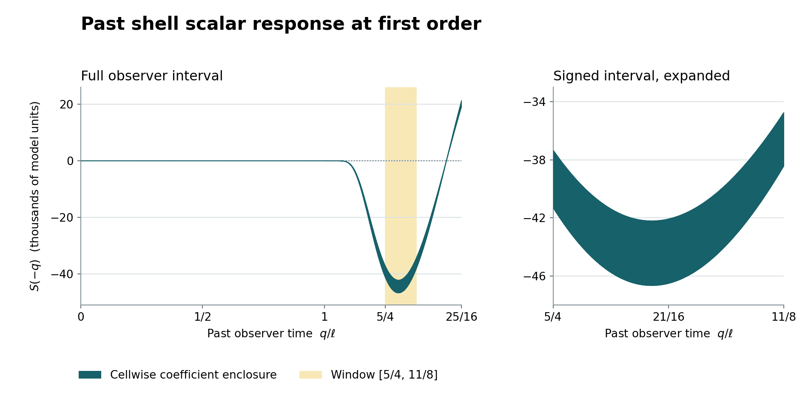

# A nonzero angular response on the shell observer’s clock

18 November 2026 · HDBLAST conditional local-model calculation · [Zenodo edition](https://doi.org/10.5281/zenodo.24351089)

For the specified five-dimensional Einstein–scalar packet, different directions on the same shell respond differently. The full-sphere mean loses the entire linear signal. A quadrupole measurement retains its sign, and the angular variance measures its size regardless of the choice of angular axes. This holds under the registered background, initial-data, gauge, evolution and waveform-enclosure assumptions.



| Quantity | Conditional result |
| --- | --- |
| First derivative of the observed scalar at label $n$ | $S(-q)Y(n)$, with $Y=n_1^2-n_2^2$ |
| Mean over the whole cut, weighted by its physical area | Exactly even in the registered amplitude $\epsilon$. Its first derivative vanishes. |
| Signed quadrupole coefficient | $-46{,}653<S(-q)<-34{,}748$ throughout $5/4\le q/\ell\le11/8$, in model units per unit amplitude. |
| Angular variance on a cut | Its coefficient of $\epsilon^2$ is $S(-q)^2/6$. |
| Variance averaged over $0\le q\le25\ell/16$ | Its coefficient of $\epsilon^2$ lies strictly between **35,373,971** and **43,294,110**, in squared model units per squared unit amplitude. |

Here $q=-\tau/\rho_b$ increases into the past and $\ell=10^{-6}$. Each value refers to a three-dimensional spatial cut of the shell. The numbers depend on the chosen normalization of the packet. A positive variance also holds at finite, sufficiently small nonzero amplitude throughout the highlighted interval. The magnitude of the allowed amplitude for that statement has yet to be evaluated. For every sufficiently small nonzero amplitude the signed quadrupole has at least one zero in the open interval $1.49998<q/\ell<1.49999$.

## What this checkpoint adds

The October and November waveform calculations already enclosed the signed **linear** scalar response for this packet. The November 16 observer result established a common duration for the selected **nonlinear** family. The present proof matches their full initial data, constructs the required harmonic representative in past time, and identifies the earlier waveform with the derivative actually seen by these observers. The variance and its time-average bound then follow without solving for the second-order field. The two outputs have different meanings. The full-sphere scalar mean’s quadratic coefficient still needs the second-order scalar solution and its correlations with the moving cuts. [Field and clock identification](BRIDGE.md) · [Symmetry of the selected family](SYMMETRY.md) · [Observable derivation and interval calculation](VARIANCE.md)

The model prescribes a local perturbation. Its generation by a higher-dimensional event, the conversion into ordinary matter or radiation, the physical time scale and a distinguishing astronomical measurement remain open. A light-cone calculation is needed before relating a shell cut to a sky map. The reviewed literature and research catalog document which earlier results address these issues. [Primary literature](RESEARCH_CONTEXT.md) · [Portfolio review](PORTFOLIO.md)

## Reproduce the result

From this directory, run the following commands with Python 3.12. The numerical replay uses only the standard library. It checks the three input digests before calculating the enclosures and prints exact rational endpoints. Matplotlib is needed only to regenerate the optional figure.

```sh
sha256sum -c SHA256SUMS
python -I -B replay.py > /tmp/hdblast-shell-response.json
cmp RESULTS.json /tmp/hdblast-shell-response.json
python -I -B -O replay.py > /tmp/hdblast-shell-response-optimized.json
cmp RESULTS.json /tmp/hdblast-shell-response-optimized.json
```

The original input paths and proof sources are recorded against immutable commit `609fd60518150d23c0995631aeffa6a4958e0088`. Finite arithmetic checks reproduce the interval calculation. The background solution, the continuous cell enclosures and the PDE arguments remain mathematical premises. [Source register](SOURCES.json) · [Exact output](RESULTS.json) · [Plot script](plot_response.py)
