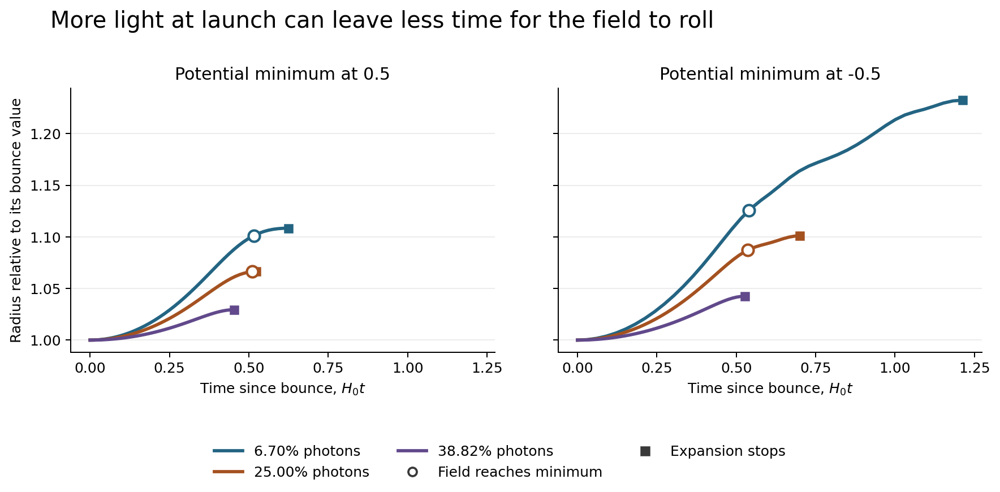

# Can pre-existing light dominate after a closed cosmological bounce?

In the HDblast hypothesis, a higher-dimensional event could have left our universe in a hot, expanding state. A model of that idea has to explain two things separately. What starts the expansion? Where does the energy in the hot particles come from? We tested whether ordinary light already present at the start could answer the second question.

**In a round, closed universe containing a canonical scalar field and ordinary light, with no further transfer of energy into light, the answer is no during the first expansion from a regular bounce.** The light must start with less than half the energy, and there is an exact upper bound on its share at every larger radius. The bound follows from standard gravitational dynamics and applies independently of the detailed potential used by this project.

We also tested two uneven model universes and changed how the quantum state of a second scalar field was prepared. The uneven examples give quantitative bounds for a weak light wave. The quantum calculations show how much a prediction can change when we vary what counts as the initial state. None of the calculations measures the cause of our own Big Bang. [Research plan posted before the results](https://github.com/maldonado-research/HDblast/issues/157#issuecomment-7024504107) · [Earlier two-field study](https://doi.org/10.5281/zenodo.24380589)

## A test any proposed source of radiation must pass

Let $a_i$ be the radius at the bounce, $a$ the current radius, $h$ the expansion rate in reference units, and $F_i$ the fraction of energy in photons at the bounce. We use dimensionless $a=H_0a_{\rm physical}$ and $h=H/H_0$. For conserved light the curvature term in the closed Friedmann equation gives

$$
F_\gamma=\frac{F_i(a_i/a)^2}{1+a^2h^2}\le F_i(a_i/a)^2,\qquad F_i<\frac12 .
$$

The second inequality follows from positive acceleration at a regular bounce with a canonical parent. This result also applies to any later event at which $a\ge a_i$. It permits temporary increases of the fraction below its ceiling. It makes no statement about a collapse below the initial radius.

For a mechanism that transfers energy into photons, write $C=a^4r_\gamma$, where $r_\gamma$ is their density in units of $3M_{\rm Pl}^2H_0^2$. To reach half the total energy, the cumulative increase in $C/a_i^2$ must be at least $\tfrac12(a/a_i)^2(1+a^2h^2)-F_i$. The radius and expansion rate must be evaluated in the model with that transfer. This turns “could it heat the universe?” into a quantitative test of a proposed interaction. [Proof, thermal spectrum and numerical cases](radiation/PHOTONS.md)

## Light can change which event happens first

We gave the light a specified thermal distribution on the closed sphere and included its gravity. In one of the two calibrated potentials, increasing the initial photon fraction past **27.89%** makes the expansion stop before the scalar field first reaches its potential minimum. The corresponding local change of event order occurs at **38.14%** in the other potential. These numbers describe fixed initial field displacements in this study. They are separate from the one-half bound, which holds throughout the stated round-model class.



At the largest radiation load compatible with a real initial radius, the two roots of the constraint coalesce. In these launches the field is at rest on a slope. Exactly at the limit the radius has a flat local maximum with a negative fourth-order time dependence. Approaching from the expanding side, the duration of expansion scales with the fourth root of the fractional distance to the limiting load. This explains why the regular expanding branch disappears. [Critical-point derivation and numerical check](radiation/CRITICAL.md)

## What changes when the geometry is uneven?

We repeated the light test on two simulated geometries from the earlier single-field evolution. In one the field first reaches its minimum at the poles, and in the other at the equator. Here light is a test field, so the quoted bound applies when its gravity can be neglected. The Maxwell stress tensor bounds the whole-sphere energy for **all wavelengths, directions and polarizations** of a source-free classical field on each prescribed spacetime. The coefficients of that inequality were evaluated numerically.

| If light starts with 0.1% of the parent field's energy | Largest allowed light energy at first crossing, as a percentage of the parent energy then |
| --- | ---: |
| First crossing at the poles | 0.0661% |
| First crossing at the equator | 0.0654% |

These limits compare the bounce with first crossing. In the short interval straddling the equatorial crossing there is room for a temporary increase in electromagnetic energy. A finite quantum calculation also finds that the occupation read out for an individual wave can increase while the total energy of an added classical wave falls. An occupation quoted using an instantaneous measurement basis cannot by itself establish heating. [Electromagnetic derivation, measurements and energy bounds](maxwell/MAXWELL.md)

## How much do the scalar predictions depend on their starting state?

The previous study supplied a small starting wave. Here we used an explicit quantum preparation for the nonconstant modes of a massless second scalar. We chose the state that minimizes its physical energy density averaged over a short interval centered at the bounce. We then varied the duration of that interval and followed each state to the first crossing. The constant mode requires separate preparation and we kept it identical in the comparisons.

- **Two rolling round geometries.** Halving the sampling halfwidth from $0.20$ to $0.10$ changes the second field's first-crossing density by $+2.43\times10^{-8}$ and $+4.01\times10^{-8}$ of the parent density. Widening it to $0.30$ changes the sign of the difference in both cases. An independently specified matter clock at width $0.20$ changes the density by about one part in $10^{11}$ of the parent density. The sum covers the harmonics through $n=2048$. These are signed differences between states on the same prescribed geometry. A common vacuum contribution cancels. [Round background calculation and convergence](round/ROUND.md)
- **Exact quantum control.** For a massless scalar on round closed de Sitter spacetime, every fixed positive sampling width in this family gives a smooth stress difference from the specified reference on the nonzero modes. Taking the width toward zero is singular. For the specified sampling profile the bounce density difference divided by $h^4$ behaves as $-\log(1/(hT))/(32\pi^2)+O(1)$, and the pressure difference grows as $0.0223265\,h^4/(hT)^2$. Here $h$ is the *constant* de Sitter curvature scale. The calculation uses exactly known waves and independently checks the predicted growth with a sum through 255,999 shells. [Exact solution, zero mode and sharp-time limit](checks/STATE_CHECK.md)
- **Two uneven geometries.** We minimized the sampled density allowing different radial waves to be correlated. In one finite angular sector with 80 radial oscillators, shortening the preparation raises the direct coupling work relative to the reference near polar first crossing and lowers it near equatorial first crossing. In the polar case the work from geometry and the direct coupling nearly cancel. Raising the radial cutoff from 128 to 160 changed individual work terms by up to 1.9%. This is a finite-sector result. Controlling the rest of the angular and radial spectrum and calculating the absolute renormalized stress would be necessary to include its gravitational effect. [Finite-sector calculation](patch/PATCH.md)

## What the hypothesis still owes

A hot beginning requires an identified source of radiation, a calculation of how fast it supplies energy, and enough interactions to form a thermal population. A next test is to derive that source from an explicit parent-to-matter interaction allowed by the higher-dimensional model, evolve both components and gravity together, and compare the accumulated energy with the threshold above. That test would need a prediction or observational constraint that distinguishes this mechanism from ordinary early-universe alternatives. [Literature and relation to earlier HDblast work](literature.md)

## Reproduction

Use Python 3.12, NumPy 2.3.5 and SciPy 1.17.0. From this directory, verify the archive and its historical inputs, then regenerate the five numerical products.

```bash
python -I -B -S reproduce.py
python -I -B reproduce.py --verify --jobs 2
```

The numerical replay runs offline once those dependencies are installed. To retain new outputs, add `--output-dir` with a fresh directory outside the capsule. To redraw the figure after installing Matplotlib, run `python figure.py`. [Historical source manifest](SOURCES.json) · [Numerical replay](reproduce.py)
